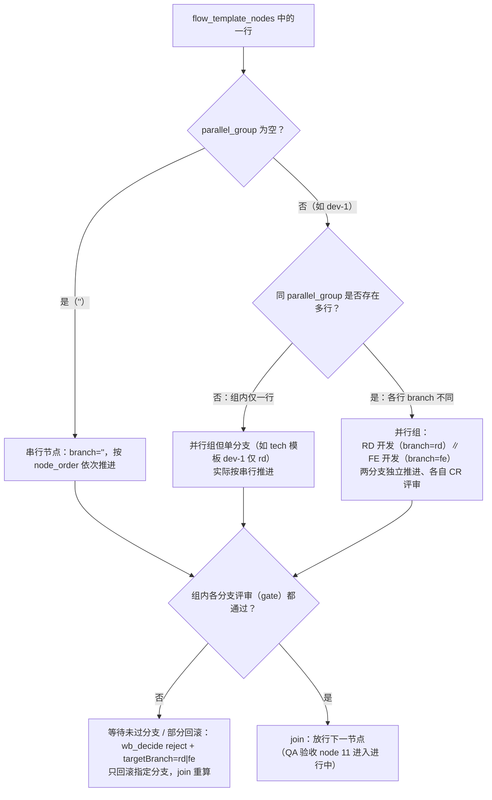

# M8：流程简化复盘与推演（程序做路由，agent 做专业）

> 状态：**v0.28（方案定稿并落库：sqlite 11 表建库完成；v0.23 capabilities 收缩+模板外置；v0.28 节点-能力绑定模型——products 单列、QA 能力合并、mode=align 无产物节点、reviewers 升级 [{role,capability_id,scope?}]、角色缩写 arch/inv）**
> 目的：复盘现有 preset/persona 中明文的流程规范，推演「程序做路由、agent 做专业」的简化形态，评估可行性与收益，供 User 拍板后再开发。
> 范围：**复盘全部 9 个预设角色**——User / Leader / Investigator / Architect / RD / PM / FE / QA / Code Reviewer。其中 RD / FE / Code Reviewer 已落地为子 agent persona（有冗余流程文字可瘦身）；Architect / PM / Investigator 尚未落地、QA 仅演练用过，落地时**直接采用本方案的程序化协议**（专业卡 + 一句协作协议），不再写入流程路由文字。QA 缺陷场景为跨端归属入口，方案对全部角色通用。
> 关联：m6-flow-templates.md（流程/产物/审批）、m6-team-preset.md（制度）、m7-agent-protocol.md（角色协议）、m7-comment-design.md（评论/通知/指派）。
>
> **v0.9 更新（User）**：**引入 sqlite 结构化存储**（§3.6）——替代 JSON 明确描述模型与语义；8 核心表 + 4 支撑表（含审计，保留留痕能力）；JSON 仅作导出格式。**v0.20 已精简至 11 表**（见 §3.6.1）。
>
> **v0.7 更新（User）**：复盘范围确认为**全部 9 角色**，不限于已落地的 RD/FE/CR；未落地角色（Architect/PM/Investigator）在本阶段一并按程序化协议完成行为定义（§2.4 补齐），落地时不再写流程路由文字。
>
> **v0.4 新增**：§4 四流程（业务/技术/任务/版本）逐节点交互推演——每个节点的参与者/动作/工具/通知链，归纳出 5 种可复用交互模式（P1-P5）；§2.4 任务目标层——角色行为协议表（roleObjective/behaviors/onFeedback，含被评审者收反馈职责链）；§5 能力缺失复盘——推演暴露 G1-G12 共 12 项缺口及优先级。
>
> **决策记录**：D1 问题归属三层模型——L1 锚点产物作者默认 / L2 节点 owner / **L3 跨端根因判定（QA 输出 domain=rd\|fe，仅 L1/L2 无法唯一归属时）**；D2 新开 wb_my_task；D3 通知参数保留可选覆盖；D4 QA 写缺陷文档；D5 锚点推断即 L1 默认归属（依赖数据不依赖 persona）；D6 wb_comment 路由**全切默认**（不再向后兼容旧调用）；D7 wb_my_task 显式传 role 参数。
> **v0.5 确认（User）**：**角色行为协议落到程序中**——wb_my_task 等工具作为「上下文供给者」，按节点类型×角色返回任务目标/行为/收反馈职责链（§2.4），preset 仅保留专业能力卡与产物规范，预设信息大幅减轻。

---

## 1. 复盘：现有交互中「流程逻辑」分布在哪

### 1.1 明文流程文本盘点（agent.cordis.yml + persona）

| 位置 | 写了什么 | 本质 |
|---|---|---|
| persona（Leader） | 4 种流程节点序列（业务 12/技术 7/任务 5/版本 4）、门禁与评审、并行组、协作铁律、角色编排协议 | 流程路由表（写在主 agent 脑子里） |
| RD persona | 「职责范围（按团队流程，各审各的）」：业务需求③④⑧⑨.1、技术需求①②③⑥、任务③；评论与复核闭环；依赖方向 | 职责→节点映射表 + 路由规则 |
| FE persona | 业务需求⑤⑥⑧⑨.2、技术需求④、scope=仅前端特判；评论与复核闭环；依赖方向 | 同上 |
| CR persona | 评审流程 4 步、评审维度、复核闭环（confirm/reopen 职责） | 评审流程表 + 路由规则 |
| m6-flow-templates.md | 每个节点的负责人/做什么/输入/产物/审批者/审核重点（4 张表 + 评审分工表 + 审批者速查） | 流程真相源（文档） |
| m7-agent-protocol.md | 角色卡、编排序列、输出格式 | 角色协议（文档） |
| m7-comment-design.md | 通知链路表（谁通知谁）、assignee 规则、resolve/confirm/reopen 语义 | 路由规则（文档） |

### 1.2 每类交互中 agent 现在要做的判断

把「一个角色子 agent 被派活后」的完整认知过程拆出来：

| # | 交互 | agent 现在要判断什么 | 判断依据在哪 |
|---|---|---|---|
| A1 | 知道自己做什么 | 我在哪类流程（业务/技术/任务/版本）？当前节点是什么？我的职责是什么？ | persona 职责枚举 + wb_get_requirement 返回的 flow |
| A2 | 知道自己看什么 | 这个节点要看哪些产物？依赖哪些文档？ | persona 依赖方向 + artifacts 列表 |
| A3 | 知道自己产什么 | 我要产出什么文档？写到哪个路径？用什么模板？ | persona 产物规范 + m6 模板 |
| A4 | 通知谁 | 评论的 reviewerRole / to / assignee 填什么？ | persona 评论闭环 + m7 通知表 |
| A5 | 问题归属 | 谁发现产物中的什么问题 → 归属谁？（跨端时根因在谁） | QA 专业判断 + persona 部分回滚规则 |
| A6 | 流程推进 | 什么时候该 pass/打回/部分回滚？并行组怎么 join？ | Leader persona 门禁规则 + wb_decide |

### 1.3 问题定位

1. **流程路由表在 persona 里重复维护三份**（RD/FE/CR 各一份职责枚举），流程一变要同步三处，改漏即漂移（reqType/scope 演进已发生过）。
2. **agent 在重复推理流程**：`wb_get_requirement` 已返回完整 flow（nodes/reviewers/branch/parallelGroup），但 agent 要自己解析「我在哪、看啥、产啥、通知谁」。
3. **通知路由靠人肉**：reviewerRole/to/assignee 要 agent 自己填——正是 QA 缺陷「该通知谁」的痛点。
4. **流程真相源分散**：m6 文档（人读）、flow.json（机器读）、persona（agent 读）三处，靠人工同步。

---

## 2. 推演：简化后的交互形态

### 2.1 核心原则

- **agent 不再持有流程路由表**，只持有「专业能力卡 + 产物规范 + 一句协议」。
- **程序（wb_* 工具）从 flow.json / artifacts.json / comments.json 推导路由**，把「你在哪、看什么、产什么、通知谁」直接算好返回。
- **agent 只做专业判断**：内容质量、方案设计、缺陷归属（rd|fe）、评审结论。

### 2.2 逐交互推演（对照 1.2 表）

| # | 现在 | 简化后 | 谁做判断 |
|---|---|---|---|
| A1 知道自己做什么 | 解析 flow + 查 persona 职责枚举 | **新工具 `wb_my_task`**：传入 reqId+role，返回**确定性任务列表**（每个任务：nodeId/节点/职责/产物/上下文）；并行编排被扁平化为各角色的具体任务（§2.6） | 程序（读 flow.json + 派生规则） |
| A2 知道自己看什么 | persona 依赖方向 + 手工过滤 artifacts | **wb_my_task 直接列出**：本节点要评审/消费的产物 + 依赖文档（按节点类型从 flow/artifacts 推导） | 程序 |
| A3 知道自己产什么 + 怎么表现 | persona 产物规范 + 手工推理「评审该审什么、收反馈后我该做什么」 | **wb_my_task 任务目标层**：roleObjective（本节点行为目标）+ behaviors（可做/应做动作）+ onFeedback（收反馈后的职责链）——按「节点类型 × 角色」查表返回（§2.4），persona 只留专业能力 | 程序（查行为协议表） |
| A4 通知谁 | persona 评论闭环 + 手工填 reviewerRole/to/assignee | **wb_comment 全切默认路由**：agent 只传 reqId+nodeId+text(+anchor+type+domain)；reviewerRole/to/assignee 一律由程序按节点 reviewers[]/ownerRole/锚点作者/domain 推导（D6 全切） | 程序（默认）/ Leader 覆盖 |
| A5 问题归属 | **问题归属判定**：谁发现产物中的什么问题 → 归属谁？ | **通用归属模型**（§2.3③）：L1 锚点产物作者（谁的产物问题就是谁的）→ L2 节点 owner → **L3 跨端根因判定**（QA 验收、非纯端需求：接口调不通是后端 bug 还是前端协议没对齐的前端 bug）→ 程序按归属端路由 assignee/to；domain 是 L3 的**根因判定输出**，不是「打回谁」的标签 | 默认程序路由（L1/L2）+ QA 根因判定（L3）+ 锚点兜底 |
| A6 流程推进 | Leader persona 门禁规则 | 已由 wb_decide 状态机承担（并行 join/部分回滚均数据驱动），Leader 只做「通过/打回」决策 | 程序（状态机）+ Leader 决策 |

### 2.3 三个新增/增强点

#### ① 新工具 `wb_my_task`（任务上下文视图 + 任务目标层）

```
输入：reqId + role (+nodeId 可选)
输出（示例）：
{
  "requirement": { id, title, category, reqType, scope, owner, status },
  "node": { id, key, ownerRole, gate, state, isCurrent, branch?, parallelGroup? },
  "myRole": "QA",                          // 显式传 role（D7）
  "capability": {                          // 本节点用什么能力执行（§3.4，能力模型新增）
    "id": "acceptance-test", "name": "验收测试",
    "how": ["读输入：rd/fe 开发说明 + qa/cases.md", "按 test-result 模板逐节验收", "自检质量门禁（AC 三态核对）", "登记产物 + 缺陷走 L3 归属"]
  },
  "task": "验收 RD/FE 开发产物",            // 由节点 key + gate 推导
  "roleObjective": "按用例逐项验收；发现问题先按锚点/产物归属（L1/L2），跨端根因不明时判定 domain（L3）并建缺陷；验收通过进用户验收",  // 本角色在本节点的行为目标（新增）
  "behaviors": [                            // 行为协议：本角色在本节点可做/应做的动作（新增）
    { "action": "review", "what": "逐项核对《测试用例与结果》执行情况", "tools": ["wb_comment", "wb_review"] },
    { "action": "fileIssue", "what": "发现问题：先按归属模型定 assignee，跨端才需 domain 判定", "tools": ["wb_comment"] }
  ],
  "onFeedback": [                           // 被评审者收到反馈后的职责（新增，P2/P3/P4 节点）
    { "when": "收到评审意见(issue)", "do": "先 wb_reply 澄清/确认，非分歧则按意见修订文档，修订后 wb_resolve(note=修复说明)" },
    { "when": "提评者 reopen", "do": "按 reopen 理由继续修订，再 resolve（roundCount++；>5 轮 Leader 介入）" },
    { "when": "与提评者分歧", "do": "在 thread 讨论达成一致（B 路径 agree 关闭）；无法一致则报 Leader" }
  ],
  "artifactsToReview": [ {id,label,href,author,nodeId} ],   // 本节点要审的产物
  "dependencyDocs": [ "rd/design.md", "fe/design.md", "prd.md", "qa/cases.md" ], // 依赖文档（来自 capability.inputs + 前置产物）
  "outputs": [ {capability_id:"acceptance-test", label:"《测试用例与验收记录》", kind:"document"} ],  // 本节点应产出（产物路径/模板经 capabilities.products 展开，v0.28）
  "reviewers": [ {role, capability_id, state} ],   // 本节点评审归属 + 各自评审能力（各审各的，评审维度在评审能力 how，v0.28）
  "discussions": [ {issue_id, author, text, replies[]} ],  // 该需求全流程讨论（含 align 澄清结论），一并给 subagent（v0.28 B 点）
  //   ▲ v0.30 泛化：已升级为 sessionsByNode（每个 node 的全部会话按 node 分组、含文档锚定会话，见 §11）——本条为 v0.28 历史结构快照，实现以 §11 为准
  "defaultAssignee": "RD"                  // 评论/缺陷默认解决责任人
}
```

推导规则（全部读 flow_template_nodes + capabilities（products）+ 实例数据，**无 persona 参与**）：
- `capability`：flow_template_nodes[].capability_id → capabilities 表（how/products）——能力模型（§3.4）核心；模板规范外置 docs/templates/ 文件（v0.23），products[].template_path 指向
- `task`：gate=true → 「评审+表态」；ownerRole=对应角色 → 按节点 key 映射动作（产品设计→产出设计、开发→产出开发说明+MR、**验收→按 AC+接口协议建自动化测试+代码验收**）——映射表放工具内，不放 persona
- `roleObjective` / `behaviors` / `onFeedback`：**由 capability.how + 行为协议表推导**（§2.4 + §3.4），表内容来自 m6 审批表 + m7 评论闭环语义，程序化后 persona 不再需要写
- `reviewers[].capability_id`：评审者的「审什么」来自其评审能力 how（如 RD 技术评审：arch→arch-tech-review 技术路线、rd→rd-tech-review 设计完整性/自测、fe→fe-tech-review 接口契约可对接、qa→qa-tech-review 可测性、pm→pm-review 工期/依赖、user→final-approve 拍板）——评审者无需自己推理
- `artifactsToReview`：gate 节点的 reviewers[].commentIds 关联产物 + 前置节点产物
- `discussions`：mode='align' 节点沟通/确认结论存 issues（discussion 型），wb_my_task 返回时把该需求全流程 issues 打包进上下文（v0.28 B 点）
- `dependencyDocs`：前置设计产物路径（m7-doc-structure 目录约定）+ 对齐结论（align 阶段 discussion）。**QA 验收节点特殊**：dependencyDocs 额外包含 `prd.md（AC）+ qa/cases.md（用例）+ rd/design.md + fe/design.md（接口协议）+ MR/featureBranch（代码）`——QA 的 how 依赖代码做验收、创建自动化测试与缺陷分析
- `outputs`：节点 expected_outputs 引用 capability_id（v0.17）→ 读 capabilities.products 展开 doc_path/template_path/demo_path（v0.28；QA 验收节点 1 能力 2 产物：acceptance-test → qa/test.md + qa/defect.md）
- `defaultAssignee`：缺陷域 rd→RD、fe→FE；普通评论→锚点产物作者（artifacts.addedBy）

#### ② `wb_comment` 增强：程序默认路由 + agent 可覆盖

```
现在：agent 传 reviewerRole/to/assignee（人肉）
简化后：agent 传 reqId+nodeId+text+anchor(+type+domain?)
程序默认推导：
  reviewerRole = 当前节点 gate 的评审归属（读 flow.nodes[].reviewers[]）
  to           = reviewerRole（或节点 ownerRole）
  assignee     = anchor 产物作者；domain=rd|fe 时 → RD|FE
可选覆盖：reviewerRole/to/assignee 仍可显式传（Leader 特殊场景）
```

#### ③ 问题归属路由（通用模型；缺陷是跨端特例）

> **抽象先于具体**：不是「QA 发现缺陷→打回 rd/fe」，而是通用问题——**谁发现产物中的什么问题 → 归属谁**。缺陷只是 QA 验收阶段、可能跨端根因的问题特例。

```
问题归属判定（三层，程序按顺序尝试，能定即定）：
L1 锚点产物作者（默认，最简单）：评论锚到哪个产物 → assignee = 该产物作者
   —— 谁的产物问题就是谁的（rd/design.md→RD、fe/dev.md→FE、qa/cases.md→QA）
L2 节点 owner：无锚点 → assignee = 当前节点 ownerRole（如设计评审意见→设计作者）
L3 跨端根因判定（QA 验收、非纯端需求）：L1/L2 无法唯一归属（问题横跨前后端）
   —— 需要判断「根因在谁」：接口返回错误/超时 → 后端 bug（domain=rd）；
      前端调用协议没对齐（字段/参数/序列化与 rd/design.md 契约不符）→ 前端 bug（domain=fe）
   —— 程序辅助判定上下文：wb_my_task 提供关联契约文档对照
     （rd/design.md 接口契约 vs fe/design.md 调用契约 vs qa/cases.md 预期）
   —— QA 做根因分析（专业判断）→ 输出 domain=rd|fe → 程序路由
   —— 锚点兜底：QA 锚到具体产物（如锚 fe/dev.md 某行）→ 程序按 L1 自动归属，无需 domain

程序路由（归属端确定后，全自动）：
  assignee = 归属端对应角色（rd→RD、fe→FE）
  to       = 同 assignee（返工提醒）
  reviewerRole = 开发节点评审归属（Code Reviewer）
  domain 需显式场景（L3）：QA 写《缺陷文档》+ wb_comment(domain=rd|fe)
  → thread 关联缺陷文档条目 → resolve/reopen 闭环沿用
```

**domain 语义澄清**：`domain` 不是「打回谁」的标签，而是 **L3 根因判定输出**——只有当 L1/L2 无法唯一归属时才需要 QA 判断。纯前端/纯后端需求（scope 决定）通常落到 L1（产物作者唯一），不走 L3。

### 2.4 任务目标层：角色行为协议表（wb_my_task 的 roleObjective/behaviors/onFeedback）

> 用户在推演中指出：A3（知道自己产什么）不能只给清单，要给「角色在本节点做什么、收到反馈后职责是什么」。本表把四流程各节点的角色行为程序化——**表内容来自 m6 审批者主要审核列 + m7 评论闭环语义**，wb_my_task 按「节点类型 × 角色」查表返回，persona 无需再写。

#### 2.4.1 节点类型与角色矩阵

| 节点类型（由 flow key 判定） | 评审者角色（各审各的；评审维度在各自评审能力 how，v0.28 reviewers 只存 role+capability_id） | 被评审者角色 |
|---|---|---|
| 产品设计/需求评审 | PM(价值/优先级/范围)、Architect(技术可行性)、User(拍板) | Architect（产品设计） |
| RD 技术设计评审 | Architect(技术路线/架构一致)、RD(设计完整性/自测)、FE(接口契约可对接)、QA(可测性与联调口径)、PM(工期/依赖)、User(方案确认) | RD（RD 技术设计） |
| FE 设计评审 | QA(交互可测性/关键路径可验证) | FE（FE 技术设计） |
| 用例设计评审 | RD(后端口径)、FE(前端口径) | QA（用例设计） |
| 开发评审（并行组） | Code Reviewer(代码质量/设计落地/回归风险) | RD ∥ FE（开发说明+MR） |
| QA 验收 | QA(按用例验收/缺陷闭环) | RD/FE（缺陷返工） |
| 立项/调研/架构规划 | PM/Architect/Leader(见 §4 版本规划) | Architect/Investigator |

#### 2.4.2 被评审者行为协议（onFeedback 核心：用户重点）

以 **RD 技术设计评审**为例（RD 收到反馈后的完整职责链）：

```
阶段：RD 技术设计 → 已提评 → 收到评审者评论
RD 的 onFeedback（wb_my_task 返回）：
  1. 先读全部 open 评论（按 reviewerRole 分组：Architect/FE/QA/PM 各审各的）
  2. 对每条意见：
     - 理解一致 → 修订《RD 技术设计》对应小节 → wb_resolve(note=修订说明, path=fix)
     - 存在分歧 → 用 wb_reply 澄清（说明设计意图/权衡）→ 达成一致后修订并 resolve；
       若坚持原方案 → 在 thread 说明理由，走 B 协商一致关闭（path=agree）或请 Leader 协调
     - 不认可的意见（如误读）→ wb_reply 澄清，由提评者确认或关闭
  3. 全部 resolve 后 → 各评审者 wb_review pass → Leader wb_decide 推进
  4. 边界：不改 flow.json；不改评审者评论；分歧无法解决时报 Leader（不自行绕过）
```

**同一模式适用**：FE 设计评审（FE 收反馈）、用例设计评审（QA 收反馈）、开发评审（RD/FE 收 CR 反馈）、QA 验收缺陷（RD/FE 收缺陷，见 §2.3③）。—— 被评审者行为**与节点类型无关，模式统一**（这正是可程序化的关键）。

#### 2.4.3 评审者行为协议（behaviors 核心）

以 **RD 技术设计评审**的评审者为例（各审各的）：

```
评审者角色（如 QA）的 behaviors（wb_my_task 返回）：
  1. 读依赖文档（rd/design.md）+ 本节点产物
  2. 按评审能力 how 的维度只审职责内（QA → 可测性与联调口径，不越界评技术路线；维度来自 reviewers[].capability_id 对应的评审能力）
  3. 提评论（wb_comment 锚到产物对应位置，reviewerRole=QA 由程序推导）
  4. 表态：无阻塞 → wb_review pass；有阻塞 → 先留评论再 wb_review block(附理由)
  5. 作者 resolve 后 → 复核：通过 wb_confirm_review / 不通过 wb_reopen（roundCount++）
```

**评审者行为同样与节点类型无关**（都是：读→按 focus 审→评论→表态→复核），差异只在 focus 内容（来自 m6 审批表）。

#### 2.4.4 全部 9 角色行为协议总表（v0.7 补：复盘范围扩展到全部角色）

> 每个角色的 roleObjective / behaviors / onFeedback 由 wb_my_task 按角色查表返回。**已落地角色**（RD/FE/CR）据此瘦身 persona；**未落地角色**（Architect/PM/Investigator）落地时直接按此表生成 persona，不再写流程路由文字。

| 角色 | roleObjective（在本节点要达成什么） | behaviors（可做/应做，wb_my_task 返回） | onFeedback（被评审收反馈后，P2/P3/P4 节点） |
|---|---|---|---|
| **Leader** | 编排推进：分派、协调、门禁决策 | wb_list_* 全局视图；派活给子 agent（reqId+role）；wb_decide 推进/打回；破坏性操作需 User 指令 | —（不产被评审物；收到返工报告→重新派活） |
| **Architect** | 产品设计/技术方案/版本规划把关 | 产《产品设计》《架构规划》《需求对齐文档》；评审 focus=技术路线/可行性/架构一致；wb_review 表态 | 设计意见被质疑 → 澄清设计意图 → 修订文档 → resolve |
| **PM** | 需求价值/优先级/范围/排期把关 | 评审 focus=价值/优先级/范围/工期依赖；wb_comment 提评；wb_review 表态；版本规划参与 | 评审意见被质疑 → 澄清 → 确认或修订 |
| **RD** | 后端设计/开发/自测 | 产《RD 技术设计》《RD 开发说明》+MR；评审 focus=设计完整性/自测/后端口径；wb_comment；wb_review | 收评审/CR/缺陷反馈 → 澄清→修订→resolve→复核（§2.4.2） |
| **FE** | 前端设计/开发/自测 | 产《FE 技术设计》《FE 开发说明》+MR；评审 focus=接口契约/前端口径；wb_comment；wb_review | 同上（§2.4.2 同模式） |
| **QA** | 用例设计/验收/缺陷闭环 | 产《用例设计》《测试用例与验收记录》《缺陷文档》；读 MR/代码+接口协议，按 AC 创建测试数据与自动化测试用例（落代码 qa/data/ + qa/code/，供回测复验）；评审维度=可测性/验收；L3 根因判定（domain，依赖代码分析）；wb_review | 用例设计意见被质疑 → 澄清→修订→resolve；缺陷返工后重跑自动化回测 |
| **Code Reviewer** | 代码质量/设计落地/回归风险把关 | 评审 focus=质量/设计落地/回归；评论→表态→复核（confirm/reopen）；并行组多任务（§2.6） | 评审结论被作者质疑 → thread 澄清 → 确认或坚持（reopen） |
| **Investigator** | 竞品调研/建议 | 产《调研文档》；按需求对齐文档调研 → 结论（引入/重写）；无 gate 表态（产物由 Architect 审） | 调研意见被质疑 → 补充依据 → 修订 → resolve |
| **User** | 需求真实性与最终拍板 | 各 gate 节点拍板（wb_review 表态）；最终验收；破坏性操作授权 | —（最终裁决者，无被评审物） |

**要点**：
- **评审者角色**（Architect/PM/RD/FE/QA/CR）共享同一套评审者协议（§2.4.3），差异只在评审能力 how 的维度（reviewers[].capability_id 决定按哪个评审能力审）
- **被评审者角色**（Architect/RD/FE/QA/Investigator）共享同一套被评审者协议（§2.4.2），差异只在产物类型
- **编排者/拍板者**（Leader/User）协议固定：Leader=派活+wb_decide，User=拍板+授权
- 未落地角色（Architect/PM/Investigator）落地时：persona = 专业卡（本表 roleObjective/behaviors 提炼）+ 一句协作协议，**不写任何流程路由文字**

#### 2.4.5 结论

- **被评审者**：5 步统一协议（读意见→澄清分歧→修订 resolve→复核→等推进）
- **评审者**：5 步统一协议（读产物→按 focus 审→评论→表态→复核）
- 差异全部参数化在 `reviewers[].capability_id`（→ 评审能力 how 的维度，源自 m6 审批表）与节点类型里，**persona 只留专业能力，行为协议由 wb_my_task 返回**

### 2.5 persona 简化目标形态

每个角色 persona 从「职责枚举 + 评论闭环 + 依赖方向 + 复核闭环」压成三块：

```
## 角色（专业能力卡，保留/略减）
RD：后端工程规范/接口数据设计/自测/开发完成检查（对照设计）
FE：前端工程规范/组件状态/联调/自测/开发完成检查
CR：评审维度（质量/设计落地/边界与回归）/结论格式
Architect：技术路线/架构一致/产品方案（未落地，落地时按 §2.4.4 生成）
PM：价值/优先级/范围/工期依赖（未落地，同上）
Investigator：竞品调研/引入 or 重写（未落地，同上）
QA：用例设计/验收/缺陷根因判定（演练过，落地时按 §2.4.4 生成）

## 产物规范（保留）
目录结构、文档模板、开发完成检查对照表

## 协作协议（替代全部流程路由文字，3 行以内，9 角色通用）
- 被分配任务时先调 wb_my_task，按返回的节点/产物/行为协议（roleObjective/behaviors/onFeedback）执行
- 评论/缺陷：只传 reqId+nodeId+内容(+domain)，通知与指派由程序处理
- 不越权：不改 flow.json，流程推进归 Leader（wb_decide）
```

预计删除量：已落地角色（RD/FE/CR）persona 中「职责范围枚举 + 评论与复核闭环 + 依赖方向」约 **40-60% 的流程文字**；未落地角色（Architect/PM/Investigator）落地时**直接按瘦身形态生成**，不经历重 persona 阶段。

### 2.6 并行编排 vs 执行者确定性任务（重写：v0.8）

> **用户纠正（v0.8）**：并发是**局外人/编排者**的视角；对**单个执行决策的单点**（如 CR）而言没有并发——CR 需要的是「我要评审谁」的**确定性答案**（节点 id + 产物 + 上下文），而不是「你处于一个并行组，自己去推断」。任务的抽象应基于**确定上下文**，不做推断。

**两类视角分离**：

```
编排层（Leader / flow.json）：并行组是流程结构
  dev-1 = { n-09(RD开发, branch=rd), n-10(FE开发, branch=fe) }   // 并行编排信息，供 Leader 调度

执行层（各角色 / wb_my_task）：任务永远确定性
  CR 收到 → 2 个明确任务：评审 n-09（rd，产物 rd/dev.md）+ 评审 n-10（fe，产物 fe/dev.md）
  RD 收到 → 1 个明确任务：产出 n-09（rd，产物 rd/dev.md）
  每个任务带：nodeId / nodeKey / branch / 产物 / 评审者 / 上下文
```

**要点**：
1. **每个 node 有独立 id**（n-09、n-10 各自独立），并行组只是 node 上的 `parallelGroup` 编排标记——不是任务的形态
2. **wb_my_task 不返回「并行组」**，返回的是**该角色要执行的具体任务列表**（每个任务绑定 nodeId+产物+角色职责），列表由程序从编排信息推导后**扁平化**给出
3. **上下文确定性**：Leader 派活给 CR 时，上下文已是「谁完成了开发（n-09/n-10 已登记产物）、节点 id、等待评审」——CR 调 wb_my_task 直接得到 2 个明确评审任务，无需任何推断
4. 部分回滚同理：QA 打回 n-10(fe) → 上下文变为「n-10 待返工」→ wb_my_task 给 FE 明确「产出 n-10 返工」，给 CR 明确「评审 n-10 返工结果」——仍然是确定性任务

**任务派生规则**（程序，从编排信息→执行任务）：
```
给定 flow.nodes + role：
  对每个「进行中或待评审」的节点 n（含并行组内全部未通过分支）：
    - n.ownerRole === role  → 产出任务(n)
    - n.gate && n.reviewers 含 role 且未表态 → 评审任务(n, focus)
  返回任务列表（每个任务：nodeId/nodeKey/branch/产物/职责/上下文）
```

---

## 3. 核心数据模型（抽象层，v0.8 新增）

> **用户要求（v0.8）**：先把核心数据模型捋清楚——流程/节点/任务/角色四类抽象、流程编排信息、节点关联、任务与 inbox 的关系。现状 `flow.json` 模板与实例混在一起、无任务实体、角色是裸字符串，设计混乱。本节给出抽象模型，作为工具与 persona 的实现基础。

### 3.1 四类抽象实体

```
┌─────────────────────────────────────────────────────────────────┐
│  ROLES（角色，全局唯一）                                          │
│  roleId: 'rd' | 'fe' | 'cr' | 'arch' | 'pm' | 'qa' |       │
│          'inv' | 'leader' | 'user'                      │
│  属性: name(显示名), capability(专业能力卡), reviewerFocus(评审维度) │
│  同一角色跨流程同一：RD 在业务/技术/任务中都做技术设计              │
├─────────────────────────────────────────────────────────────────┤
│  FLOW_TEMPLATE（流程模板，静态定义，按 reqType/category 选择）      │
│  4 种：business(业务需求) / tech(技术需求) / task(任务) / plan(版本规划) │
│  属性: flowType, nodeDefs[](节点定义), 编排关系(串行/并行)         │
├─────────────────────────────────────────────────────────────────┤
│  FLOW_INSTANCE（流程实例 = 具体需求/任务的 flow，运行时状态）        │
│  属性: requirementId, flowType, currentNodeId, nodes[](实例节点)  │
├─────────────────────────────────────────────────────────────────┤
│  NODE（节点实例，独立 id）                                        │
│  属性: id(n-00…), key, order, ownerRole, gate, state,           │
│        expectedOutputs[](期望产物), reviewers[](评审人),          │
│        branch?, parallelGroup?, featureBranch?,                │
│        enteredAt, rolledBackCount, lastDecision                   │
├─────────────────────────────────────────────────────────────────┤
│  TASK（任务，派发的原子工作单元 —— 新增，当前缺失）                 │
│  属性: taskId, reqId, nodeId, roleId(执行者), type(产出|评审|验收), │
│        goal(任务目标), context(确定性上下文), status,              │
│        from(派发者=Leader), createdAt                             │
├─────────────────────────────────────────────────────────────────┤
│  ARTIFACT（产物）                                                │
│  属性: id, nodeId, label, href, kind, addedBy, addedAt          │
├─────────────────────────────────────────────────────────────────┤
│  ISSUE（评论/问题）                                              │
│  属性: id, requirementId, nodeId, anchor, author, role,         │
│        reviewerRole, assignee, text, state, resolve…, roundCount │
├─────────────────────────────────────────────────────────────────┤
│  INBOX_MSG（收件箱消息 = 任务的投递载体/通知，与 TASK 关联）          │
│  属性: id, taskId?, reqId, type, from, to, text, at, read        │
└─────────────────────────────────────────────────────────────────┘
```

### 3.2 流程编排信息（怎么存阶段/节点/串联关系）

**模板层（静态，工具内定义，一份）**——节点定义 + 串联关系：

```jsonc
// FLOW_TEMPLATE.business（业务需求，节选）
{
  "flowType": "business",
  "scope": ["full", "fe-only", "be-only"],       // scope 决定跳过哪些 nodeDef
  "nodeDefs": [
    { "key": "产品设计",   "ownerRole": "arch", "gate": false,
      "expectedOutputs": [{ "label": "《产品设计文档》", "kind": "document" }] },
    { "key": "需求评审",   "ownerRole": "pm", "gate": true,
      "reviewers": [ "pm", "arch", "user" ] },                 // 评审人角色（focus 查 ROLES）
    { "key": "RD 技术设计", "ownerRole": "rd", "gate": false,
      "expectedOutputs": [{ "label": "《RD 技术设计》", "kind": "document" }] },
    // … 12 节点 …
    { "key": "RD 开发", "ownerRole": "rd", "gate": true, "branch": "rd",
      "parallelGroup": "dev-1", "reviewers": ["cr"] },
    { "key": "FE 开发", "ownerRole": "fe", "gate": true, "branch": "fe",
      "parallelGroup": "dev-1", "reviewers": ["cr"] }               // 并行组：同 parallelGroup 的 nodeDef 并行
  ]
}
```

**实例层（每个需求/任务一份 flow.json）**——由模板实例化 + 运行时状态：

```jsonc
{
  "requirementId": "req-019",
  "flowType": "business",
  "currentNodeId": "n-09",          // 当前指针（串行推进；并行组内指向组内进行中的分支）
  "nodes": [
    { "id": "n-00", "key": "待启动", "order": 0, "ownerRole": "leader", "gate": false, "state": "已通过", … },
    { "id": "n-09", "key": "RD 开发", "order": 9, "ownerRole": "rd", "gate": true,
      "branch": "rd", "parallelGroup": "dev-1",
      "reviewers": [{ "role": "cr", "state": "未通过", "commentIds": [] }],
      "state": "进行中", "expectedOutputs": [{ "label": "《RD 开发说明》", "kind": "document" }], … },
    { "id": "n-10", "key": "FE 开发", "order": 10, "ownerRole": "fe", "gate": true,
      "branch": "fe", "parallelGroup": "dev-1", … }
  ]
}
```

**串联关系语义**：
- **串行**：节点按 order 排列，`currentNodeId` 单指针推进（非并行组时）
- **并行**：同 `parallelGroup` 的节点并行执行，各自独立 id/state；**组内全部已通过（join）才放行组后节点**——join 判定在 wb_decide 状态机（数据驱动）
- **分支**：`branch: rd|fe` 标注泳道（仅并行开发组），用于 UI 双行布局与部分回滚定位

### 3.3 任务（TASK）与通知的关系（v0.19：inbox 并入 tasks；通知是视图不是数据）

**现状**：派活只发生在 Leader 的 prompt 里，inbox 消息不关联任务，任务状态无处可查——这是「上下文不明确」的根源。

**目标模型（v0.18/v0.19 拍板）**：
- **TASK 是唯一待办总线**——inbox 取消并入 tasks。task-assign/task-done 等任务类通知回归 task 状态机，不再重复投递。
- **通知是视图不是数据**（v0.19）——IM/通知不建独立数据表（先后试过 inbox→conversations 均否决）。底层数据永远挂在项目流程的具体节点（issue 线程）上：**飞书文档↔飞书消息的双向同步，本质是"评论本体在 issues（含 replies JSON），通知只是带跳转的提示"**。任何「谁在某节点留了话、哪些待回复」都能从 `tasks`/`issues` 实时查询推导，不预存通知表。
- **可靠性/断点续接由 TASK 状态字段承载**（v0.19）：IM 是短暂提示，但"通知是否送达、任务执行到哪、中断后从哪续"必须持久化——交给 `dispatch_at`/`last_ack`/`last_progress`/`resume_hint`。

```jsonc
// TASK（leader 派活时创建；主 agent 主动派发，不用会话自查）
{
  "taskId": "t-20260815-001",
  "reqId": "req-019",
  "nodeId": "n-10",                       // 绑定的节点（确定性）
  "branch": "fe",                         // 泳道（记录位置，不承担隔离）
  "roleId": "cr",                         // 负责角色
  "type": "review",                       // produce | review | accept | decide
  "goal": "评审 FE 开发产物（n-10, fe 分支）",
  "context": {                            // 确定性上下文（主 agent 组装好，子 agent 零准备）
    "nodeKey": "FE 开发", "branch": "fe",
    "artifacts": [{ "id": "art-fe", "label": "《FE 开发说明》", "href": "docs/…/fe/dev.md" }],
    "dependencyDocs": ["rd/design.md", "prd.md", "qa/cases.md"]
  },
  "status": "todo",                       // todo|in-progress|awaiting-reply|done|rejected|closed
  "rootIssueId": "cm-1786…",              // 锚定根 issue（待回复场景的线程入口）
  // v0.19 派发/断点交接
  "dispatchAt": 1786000000000,            // 主 agent 派发时间（证明已派出）
  "lastAck": 1786000060000,               // subagent 最近确认收到时刻（心跳；NULL=未送达）
  "lastProgress": "已产出 design.md，待登记",  // 执行到哪一步（断点续接锚点）
  "resumeHint": "从 nodeId=n-05 登记产物继续"  // 断点续接提示
}
```

**关系（v0.19）**：
- **TASK 是本体**：任务的完整信息（目标/上下文/状态/线程锚点 root_issue_id）+ 派发/续接状态（dispatch_at/last_ack/last_progress/resume_hint）全存 TASK
- **通知即查询结果**：主 agent 重启/轮询时扫描 `tasks`（按 status/ack/progress）重构「哪些未送达（last_ack NULL）、哪些中断（in-progress 但进度陈旧）」；待回复视图 = `tasks WHERE status='awaiting-reply'` + `issues WHERE state='pending-confirm'`——**不建通知表**
- **节点是真相源**：所有对话本体在 `issues`（根评论 + replies JSON，锚定 flow_nodes），IM 只是入口，点开跳转具体节点看产物/回复
- **主 agent 视角（编排）**：维护 task 台账，看需求/阶段/卡点上下文；主动 wb_assign_task 派发，无需会话自查列表
- **断点恢复**：
  - *派发阶段挂断*：task 已写（dispatch_at）但 subagent 未 ack（last_ack NULL）→ 重启扫「已派未确认」重新通知
  - *执行中中断*：subagent 每完成一步更新 last_progress → 重启扫「in-progress 但进度陈旧」→ 从 last_progress/resume_hint 续做，不重来
- 任务状态流转：todo → in-progress（执行者开始）→ done（产物登记/评审表态）→ closed（终态）；待回复态 = awaiting-reply

**wb_my_task 的定位**：不是「读任务实体」，而是**按 reqId+nodeId+role 即时推导当前确定性任务**（含上下文），与 TASK 实体互补——TASK 是派发记录（谁何时被派了什么），wb_my_task 是「此刻我该做什么」的确定性视图（无论任务是否显式登记过，都能推导）。

### 3.4 能力模型：角色 — 能力 — 节点 — 模板（v0.11 重写）

> **用户指出（v0.11）**：`capability` 只是字符串，没有「如何做、产物模板是什么」；节点定义只有 `ownerRole`，没有「用什么能力执行」；角色、节点、模板三者关系缺失。本版引入 **CAPABILITY 实体**，把四者串通：
> **节点**（flow_template_nodes）→ 声明 `capability_id`（用什么能力）→ 能力展开为 **how（行为步骤）** + **内联模板（doc_path/structure/quality_gates，v0.17）** + **reviewer_focus（评审维度）**；**角色** = 能力集合。

#### 3.4.1 CAPABILITY 实体（能力注册表，含内联模板 v0.17）

```jsonc
// CAPABILITIES（全局注册表，一份；能力 = 可复用的专业行为单元；模板规范内联，无独立 document_templates 表）
{
  "capability_id": "backend-design",        // 能力 id（唯一）
  "name": "后端技术设计",
  "role_id": "rd",                          // 唯一归属角色（1 对多）
  "how": [                                   // 如何做：行为步骤（wb_my_task 返回给角色）
    "读输入：prd.md（产品设计）+ 版本 arch_design.md（大方向）",
    "产出《RD 技术设计》：按模板章节骨架逐节编写",
    "自检质量门禁：接口/数据设计对照 prd.md+arch_design.md 一致",
    "登记产物 wb_add_artifact(nodeId=当前节点) → 提评 wb_comment(to=评审归属)"
  ],
  "doc_path": "docs/<版本号>/<需求名>/rd/design.md",   // 内联：产出文档路径（评审类能力为 NULL）
  "structure": [ ... ],                    // 内联：章节骨架（评审类能力为 NULL）
  "quality_gates": [ ... ],                // 内联：质量门禁（评审类能力为 NULL）
  "version": 1,                            // 内联：模板版本（模板演进 +1）
  "reviewer_focus": { "rd-tech-review": "设计完整性/自测方案", "case-review": "后端口径" },  // 评审维度
  "inputs": ["prd.md", "arch_design.md"]     // 依赖文档（dependencyDocs 来源）
}
```

> ⚠️ **v0.23 能力字段重定义（User 拍板，已改 schema）**：上面 JSONC 中的 `structure`/`version`/`quality_gates`/`reviewer_focus`/`inputs` 已在 capabilities 表删除。能力字段收缩为：
> ```
> capabilities( capability_id, name, role_id, how, doc_path, template_path, demo_path )
> ```
> - **how** = 能力**本体**（行为步骤）：描述"作为本角色拿到上下文后如何做出合格产出"——与 prd 如何对齐、如何设计接口满足前端页面、如何与架构文档保持大方向一致、如何保证可测性、自检要点（评审类能力在此写明评审维度与表态流程）
> - **template_path / demo_path** = 产物模板文件路径（`docs/templates/xxx-template.md` 章节骨架 + 质量门槛，`xxx-demo.md` 填充示例）。模板**外置文件**，不再内联 DB——方便调整，通过 git 管理版本
> - **doc_path** = 产出文档实际存放路径（模板填充后写入处，含 `<版本>/<需求>` 占位）
> - 删除原因（User 拍板）：
>   - `reviewer_focus`：评审维度应写在**评审能力自身**的 how 里（评审者自己的能力），而非写在**被评审能力**；写在这里职责错位
>   - `inputs`：依赖文档已在派发时的 **task.context** 给出（有 prd 就给 prd），此处冗余且易漂移
>   - `quality_gates`/`structure`/`version`：章节骨架与质量门槛由**模板文件**承载，DB 不再内联
>
> ⚠️ **v0.28 产物单列化（User 拍板，§10 A 点，已改 schema）**：doc_path/template_path/demo_path 三列再合并为**单列 products**：
> ```
> capabilities( capability_id, name, role_id, how, products )
> products = JSON: [{doc_path, template_path, demo_path}]   // 一能力可多产物；评审/决策类 '[]'；产物项内 template/demo 为 JSON null=模板未固化
> ```
> - **QA 能力合并（§10.1-3）**：acceptance-test + defect-management → 一个能力「验收与缺陷管理」挂 2 产物（qa/test.md + qa/defect.md，两模板文件不变）——两能力实际不分开使用
> - 能力 20 → **19 项**；产出型 12 → **11**、评审/决策型 8 不变；已建档 9 组模板（+research-open-source-tech），未固化 3 项（backend-dev/frontend-dev/plan-cap）

**能力清单（v0.28：19 项，能力不共享；产出型 11 项指向 docs/templates，评审型 8 项无模板）**：

| capability_id | name | role_id | products（doc_path 简述） | 典型节点 |
|---|---|---|---|---|
| product-design | 产品设计 | arch | prd.md | 产品设计 |
| backend-design | 后端技术设计 | rd | rd/design.md | RD 技术设计 |
| frontend-design | 前端技术设计 | fe | fe/design.md | FE 技术设计 |
| case-design-cap | 用例/联调设计 | qa | qa/cases.md | 用例设计 |
| backend-dev | 后端开发 | rd | rd/dev.md | RD 开发 |
| frontend-dev | 前端开发 | fe | fe/dev.md | FE 开发 |
| acceptance-test | **验收与缺陷管理（v0.28 合并）** | qa | **2 产物**：qa/test.md（《测试用例与验收记录》）+ qa/defect.md（缺陷清单） | QA 验收 |
| ~~defect-management~~ | ~~缺陷管理~~ | ~~qa~~ | ~~qa/defect.md~~（已并入 acceptance-test，v0.28 删除） | — |
| code-review | 代码评审 | cr | []（评审意见） | 开发评审 |
| **arch-tech-review** | 技术方案评审（架构视角） | arch | []（评审意见） | RD 技术评审 |
| **rd-tech-review** | 技术方案评审（后端视角） | rd | []（评审意见） | RD 技术评审/用例评审 |
| **fe-tech-review** | 技术方案评审（前端视角） | fe | []（评审意见） | RD 技术评审/FE 设计评审/用例评审 |
| **qa-tech-review** | 技术方案评审（测试视角） | qa | []（评审意见） | RD 技术评审/FE 设计评审 |
| research-cap | 竞品调研 | inv | research.md | 调研 |
| arch-cap | 架构规划 | arch | arch_design.md | 架构规划 |
| alignment-cap | 需求对齐 | arch | align.md | 立项/需求对齐 |
| plan-cap | 方案设计（任务） | executor | plan.md | 方案评审 |
| pm-review | 价值/排期评审 | pm | []（评审意见） | 需求评审/RD 技术评审 |
| decide-cap | 门禁决策 | leader | [] | 各 gate 节点 |
| final-approve | 最终拍板 | user | [] | 用户验收 |

> **v0.15/0.17 模型说明（用户拍板）+ v0.28 修正**：
> - **能力唯一归属一个角色**（role_id），评审能力**按角色拆分不共享**——同一评审节点上各角色看的角度不同（如 RD 技术评审：arch 看技术路线、fe 看接口契约、qa 看可测性、pm 看 prd 符合度），各自有独立能力（arch-tech-review / fe-tech-review / qa-tech-review / pm-review…）。
> - **模板内联进 capabilities（v0.17 → v0.23 已外置）**：v0.17 曾把模板（doc_path/structure/quality_gates/version）内联进 capabilities；**v0.23 起模板改由外部文件承载**（template_path/demo_path → docs/templates/），DB 只存路径，不存 complex 结构。12 个产出能力各指模板；评审/决策 8 个能力无产出、template/demo 为 NULL。dev-notes 拆分（backend-dev→rd/dev.md、frontend-dev→fe/dev.md）；acceptance 并入 test-result（qa/test.md）。
> - **v0.28 products 单列（§10 A 点）**：doc_path/template_path/demo_path 三列合并为 `products` JSON 数组（`[{doc_path, template_path, demo_path}]`），一能力可多产物；产出型 11 项有 products、评审/决策 8 项 `'[]'`；未固化产物的 template/demo 为 JSON null（3 项：backend-dev/frontend-dev/plan-cap）。已建档 9 组模板文件。

#### 3.4.2 ROLES = 能力集合（1 对多：capabilities.role_id 引用 roles，v0.17）

> **用户拍板（v0.15）**：roles→capabilities 为 **1 对多**——每个能力唯一归属一个角色，`capabilities.owner_role` 列引用 `roles.role_id`；**删除 role_capabilities 关联表**（v0.13 的多对多方案废弃）。

```sql
-- capabilities 表（role_id 列 = 唯一归属角色；模板外置 v0.23；products 单列 v0.28）
capabilities( capability_id, name, role_id, how, products )
-- products JSON: [{doc_path, template_path, demo_path}]（一能力可多产物；评审/决策类 '[]'；未固化项 template/demo = JSON null）
-- role_id 分布：arch 4 / rd 3 / fe 3 / qa 3 / cr 1 / pm 1 / inv 1 / leader 1 / user 1 / executor 1（共 19 项）
-- 产出型 11 项有 products（acceptance-test 挂 2 产物），8 个评审/决策能力 products='[]'
```

**查询方向**：
- 「角色有哪些能力」→ `SELECT capability_id FROM capabilities WHERE role_id='rd'`
- 「能力属于谁」→ `SELECT role_id FROM capabilities WHERE capability_id='fe-tech-review'`（→ fe）
- 「能力产出文档规范」→ `SELECT products FROM capabilities WHERE capability_id='backend-design'`（JSON 展开得 doc_path/template_path/demo_path）
- 角色与 persona 关系：roles 表只存角色工作内容注释（note 列，人读；非子 agent persona，完整 persona 见 m7 角色卡 + team preset），能力集合由 `capabilities.role_id` 表达——**角色 = 其拥有的能力集合**

**同一性**：RD 在业务需求（③④⑨.1）、技术需求（②③⑥）、任务（③）中都是**同一角色实体**，拥有同一能力集合（role_id='rd' 的全部能力）；能力一次定义，跨流程复用。§2.4.4 行为协议总表即由「角色拥有的能力 → 能力.how」推导。

**1 对多一致性规则**（wb_my_task 校验）：节点的 `role_id` 必须等于其 `capability_id` 的能力的 `role_id`——即节点执行者拥有该能力（RD 技术评审→rd-tech-review、FE 设计评审→fe-tech-review、用例设计评审→qa-tech-review）。唯一例外：task 流程「开发」节点 owner=executor（动态角色），模板默认 backend-dev，实例化时按实际执行者解析。

#### 3.4.3 节点定义绑定能力（flow_template_nodes 增强）

```jsonc
// 节点定义：roleId + capability_id + mode + scope（裁剪条件）+ expectedOutputs（引用能力，v0.17）+ reviewers（v0.28）
// scope：''=全量｜'be'=仅后端侧存在｜'fe'=仅前端侧存在（实例化时按 requirement.scope 过滤，见 ★scope 裁剪 A2）
// mode：'produce'=有产物常规节点（默认）｜'align'=无产物自主对齐节点（v0.28；capability_id=NULL、不产出文档）
{ "key": "RD 技术设计", "roleId": "rd", "mode": "produce", "gate": false, "scope": "be",
  "capability_id": "backend-design",                                  // ← 用什么能力执行
  "expectedOutputs": [{ "capability_id": "backend-design", "label": "《RD 技术设计》", "kind": "document" }] },  // ← 产出引用能力（模板路径经 products 展开）

{ "key": "需求对齐", "roleId": "rd", "mode": "align", "gate": true, "scope": "",
  "capability_id": null,                                             // ← 无产物自主对齐（v0.28 B 点）
  "expectedOutputs": [],
  "reviewers": [{ "role": "user", "capability_id": "final-approve" }] },   // User 拍板确认对齐结论；沟通走 issues discussion

{ "key": "RD 开发", "roleId": "rd", "gate": true, "branch": "rd", "parallelGroup": "dev-1", "scope": "be",
  "capability_id": "backend-dev",
  "expectedOutputs": [{ "capability_id": "backend-dev", "label": "《RD 开发说明》", "kind": "document" }],
  "reviewers": [{ "role": "cr", "capability_id": "code-review" }] },   // cr 全量：评审存在的分支

{ "key": "FE 开发", "roleId": "fe", "gate": true, "branch": "fe", "parallelGroup": "dev-1", "scope": "fe",
  "capability_id": "frontend-dev",
  "expectedOutputs": [{ "capability_id": "frontend-dev", "label": "《FE 开发说明》", "kind": "document" }],
  "reviewers": [{ "role": "cr", "capability_id": "code-review" }] },   // scope=仅后端时不实例化 → dev-1 只剩 RD 分支（单分支串行）

{ "key": "QA 验收", "roleId": "qa", "gate": true, "scope": "",
  "capability_id": "acceptance-test",                                 // v0.28：验收+缺陷管理合并为一个能力
  "expectedOutputs": [   // 一个节点产出多个文档 → 一个能力挂多个产物（products 展开，v0.28）
    { "capability_id": "acceptance-test", "label": "《测试用例与验收记录》", "kind": "document" },
    { "capability_id": "acceptance-test", "label": "《缺陷文档》", "kind": "document" }
  ],
  "reviewers": [{ "role": "qa", "capability_id": "acceptance-test" }] }   // QA 自评验收；全量节点：任何 scope 下都存在
```

#### 3.4.4 四者联通关系（wb_my_task 如何组装确定性上下文）

```
wb_my_task(reqId, nodeId, role) 返回的组装链：
  1. 节点：flow_template_nodes[key] → capability_id + roleId + mode + scope（裁剪条件；实例化时已按 requirement.scope 过滤）+ expectedOutputs（引用 capability_id）
  2. 能力：capabilities[capability_id] → how（行为步骤 = 能力本体）+ products（doc_path + template_path/demo_path，v0.28 单列展开）
  3. 模板：capabilities[capability_id].products[].template_path 指向 docs/templates/xxx-template.md（章节骨架 + 质量门槛，v0.23 外置文件）
  4. 角色：roles[role] → capabilities 校验「该角色是否拥有该能力」（roleId 匹配 + capability 拥有）
  5. 讨论（v0.28 B 点）：该需求全流程的 issues（含 align 阶段 discussion 澄清结论）一并打包进返回上下文，subagent 无需自行检索
  6. 输出确定性上下文：
     { nodeKey, mode, capability: { name, how[] }, products[], reviewers[]（capability_id → 各自评审能力.how 取维度）, dependencyDocs（来自 task.context，非 capability.inputs）, discussions（全流程 issues） }
```

**示例（RD 技术设计节点，role=RD）**：
```
wb_my_task 返回：
  nodeKey: "RD 技术设计"
  mode: "produce"
  capability: { name: "后端技术设计", how: ["对照 prd 核对功能点，接口覆盖前端页面", "接口契约可对接 FE", "与架构文档一致", "数据可测性", "登记+提评"] }
  products: [{ doc_path: "docs/<版本>/<需求>/rd/design.md", template_path: "docs/templates/backend-design-doc-template.md", demo_path: "docs/templates/backend-design-doc-demo.md" }]
  reviewers: [{role:"arch", capability_id:"arch-tech-review"}, {role:"fe", capability_id:"fe-tech-review"}, ...]   // 维度从各自评审能力.how 取
  discussions: [（该需求先前需求对齐/评审的 issues 线程）]
  dependencyDocs: ["prd.md", "arch_design.md"]   // 来自 task.context，由主 agent 派发时给
  —— 角色拿到「做什么(how) + 模板(products[].template_path) + 讨论(discussions) + 依赖(dependencyDocs=task.context)」完整上下文，persona 零流程逻辑
  （注：QA 验收节点 dependencyDocs 额外含 rd/design.md + fe/design.md「接口协议」+ MR/featureBranch「代码」，见 acceptance-test.how）
```

**关系总结（v0.23）**：
- **角色 → 能力**：1 对多归属关系（capabilities.role_id 引用 roles），角色 = 其拥有的能力集合
- **节点 → 能力**：执行关系（capability_id），节点声明用什么能力
- **能力 → 模板**：外置文件关系（v0.23）——template_path/demo_path 指向 docs/templates/，不再内联 DB
- **能力 → 行为**：how 关系，能力定义行为步骤（替代 persona 里的流程逻辑）；评审维度内聚在评审能力自身的 how
- <strike>能力 → 评审（reviewer_focus）/ 能力 → 依赖（inputs）</strike>：v0.23 已删除——评审维度归评审能力.how，依赖归 task.context

### 3.5 现状与目标模型的差距（数据层）

| 现状 | 目标 | 差距 |
|---|---|---|
| flow.json 模板+实例混合（kind 是模板信息、nodes 是实例） | 模板层（静态 nodeDefs）与实例层分离 | 需把 4 种流程模板落成静态定义 |
| 无任务实体 | TASK 实体（派发记录+上下文+状态） | 新增 tasks 表（§3.6） |
| inbox 消息无 taskId 关联 | inbox.taskId → TASK | inbox 加 taskId 字段 |
| 角色是裸字符串 + capability 是字符串 | CAPABILITY 注册表（how/模板/focus）+ 角色=能力集合（capabilities.role_id 1 对多） | 新增 capabilities 表（role_id 列） |
| 节点无「用什么能力」 | flow_template_nodes.capability_id | 节点定义补能力引用 |
| 期望产物无结构化 | nodeDefs.expectedOutputs（capability_id 引用，v0.17） | 节点产物定义引用能力（v0.28：经 products 展开多产物） |
| 产物模板无结构化 | 模板外置 docs/templates/ 文件（v0.23）+ capabilities.products 数组引用（v0.28） | capabilities 加 products 列（一能力可多产物） |
| 无产物对齐节点误绑能力 | mode='align' + capability_id=NULL（v0.28） | 需求对齐节点不绑产出能力，结论落 issues discussion |
| 并行组只有编排标记 | 编排标记 + 执行者确定性任务派生 | wb_my_task 派生规则（§2.6） |

### 3.6 存储设计：sqlite（v0.9 引入，替代 JSON）

> **用户决策（v0.9）**：流程模型清晰度不足、按现有 JSON 模型扩展调整复杂——**引入 sqlite 结构化存储**明确描述模型与语义。此前 JSON 因「方便 git diff 审计」被保留，本设计用**审计表**保留留痕能力，并额外获得事务、关系查询。
> **用户决策（v0.10）**：**不使用外键约束**——结构演进灵活优先，改用逻辑引用（`_id` 列约定）+ 应用层校验 + 索引；所有表结构演进走版本化迁移（meta.schema_version）。
> **用户拍板（v0.17）**：**产物模板内联进 capabilities**（doc_path/structure/quality_gates/version），无独立 document_templates 表；acceptance 并入 test-result；dev-notes 拆分 rd/fe 两版。
> **用户拍板（v0.18 简化）**：**inbox 并入 tasks**（task 成唯一待办总线，取代收件箱待办载体；推模式派发，无需会话绑定）；**flow_node_reviewers 并入 flow_nodes.reviewers**（JSON 静态评审声明，动态「谁过了没」由 tasks+issues 推导）；**snapshots 删除**（agent 交互项目管理，无需防篡改快照；保留 audit_log 作每步改库留痕）。
> **用户拍板（v0.19 再简化）**：**conversations 删除**——IM 是视图不是数据（飞书文档↔消息双向同步的本质：评论本体在 issues，通知只是跳转提示），任何通知/待回复均由查询 `tasks`/`issues` 实时推导，不预存通知表；**tasks 加派发/断点交接字段**（dispatch_at/last_ack/last_progress/resume_hint）承载通知可靠性与断点续接。
> **用户拍板（v0.20 线程合并）**：**issue_replies 并入 issues.replies**（JSON，不可变追加）——无按回复行查询需求，消费场景都是「读整个线程」，JSON 一次读更快；audit_log 对 replies 整段 diff 粒度可接受（m7：评论不可编辑/删除）。

#### 3.6.1 表清单（定义层 4 + 实例层 5 + 支撑层 2 = 11 张，v0.20）

```
┌─────────────────────────────────────────────────────────────┐
│ 定义层                                                       │
│  capabilities   能力注册表（capability_id PK + role_id + products 数组，v0.28） │
│  roles           角色注册表（role_id PK，note 工作内容注释）            │
│  flow_templates  流程模板（flow_templates_id PK）              │
│  flow_template_nodes  模板节点定义（flow_templates_id+order PK；mode produce|align，v0.28）│
│  document_templates  （v0.17 已删除，模板外置 docs/templates/ 文件）   │
├─────────────────────────────────────────────────────────────┤
│ 实例层                                                       │
│  flows           流程实例（requirement_id PK）                │
│  flow_nodes      节点实例（requirement_id+node_id PK；reviewers JSON）│
│  tasks           任务（task_id PK，唯一待办总线，取代 inbox；含派发/断点字段）│
│  artifacts       产物（artifact_id PK）                      │
│  issues          评论/问题/线程（issue_id PK；replies JSON 内嵌回复，v0.20）│
│  issue_replies   （v0.20 已并入 issues.replies，无按回复行查询需求）    │
│  conversations   （v0.19 已删除，IM 是视图非数据）              │
├─────────────────────────────────────────────────────────────┤
│ 支撑表（审计留痕，替代 git diff JSON）                        │
│  audit_log       变更审计（表名/行 id/操作/旧值/新值/by/at）     │
│  meta            schema 版本/迁移记录                         │
│  snapshots       （v0.18 已删除，agent 交互无需防篡改快照）     │
└─────────────────────────────────────────────────────────────┘
```

**无外键约定（v0.10）**：
- 所有表**不使用 FOREIGN KEY 约束**——结构演进（加表/改列/拆表）无需先解除外键，迁移成本低
- 关联通过**逻辑引用**表达：子表关联列与父表业务主键**同名同值**（如 capabilities.role_id → roles.role_id、flow_template_nodes.flow_templates_id → flow_templates.flow_templates_id、issues.requirement_id → flows.requirement_id），应用层（wb_* 工具）负责校验引用存在性
- 关联列建**普通索引**加速 JOIN/查询
- 演进流程：改结构 → 递增 meta.schema_version → 迁移脚本（`ALTER`/数据搬运/校验）

**类型约定（v0.16）**：见 §3.6.2 开头——ID 用 INTEGER 自增（纯内部行 id），业务主键保留 TEXT（可读/跨系统引用）；时间 INTEGER(unix 毫秒，与 Node Date.now() 一致)；枚举 TEXT；布尔 INTEGER(0/1)；计数/序号 INTEGER；JSON 结构 TEXT。
**NULL 策略（v0.21，User 拍板）**：**非必要不使用 NULL**——仅当「空字符串有歧义」（模板缺省 doc_path/structure/quality_gates/version、审计 action 不适用）或「字段'无值'≠'空串'」（未发生时间/未指派引用/锚点类型不适用）时保留 NULL；其余一律 NOT NULL + DEFAULT（branch/parallel_group 非泳道=''、note=''、JSON='[]'/'{}'、计数/布尔=0）。
**全表时间戳（v0.22，User 拍板）**：每张表都有 created_at/updated_at（INTEGER unix ms；定义层 DEFAULT=当前时间毫秒自动填充）。旧等价字段改名——artifacts.added_at→created_at、issues.at→created_at、audit_log.at→created_at（audit_log 也加 updated_at，恒=created_at）；flow_nodes.entered_at 保留（业务语义=节点进入时间，≠行创建）。

#### 3.6.2 核心表结构（v0.12 类型规范化）

> **用户纠正（v0.12）**：类型不能全 TEXT——ID 用 INTEGER（自增），状态/计数/标志用合理类型。类型约定：
> - **ID 策略**：纯内部实体用 `INTEGER PRIMARY KEY AUTOINCREMENT`；业务主键（requirement_id/node_id/task_id 等）保留 TEXT——跨系统引用（文档路径/评论锚点/git 可读）需要可读性，但行 id 一律 INTEGER
> - **时间**：INTEGER（unix 毫秒时间戳，与 Node `Date.now()` 一致——v0.16 修正，原 TEXT(ISO8601) 废弃）
> - **状态/枚举**：TEXT（值可读，应用层校验白名单）
> - **布尔/标志**：INTEGER (0/1)
> - **计数/序号/行号/轮数**：INTEGER
> - **JSON 结构**（how/context/structure 等）：TEXT（sqlite 无 jsonb，存 JSON 文本；必要时 JSON1 扩展查询）

```sql
-- 能力注册表：how（能力本体）/ products（产出物 JSON 数组，v0.28 合并三列；评审/决策类 '[]'）
CREATE TABLE capabilities (
  id               INTEGER PRIMARY KEY AUTOINCREMENT,
  capability_id    TEXT NOT NULL UNIQUE, -- 'backend-design' | 'backend-dev' | …（唯一标识）
  name             TEXT NOT NULL,        -- 能力显示名（如'后端技术设计'）
  role_id          TEXT NOT NULL,        -- 归属角色（逻辑引用 roles.role_id，1 对多）
  how              TEXT NOT NULL DEFAULT '[]',
               -- JSON: [行为步骤]（能力本体）——描述如何与 prd 对齐、设计接口满足前端、与架构一致、保证可测性等
  products         TEXT NOT NULL DEFAULT '[]',
               -- JSON: [{doc_path, template_path, demo_path}]（产出物清单；一能力可多产物；
               --   评审/决策类 '[]'；产物项内 template/demo 为 JSON null=模板未固化）
  created_at       INTEGER NOT NULL DEFAULT (CAST(strftime('%s','now') AS INTEGER) * 1000),  -- unix ms
  updated_at       INTEGER NOT NULL DEFAULT (CAST(strftime('%s','now') AS INTEGER) * 1000)   -- unix ms
);
```

```json
{
  "id": 1,
  "capability_id": "backend-design",                  // 能力唯一标识
  "name": "后端技术设计",                              // 能力显示名
  "role_id": "rd",                                    // 归属角色（1 对多：rd 拥有多个能力）
  "how": [                                            // JSON: 行为步骤（能力本体，v0.23 强化）
    "对照 prd.md 逐条核对功能点：接口设计覆盖前端全部页面交互，无遗漏",
    "按 prd 前端页面需求设计接口契约：方法/路径/入参/出参/错误码，FE 可据此直接对接",
    "技术与版本架构文档 arch_design.md 保持大方向一致",
    "数据设计保证可测性：字段/约束清晰、测试构造容易、QA 可按口径验收",
    "登记产物 → 提评"
  ],
  "products": [                                       // JSON: 产出物清单（v0.28 合并三列；评审/决策类能力为 []）
    {
      "doc_path": "docs/v2.0/req-019/rd/design.md",   // 产出文档存放路径
      "template_path": "docs/templates/backend-design-doc-template.md",  // 模板文件路径
      "demo_path": "docs/templates/backend-design-doc-demo.md"          // 填充示例路径
    }
  ],
  "created_at": 1786000000000,
  "updated_at": 1786000500000
}
```

```sql
-- 角色注册表（全局唯一；note = 角色工作内容注释，非子 agent persona）
CREATE TABLE roles (
  id           INTEGER PRIMARY KEY AUTOINCREMENT,
  role_id      TEXT NOT NULL UNIQUE,   -- 'rd' | 'fe' | 'cr' | 'arch' | 'pm' | 'qa' | 'inv' | 'leader' | 'user' | 'executor'
  name         TEXT NOT NULL,          -- 角色显示名（如'后端开发'）
  note         TEXT NOT NULL,          -- 角色工作内容注释（人读；完整 persona 见 m7 角色卡，不落库）
  created_at   INTEGER NOT NULL DEFAULT (CAST(strftime('%s','now') AS INTEGER) * 1000),  -- unix ms
  updated_at   INTEGER NOT NULL DEFAULT (CAST(strftime('%s','now') AS INTEGER) * 1000)   -- unix ms
);
```

```json
{
  "id": 2,
  "role_id": "rd",                                    // 角色唯一标识
  "name": "后端开发",                                  // 角色显示名
  "note": "负责技术设计与后端实现：领域建模、接口契约、数据一致性；对设计完整性与自测负责。",  // 角色工作内容注释（非子 agent persona）
  "created_at": 1786000000000,
  "updated_at": 1786000000000
}
```

```sql
-- 流程模板（静态定义，4 种：business/tech/task/plan）
CREATE TABLE flow_templates (
  id            INTEGER PRIMARY KEY AUTOINCREMENT,
  flow_templates_id TEXT NOT NULL UNIQUE, -- 'business' | 'tech' | 'task' | 'plan'
  scope_options TEXT NOT NULL DEFAULT '[]',  -- JSON: ['full','fe-only','be-only']（可选范围；节点拓扑见 flow_template_nodes）
  created_at    INTEGER NOT NULL DEFAULT (CAST(strftime('%s','now') AS INTEGER) * 1000),  -- unix ms
  updated_at    INTEGER NOT NULL DEFAULT (CAST(strftime('%s','now') AS INTEGER) * 1000)   -- unix ms
);
```

```json
{
  "id": 1,
  "flow_templates_id": "business",                    // 模板唯一标识
  "scope_options": ["full", "fe-only", "be-only"],    // JSON: 可选实施范围（节点拓扑见 flow_template_nodes）
  "created_at": 1786000000000,
  "updated_at": 1786000000000
}
```

```sql
-- 模板节点定义（节点骨架：用什么能力 / 期望产物 / 评审人 / 并行编排）
CREATE TABLE flow_template_nodes (
  id               INTEGER PRIMARY KEY AUTOINCREMENT,
  flow_templates_id TEXT NOT NULL,      -- 逻辑引用 flow_templates.flow_templates_id
  node_order       INTEGER NOT NULL,    -- 节点序号（编排顺序，1 起）
  key              TEXT NOT NULL,       -- 节点名（产品设计/需求评审/…）
  role_id          TEXT NOT NULL,       -- 执行者角色（逻辑引用 roles.role_id）
  capability_id    TEXT,                -- 用什么能力执行（关联 capabilities.capability_id；NULL=无产出能力，mode='align' 节点，v0.28）
  mode             TEXT NOT NULL DEFAULT 'produce',   -- 'produce'=有产物常规节点｜'align'=无产物自主对齐节点（v0.28）
  gate             INTEGER NOT NULL DEFAULT 0,   -- 0/1 是否门禁
  branch           TEXT NOT NULL DEFAULT '',     -- 'rd'|'fe'（并行组泳道；''=非并行节点）
  parallel_group   TEXT NOT NULL DEFAULT '',     -- 'dev-1'（并行编排标记；''=非并行节点）
  scope            TEXT NOT NULL DEFAULT '',     -- 裁剪条件：''=全量｜'be'=仅后端侧｜'fe'=仅前端侧（见 ★scope 裁剪 A2）
  reviewers        TEXT NOT NULL DEFAULT '[]',   -- JSON: [{role,capability_id,scope?}]（静态评审声明 v0.28；条目 scope 可选，语义见 ★scope 裁剪 A3）
  expected_outputs TEXT NOT NULL DEFAULT '[]',   -- JSON: [{capability_id,label,kind}]（产出物=引用 capabilities.capability_id）
  created_at       INTEGER NOT NULL DEFAULT (CAST(strftime('%s','now') AS INTEGER) * 1000),  -- unix ms
  updated_at       INTEGER NOT NULL DEFAULT (CAST(strftime('%s','now') AS INTEGER) * 1000),  -- unix ms
  UNIQUE (flow_templates_id, node_order)
);
```

```json
{
  "id": 5,
  "flow_templates_id": "business",                    // 逻辑引用 flow_templates
  "node_order": 3,                                    // 节点序号（编排顺序）
  "key": "RD 技术设计",                                // 节点名
  "role_id": "rd",                                    // 执行者角色
  "capability_id": "backend-design",                  // 用什么能力执行（align 节点为 null）
  "mode": "produce",                                  // produce｜align（v0.28）
  "gate": 0,                                          // 0/1 是否门禁
  "branch": "",                                       // 泳道（''=非并行；rd/fe=并行泳道）
  "parallel_group": "",                               // 并行组标记（''=非并行）
  "scope": "be",                                      // 裁剪条件：''=全量｜'be'=仅后端｜'fe'=仅前端（★scope 裁剪 A2）
  "reviewers": [                                      // JSON: 静态评审声明（v0.28：[{role,capability_id,scope?}]，focus 并入能力 how；scope 语义见 ★scope 裁剪 A3）
    { "role": "rd",  "capability_id": "rd-tech-review", "scope": "be" },
    { "role": "arch","capability_id": "arch-tech-review", "scope": "be" },
    { "role": "fe",  "capability_id": "fe-tech-review", "scope": "fe" },
    { "role": "qa",  "capability_id": "qa-tech-review" },
    { "role": "pm",  "capability_id": "pm-review" }
  ],
  "expected_outputs": [                               // JSON: 期望产物（引用能力）
    { "capability_id": "backend-design", "label": "《RD 技术设计》", "kind": "document" }
  ],
  "created_at": 1786000000000,
  "updated_at": 1786000000000
}
```

---

**★ 并行开发节点示例与「并行」的判定（business node 9/10 = `dev-1`）**

怎么确定一行节点是并行的？看两个字段：`parallel_group`（并行组标记）+ `branch`（泳道）。

- `parallel_group=''` → **串行节点**，按 `node_order` 顺序推进，走完即放行下一节点；
- `parallel_group` 非空（如 `dev-1`）且**同组内存在多行、各行 `branch` 不同** → 这些行**并行推进**。`branch` 只是给每行一个泳道名（`rd`/`fe`），不是判定依据——**判定依据只有 `parallel_group` 是否同组**；
- 组内只有一行（如 tech 模板「并行开发」`dev-1` 仅 rd 一行）→ 仍是并行组标记，但只有一个分支，实际按串行推进。



**并行开发两行示例（与 `workbench-sql/seed.sql` 一致）**：

```sql
-- 并行节点两条记录：同 parallel_group='dev-1' + 不同 branch → 两个并行槽位
INSERT INTO flow_template_nodes
  (flow_templates_id, node_order, key, role_id, capability_id, mode, gate,
   branch, parallel_group, scope, reviewers, expected_outputs)
VALUES
  ('business', 9,  'RD 开发', 'rd', 'backend-dev',  'produce', 1, 'rd', 'dev-1', 'be',
   '[{"role":"cr","capability_id":"code-review"}]',
   '[{"capability_id":"backend-dev","label":"《RD 开发说明》","kind":"document"}]'),
  ('business', 10, 'FE 开发', 'fe', 'frontend-dev', 'produce', 1, 'fe', 'dev-1', 'fe',
   '[{"role":"cr","capability_id":"code-review"}]',
   '[{"capability_id":"frontend-dev","label":"《FE 开发说明》","kind":"document"}]');
```

```jsonc
[                                   // 两条记录：同 parallel_group + 不同 branch → 并行槽位
  {
    "flow_templates_id": "business",
    "node_order": 9,
    "key": "RD 开发",                // 泳道 A
    "role_id": "rd",                 // 执行者角色
    "capability_id": "backend-dev",  // 能力 → capabilities.how：读 rd/design.md → 产出 rd/dev.md → 自测 → 登记
    "gate": 1,                       // 门禁：开发完成后需 Code Reviewer 评审
    "branch": "rd",                  // ★ 泳道 A
    "parallel_group": "dev-1",       // ★ 与 node 10 同组 → 并行
    "scope": "be",                   // ★ 裁剪条件：仅后端侧存在（scope=仅前端时整行不实例化）
    "reviewers": [{ "role": "cr", "capability_id": "code-review" }],
    "expected_outputs": [{ "capability_id": "backend-dev", "label": "《RD 开发说明》", "kind": "document" }]
  },
  {
    "flow_templates_id": "business",
    "node_order": 10,
    "key": "FE 开发",                // 泳道 B
    "role_id": "fe",                 // 执行者角色
    "capability_id": "frontend-dev", // 能力 → 产出 fe/dev.md（products[].doc_path=docs/<版本>/<需求>/fe/dev.md，v0.28）
    "gate": 1,
    "branch": "fe",                  // ★ 泳道 B
    "parallel_group": "dev-1",       // ★ 与 node 9 同组 → 并行
    "scope": "fe",                   // ★ 裁剪条件：仅前端侧存在（scope=仅后端时整行不实例化）
    "reviewers": [{ "role": "cr", "capability_id": "code-review" }],
    "expected_outputs": [{ "capability_id": "frontend-dev", "label": "《FE 开发说明》", "kind": "document" }]
  }
]
```

**join 与部分回滚**：两分支各自 CR 评审（gate=1）都通过后，QA 验收（node 11）才从待启动进入进行中（并行组 join）；QA 打回 `wb_decide reject + targetBranch=fe` 只回滚 FE 分支（node 10），RD 分支（node 9）保持已通过；回滚后 join 重算再放行。

---

**★ scope 裁剪：定义层如何描述可裁剪、实例如何构建、评审如何跟随**

> 目的：把"scope 裁剪"从 prose 规则变成**数据模型可直接表达**的机制——定义类表声明每行/每个评审位在哪些 scope 下存在；实例表由**确定性构建流程**生成，不靠任何 persona/人工判断。

### A. 定义层：可裁剪性写在哪（三处，均机器可读）

1. **`flow_templates.scope_options`**（模板级声明）：列出该流程支持的可选 scope 令牌，供创建需求时校验/选择（business=`["full","fe-only","be-only"]`，tech=`["be-only","full"]`，task/plan=`[]`）。
2. **`flow_template_nodes.scope`**（新增列，**每行自带裁剪条件**，取代"按 key 硬编码跳过"的隐式规则）：

   | scope 值 | 含义 | business 模板中的应用 |
   |---|---|---|
   | `''`（全量） | 任何 scope 下都存在 | 待启动、产品设计、需求评审、用例设计、用例设计评审、QA 验收、用户验收 |
   | `'be'` | 仅当需求含后端侧时存在 | RD 技术设计③、RD 技术评审④、RD 开发⑨.1（dev-1 的 rd 分支） |
   | `'fe'` | 仅当需求含前端侧时存在 | FE 技术设计⑤、FE 设计评审⑥、FE 开发⑨.2（dev-1 的 fe 分支） |

   保留判定：`节点保留 ⇔ scope='' 或 requirement.scope 覆盖该侧`（前后端都含=两侧都覆盖）。
3. **`flow_template_nodes.reviewers[]` 条目级 `scope` 条件**（可选字段）：评审者只在其声明侧存在时进入该节点的评审。缺省语义：**节点 scope 非空时评审位缺省随节点侧；节点 scope=''（全量）时侧特定的评审位必须显式声明 `scope`，全量评审位（QA/PM/User/Architect-产品层）缺省即两侧都参与**。示例（business）：

   ```jsonc
   {
     "key": "RD 技术评审",            // 节点自身 scope='be'
     "reviewers": [
       { "role": "arch", "focus": "技术路线/架构一致性" },   // 随节点侧（be）
       { "role": "rd",       "focus": "设计完整性/自测" },        // 随节点侧（be）
       { "role": "fe",       "focus": "接口契约可对接", "scope": "fe" },  // ★ 仅前端侧存在时参与
       { "role": "qa",       "focus": "可测性" },
       { "role": "pm",       "focus": "工期/依赖" },
       { "role": "user",     "focus": "方案确认" }
     ]
   }
   ```

### B. 实例构建流程（模板 → `flow_nodes` 的确定性步骤）

1. **输入**：`requirement.scope` + `flow_templates_id`（创建需求时确定；打回重定范围走 C 节）。
2. **取模板**：`SELECT * FROM flow_template_nodes WHERE flow_templates_id=? ORDER BY node_order`。
3. **过滤节点**：按 A2 的保留判定逐行过滤（scope 不覆盖的行不实例化）。
4. **过滤评审位**：每个保留节点的 `reviewers[]` 按条目 scope 过滤（A3）；`expected_outputs` 不变。
5. **生成实例行**：为每个保留节点写一条 `flow_nodes`（`node_id=n-00…` 连续编号；复制 key/role_id/capability_id/gate/branch/parallel_group）；`flows.current_node_id=n-00`（待启动）。
6. **并行组退化**：实例化后若 `dev-1` 组只剩单分支（如 be-only 时仅 RD 开发）→ 组内按**串行**推进，join 恒成立，`wb_decide`/回滚逻辑不受影响（只统计存在的分支）。
7. **此后一切按实例走**：`wb_my_task` 只派实例 `flow_nodes` 里的任务；join/部分回滚只统计实例行。

### C. 评审参与规则（明确化 + 设计遗漏修复）

| requirement.scope | 每个评审节点的评审者（按 A3 过滤后） | 说明 |
|---|---|---|
| `前后端都含` | ② 需求评审：PM+Architect+User；④ RD 技术评审：Architect/RD/FE/QA/PM/User；⑥ FE 设计评审：QA；⑧ 用例设计评审：RD+FE | 全量 |
| `仅后端`（be-only） | ④ 剔 **fe** 位；⑧ 剔 **fe** 位；⑥ 节点整体不存在 | **FE 不参与任何评审**（接口契约无人审，但无前端改动无需审） |
| `仅前端`（fe-only） | ⑥ FE 设计评审仍仅 QA；⑧ 剔 **rd** 位；④ 节点整体不存在 | **Architect / RD 不参加前端侧评审**；② 需求评审的 Architect 仍参与（产品可行性属产品层，与前后端范围无关） |

> 遗漏修复点：此前只写了「be-only 时 FE 不参与评审」，**对称的 fe-only 规则**（Architect/RD 不参加前端侧评审：⑧ 剔 rd 位、⑥ 保持仅 QA、④ 不存在）一并在此定死，实现时评审位过滤与节点过滤同一套 scope 判定函数。

**示例：业务需求 `scope=仅后端`（be-only）实例化结果（13 模板行 → 10 实例行）**：

> 实例 node_id 按 §B 步骤 5 连续重编（n-00…n-09），不再保留被裁剪行的序号空洞。

| node | 节点 | role | gate | 并行 | 保留的 reviewers（**fe 位全部剔除**） |
|---|---|---|---|---|---|
| n-00 | 待启动 | leader | 0 | — | — |
| n-01 | 产品设计 | arch | 0 | — | — |
| n-02 | 需求评审 | pm | 1 | — | pm、arch、user（产品层，Architect 照常） |
| n-03 | RD 技术设计 | rd | 0 | — | — |
| n-04 | RD 技术评审 | rd | 1 | — | arch、rd、qa、pm、user（**fe 位剔除**） |
| n-05 | 用例设计 | qa | 0 | — | — |
| n-06 | 用例设计评审 | qa | 1 | — | rd（**fe 位剔除**） |
| n-07 | RD 开发 | rd | 1 | dev-1（仅剩 rd 单分支，按串行） | cr（Code Reviewer 全量，评审存在的分支） |
| n-08 | QA 验收 | qa | 1 | — | qa |
| n-09 | 用户验收 | user | 1 | — | user |

> 不实例化：FE 技术设计、FE 设计评审、FE 开发 三行；**FE 角色在该需求上零节点、零任务、零评审位**。⑥ FE 设计评审整体不存在（谈不上任何人评审它）；④、⑧ 的 reviewers 里 fe 条目也一并剔除——节点裁剪与评审位裁剪由同一套 scope 判定函数给出（§C 遗漏修复点）。

**事后改范围**：评审/验收打回需重定范围 → `flow_nodes.pending_scope` 记录待定范围 → Leader 改 `requirements.scope` → **重跑 B 节实例化**（新增缺失节点、移除多余节点；已通过节点状态保留）。

```sql
-- 流程实例（每个需求/任务一份）
CREATE TABLE flows (
  id              INTEGER PRIMARY KEY AUTOINCREMENT,
  requirement_id  TEXT NOT NULL UNIQUE,  -- 业务主键（req-001）
  flow_templates_id TEXT NOT NULL,       -- 逻辑引用 flow_templates.flow_templates_id
  current_node_id TEXT,                  -- 当前指针（n-00…，逻辑引用 flow_nodes.node_id；NULL=未启动/无当前）
  created_at      INTEGER NOT NULL,         -- unix ms (epoch 毫秒)
  updated_at      INTEGER NOT NULL          -- unix ms (epoch 毫秒)
);
```

```json
{
  "id": 12,
  "requirement_id": "req-019",                        // 业务主键（每个需求一份）
  "flow_templates_id": "business",                    // 实例→模板
  "current_node_id": "n-04",                          // 当前指针（null=未启动）
  "created_at": 1786000000000,
  "updated_at": 1786001000000                         // 每次节点推进都刷新
}
```

```sql
-- 节点实例（独立 id，运行时状态；reviewers JSON 取代独立 flow_node_reviewers 表 v0.18）
CREATE TABLE flow_nodes (
  id              INTEGER PRIMARY KEY AUTOINCREMENT,
  requirement_id  TEXT NOT NULL,        -- 逻辑引用 flows.requirement_id
  node_id         TEXT NOT NULL,        -- n-00…（实例化时生成，独立可读 id）
  node_order      INTEGER NOT NULL,     -- 节点序号（同模板编排顺序）
  key             TEXT NOT NULL,        -- 节点名（从模板复制）
  role_id         TEXT NOT NULL,        -- 执行者角色（逻辑引用 roles.role_id）
  gate            INTEGER NOT NULL DEFAULT 0,   -- 0/1 是否门禁
  branch          TEXT NOT NULL DEFAULT '',     -- 'rd'|'fe'（并行组泳道；''=非并行节点）
  parallel_group  TEXT NOT NULL DEFAULT '',     -- 'dev-1'（并行编排标记；''=非并行节点）
  reviewers       TEXT NOT NULL DEFAULT '[]',   -- JSON: [{role, focus}] 静态评审声明（v0.18 取代独立表）
                              -- 动态「谁过了没」由 tasks(review)+issues(意见线程) 推导
  feature_branch  TEXT,                 -- 评审节点敲定后写入的 git 分支名（NULL=尚未敲定）
  state           TEXT NOT NULL DEFAULT '未开始',  -- 未开始/进行中/待评审/已通过（应用层白名单）
  entered_at      INTEGER,                 -- unix ms；节点进入执行时间（NULL=未进入）
  rolled_back_count INTEGER NOT NULL DEFAULT 0,   -- 回滚次数（替代 JSON 数组，计数）
  last_decision   TEXT,                 -- JSON: {verdict,reason,at,branch?}（NULL=尚未决策）
  pending_scope   TEXT,                 -- 打回时待重定范围（NULL=无待定范围）
  created_at      INTEGER NOT NULL DEFAULT (CAST(strftime('%s','now') AS INTEGER) * 1000),  -- unix ms（实例化）
  updated_at      INTEGER NOT NULL DEFAULT (CAST(strftime('%s','now') AS INTEGER) * 1000)   -- unix ms
);
```

```json
{
  "id": 34,
  "requirement_id": "req-019",
  "node_id": "n-04",                                  // 实例化时生成，独立可读 id
  "node_order": 4,
  "key": "RD 技术评审",                                // 节点名（从模板复制）
  "role_id": "arch",                             // 执行者角色
  "gate": 1,                                          // 门禁节点
  "branch": "",                                       // ''=非并行
  "parallel_group": "",
  "reviewers": [                                      // JSON: 静态评审声明
    { "role": "arch", "focus": "技术路线/架构一致性" },
    { "role": "fe", "focus": "接口契约" },
    { "role": "qa", "focus": "可测性" }
  ],
  "feature_branch": null,                             // 评审敲定后写入（null=未敲定）
  "state": "待评审",                                  // 未开始/进行中/待评审/已通过
  "entered_at": 1786000800000,                        // 节点进入时间（null=未进入）
  "rolled_back_count": 0,                             // 回滚次数
  "last_decision": null,                              // JSON: {verdict,reason,at,branch?}（null=未决策）
  "pending_scope": null,                              // 打回待重定范围（null=无）
  "created_at": 1786000000000,
  "updated_at": 1786000800000
}
```

```sql
-- 任务（唯一待办总线 v0.18，取代 inbox；推模式派发——主 agent 主动 wb_assign_task 指定会话）
CREATE TABLE tasks (
  id         INTEGER PRIMARY KEY AUTOINCREMENT,
  task_id    TEXT NOT NULL UNIQUE,      -- t-<ts>-<seq>（业务可读）
  requirement_id TEXT NOT NULL,          -- 逻辑引用 flows.requirement_id
  node_id    TEXT NOT NULL,             -- 逻辑引用 flow_nodes.node_id
  branch     TEXT NOT NULL DEFAULT '',  -- 泳道描述（'rd'|'fe'；v0.18 不再承担隔离，只记录物理位置；''=无）
  role_id    TEXT NOT NULL,             -- 负责角色（执行者）
  task_type  TEXT NOT NULL,             -- produce | review | accept | decide
  goal       TEXT NOT NULL,             -- 任务目标（确定性）
  context    TEXT NOT NULL,             -- JSON: 确定性上下文（nodeKey/branch/artifacts/dependencyDocs）
  status     TEXT NOT NULL DEFAULT 'todo',
             -- todo | in-progress | awaiting-reply | done | rejected | closed
             --   todo=待开始；awaiting-reply=等回复/表态（待回复 tab）
  root_issue_id TEXT,                   -- 锚定根 issue（线程入口；NULL=非 task 驱动的纯执行任务）
  reply_count  INTEGER NOT NULL DEFAULT 0,  -- 该待办线程当前回复数
  last_reply_at INTEGER,                -- 线程最新回复时间（列表排序；NULL=尚无回复）
  -- 派发/断点交接（v0.19：承载通知可靠性与断点续接，取代 conversations 通知表）
  dispatch_at  INTEGER,                 -- 主 agent 派发时间（unix ms；证明已派出；NULL=尚未派发）
  last_ack     INTEGER,                 -- subagent 最近确认收到时刻（心跳；NULL=未送达，需重发）
  last_progress TEXT,                   -- 执行到哪一步（如"已产出 design.md，待登记"；断点续接锚点；NULL=未开始）
  resume_hint  TEXT,                    -- 断点续接提示（如何恢复：指向节点/产物/下一步；NULL=无提示）
  created_at INTEGER NOT NULL,             -- unix ms (epoch 毫秒)
  updated_at INTEGER NOT NULL,             -- unix ms (epoch 毫秒)
  done_at    INTEGER,                      -- unix ms (epoch 毫秒)；NULL=未完成
  closed_at  INTEGER                       -- unix ms (epoch 毫秒，final）；NULL=未关闭
);
```

```json
{
  "id": 42,
  "task_id": "t-20260815-002",                        // 业务可读 id
  "requirement_id": "req-019",
  "node_id": "n-04",                                  // 绑定节点
  "branch": "",                                       // 泳道（''=无）
  "role_id": "arch",                             // 负责角色
  "task_type": "review",                              // produce | review | accept | decide
  "goal": "评审 RD 技术设计（n-04，架构视角）",
  "context": {                                        // JSON: 主 agent 组装的确定性上下文
    "nodeKey": "RD 技术评审",
    "branch": "",
    "artifacts": [{ "id": "art-101", "label": "《RD 技术设计》", "href": "docs/v2.0/req-019/rd/design.md" }],
    "dependencyDocs": ["prd.md", "rd/design.md"]
  },
  "status": "awaiting-reply",                         // todo|in-progress|awaiting-reply|done|rejected|closed
  "root_issue_id": "cm-1002",                         // 锚定根 issue 线程（null=纯执行任务）
  "reply_count": 2,                                   // 线程回复数
  "last_reply_at": 1786001200000,
  "dispatch_at": 1786000950000,                       // 派发时间（证明已派出）
  "last_ack": 1786000960000,                          // 确认收到时刻（null=未送达需重发）
  "last_progress": "已读 design.md，提出意见 cm-1002", // 断点续接锚点
  "resume_hint": "等待 arch 对 cm-1002 的最终确认",
  "created_at": 1786000950000,
  "updated_at": 1786001200000,
  "done_at": null,                                    // null=未完成
  "closed_at": null                                   // null=未关闭
}
```

```sql
-- 产物
CREATE TABLE artifacts (
  id          INTEGER PRIMARY KEY AUTOINCREMENT,
  artifact_id TEXT NOT NULL UNIQUE,     -- art-<ts>（业务可读）
  requirement_id TEXT NOT NULL,          -- 逻辑引用 flows.requirement_id
  node_id     TEXT NOT NULL,            -- 逻辑引用 flow_nodes.node_id
  label       TEXT NOT NULL,            -- 产物显示名（如《RD 技术设计》）
  href        TEXT NOT NULL,            -- 文档路径 / 链接 URL
  kind        TEXT NOT NULL DEFAULT 'document',  -- document | link
  note        TEXT NOT NULL DEFAULT '', -- 可选备注（''=无备注）
  added_by    TEXT NOT NULL,            -- 登记人（role_id）
  created_at  INTEGER NOT NULL,            -- unix ms；登记（创建）时间（原 added_at）
  updated_at  INTEGER NOT NULL             -- unix ms
);
```

```json
{
  "id": 101,
  "artifact_id": "art-101",
  "requirement_id": "req-019",
  "node_id": "n-03",                                  // 挂到产出节点
  "label": "《RD 技术设计》",                          // 显示名
  "href": "docs/v2.0/req-019/rd/design.md",           // 文档路径（kind=link 时为 URL）
  "kind": "document",                                 // document | link
  "note": "含接口契约 v2 修订",                        // 可选备注（''=无）
  "added_by": "rd",                                   // 登记人
  "created_at": 1786000800000,                        // 登记（创建）时间
  "updated_at": 1786000800000
}
```

```sql
-- 评论/问题/线程（单表 v0.20：根评论 + replies JSON 内嵌回复，issue_replies 已并入）
CREATE TABLE issues (
  id           INTEGER PRIMARY KEY AUTOINCREMENT,
  issue_id     TEXT NOT NULL UNIQUE,     -- cm-<ts>（业务可读）
  requirement_id TEXT NOT NULL,           -- 逻辑引用 flows.requirement_id
  node_id      TEXT NOT NULL,            -- 逻辑引用 flow_nodes.node_id
  anchor_kind  TEXT NOT NULL DEFAULT 'document',  -- document|line|range|block
  anchor_artifact_id TEXT,               -- 锚定产物（逻辑引用 artifacts.artifact_id；NULL=未锚定具体产物）
  anchor_line       INTEGER,             -- 单行号（仅 kind=line）
  anchor_start_line INTEGER,             -- 范围起行（仅 kind=range）
  anchor_end_line   INTEGER,             -- 范围终行（仅 kind=range）
  anchor_block_start INTEGER,            -- 代码块起行（仅 kind=block）
  anchor_block_end  INTEGER,             -- 代码块终行（仅 kind=block）
  anchor_lang  TEXT,                     -- 代码块语言（仅 kind=block；如 javascript/mermaid）
  author       TEXT NOT NULL,            -- 作者（role_id 或 'user'）
  role_id      TEXT NOT NULL,            -- 作者角色（逻辑引用 roles.role_id）
  reviewer_role TEXT,                    -- 评审归属（L3 domain 推导后；NULL=尚未推导/非评审评论）
  issue_type   TEXT NOT NULL DEFAULT 'issue',   -- issue|notification|discussion
  assignee     TEXT,                     -- 解决责任人（L1/L2/L3 归属；NULL=尚未指派）
  text         TEXT NOT NULL,            -- 根评论内容
  replies      TEXT NOT NULL DEFAULT '[]',
               -- JSON: [{reply_id, by, role_id, text, at}]（v0.20 并入 issue_replies；
               --   不可变追加；消费场景均为「读整个线程」，无按回复行查询需求）
  state        TEXT NOT NULL DEFAULT 'open',    -- open|pending-confirm|resolved|overridden
  created_at   INTEGER NOT NULL,            -- unix ms；根评论创建时间（原 at）
  round_count  INTEGER NOT NULL DEFAULT 0,  -- 回复轮数（wb_reply 递增）
  last_reply_at INTEGER,                 -- 最近回复时间（NULL=尚无回复）
  resolve_by   TEXT,                     -- 解决责任人（NULL=未解决）
  resolve_at   INTEGER,                  -- 解决时间（NULL=未解决）
  resolve_note TEXT,                     -- 解决说明（NULL=未解决/无说明）
  resolve_path TEXT,                     -- fix|agree（NULL=未解决）
  resolve_reviewer_confirmed INTEGER NOT NULL DEFAULT 0,  -- 0/1 评审者是否确认 closed
  resolved_by  TEXT,                     -- 最终确认人（NULL=未闭环）
  resolved_at  INTEGER,                  -- 最终确认时间（NULL=未闭环）
  updated_at   INTEGER NOT NULL             -- unix ms
);
```

```json
{
  "id": 1002,
  "issue_id": "cm-1002",
  "requirement_id": "req-019",
  "node_id": "n-04",                                  // 评论所属节点
  "anchor_kind": "block",                             // document|line|range|block
  "anchor_artifact_id": "art-101",                    // 锚定产物（null=未锚定）
  "anchor_line": null,                                // 仅 kind=line
  "anchor_start_line": null,                          // 仅 kind=range
  "anchor_end_line": null,                            // 仅 kind=range
  "anchor_block_start": 42,                           // 代码块起行（仅 kind=block）
  "anchor_block_end": 58,                             // 代码块终行（仅 kind=block）
  "anchor_lang": "sql",                               // 代码块语言（仅 kind=block）
  "author": "arch",                              // 作者
  "role_id": "arch",                             // 作者角色
  "reviewer_role": null,                              // L3 归属（null=非跨端）
  "issue_type": "issue",                              // issue|notification|discussion
  "assignee": "rd",                                   // 解决责任人（L1/L2/L3）
  "text": "数据模型表 user_order 缺唯一约束，并发下单会重复。",
  "replies": [                                        // JSON: 不可变回复数组
    { "reply_id": "r-1", "by": "rd", "role_id": "rd", "text": "已补 UNIQUE，见 §3", "at": 1786001100000 },
    { "reply_id": "r-2", "by": "arch", "role_id": "arch", "text": "确认，可关闭。", "at": 1786001200000 }
  ],
  "state": "pending-confirm",                         // open|pending-confirm|resolved|overridden
  "created_at": 1786001000000,                        // 根评论创建时间
  "round_count": 2,                                   // 回复轮数
  "last_reply_at": 1786001200000,
  "resolve_by": "rd",                                 // 解决责任人（null=未解决）
  "resolve_at": 1786001100000,                        // 解决时间（null=未解决）
  "resolve_note": "已补唯一约束",
  "resolve_path": "fix",                              // fix|agree
  "resolve_reviewer_confirmed": 1,                    // 评审者是否确认
  "resolved_by": null,                                // 最终确认人（null=未闭环）
  "resolved_at": null,                                // 最终确认时间（null=未闭环）
  "updated_at": 1786001200000
}
```

```sql
-- 审计（agent 每步改库的留痕，v0.18；snapshots 已删）
CREATE TABLE audit_log (
  id         INTEGER PRIMARY KEY AUTOINCREMENT,
  table_name TEXT NOT NULL,             -- 被变更的表名
  row_id     TEXT NOT NULL,             -- 业务主键值（req-001 / n-09 / cm-xxx / t-xxx）
  action     TEXT NOT NULL,             -- INSERT | UPDATE | DELETE
  field      TEXT,                      -- 变更字段（UPDATE 时；INSERT/DELETE NULL）
  old_value  TEXT,                      -- 旧值（NULL=无旧值，如 INSERT）
  new_value  TEXT,                      -- 新值（NULL=无新值，如 DELETE）
  by_who     TEXT NOT NULL,             -- 操作者（role_id / 'user' / 'system'）
  created_at INTEGER NOT NULL,             -- unix ms；审计事件时间（原 at）
  updated_at INTEGER NOT NULL DEFAULT (CAST(strftime('%s','now') AS INTEGER) * 1000)   -- unix ms（恒=created_at）
);
```

```json
{
  "id": 5201,
  "table_name": "tasks",                              // 被变更的表
  "row_id": "t-20260815-001",                         // 业务主键值
  "action": "UPDATE",                                 // INSERT | UPDATE | DELETE
  "field": "status",                                  // 变更字段（INSERT/DELETE null）
  "old_value": "in-progress",                         // 旧值（null=无旧值）
  "new_value": "done",                                // 新值（null=无新值）
  "by_who": "rd",                                     // 操作者
  "created_at": 1786000900000,                        // 审计事件时间
  "updated_at": 1786000900000                         // 恒=created_at（审计行不可变）
}
```

```sql
-- 元信息（schema 版本/迁移）
CREATE TABLE meta (
  id             INTEGER PRIMARY KEY AUTOINCREMENT,
  meta_key       TEXT NOT NULL UNIQUE,   -- 元信息键（如 schema_version）
  meta_value     TEXT NOT NULL,          -- 元信息值
  created_at     INTEGER NOT NULL DEFAULT (CAST(strftime('%s','now') AS INTEGER) * 1000),  -- unix ms
  updated_at     INTEGER NOT NULL DEFAULT (CAST(strftime('%s','now') AS INTEGER) * 1000)   -- unix ms
);
```

```json
{
  "id": 1,
  "meta_key": "schema_version",                       // 元信息键
  "meta_value": "6",                                  // 元信息值（迁移版本）
  "created_at": 1786000000000,
  "updated_at": 1786000000000
}
```
#### 3.6.3 审计与 diff 能力（替代 JSON 的 git diff）

```
1. audit_log：每次写操作记录（表名/主键/动作/旧值/新值/by/at）——精确到字段的变更历史
   （替代现在 requirements.history / 手写字段 diff）
2. ~~snapshots~~（v0.18 已删除）：曾按需把全库 JSON 序列化存一份作人工对比。v0.18 判定无需——agent 交互项目管理，source of truth 已唯一，无防篡改需求；audit_log 作每步改库留痕已足够。
3. 需求字段审计（title/description/owner 变更）仍可在 audit_log 或独立 requirement_audit 表
   ——保留「谁将什么从什么变更为什么」语义（现 history 字段迁移）
```

#### 3.6.4 迁移与并发

```
迁移（JSON → sqlite）：
  1. 一次性导入脚本：requirements/versions/inbox/各 req 的 flow/artifacts/comments → sqlite
     （inbox 并入 tasks，以 task 形式导入，root_issue_id 关联原评论线程）
  2. 历史字段映射：requirements.history → audit_log；comments.resolve → issues 列
  3. meta 表记录 schema 版本；后续演进走 ALTER + 迁移脚本（版本化）
并发：
  - sqlite WAL 模式：单写多读，工作台单 Leader 写主导，无写冲突
  - 所有 wb_* 工具改走 sqlite（事务包裹），JSON 读写层废弃
访问路径：
  - 保留 .workbench/ 目录但改为 workbench.db（JSON 只作导出格式）
  - db 是否入 git 由仓库政策决定（sqlite WAL 二进制；留痕靠 audit_log，不依赖 git diff）
```

#### 3.6.5 与 m8 方案的衔接

| 数据模型需求 | sqlite 落点 |
|---|---|
| 流程模板/实例分离 | flow_templates / flow_template_nodes + flows / flow_nodes |
| 节点独立 id + 并行编排 | flow_nodes(node_id, parallel_group, reviewers JSON) |
| 任务实体 + 确定性上下文 | tasks（goal/context JSON；唯一待办总线，取代 inbox） |
| 待回复场景（多轮线程） | tasks(root_issue_id) 锚定 issues（replies JSON 内嵌回复，v0.20） |
| IM/通知（视图非数据） | 查询 tasks（awaiting-reply/未 ack/进度陈旧）+ issues（pending-confirm）实时推导，不建通知表（v0.19） |
| 角色同一性 | roles 注册表 + capabilities.role_id（1 对多，能力归属角色） |
| 节点用什么能力 | flow_template_nodes.capability_id → capabilities（how/products，v0.28；评审维度在评审能力 how） |
| 问题归属 L1/L2/L3 | issues(assignee) + reviewer_role；L3 domain 由工具算后写 assignee |
| 审计留痕 | audit_log（v0.18；snapshots 已删，agent 交互无需防篡改快照） |
| 产物模板固化 | capabilities.products[].template_path/demo_path 指向 docs/templates/（外置文件，§3.6.6；v0.28 products 单列） |

#### 3.6.6 产物模板固化（v0.23：外置 docs/templates/ 文件）

> **用户决策（v0.10 起，v0.23 落地为外置文件）**：技术设计、调研、缺陷管理等**产物模板固化**——结构化目标明确、可调整、产出稳定。演进：
> - **v0.17 曾内联**：模板规范内联进 capabilities（doc_path/structure/quality_gates/version 列），无独立 document_templates 表
> - **v0.23 改外置**：DB 只存模板**路径**，模板内容（章节骨架 + 质量门槛）由 `docs/templates/*-template.md` 文件承载，另配 `*-demo.md` 填充示例。方便调整：改文件即调模板，经 git 管理版本。wb_my_task outputs[] 引用 capability_id → 读 template_path 指向的文件。

```text
docs/templates/
├── prd-template.md                      # product-design 模板（章节骨架 + 质量门槛）
├── prd-demo.md                          # 填充示例
├── backend-design-doc-template.md       # backend-design 模板
├── backend-design-doc-demo.md
├── frontend-design-doc-template.md      # frontend-design 模板
├── frontend-design-doc-demo.md
└── …（其余产出能力模板陆续补充）
```

```sql
-- capabilities 存产物（v0.28；products 单列：产出型 11 项有 products，评审/决策 8 项 '[]'）
-- 示例：后端技术设计能力（backend-design）
INSERT INTO capabilities(capability_id, name, role_id, how, products) VALUES (
  'backend-design', '后端技术设计', 'rd',
  '["对照 prd.md 逐条核对功能点：接口覆盖前端页面","按 prd 前端页面需求设计接口契约：方法/路径/入参/出参/错误码","技术与架构文档 arch_design.md 保持大方向一致","数据设计保证可测性：字段/约束清晰、测试构造容易","登记产物 → 提评"]',
  '[{"doc_path":"docs/<版本号>/<需求名>/rd/design.md","template_path":"docs/templates/backend-design-doc-template.md","demo_path":"docs/templates/backend-design-doc-demo.md"}]'
);
```

**固化范围（v0.28：产出型能力 11 项，已建档 9 组模板；acceptance-test 合并后挂 2 产物）=**

| capability_id | 名称 | role_id | 已建档模板（template_path） | products（doc_path 简述） | 服务对象（谁审什么） |
|---|---|---|---|---|---|
| product-design | 产品设计 | arch | docs/templates/prd-template.md | prd.md | 需求评审（PM 价值/可行性） |
| backend-design | 后端技术设计 | rd | docs/templates/backend-design-doc-template.md | rd/design.md | RD 技术评审（Architect/RD/FE/QA/PM） |
| frontend-design | 前端技术设计 | fe | docs/templates/frontend-design-doc-template.md | fe/design.md | FE 设计评审（QA 可测性） |
| case-design-cap | 用例/联调设计 | qa | docs/templates/qa-testcase-review-template.md | qa/cases.md | 用例评审（RD/FE 口径） |
| acceptance-test | 验收与缺陷管理（v0.28 合并） | qa | qa-acceptance-template.md + qa-defect-management-template.md | **2 产物**：qa/test.md + qa/defect.md | QA 验收（AC 逐条）+ User |
| research-cap | 竞品调研 | inv | docs/templates/research-open-source-tech-template.md | research.md | 调研评审（Architect 覆盖度/建议） |
| arch-cap | 架构规划 | arch | docs/templates/arch-version-design-template.md | arch_design.md | 架构规划评审（Leader/PM/User） |
| alignment-cap | 需求对齐 | arch | docs/templates/arch-version-scope-align-template.md | align.md | 立项评审（PM/User） |
| backend-dev | 后端开发 | rd | （待固化） | rd/dev.md | CR（设计落地核对） |
| frontend-dev | 前端开发 | fe | （待固化） | fe/dev.md | CR（设计落地核对） |
| plan-cap | 方案设计（任务） | executor | （待固化） | plan.md | 方案评审（QA 可测性/User 拍板） |

> v0.28 变更：defect-management 已并入 acceptance-test（products 第 2 项，模板 qa-defect-management-* 沿用）；research-cap 模板回填（此前已建档未引用）。已建档 9 组 template+demo 成对。

**模板的作用机制（v0.23 + v0.28）**：
1. **wb_my_task 引用**：outputs[] 的每项带 capability_id → 读 capabilities.products[].template_path 指向的模板文件（§2.3①）
2. **质量检查**：角色产出前按模板内的质量门槛自检；CR/QA 评审时按模板章节结构核对（各审各的）
3. **结构调整**：改 docs/templates/ 中对应模板文件即可全局调整模板（不碰 persona/代码）——模板演进而非重构
4. **模板 vs persona 分工**：模板管「产出结构/质量门槛」（文件承载），persona 管「专业能力」，流程路由完全程序化

---

## 4. 四流程逐节点交互推演（按「程序做路由」视角）

> 推演口径：每个节点列出**参与者（被评审者 / 评审者 / 拍板者）**、各自的**交互动作**（产出→提评→评审→表态→推进）、**工具调用**（wb_my_task 视角 / wb_comment 路由 / wb_review / wb_decide）、**通知链**（who→to）。「被评审者」= 该节点产出/发起者，「评审者」= 该节点 gate 的 reviewers[]（各审各的），「拍板者」= User/特殊裁决。
> 假设：wb_my_task 已实现（role 显式传）、wb_comment 全切默认路由（D6）、QA 缺陷 domain 已接入。

### 3.1 业务需求（12 节点 + 待启动，scope 控制 RD/FE 侧）

| # 节点 | 被评审者 | 评审者（各审各的） | 交互动作 | 工具/通知链 |
|---|---|---|---|---|
| ⓪ 待启动 | Leader | — | 确认资源投入 → 推进 | wb_decide pass；无评论 |
| ① 产品设计 | Architect | —（产出后由②把关） | 产《产品设计文档》→ 登记 → 提评 | wb_add_artifact；wb_my_task=产出；wb_comment(to=PM) 请审 |
| ② 需求评审 | PM（发起） | PM + Architect + User(拍板) | PM 评价值/优先级/范围；Architect 评可行性；疑问评论讨论 → 各审各的表态 → 拍板 | wb_comment(reviewerRole=各自, 锚到产品设计)；wb_review(pass/block)；wb_decide |
| ③ RD 技术设计 | RD | —（产出后由④把关） | 产《RD 技术设计》→ 登记 → 提评 | wb_add_artifact；wb_comment(to=Architect/RD/FE/QA/PM) |
| ④ RD 技术评审 | RD（发起） | Architect/RD/FE/QA/PM + User(拍板) | 各审各的：Architect 技术路线、RD 自评、FE 接口、QA 可测性、PM 工期；敲定 featureBranch；疑问评论 → 表态 → 拍板 | 同上模式；**wb_my_task 对每个评审者返回「评审 n-04」任务**；featureBranch 写入 flow |
| ⑤ FE 技术设计 | FE | —（产出后由⑥把关） | 产《FE 技术设计》→ 登记 → 提评 | wb_add_artifact；wb_comment(to=QA) |
| ⑥ FE 设计评审 | FE（发起） | QA | QA 审交互可测性/关键路径；评论 → 表态 | wb_comment(reviewerRole=QA, 锚到 FE 设计)；wb_review |
| ⑦ 用例设计 | QA | —（产出后由⑧把关） | 产《用例/联调设计》→ 登记 → 提评 | wb_add_artifact；wb_comment(to=RD/FE) |
| ⑧ 用例设计评审 | QA（发起） | RD、FE（按需） | RD 审后端口径、FE 审前端口径；评论 → 表态 | wb_comment(reviewerRole=RD/FE)；wb_review |
| ⑨.1 RD 开发 ∥ ⑨.2 FE 开发 | RD ∥ FE | Code Reviewer（各分支） | 各自开发+自测+MR；wb_my_task 返回各自产出任务；CR 并行评审两分支（§2.6） | wb_add_artifact(MR link)；wb_comment(domain=rd\|fe→自动指派)；wb_review；join 判定 |
| ⑩ QA 验收 | QA | QA（自评）+ 缺陷闭环 | 读 prd(AC)+cases+接口协议+MR/代码；按 AC + 接口协议创建测试数据与自动化用例（qa/data/ + qa/code/ 落代码供回测/复验）；执行自动化 + 按用例验收（qa/test.md 含 §3 测试资产必填）；发现缺陷（分析依赖代码）→ defect.md + domain=rd\|fe → 自动指派返工；不通过→wb_decide reject(targetBranch) | wb_add_artifact(test.md + qa/data/ + qa/code/ link)；wb_comment(domain)；wb_resolve/confirm/reopen 闭环（重跑自动化回测）；wb_decide |
| ⑪ 用户验收 | User | User（拍板） | 最终验收 → wb_review pass → 收尾 | wb_decide；wb_update_requirement(status=已完成) |

### 3.2 技术需求（8 节点 + 待启动，owner=RD）

| # 节点 | 被评审者 | 评审者 | 交互动作 | 工具/通知链 |
|---|---|---|---|---|
| ⓪ 待启动 | Leader | — | 推进 | wb_decide |
| ① 需求对齐（align） | RD（发起） | User（拍板确认对齐结论） | 对齐目标/范围；疑问与架构师、User 确认拍板；**无产物、无文档模板**（mode='align'）；结论落 issues discussion | wb_comment(discussion)；wb_my_task（mode=align 返回自主决策 + 讨论上下文）；wb_decide |
| ② RD 技术设计 | RD | — | 产《RD 技术设计》→ 登记 → 提评 | wb_add_artifact；wb_comment |
| ③ RD 技术评审（按需） | RD（发起） | Architect/FE(按需)/QA + User(拍板) | 同上业务④；敲定 featureBranch | 同上模式 |
| ④ FE 技术设计（按需） | FE | — | 产《FE 技术设计》→ 登记 | wb_add_artifact |
| ⑤ 用例设计 | QA | RD、FE(按需) | 产《用例设计》→ 评审 | wb_add_artifact；wb_comment；wb_review |
| ⑥ 并行开发 | RD + FE(按需) | Code Reviewer | 同业务⑨（§2.5） | 同业务⑨ |
| ⑦ QA 验收 | QA | QA | 同业务⑩（读 prd(AC)+cases+接口协议+MR/代码，创建测试数据+自动化用例落代码 qa/data/ + qa/code/） | 同业务⑩ |
| ⑧ 用户验收 | User | User | 收尾 | wb_decide |

### 3.3 任务（5 节点 + 待启动，owner=执行者）

| # 节点 | 被评审者 | 评审者 | 交互动作 | 工具/通知链 |
|---|---|---|---|---|
| ⓪ 待启动 | Leader | — | 推进 | wb_decide |
| ① 需求对齐（align） | 执行者 | —（最多沟通记录，无审批者） | 核对目标/范围；疑问确认；**无产物、无文档模板**（mode='align'）；结论落 issues discussion | wb_comment(discussion)；wb_my_task（mode=align）；wb_decide |
| ② 方案评审 | 执行者 | QA 审核 + User 拍板 | 产《方案文档》→ 约定 fix 分支名 → 提评；QA 审可测性/回归影响 | wb_add_artifact；wb_comment(to=QA)；wb_review；featureBranch 写入 |
| ③ 开发 | 执行者 | Code Reviewer | 编码/自测/MR；CR 评审 | wb_add_artifact(MR)；wb_comment(domain 按需)；wb_review |
| ④ QA 验收 | QA | QA | 按任务目标验证/回归；读 prd(AC)+任务目标+接口协议+MR/代码，创建测试数据+自动化用例落代码 qa/data/ + qa/code/；缺陷分析依赖代码；缺陷闭环（重跑自动化回测） | 同业务⑩ |
| ⑤ 用户验收 | User | User | 确认关闭 | wb_decide；wb_update_requirement(status=已完成) |

### 3.4 版本规划（4 节点 + 待启动，owner=Architect）

| # 节点 | 被评审者 | 评审者 | 交互动作 | 工具/通知链 |
|---|---|---|---|---|
| ⓪ 待启动 | Leader | — | 推进 | wb_decide |
| ① 立项（需求对齐） | Architect | PM(产品评审) + User(拍板) | 产《需求对齐文档》→ 提评；PM 评价值/优先级 | wb_add_artifact；wb_comment(to=PM)；wb_review |
| ② 调研 | Investigator | Architect | 产《调研文档》→ 提评；Architect 评覆盖度/依据/建议 | wb_add_artifact；wb_comment(to=Architect)；wb_review |
| ③ 架构规划 | Architect | Leader + PM + User(拍板) | 产《架构规划》→ 提评；Leader 评范围资源、PM 评排期依赖 | wb_add_artifact；wb_comment；wb_review |
| ④ 创建需求·启动版本 | Leader | — | 按拆解创建需求（查重：相似则改旧需求非新建；非规划需求移出版本）→ 大版本推进 | wb_create_requirement/update；wb_advance_version |

### 3.5 推演暴露的「交互模式」归纳

四个流程虽有 30+ 节点，但角色交互只有 **5 种重复模式**（这正是程序可统一的）：

| 模式 | 出现节点 | 角色交互 | 程序统一处理 |
|---|---|---|---|
| **P1 产出→提评** | 产品设计/RD设计/FE设计/用例/方案/调研/架构规划/需求对齐 | 被评审者产 doc → 登记 → wb_comment 请审 | wb_my_task 给产出清单；wb_comment 自动 to=评审归属 |
| **P2 多评审者表态** | 需求评审/RD技术评审/FE设计评审/用例评审/立项/调研/架构规划 | 各评审者读产物 → 各自评论(各审各的) → wb_review 表态 | wb_my_task 给「评审任务+我要审的产物」；reviewerRole 按节点推导 |
| **P3 开发→CR 并行评审** | 业务⑨/技术⑥/任务③ | 开发+MR → CR 评审（并行组 2 分支，§2.5） | wb_my_task 返回多任务；domain 自动指派 |
| **P4 验收→缺陷闭环** | 业务⑩/技术⑦/任务④ | QA 验收 → 缺陷 domain 指派 → 返工 → resolve/confirm/reopen | wb_comment(domain) 全自动；reopen 拉锯 |
| **P5 拍板推进** | 各 gate 节点末 | 评审通过后 Leader wb_decide 推进 | wb_decide 状态机（join/部分回滚） |

**结论**：四流程=5 种交互模式×参数化（节点/产物/评审者来自 flow.json）。wb_my_task + wb_comment 路由即可覆盖全部，无需在 persona 中写任何节点专属逻辑。

---

## 5. 能力缺失复盘（推演暴露的缺口）

对照推演中每步「程序应该自动做」的动作，盘点当前工具/数据缺口：

| # | 缺口 | 场景（来自推演） | 现状 | 需要 |
|---|---|---|---|---|
| G1 | **wb_my_task 未实现** | 全部节点：agent 认知「我在哪/看啥/产啥」 | 无此工具，agent 解析 wb_get_requirement+persona | 新工具（§2.3①） |
| G2 | **wb_comment 无默认路由** | P2/P3/P4：reviewerRole/to/assignee 全手填 | agent 手填，靠 persona 记忆 | 全切默认路由（D6）+ domain 参数 |
| G3 | **评审「任务→评审者」无自动派生** | P2：多评审者各审各的 | 评审者清单在 flow.json reviewers[]，但 agent 要自己读 | wb_my_task 按 role 筛出「我要评审的节点+产物」+ reviewers[].capability_id（各审各的审什么=对应评审能力 how，v0.28 已固化 reviewers 结构） |
| G4 | **并行组/部分回滚后的任务状态无统一视图** | P3/P4：返工分支、join 未满 | 状态分散在 flow.json，agent 手工拼 | wb_my_task 活跃集算法（§2.5） |
| G5 | **featureBranch 敲定/消费无显式机制** | ④/② 敲定 → 开发/CR/QA 消费 | 仅 m6 文档约定，flow.json 有字段但工具未读写 | wb_my_task 输出带 featureBranch；wb_decide/评审节点可写 |
| G6 | **缺陷文档与缺陷评论未联动** | P4：QA 写《缺陷文档》+ wb_comment(domain) | 两处独立，无关联 | wb_comment(domain) 自动登记缺陷条目/锚点（D4：文档 QA 写，工具做登记+路由） |
| G7 | **无「产出物模板/目录」提示** | P1：被评审者要写对应模板 | persona 记模板（m6 附录），agent 自取 | wb_my_task outputs[] 带 label/路径/模板要点 |
| G8 | **评审者「是否表态」无快速视图** | P2：Leader 不知谁未表态 | flow.json reviewers[].state 有，但 Leader 手工看 | wb_get_requirement/任务视图加 reviewers 汇总（已部分有） |
| G9 | **domain=rd\|fe 的锚点兜底未实现** | P4：QA 未显式传 domain 时 | 无 | anchor→artifacts.nodeId→flow.node.branch 推断（§2.3③） |
| G10 | **版本规划④查重/移池规则在 persona** | 版本④：创建需求查重、非规划需求移出版本 | Leader persona 明文规则 | 建议程序化：wb_create_requirement 加查重提示 or wb_my_task 输出检查清单 |
| G11 | **QA 验收「按用例验收」无结构化核对** | P4：AC 逐条核对 | QA 自由发挥 | （可选）wb_my_task 带验收点清单（读 requirement.description） |
| G12 | **任务目标层未程序化**（用户 A3 升级） | 全部节点：agent 不知道「评审该审什么、被评审收反馈后该做什么」 | persona 写行为协议（评论闭环/澄清/修订），agent 记 | wb_my_task 增加 roleObjective/behaviors/onFeedback，按「节点类型×角色」查行为协议表（§2.4）——被评审者 5 步、评审者 5 步统一协议，差异参数化在评审能力 how（v0.28：reviewers.capability_id 决定按哪个能力审） |
| G13 | **未落地角色（Architect/PM/Investigator）无 persona、无行为协议**（用户 v0.7 复盘范围扩展） | 全部角色：版本规划（Investigator 调研）、需求评审（PM）、架构把关（Architect）流程无人可派 | 仅 RD/FE/CR 有 persona 行；Architect/PM/Investigator 未落地（m7 状态 ⏳） | §2.4.4 行为协议总表已定义 9 角色；落地时直接按「专业卡 + 一句协作协议」生成 persona，不写流程路由文字 |
| G14 | **产物模板未固化**（用户 v0.10 决策） | 全部产出节点：角色不知道产出结构/质量门禁，产出不稳定 | 模板要点在 persona + m6 附录，agent 自行记忆 | 模板内联进 capabilities（§3.6.6，v0.17）12 个产出能力；wb_my_task outputs[] 引用 capability_id；调研子 agent 已交付 m8-doc-templates.md（历史参考） |
| G15 | **能力模型缺失**（用户 v0.11 指出） | 全部节点：capability 是字符串，没有「如何做/产出模板/评审维度」；节点无「用什么能力」；角色/节点/模板三者关系断裂 | roles.capability 是裸字符串；flow_template_nodes 只有 ownerRole；模板与节点无引用 | §3.4 能力模型：CAPABILITY 实体（how/模板/focus/inputs）+ 角色=能力集合（capabilities.role_id 1 对多 v0.15/v0.17）+ 节点绑定 capability_id（§3.4.3）+ capabilities 表（§3.6.2） |

**缺口优先级**（影响面×频次）：
- **必做（G1-G4, G12-G15）**：wb_my_task（含任务目标层 + 能力模型 §3.4）+ wb_comment 路由 + 并行组视图 + 未落地角色按行为协议表落地 + 产物模板固化（§3.6.6）—— 这是「程序做路由」的骨架，四流程全部受益
- **高（G5/G6/G9）**：featureBranch 显式化、缺陷文档联动、domain 兜底 —— 业务/技术/任务三流程的 P3/P4 关键
- **中（G7/G8）**：产出物模板提示、表态视图 —— 体验增强，非阻塞
- **低（G10/G11）**：版本规划程序化、验收点清单 —— 后续迭代

---

## 6. 可行性核对（数据基础）

| 需要推导的信息 | 数据源（已有字段） | 是否齐全 |
|---|---|---|
| 当前节点/是否门禁 | flow.json: currentNodeId, nodes[].gate | ✅ |
| 节点评审归属 | flow.json: nodes[].reviewers[].role | ✅ |
| 节点负责人 | flow.json: nodes[].ownerRole | ✅ |
| 并行组/分支 | flow.json: nodes[].parallelGroup, branch | ✅ |
| 产物与作者 | artifacts.json: nodeId, addedBy, href, kind | ✅ |
| 评论/缺陷状态 | comments.json: state, reviewerRole, assignee, resolve | ✅ |
| 问题归属 | L1/L2 读 artifacts.addedBy + flow.nodes[].ownerRole；L3 domain 显式传（新参数） | ✅（既有字段 + 新增 domain 参数） |
| 依赖文档路径 | m7-doc-structure 目录约定（docs/<版本>/<需求>/{rd,fe,qa}/…） | ✅（路径约定 + artifacts） |

**结论：不需要新增流程规则表，全部从 flow.json/artifacts.json/comments.json 既有字段推导。** 这是方案能成立的核心。

---

## 7. 收益与代价

### 收益
1. **流程演进只改一处**：加节点/改审批→改 flow.json + wb_my_task 映射，不再同步三份 persona。
2. **agent 认知负担大幅下降**：不再解析流程、不再记通知规则，专注专业产出。
3. **通知/指派不再出错**：reviewerRole/to/assignee 由程序按数据推导，消除人肉填错。
4. **子 agent 的 wb_* 依赖降低**：任务卡一次调用替代多次 getRequirement+过滤（子 agent 无宿主工具时仍可文件直写，但路径更明确）。
5. **QA 缺陷链路变直**：只传 reqId+domain，其余全自动。

### 代价/风险
1. **wb_my_task 的「任务→动作」映射要维护**：节点 key→任务描述的映射表（约 30 个节点文案），仍是一处真相源（但只在一处，且与 flow.json 解耦）。
2. **默认路由可能不符合特殊场景**：保留覆盖参数（to/reviewerRole/assignee 可显式传）兜底。
3. **persona 瘦身后专业判断仍依赖 agent 能力**：开发完成检查/评审维度等质量底线不能删，否则质量失控。
4. **回归成本**：wb_comment 全切默认路由（D6）——回归以「推导结果与旧手填结果一致」为标准；旧调用无需逐个迁移，但行为由程序接管。
5. **QA「只传 domain」要求 QA 先判断归属**：这是专业判断（QA 知道缺陷在前端还是后端），符合「agent 做专业」；不满足时可用锚点推断兜底。

---

## 8. 决策记录（v0.2 全部拍板）

| # | 决策 | 定案 |
|---|---|---|
| D1 | 问题归属模型 | ✅ 三层：L1 锚点产物作者（默认）→ L2 节点 owner → L3 跨端根因判定（QA 输出 `domain=rd\|fe`，仅 L1/L2 无法唯一归属时） |
| D2 | 任务上下文形态 | ✅ 新开 `wb_my_task` |
| D3 | 通知参数 | ✅ 保留 `to/reviewerRole/assignee` 可选覆盖（默认程序路由） |
| D4 | 缺陷文档 | ✅ QA 写文档，工具只做路由+登记 |
| D5 | 锚点归属兜底 + 瘦身范围 | ✅ L1 锚点产物作者即默认归属（纯数据推导，不依赖 persona）；先瘦 RD/FE/CR |
| D6 | wb_comment 兼容策略 | ✅ **全切默认**：路由参数一律由程序推导，agent 不再填 reviewerRole/to/assignee（覆盖参数仅保留给特殊场景，Leader 可用） |
| D7 | wb_my_task 角色判定 | ✅ **显式传 role 参数**（Leader 派活时在 prompt 中告知） |

> **D6 全切说明**：旧调用（req-019 演练中 agent 手填 reviewerRole/to）将不再作为路由依据——工具忽略 agent 传入的路由参数、一律按 flow/artifacts 推导。回归时以「推导结果与手填结果一致」为通过标准。

---

## 9. 实施顺序建议（拍板后）

0. **数据模型 + sqlite 存储落地（§3.6）**：建库（11 表：定义层 4 + 实例层 5 + 支撑层 2，无外键）；流程模板层（4 种 nodeDefs）与实例层分离；ROLES 注册表 + CAPABILITIES（模板内联，§3.6.6）；TASK 实体（唯一待办总线，取代 inbox/通知表；含派发/断点交接字段）；issues 单表（replies JSON 内嵌）；JSON→sqlite 迁移脚本；审计留痕（audit_log）—— 一切工具/persona 的基础
1. **工具层**：wb_my_task（新，含 G12 任务目标层 + §2.6 确定性任务派生）+ wb_comment 全切默认路由（D6）+ wb_resolve/confirm/reopen 保持
2. **QA 缺陷链路**：domain 参数接入 wb_comment（含 G9 锚点兜底）+ 缺陷文档联动（G6）
3. **persona 瘦身/落地**：9 角色——已落地（RD/FE/CR）瘦身，未落地（Architect/PM/Investigator）直接按 §2.4.4 生成（保留专业卡/产物规范，删流程路由文字，加 3 行协作协议）——按 §5 缺口 G1-G4/G12-G13 骨架完成后执行
4. **回归**：req-019 全流程重跑（子 agent 用新协议），核对产物/评论/通知与旧行为一致
5. **沉淀**：wb_my_task 映射表 + 核心数据模型（§3）+ 协议更新进 m7-agent-protocol.md；四流程推演表（§4）作为行为基准

---

## 附录：现有交互全清单（对照底稿）

| 交互 | 涉及工具 | 现在谁路由 | 简化后谁路由 |
|---|---|---|---|
| 派活 | subagent prompt（Leader 手写自包含） | Leader | Leader（prompt 更短，只给 reqId+node+role） |
| 任务认知 | wb_get_requirement + persona | agent | wb_my_task（程序，任务列表含并行组多任务） |
| 产物登记 | wb_add_artifact | agent（填 nodeId） | agent（wb_my_task 给出 nodeId/路径） |
| 评论 | wb_comment | agent（填 reviewerRole/to/assignee） | 程序全切默认（D6）+ Leader 覆盖 |
| 缺陷 | wb_comment + 缺陷文档 | agent（填 assignee/打回） | QA 传 domain，程序路由 |
| 回复/解决 | wb_reply / wb_resolve | agent | 不变（resolve 闭环已有） |
| 复核 | wb_confirm_review / wb_reopen | agent | 不变（提评者职责） |
| 评审表态 | wb_review | agent（填 role/verdict） | 不变（node reviewers 已含 role） |
| 门禁推进 | wb_decide | Leader | Leader（决策）+ 程序（状态机/join/部分回滚） |
| 通知/沟通 | wb_list_inbox → 查询 tasks/issues（视图） | agent 自读 / 主 agent 推模式派发（task 台账） | 主 agent 派发（含断点恢复：扫未 ack/进度陈旧续接） |

---

## 10. 节点-能力绑定模型重设计（v0.24 → v0.28 已拍板落库）

> 状态：**已拍板并落库（v0.28，2025 会话）**——A/B/C 三点已按下文定案，schema.sql / seed.sql / README / ER / demo-data 已同步。此节为「节点 ↔ 能力 ↔ 产物」绑定模型的权威记录，替代 §3.4 旧的一节点一能力假设。

### 10.1 已拍板的 4 点（User）

1. **评审节点不绑单一能力**：绑**评审者集合**，每个评审者用自己的评审能力（各审各的固化进节点 reviewers 数组）。
   ```
   RD 技术评审节点 reviewers:
     [{role: arch, capability_id: arch-tech-review},  // 架构视角
      {role: fe,   capability_id: fe-tech-review},    // 接口契约
      {role: qa,   capability_id: qa-tech-review},    // 可测性
      {role: pm,   capability_id: pm-review}]         // 工期/价值
   ```
2. **无产物节点（需求对齐类）不绑产出能力**：subagent 收到任务后**自主决策**——需求不清晰 → 与 User 沟通澄清（IM 式对话）；需求清晰 → 产出对需求的认知 → 与 User 确认 → 再开发。对齐产物 = 沟通结果/认知确认，无预设文档模板。**落库（v0.28 B 点）**：tech①/task① 需求对齐 `mode='align'` + `capability_id=NULL`；对齐结论落 `issues`（`issue_type='discussion'`）；**wb_my_task 组装链把该需求全流程讨论一并打包进返回上下文**，subagent 无需自行检索。
3. **QA 能力合并**：验收 + 缺陷管理合并为**一个能力绑定两个产物**（qa/test.md 测试用例与验收记录 + qa/defect.md 缺陷清单）——两能力实际不分开使用。**落库（v0.28 A 点）**：acceptance-test 改名「验收与缺陷管理」，products 挂 2 产物；defect-management 行删除（能力 20→19）。
4. **绑定是静态的**：节点→能力映射静态存储，程序静态读取（非动态推导）。

### 10.2 已拍板 3 个设计点（A/B/C，v0.28 落库）

- **A. 「一个能力多产物」承载方式 —— 已拍板：products JSON 数组**
  - capabilities 的 doc_path/template_path/demo_path 三列合并为单列 `products: [{doc_path, template_path, demo_path}]`（JSON 数组，评审/决策类 `'[]'`；产物项内 template/demo 为 JSON null=模板未固化）。理由：产物数少（1–2 个）、语义内聚在能力行内、避免为少数字段拆表；acceptance-test 合并后 products 有 2 项。
  - 已落地：schema.sql（列合并）+ seed.sql（19 项、acceptance-test 2 产物）+ README/ER/demo-data/m8 同步。
- **B. 「需求对齐」类无产物节点 —— 已拍板：capability_id 置 NULL + mode 标记**
  - flow_template_nodes 加 `mode` 列（`produce`=默认有产物｜`align`=无产物自主对齐），align 节点 `capability_id=NULL`、`expected_outputs='[]'`。tech① gate 保留（reviewers=[{role:user,capability_id:final-approve}]，User 拍板确认对齐结论，rd/arch 参与走 IM 不入 reviewers）；task① gate=0（无审批者，m6 口径）。
  - 对齐沟通落 issues discussion（现有机制）；wb_my_task 返回时把全流程讨论一起给 subagent。不靠 key 中文文案判断（程序判断依据 = mode 字段）。
- **C. 评审节点 reviewers 数组 —— 已拍板：升级为 `[{role, capability_id, scope?}]`**
  - 「各审各的」固化进 flow_template_nodes.reviewers / flow_nodes.reviewers：role 决定是谁审，capability_id 决定按哪个评审能力审（how 内含该角色评审维度）；**focus 移除**（v0.23 已并入能力 how，不重复存）；scope 保留（按需评审位）。
  - **leader 移出 reviewers**：决策者（wb_decide）≠ 评审表态者；其「范围/资源把关」体现在决策 reason。plan③架构规划 reviewers = [pm, user]。
  - 兼容：v0.18 起 reviewers 已是 JSON 数组，本次统一全部条目为对象（原裸字符串 `["pm",...]` 与 `[{role,focus,scope}]` 混用一并规整）。
  - 角色→评审能力映射：arch→arch-tech-review、rd→rd-tech-review、fe→fe-tech-review、qa→qa-tech-review（QA 验收自评位→acceptance-test）、pm→pm-review、cr→code-review、user→final-approve。

### 10.3 关联修正（已核对并修正）

- tech「需求对齐」：原误用 rd-tech-review → **已改为 mode='align' + capability_id=NULL**（10.1-2 + B 点）
- tech「RD 技术设计」：seed 原已是 backend-design（核对确认无误用），m8 §4.2 标题「7 节点」为笔误——按 m6 落 9 行（README 注记 2）
- task「需求对齐」：原误用 plan-cap → **已改为 mode='align' + capability_id=NULL**（同属 10.1-2）
- business 节点数口径：**seed 13 行 = 12 业务节点 + 待启动**（并行开发 RD/FE 各占一行）；m6「11 节点」为并行组合并计数——口径统一为 12 业务节点 + 待启动（m6 文档同步说明）
- qa-acceptance 与 qa-defect-management 合并：capabilities **已合并为 acceptance-test（2 产物）**（10.1-3）；QA 验收节点 expected_outputs 两条引用都指向 acceptance-test

---

## 11. wb_my_task 全会话供给 —— 拍板 / PRD / TechDesign / 实现状态（v0.30 泛化）

> **背景（User 确认 + 泛化 v0.30）**：不搞「某一特定会话（如需求确认/需求对齐对话）被当作产物」——而是**把每个 node 里的所有会话（issue/discussion/notification 全含，包括锚定在产物文档上的会话）都作为上下文产物**，附在 `wb_my_task` 返回里；**每条会话必须明确标注属于哪个 node**（组外层 + 会话内层双重 nodeId/nodeKey 归属）。设计/开发节点 subagent 由此获得全流程完整上下文，无需自行检索。
> **载体拍板（User，本会话）**：**维持 issues discussion 唯一载体**——会话及其结论**不**另产物化到 artifacts（不新增文档、不登记 artifact 行，锚定在产物上的会话仍是 issues 行，只是返回时解析出对应产物 label/href）；对话本体唯一载体 = issues（回复链在 replies 内嵌），由 wb_my_task 打包供给。

### 11.1 PRD（产品需求）

**用户故事**：
- RD 需求对齐：RD 与 User 在需求对齐节点澄清范围（「范围只做 A，B 走后续版本」）→ 逐轮对话落 issues(discussion) 线程 → User `wb_decide` 拍板通过。
- 后续设计：RD 技术设计节点 subagent 收到任务 → 先调 `wb_my_task(reqId, role)` → `sessionsByNode` 按 node 分组返回**全需求每个 node 的全部会话**（含上述范围确认对话完整回复链、各节点评审意见、锚定在产物文档上的会话）→ 设计以此为据，无需再自行翻查。
- 评审者：收到评审任务先调 `wb_my_task` → 从目标节点组的会话看到已提意见历史（避免重复提问），从锚定文档会话定位问题原文。

**入参**：`{ reqId, role, nodeId? }`（nodeId 缺省 = 当前节点 flow.currentNodeId；nodeId 只决定 task/reviewers/outputs，`sessionsByNode` 总是全量返回）。

**返回结构**（JSON 载体实现版，pkg-41；与 §2.3① 目标结构对齐的子集）：
```
{
  reqId, role, nodeId, nodeKey,
  mode,               // 'produce' | 'align'（需求对齐节点 = align）
  gate, state,
  task,               // 节点任务（gate→评审+表态；否则产出）
  roleObjective,      // 本角色在本节点的行为目标（§2.4.4 行为协议表）
  behaviors,          // 可做/应做动作
  onFeedback,         // 被评审收反馈后的职责链
  reviewers,          // 本节点评审归属（role/state）
  artifactsToReview,  // 本节点待审/已产产物
  dependencyDocs,     // 前置节点已登记产物 href（设计阶段 = 前置产物）
  outputs,            // 本节点应产出（align 节点 = []）
  sessionsByNode: [   // ★ 全需求每个 node 的全部会话，按 node 分组（组内时间升序、replies 完整）
    {
      nodeId, nodeKey, nodeOrder,      // 组归属
      sessions: [ {
        issue_id, nodeId, nodeKey,     // ★ 每条会话明确归属哪个 node（内外双重标注）
        type,                          // issue | discussion | notification（全含）
        author, role, text, at, state,
        anchor,                        // 锚点（kind/artifactId…）
        anchorArtifact,                // 锚定的产物文档 {label, href} | null（文档里的会话）
        replies                        // 回复链 [{by, role, text, at}]
      } ]
    }
  ]
}
```

**验收标准（AC）**：
- AC1：`sessionsByNode` 覆盖该需求**全部节点**（每 node 一个组，空组 sessions=[]）；每个 node 组的全部会话（issue/discussion/notification 全含）都被打包，组内时间升序、replies 完整。
- AC2：**任意节点**下调用 `wb_my_task`，`sessionsByNode` 都是全量（含需求对齐节点组的对话）；锚定在产物文档上的会话解析出 `anchorArtifact={label, href}`（文档里的会话）。
- AC3：每条会话（含组）均带 `nodeId`+`nodeKey` 明确归属，嵌套不冲突。
- AC4：无任何会话的需求 → 每 node 组 `sessions=[]`，不报错、不返回失败。
- AC5：nodeId 缺省取当前节点；请求节点不存在 → `{ok:false, error}`；`mode='align'` 节点 `outputs=[]`。

### 11.2 TechDesign（技术设计）

**实现载体**：**当前运行插件 `workbench-plugin/host.js`（pkg-41）**——JSON 数据源（`.workbench/<req>/flow.json + artifacts.json + comments.json`）先行落地；sqlite（v0.28）组装链（§3.4.4）为迁移目标，语义一致。

| 装配项 | JSON 载体实现（pkg-41） | sqlite 迁移后（v0.28 目标，§3.4.4） |
|---|---|---|
| mode | 节点 key 含「需求对齐」（tech①/task①/plan①立项）→ `align`，否则 `produce`（**过渡：key 判断**） | `flow_template_nodes.mode`（不靠 key，§10.2-B） |
| capability/how | 行为协议表内联（§2.4.4 全角色 + executor 占位） | `capabilities[capability_id].how` |
| outputs | NODE_OUTPUTS 按节点 key 映射（RD 技术设计→《RD 技术设计》…） | `capabilities.products` 展开（doc_path/template_path/demo_path，v0.28） |
| reviewers | `flow.nodes[].reviewers`（role/state；JSON 无 capability_id 字段） | `flow_nodes.reviewers` `[{role,capability_id,scope?}]` |
| dependencyDocs | 前置节点（order 较小）已登记产物 href | 前置产物路径 + task.context（§3.4.4） |
| sessionsByNode | `comments.json` 全 type（issue/discussion/notification）按 `nodeId` 分组，组内按 `at` 升序；`anchor.artifactId` → artifacts.json 解析 `anchorArtifact={label,href}`；thread 原样内嵌为 replies | `issues WHERE requirement_id=? ORDER BY node_id, created_at` 按 `node_id` 分组，`issue_type` 全含；`anchor_artifact_id` LEFT JOIN artifacts 解析 label/href，replies 内嵌 |

> **迁移注记**：JSON 载体的 sessionsByNode 打包对应 sqlite SQL——`SELECT node_id, issue_id, author, issue_type, text, anchor_artifact_id, replies FROM issues WHERE requirement_id=? ORDER BY node_id, created_at`，锚定产物经 `LEFT JOIN artifacts a ON a.artifact_id = i.anchor_artifact_id` 取 `a.label/a.href`；模式判断从「key 含需求对齐」切换为 `flow_template_nodes.mode='align'`（v0.28 已落库）。

### 11.3 实现状态（pkg-41，已落地，泛化 v0.30）

- `workbench-plugin/host.js`：+`wb_my_task`（22 个 `wb_*` 工具）——读 flow.json/artifacts.json/comments.json 组装确定性上下文，`sessionsByNode` = 全需求每 node 全会话按 node 分组打包（含文档锚定会话解析 anchorArtifact，条条带 nodeId/nodeKey 归属）；行为协议表（§2.4.4）内联为 ROLE_PROTOCOLS；产出映射为 NODE_OUTPUTS；align 判定为 key 含「需求对齐」。
- 冒烟：`node --check` 语法 + 真实数据（req-016 task 流程，含锚到文档会话 cm-201→art-plan）验证 AC1–AC5。
- sqlite 组装链（§3.4.4）与 m7 目录约定的 dependencyDocs 展开留待 sqlite 应用层落地（见 §2.3①/§3.4.4 目标结构）。
