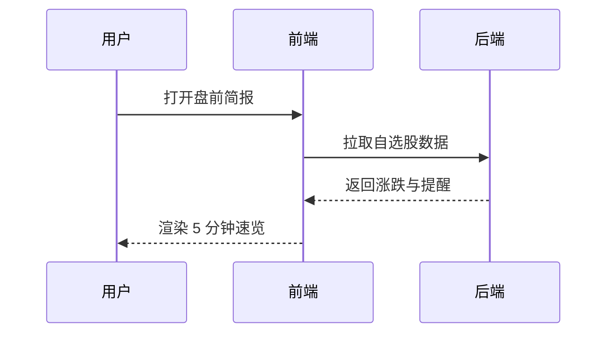

# 产品文档：盘前简报模块

> 设计理念：以「5 分钟速览」为主线，让交易者在开盘前极短时间内掌握关键信息。

## 1. 功能范围

盘前新闻聚合、自选股涨跌速览、事件提醒、本地持仓导入。

### 1.1 盘前新闻聚合

聚合权威财经源，按热度与相关性排序。

## 2. 验收标准

开盘前 30 分钟可完整加载；
宕机不阻塞浏览；
数据延迟 ≤ 5s。

## 3. 异常处理

行情源中断时展示降级横幅，并保留已加载内容。

## 4. 核心流程（mermaid 图示）



## 5. 数据样例（JSON）

```json
{
  "symbol": "600000",
  "name": "浦发银行",
  "changePct": 1.23,
  "alert": "开盘前 5 分钟成交量异动"
}
```
