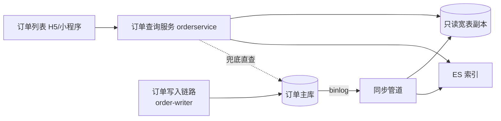
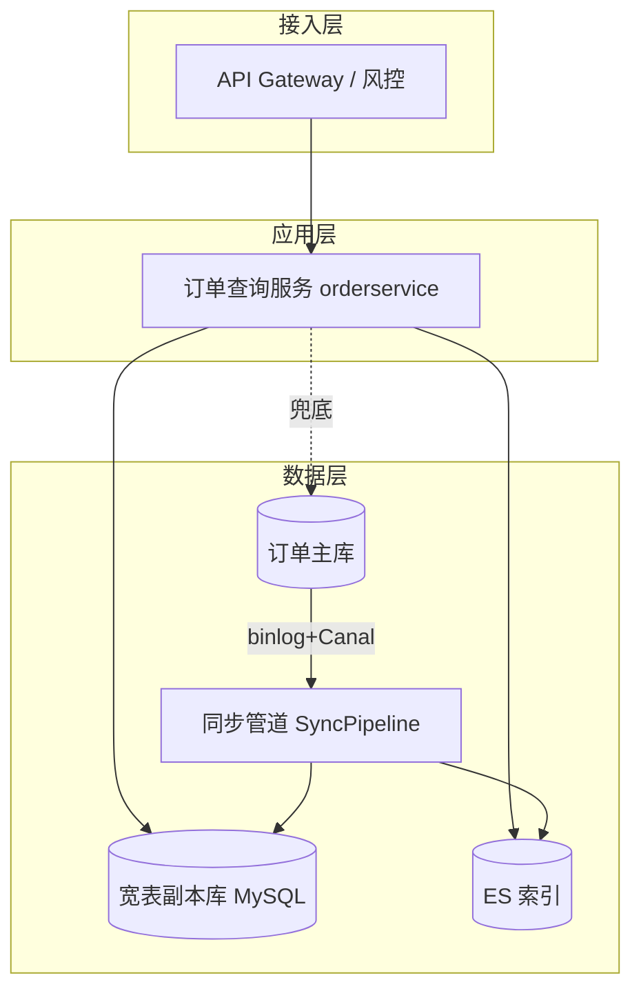
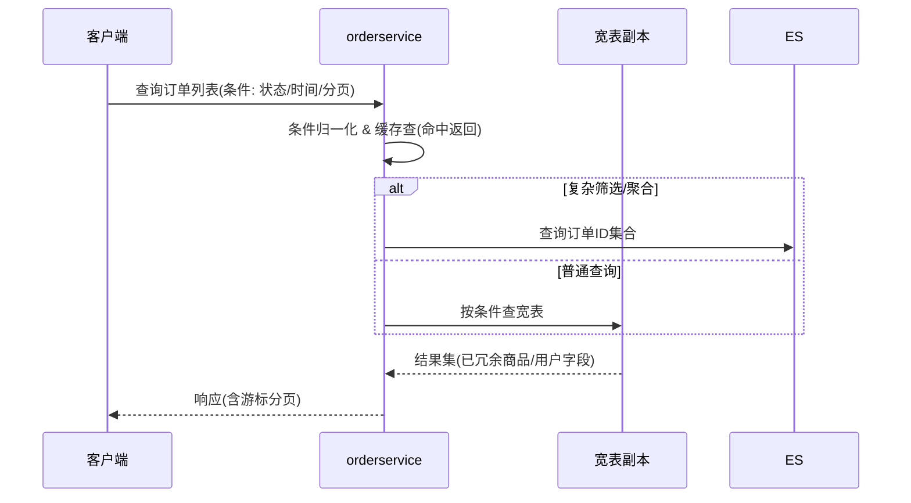

# 订单查询服务重构 技术设计文档（Demo 示例）

> 本文为模板的**填充示例**，演示一份合格的后端技术设计文档长什么样。业务数据均为虚构。

> **文档信息**

| 项 | 值 |
|---|---|
| 版本 | v1.0（已定稿） |
| 作者 | 张三 |
| 日期 | 2025-03-10 |
| 关联需求 | PRD-2025-003《订单列表页性能优化与数据一致性改造》 |
| 关联设计 | 订单中心架构规范 v2.1 |

---

## 1. 背景与动机

订单查询一直是订单中心 QPS 最高的链路（日均 2.4 亿次调用）。当前实现为"订单主库直查 + 行级 N+1 补查商品信息"，存在三个问题：

1. **慢查询**：列表页多表 JOIN + 大偏移量分页，P99 延迟高达 1.8s，大促期间经常触发告警；
2. **一致性隐患**：商品信息、用户信息通过 N+1 实时补查，下游任何一个服务抖动都会拖垮整个查询链路；
3. **扩展性差**：直接耦合订单主库，读写争抢严重，主库扩容成本高。

本次改造的目标是把查询链路与写入链路**读写分离**，引入宽表只读副本，把 P99 压到 200ms 以内，为后续大促扩容做准备。

## 2. 目标与非目标

### 2.1 目标

- 订单列表/详情查询 **P99 < 200ms**（当前 1.8s）；
- 订单查询对商品、用户服务的依赖从 **N+1 实时调用降为 0**；
- 主库只读流量下降 **90%** 以上；
- 支持分钟级的数据延迟下做到**最终一致性**，写后 5s 内可见。

### 2.2 非目标

- 不做订单**写入**链路的重构（本期只读改方案）；
- 不做历史 3 年以前订单的数据归档（后续专项）；
- 不追求**强一致**：本场景允许最终一致，实时一致性需求（如支付成功回调）走原有直查路径。

## 3. 总体方案设计（核心）

### 3.1 系统上下文图



### 3.2 整体架构图



- **应用层**：订单查询服务只读宽表/ES，不再调用商品、用户 RPC；
- **数据层**：宽表副本由同步管道消费主库 binlog 实时构建，承接 95% 查询流量；ES 承接复杂筛选/聚合；
- **兜底**：宽表延迟超过阈值 5s 时，查询降级到主库直查（限流保护）。

### 3.3 关键流程



异常路径：宽表/ES 不可用 → 熔断 → 降级主库直查（QPS 限流到原流量的 5%）→ 仍失败则返回错误码 + 前端重试按钮。

### 3.4 模块与依赖

| 模块 | 职责 | 依赖 | 解耦说明 |
|---|---|---|---|
| query-handler | 参数校验、条件归一化、缓存 | 无外部 RPC | 新增，纯本地逻辑 |
| wide-table-reader | 宽表查询、游标分页 | MySQL 副本（自有） | 替代原 N+1 补查 |
| es-reader | 复杂筛选/聚合查订单 ID | ES（自有） | 与宽表互补，均可熔断 |
| fallback-router | 延迟/故障检测与降级路由 | 主库（受控） | 通过开关限流保护主库 |

内部依赖：query-handler → wide-table-reader / es-reader / fallback-router，全部面向接口编程，便于单测替换。

### 3.5 接口设计

接口语义保持与现网**完全兼容**（避免客户端改造），内部实现替换：

| 接口 | 方法 | 说明 | 鉴权 | 错误码 |
|---|---|---|---|---|
| `/api/order/list` | POST | 订单列表（新增游标参数 cursor） | 用户登录态 token | 40001 参数错误 / 50001 查询暂不可用 |
| `/api/order/detail` | GET | 订单详情（缓存优先） | 用户登录态 token | 40002 订单不存在 / 50001 查询暂不可用 |

响应统一结构：

```json
{
  "code": 0,
  "message": "ok",
  "data": {
    "cursor": "eyJ0cyI6IjE2Mj...",
    "hasMore": true,
    "list": [
      {
        "orderId": "20250310000001",
        "status": 20,
        "goodsName": "示例商品",
        "goodsImg": "https://...",
        "amount": 19900,
        "createdAt": "2025-03-10 10:00:00"
      }
    ]
  }
}
```

与现状的 3 处**不兼容点**需要在本次灰度中处理：分页参数从 offset 改为 cursor（服务端做双兼容，灰度期同时接受 offset）、冗余字段名称统一、错误码收敛。

### 3.6 数据与存储设计

| 存储 | 用途 | 选型理由 | 容量与扩展 |
|---|---|---|---|
| 宽表副本（MySQL × 4 分片） | 列表/详情 95% 查询 | 单行含冗余字段，无 JOIN，查询快；扩容以只读副本加节点为主 | 单表预计 2 亿行，按 buyer_id 哈希分片，预留 1 年增长 |
| ES 集群（3 节点） | 复杂筛选/聚合 | 多维条件与聚合能力强 | 按日滚动索引，保留 180 天 |
| 订单主库 | 兜底与写入 | 维持现状 | 只读流量下降，写入压力不变 |

宽表同步机制：Canal 消费 binlog → 幂等写入副本（主键 upsert）；**一致性保障**：同步延迟监控 + 延迟 >5s 自动降级；**回放**：每日凌晨全量校验 diff，异常数据自动重放修复。

## 4. 备选方案与取舍

| 方案 | 描述 | 优点 | 缺点 |
|---|---|---|---|
| 方案 A（选定）：宽表副本 + ES | 主库—副本读写分离，消费 binlog 构建只读宽表，ES 承接复杂查询 | 查询性能好、主库零负担、读写彻底分离、扩展性好 | 引入同步管道与 ES 两套基础设施，运维成本高，存在秒级延迟，需降级兜底 |
| 方案 B：仅缓存 + 索引优化 | 保留主库直查，Redis 缓存热点 + 优化索引 | 改造小、无新基础设施 | 大偏移分页与多条件筛选仍慢，缓存击穿风险大，治标不治本 |
| 方案 C：只上 ES | 全部查询走 ES，主库只负责写 | 省一套副本存储 | ES 无法完全替代订单主数据的强约束校验，兜底仍复杂，成本与 A 接近 |

**最终选择**：方案 A。订单查询是典型的"读多写少、条件复杂"场景，读写分离 + 宽表是业界成熟范式（参考业内多个订单中心落地案例），长期收益最高；为控制成本，ES 仅承接确需多维聚合的场景，普通列表全部走宽表。
**被放弃的内容**：方案 B 只能缓解不能根治，且大促峰值依然打满主库；方案 C 与 A 成本相当但引入 ES 单点依赖，风险更高。

## 5. 非功能设计

### 5.1 性能

- 指标：列表 P99 < 200ms、详情 P99 < 100ms、缓存命中率 > 85%；
- 压测：模拟 3 倍大促峰值（12,000 QPS）验证宽表与 ES 水位，压测数据抽真库脱敏；
- 大页/内存池、连接池参数按压测结果调优。

### 5.2 稳定性

- 宽表读取失败 → 熔断 30s → 自动降级主库；
- 同步管道消费积压告警（lag > 30s 告警、>5s 触发查询降级垫底）；
- 全链路超时：查询服务 500ms 硬超时，避免拖垮调用方。

### 5.3 安全

- 查询接口鉴权 + 越权校验（订单归属校验，防遍历他人订单）；
- 宽表副本仅内网访问，账号最小权限；日志脱敏（手机号、地址打码）。

### 5.4 灰度与降级

- 功能开关 `order.query.v2`，按租户/用户灰度 0→10%→50%→100%；
- 随时一键回切旧链路；新链路任一环节异常自动降级；
- 分页参数双兼容（offset 与 cursor 同时接受），避免灰度期间客户端报错。

### 5.5 可观测性

- 指标：P99/P50、宽表延迟、同步 lag、熔断次数、降级比例；
- 告警：P99 > 200ms、lag > 5s、熔断触发、降级流量 > 30%；
- 全链路 Trace 接入（traceId 贯穿网关→查询服务→数据层）。

## 6. 风险与未决问题

| 风险/问题 | 影响 | 应对/缓解 |
|---|---|---|
| 同步管道引入的秒级延迟不符合部分业务预期 | 写后立即读出现旧数据 | 写后 5s 内窗口走主库直查兜底；强一致需求（支付回调）保留主库路径 |
| 宽表字段冗余导致存储成本上升 | 成本增加 | 仅冗余高频查询字段，低频字段留在主库按需 DTS 查询 |
| ES 与宽表数据不一致 | 聚合结果与列表不一致 | 同一同步管道写入并做时间戳对齐，diff 校验覆盖 ES |
| 未决：3 年历史订单是否进宽表 | 影响容量规划 | 上线前与业务确认，默认 3 年内订单进宽表 |

## 7. 测试与验收

### 7.1 测试策略

- **单元测试**：query-handler 条件归一化、fallback-router 降级判断、幂等 upsert（覆盖重复 binlog）；
- **集成测试**：宽表与 ES 双读一致性比对、同步管道故障注入（延迟/丢失/乱序）；
- **性能测试**：12,000 QPS 压测、缓存击穿演练、主库降级压测（5% 流量上限校验）；
- **演练**：大促前故障演练（ES 宕机、管道积压、主库抖动）。

### 7.2 验收标准

- [ ] Given 列表页正常查询, when 任意条件组合, then 响应 P99 < 200ms 且结果与旧链路一致（diff 全量比对 0 差异）
- [ ] Given 存在 5s 内的新订单, when 查询列表, then 该订单可见或链路已降级（不返回中间态脏数据）
- [ ] Given 商品服务完全宕机, when 查询列表, then 商品字段仍正确返回（不依赖外部 RPC）
- [ ] Given ES 宕机, when 复杂筛选查询, then 自动降级宽表/主库，错误码 50001 且不超时
- [ ] Given 灰度开关开启 100%, when 观察 24h, then 降级比例 < 0.1%、无数据一致性问题

## 8. 排期与任务拆分

| 里程碑/任务 | 负责人 | 计划时间 | 状态 |
|---|---|---|---|
| M1 宽表 Schema 设计与同步管道 | 李四 | 03-10 ~ 03-24 | 已完成 |
| M2 查询服务 v2 实现（宽表+缓存） | 张三 | 03-25 ~ 04-08 | 进行中 |
| M3 ES 接入与聚合查询 | 王五 | 04-09 ~ 04-22 | 未开始 |
| M4 降级/熔断/灰度开关 | 张三 | 04-23 ~ 04-30 | 未开始 |
| M5 压测与故障演练 | 赵六 | 05-01 ~ 05-08 | 未开始 |
| M6 灰度上线（10%→100%） | 全员 | 05-09 ~ 05-23 | 未开始 |
| M7 大促保障与复盘 | 全员 | 05-24 ~ 06-01 | 未开始 |

## 9. 参考资料

- PRD-2025-003《订单列表页性能优化与数据一致性改造》
- 订单中心架构规范 v2.1
- 业内订单中心读写分离落地案例（内部分享文档）
- Canal / ES 官方文档