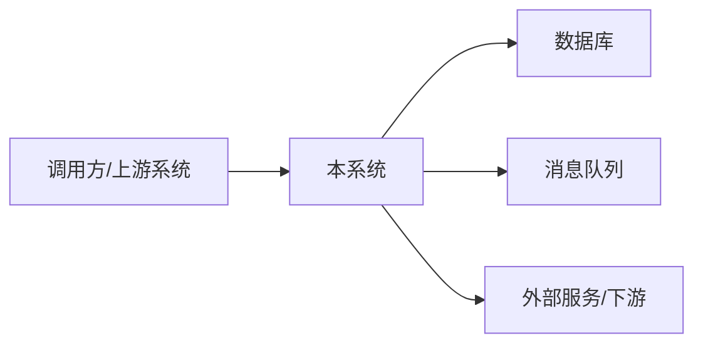
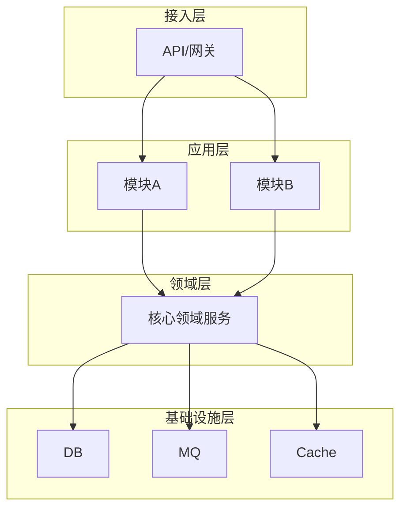
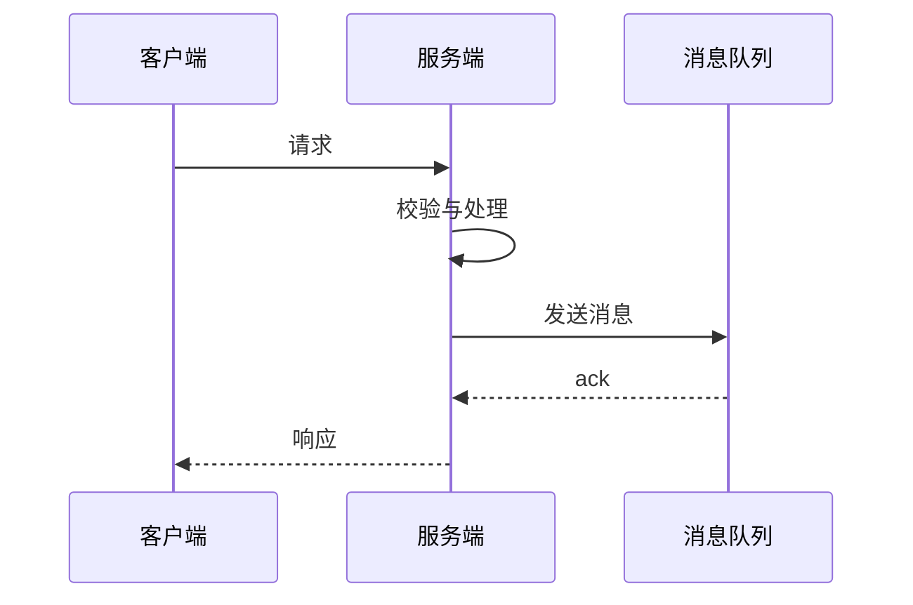

# [项目/功能名称] 技术设计文档

> **文档信息**

| 项 | 值 |
|---|---|
| 版本 | v0.1（草案 / 评审中 / 已定稿） |
| 作者 | [姓名] |
| 日期 | [YYYY-MM-DD] |
| 关联需求 | [PRD / 需求文档链接] |
| 关联设计 | [相关设计文档 / 上线单链接] |

---

## 1. 背景与动机

> 说明：1–2 段讲清楚业务背景、要解决的问题、为什么"现在"做。这不是需求清单复述，而是让读者快速进入上下文。

[业务背景、现状痛点、触发本次设计的原因]

## 2. 目标与非目标

### 2.1 目标

> 说明：写**可度量**的结果，不要写实现细节。

- [目标 1：例如 QPS 提升至 X、P99 延迟 < Yms、接口收敛到 Z 个]
- [目标 2]

### 2.2 非目标

> 说明：显式挑出"本期不做"，防止范围蔓延。非目标≠"系统不应崩溃"这类否定句。

- [本期明确不做 / 未来再做 / 不在范围的内容]

## 3. 总体方案设计（核心）

> 说明：本章是文档主体，按需增删小节。所有图建议使用 Mermaid，随代码库版本管理。

### 3.1 系统上下文图

> 展示本系统与外部的边界：依赖的服务、外呼组件、数据源。



### 3.2 整体架构图

> 分层架构与职责：展示层 / 应用层 / 领域层 / 基础设施层，说明层间关系。



### 3.3 关键流程

> 主流程 + 异常流程都要画，附简短文字说明。



### 3.4 模块与依赖

> 说明模块划分、模块间依赖关系与原因；区分内部依赖与外部依赖，明确解耦思路。

| 模块 | 职责 | 依赖 | 解耦说明 |
|---|---|---|---|
| [模块A] | [职责] | [依赖项] | [为何耦合/如何解耦] |

### 3.5 接口设计

> 草拟对外 API：方法、路径、鉴权、请求/响应结构、错误码。避免整体复制正式 Schema，只写与设计取舍相关的部分。

| 接口 | 方法 | 说明 | 鉴权 | 错误码 |
|---|---|---|---|---|
| `/api/xxx` | POST | [用途] | [鉴权方式] | [常见错误码] |

请求示例 / 响应示例：

```json
{
  "code": 0,
  "data": {}
}
```

### 3.6 数据与存储设计

> 表结构、存储选型与理由、一致性/容量/扩容考虑。

| 存储 | 用途 | 选型理由 | 容量与扩展 |
|---|---|---|---|
| [MySQL] | [核心业务数据] | [理由] | [容量规划] |

## 4. 备选方案与取舍

> 说明：列出 2–3 个可行方案并对比，这是文档最有价值的部分——讲清"为什么选它、放弃了什么"。

| 方案 | 描述 | 优点 | 缺点 |
|---|---|---|---|
| 方案 A | [简述] | [优点] | [缺点] |
| 方案 B | [简述] | [优点] | [缺点] |

**最终选择**：方案 [A/B]
**理由**：[为什么在给定目标与非目标下它是最优解]
**被放弃的内容**：[明确说明放弃了什么及其代价]

## 5. 非功能设计

### 5.1 性能

> 目标指标、评估方式、瓶颈分析与优化手段。

### 5.2 稳定性

> 容错、重试、限流、熔断、自愈机制。

### 5.3 安全

> 鉴权授权、数据脱敏、防注入/越权、合规要求。

### 5.4 灰度与降级

> 功能开关、A/B、灰度比例、降级兜底方案（新特性影响业务时的回退路径）。

### 5.5 可观测性

> 日志、监控指标、告警规则、链路追踪。

## 6. 风险与未决问题

> 已知风险与缓解措施；尚未确定、需要评审或验证的开放问题。

| 风险/问题 | 影响 | 应对/缓解 |
|---|---|---|
| [风险 1] | [影响] | [措施] |

## 7. 测试与验收

### 7.1 测试策略

> 单元测试（纯逻辑/校验）、集成测试（组件交互/外部系统）、压测、故障演练。

### 7.2 验收标准

> 用可测试语句描述完成条件，例如 "Given X, when Y, then Z"，含正反用例。

- [ ] Given [前置], when [操作], then [期望结果]
- [ ] [验收项 2]

## 8. 排期与任务拆分

> 说明：大型项目给出里程碑；任务拆到可立即执行、可逐项勾选的粒度。

| 里程碑/任务 | 负责人 | 计划时间 | 状态 |
|---|---|---|---|
| [任务 1] | [姓名] | [日期] | [未开始/进行中] |

## 9. 参考资料

- [内部资料：需求文档、架构规范]
- [外部资料：调研文章、开源项目、官方文档]