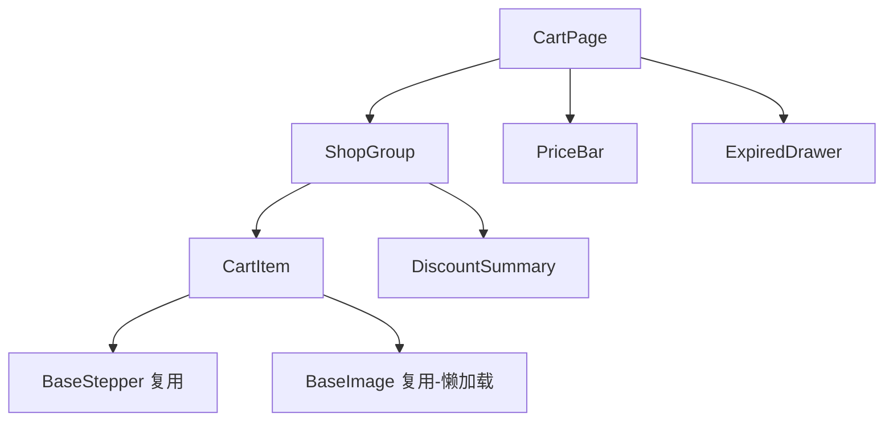
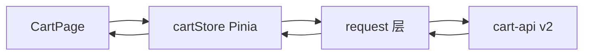

# 购物车页面改版（含优惠归并）前端技术设计文档（Demo 示例）

> 本文为模板的**填充示例**，演示一份合格的前端技术设计文档长什么样。业务数据均为虚构。

> **文档信息**

| 项 | 值 |
|---|---|
| 版本 | v1.0（已定稿） |
| 作者 | 王小明 |
| 日期 | 2025-06-15 |
| 对应需求版本 | 版本 v3.12.0（上线单 FY25-Q2-018） |
| 相关文档 | [RP 链接：购物车改版 v6] / [Figma 设计稿 v6] / [后端接口文档 cart-api v2] |

---

## 1. 背景与目标

当前购物车为"单品勾选、全量金额相加"的朴素实现，存在三个问题：

1. **优惠不可见**：满减/满折/会员价在结算页才生效，用户在购物车无法感知，转化率低于竞品 8%；
2. **计算口径分叉**：前端本地合计金额与后端结算金额规则不一致，历史客诉多；
3. **性能痛点**：购物车商品多时全量渲染 + 图片无懒加载，FCP 达 3.2s。

本次改版目标：购物车内直接展示"优惠归并"结果（满减、会员价、运费预估），并把金额计算全部收敛到后端接口返回，前端只做展示与交互；同时优化首屏性能。预期带动购物车→结算转化率提升 5% 以上。

## 2. 页面与交互设计

### 2.1 页面清单与路由

| 页面/路由 | 说明 | 入口 | 是否新增 |
|---|---|---|---|
| `/cart` | 购物车主页面（改版） | TabBar「购物车」 | 改造 |
| `/cart/expired` | 失效商品列表抽屉 | `/cart` 内悬浮入口 | 新增 |
| `/cart/settlement` | 结算确认页（复用现网） | `/cart` 底部按钮 | 复用 |

### 2.2 交互流程

```mermaid
flowchart TD
    A[进入 /cart] --> B[并行拉取 购物车列表 + 优惠规则 + 用户信息]
    B -->|成功| C{是否有可售商品}
    C -->|是| D[按店铺分组渲染]<br>展示优惠归并条 / 预估运费
    C -->|否| E[空态：去逛逛]
    B -->|失败| F[错误提示 + 重试]
    F --> A
    D --> G{用户操作}
    G -->|勾选/改数量/改优惠| H[防抖 300ms 调优惠重算接口]
    H --> I[局部更新金额区域 + 角标动效]
    I --> G
    G -->|点击失效商品| J[打开失效商品抽屉]
```

边界与异常态：金额加载中显示骨架条；优惠重算失败保留上一次成功结果并提示"金额可能未更新"；网络重连后自动重算一次；勾选状态与金额通过**唯一请求序号**防竞态（只接受最后一次请求的结果）。

### 2.3 状态梳理

| 状态 | 触发条件 | 展示内容 |
|---|---|---|
| loading | 首屏数据请求中 | 列表骨架屏 + 金额骨架条 |
| 数据为空 | 无任何商品（含失效） | 空态插画 + 「去逛逛」按钮 |
| 部分失效 | 存在失效商品 | 顶部横条「N 件商品已失效」+ 抽屉入口 |
| 金额计算中 | 勾选/数量变更触发重算 | 金额区局部 loading，其余区域可继续操作 |
| 金额计算失败 | 重算接口异常 | 保留上次金额 + toast「金额可能未更新」+ 重试 |
| 全选状态 | 全部可售商品均勾选时 | 全选勾选 + 合计为所有商品金额 |

## 3. 组件设计

| 组件 | 类型（新增/复用/改造） | 职责 | 输入/输出 |
|---|---|---|---|
| `CartItem` | 改造 | 单商品行：图片、数量步进器、勾选、价格展示 | props: item 数据 / emits: change, select |
| `ShopGroup` | 新增 | 按店铺分组 + 组内满减进度条 + 店铺级优惠展示 | props: group 数据、勾选集 |
| `DiscountSummary` | 新增 | 优惠归并明细条（已省 X 元、点击展开明细） | props: discount 数据 |
| `PriceBar` | 改造 | 底部合计栏：合计/优惠/预估运费/去结算 | props: summary 数据 |
| `ExpiredDrawer` | 新增 | 失效商品列表抽屉 | props: expiredList |



复用沉淀：本次沉淀 `BaseStepper`、`BaseImage（懒加载）` 两个基础组件到公共组件库；`ShopGroup` 近期可复用至"拼团确认页"。

## 4. 数据与状态管理

### 4.1 数据流



数据流原则：**金额计算全部以后端接口返回为准**，前端任何本地计算（勾选态、小计显示）仅用于界面即时反馈，最终金额一律以 `POST /api/cart/summary` 的结果覆盖。

### 4.2 状态管理方案

| 状态 | 存放位置 | 理由 |
|---|---|---|
| 购物车列表 + 勾选集 | cartStore（Pinia） | 多页面共享（购物车/结算页）且后续活动页需要 |
| 金额 summary | cartStore 中独立字段 | 依赖勾选集，便于竞态序号管理 |
| 用户信息 | userStore（已有） | 会员价展示需要会员等级 |
| 纯 UI 状态（抽屉开合、loading 细粒度） | 组件内 state | 无跨组件需求 |

选型理由：项目已有 Pinia 体系，不再引入新状态库；对比方案（仅组件内 props 传递）在"结算页需读取购物车状态"的场景会形成 props 深穿透，故放全局 store。

## 5. 接口设计（前后端契约）

以下接口由本次改版新增或改造，已与后端（李后端）评审对齐，mock 数据已就绪：

| 接口 | 方法 | 用途 | 请求参数 | 响应要点 |
|---|---|---|---|---|
| `/api/cart/list` | GET | 购物车列表（含失效） | version=v2 | items[]、expiredItems[]、groupList[] |
| `/api/cart/summary` | POST | 优惠归并金额计算（**核心**） | itemIds、quantities、couponCode? | total、discountDetail[]、freight、memberPrice 逐项 |
| `/api/cart/check` | POST | 结算前校验 | itemIds | 可结算标志、拦截原因码 |

`/api/cart/summary` 关键响应结构（节选，完整见接口文档）：

```json
{
  "code": 0,
  "data": {
    "totalPrice": 29900,
    "totalDiscount": 5400,
    "freight": 0,
    "settlementPrice": 24500,
    "discountDetail": [
      { "type": "MANJIAN", "title": "满300减50", "amount": 5000 },
      { "type": "MEMBER", "title": "会员价优惠", "amount": 400 }
    ]
  }
}
```

联调约定：前端以 mock 先行开发；金额字段单位统一为"分"；失败时返回 `code=40003`（金额重算失败）并携带 `retryable=true`，前端据此展示"金额可能未更新"。

## 6. 技术选型与工程化

### 6.1 选型对比

| 技术 | 候选 | 选择 | 理由 |
|---|---|---|---|
| 状态管理 | 组件本地 state / cartStore(Pinia) | cartStore | 结算页与活动页需共享，避免 props 穿透 |
| 金额计算 | 前端本地算 / 后端 summary 接口 | 后端接口 | 避免口径分叉，单一事实来源 |
| 骨架屏 | 手写 / 组件库 Skeleton | 组件库 Skeleton | 与现有设计体系一致，无额外成本 |

### 6.2 目录与规范

- 新增目录 `src/modules/cart/`：`views/`、`components/`、`store/`、`api/`；
- 遵循 ESLint + Prettier 既有规范；金额展示统一走 `formatPrice` 工具（分→元，千分位）。

## 7. 性能与兼容性

### 7.1 性能优化

- **首屏**：列表数据并行请求（list 与 summary 首屏只调 list，summary 在勾选态变化时再调）；图片懒加载 + 占位色；
- **渲染**：大列表用虚拟滚动（组件库 List）；数量步进防抖 300ms，避免高频重算；
- **缓存**：购物车列表缓存 10s 内不重复拉取；summary 结果 1s 内相同入参直接命中本地缓存。

### 7.2 兼容性

- 支持 Chrome/Edge 最近 2 个大版本 + iOS Safari 15+ + Android WebView（系统 WebView ≥ 83）；
- 布局用 flex + 百分比，375px 与 414px 宽度下金额区不换行（overflow 省略）；
- 降级：无 `IntersectionObserver` 的旧 WebView 用滚动事件替代懒加载；无 `AbortController` 时竞态防护退化为忽略过期响应序号。

## 8. 埋点与监控

| 埋点事件 | 触发时机 | 上报字段 |
|---|---|---|
| `cart_view` | 页面曝光 | 商品数、失效数、来源 |
| `cart_discount_show` | 优惠归并条曝光/展开 | 优惠类型、金额 |
| `cart_amount_recalc` | 金额重算请求发出/成功/失败 | 耗时、错误码、是否降级展示 |
| `cart_go_settle` | 点击去结算 | 结算金额、优惠总额 |

错误监控：接入现有 Sentry，`summary` 接口失败即上报 error + 上下文（入参摘要，脱敏）。

## 9. 任务拆分与排期

| 任务 | 负责人 | 估算 | 依赖 | 状态 |
|---|---|---|---|---|
| UI 组件开发（CartItem 改造、ShopGroup、DiscountSummary、PriceBar、ExpiredDrawer） | 王小明 | 5 人日 | 设计稿 v6 | 进行中 |
| cartStore + 竞态防护 + summary 对接 | 王小明 | 3 人日 | 后端 mock 就绪 | 未开始 |
| 性能优化（虚拟滚动、懒加载、缓存） | 王小明 | 2 人日 | 组件完成 | 未开始 |
| 埋点 + 监控接入 | 陈前端 | 1 人日 | 数据流完成 | 未开始 |
| UI 还原走查 + 交互微调（交互预算 25%） | 王小明 | 2 人日 | 联调完成 | 未开始 |
| 自测 + Mock 联调 + 真机兼容测试 | 王小明 + 测试香 | 3 人日 | 全量开发完成 | 未开始 |

里程碑：M1 联调冻结 07-01；M2 提测 07-05；M3 上线 07-12（随 v3.12.0 灰度 10%）。

## 10. 风险与验收

### 10.1 风险与应对

| 风险 | 影响 | 应对 |
|---|---|---|
| 优惠归并逻辑复杂导致 summary 接口返工 | 排期延期 | mock 前置 + 与后端每日对齐规则清单 |
| 旧 WebView 不支持懒加载 API | 图片加载体验下降 | 滚动事件降级实现 |
| 结算页依赖旧金额字段需同步改造 | 上线互相阻塞 | 结算页金额字段兼容新旧结构，灰度期双写 |
| 重构影响范围：`PriceBar` 被结算页引用 | 波及结算页 | 影响清单提前同步测试与后端 |

### 10.2 自测用例与验收标准

- [ ] Given 勾选 2 件不同店铺商品, when 修改其中一件数量, then 300ms 后金额区更新为后端返回结果且无闪烁
- [ ] Given 连续快速点击数量步进器, when 请求乱序返回, then 界面最终金额等于最后一次入参的结果（竞态防护生效）
- [ ] Given summary 接口报错, when 完成改数量操作, then 保留上一次金额并 toast「金额可能未更新」且可重试
- [ ] Given 存在失效商品, when 进入购物车, then 顶部横条展示且抽屉内可逐件删除
- [ ] Given 375px 与 414px 宽度, when 查看金额区, then 无换行错位；iOS 15 与 Android WebView ≥83 下交互正常
- [ ] UI 还原：与设计稿逐像素比对通过率 ≥ 95%

### 10.3 上线配置

- **权限**：`/cart` 页面权限默认对所有登录用户开放；新功能开关 `cart.v2.ga` 灰度 10%→50%→100%；
- **灰度开关**：`cart.discount.visible` 控制优惠归并条显隐（关闭时退回旧展示，金额仍走新接口）；
- **定制数据**：接入配置中心读取优惠展示规则文案；AB 实验 id 关联埋点。

## 11. 参考资料

- RP 链接：购物车改版 v6（含交互说明 v3）
- Figma 设计稿 v6（含动效标注）
- 后端接口文档 cart-api v2（含 summary 字段定义）
- 组件库文档：BaseImage / BaseStepper / Skeleton 使用说明