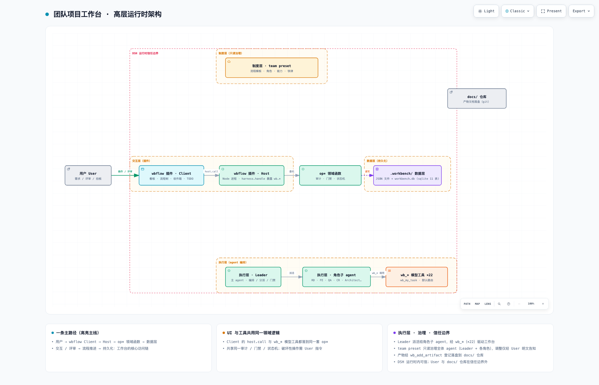

# 团队项目工作台 · 整体架构（总纲）


> ⚠️ **历史归档（2026-09-08 标注）**：本文件为 arch_design 拆分前旧版快照——现行权威见 `docs/v1.0/`（PRD/RD/FE 分册）与 `docs/v1.0/arch_design.md`；交互层 v3 增补见 `docs-tmp/ui-interaction-final.md`。仅作历史参考，勿据以实现。

> 本文档是全部设计文档的**总纲**：定位、设计原则、架构分层、模块划分与关键技术决策。
> 模块级需求/设计见 `02`~`04`；数据模型见 `05`；制度/执行/规范见 `06`~`08`；状态见 `09`。

---

## 1. 定位

**团队项目工作台（Team Project Workbench）**是一个运行在 DeepSeek Harness（DSH）之上的「项目管理 + OA 流程 + 评审协作」三合一交互系统。

与普通项目管理软件的核心区别：

- **每个流程阶段绑定产物**（如【需求评审】绑定《产品设计文档》）；
- **每个阶段下挂评审沟通记录**（评审意见、打回理由、改进说明、讨论往返）；
- **阶段负责的是 Agent 角色**（PM/RD/FE/QA/Architect/…），而非仅人类成员；
- **门禁 = User 评审决策**，评审是双向、多轮的对话过程，而非单次通过/打回。

不是通用的可编辑流程引擎：**流程写死**（四类流程以确定的节点/门禁建模），**交互体验对齐成熟项目协作软件**。

## 2. 关键概念边界

| 概念 | 含义 | 归属 |
|---|---|---|
| 流程 / 角色 / 门禁制度 | 四类流程、9 角色、各阶段与门禁规则 | **制度层**（team preset，只读，供 Agent 学习遵循） |
| 交互工作台 | 版本看板 / OA 流程树 / 收件箱 / TODO | **交互层**（插件，供 User 操作） |
| 过程数据 | 版本、需求、流程节点、产物、评论、任务 | **数据层**（持久化存储） |
| 执行引擎 | 谁推进节点、生成产物、回复评审 | **执行层**（Leader + 角色子 agent + wb_* 工具） |

**一句话**：制度进预设（Agent 学习并遵循），界面进插件（User 操作），数据进存储（持久化），执行靠 Agent 编排。

## 3. 设计原则

1. **流程写死、不造引擎**：四类流程以确定节点/门禁建模，不做可视化流程编辑。
2. **门禁是人机交互的自然面**：User 确认 = 评审卡点；评审必有产出物 + 可对话 + 可带理由打回 + 可异议多轮 + 可引入新范围反向确认。
3. **数据与 UI 解耦**：数据层是单一可查询领域模型；UI 只是它的投影。
4. **渐进落地**：先静态流程骨架 + 交互 demo，再接入真实 Agent 编排。
5. **程序做路由，agent 做专业**：节点/评审/归属/通知的路由由程序从数据推导（`wb_my_task`/默认路由），Agent 只做内容与专业判断。

## 4. 四层架构（运行时）

> 完整可交互架构图见 `diagrams/team-workbench-runtime.html`；下图为 2048×1320 视口截图。



四层关系：

- **制度层（team preset，只读）**：流程模板 / 角色 / 能力 / 铁律，供全部 agent 学习遵循；调整仅经「User 明文告知 → 协助调整 preset 文件」通道。
- **交互层（wbflow 插件，Host + Client）**：Client（浏览器 UI，看板/流程树/收件箱/TODO）只经 `host.call` 交互，不直接碰文件；Host 暴露 `wb.*` RPC，委托 op* 领域函数，写数据层。
- **执行层（Leader + 角色子 agent + wb_* 工具 ×22）**：Leader 派活给角色子 agent，经 wb_* 工具驱动工作台；wb_* 工具与 UI 共用同一套 op* 领域函数（同一审计/门禁/状态机）。
- **数据层（`.workbench/`）**：实体模型 + sqlite 11 表 + JSON 文件；透明可 diff，agent 交互的持久化来源。

**主路径**：用户 → wbflow Client → Host → op* 领域函数 → 数据层（交互 / 评审 → 流程推进 → 持久化）。

## 5. 模块划分（四个核心模块）

| 模块 | 名称 | 载体位置 | 文档 |
|---|---|---|---|
| I | 版本看板 + 需求池（外层入口） | `conversation.view` tab（id=`workbench`） | `02-module-board.md` |
| II | 需求 OA 流程树（需求详情页） | 同上 tab 内二级视图 | `03-module-flow-tree.md` |
| III | 门禁通知收件箱（User 全局） | `shell.overlay` badge/toast + 收件箱列表 | `04-module-inbox-todo.md` |
| IV | TODO 列表（收件箱的操作投影） | `conversation.input.dock` | `04-module-inbox-todo.md` |

四模块关系：**看板（I）→ 点需求 → 流程树（II）**；流程/评论/任务事件产生**收件箱条目（III）**，收件箱的可操作投影即 **TODO（IV）**。

## 6. 关键技术决策（定稿）

| # | 决策 | 定稿 |
|---|---|---|
| 1 | 领域存储 | 文件存储 `<workspace>/.workbench/` 起步（透明可 diff）；**已演进为 sqlite**（`workbench.db`，11 表，无外键、逻辑引用、审计留痕），JSON 仅作导出格式 |
| 2 | 制度只读 | 流程/角色/门禁落在 team preset（只读）；User 明文告知才调整 |
| 3 | 通知形态 | 经历「IM 收件箱 → 任务总线」演进，**定稿：TASK 是唯一待办总线**；通知/待回复由查询 `tasks`/`issues` 实时推导（通知是视图，不是数据） |
| 4 | 评论模型 | 统一「评论 = 问题」模型；状态 `open → pending-confirm → resolved`（或 `overridden`）；解决需提评者复核确认 |
| 5 | 锚点 | 四级：`document / line / range / block`（废弃章节级 heading；diff 级后置） |
| 6 | 项目边界 | 项目 = DSH workspace（目录），各一套独立数据；收件箱/TODO 为 User 全局（跨项目聚合，可按项目/任务名筛选） |
| 7 | 评审职责 | **各审各的**：评审者只对自己职责内维度评审与表态（维度固化在评审能力 how） |
| 8 | 问题归属 | 三层：L1 锚点产物作者 → L2 节点 owner → L3 QA 跨端根因判定（`domain=rd\|fe`） |
| 9 | 流程演进 | 流程路由程序化（`wb_my_task` + 默认路由），persona 只留专业能力卡 + 3 行协作协议 |
| 10 | 进程约定 | 插件 Cordis 定义必须同时带 `host`+`client`；Host 返回恒为纯 JSON（lossless）；写文件显式传 `writePolicy()`（workspaceRoot=PROJECT） |

## 7. 协作流程（固化约定）

每个里程碑遵循同一节奏：

1. **先细化文档 → 产出产品文档**（页面/交互/数据字段），而非直接写代码；
2. **用户确认**：审产品文档，认可后才进入实现；
3. **再实现**：过程中遇新决策点，回到 1 补充产品文档再定。

> 纯数据/后端里程碑无可见页面时，产品文档以「数据 Schema + 命令/查询接口说明 + 数据样例」呈现，同样需用户确认。

## 8. 实现 Roadmap

### 8.1 MVP（v1.0）—— 可端到端跑通的最小闭环

**目标**：User 按流程走一遍，每个角色有真实子 agent 执行，产出登记、评审闭环、门禁推进、收件箱通知全流程可用。

#### MVP 需求拆解

| # | 需求 | 落地状态 | 预计工作量 |
|---|---|---|---|
| P1 | **team preset 接线**（M6）：从 standard 复制 → 叠加团队制度 → 挂载 skill（wb-agent-guide / team-conventions）→ 新会话可加载 | PRD 定稿，尚未接线 | 1–2 天 |
| P2 | **sqlite 应用层迁移**（M8）：wb_* 工具改走 sqlite 事务；wb_my_task 组装链切 `flow_template_nodes.mode` / `capabilities.products` 展开；JSON 载体废弃 | schema 已建库 seed；应用层迁移进行中 | 2–3 天 |
| P3 | **Architect / PM / Investigator 角色卡**（M7）：落地 persona（专业卡 + 3 行协作协议）；验证：版本规划/需求评审全流程 | ⏳ 待落地 | 1–2 天 |
| P4 | **Skill 落地**（M6）：`wb-agent-guide` 编排流程（拆分版本/推进任务/评审闭环/破坏性操作确认）+ `team-conventions` 制度速查 | skill 草案已有，待沉淀到 preset | 0.5–1 天 |
| P5 | **真实 agent 执行**（M7）：子 agent 直接使用 wb_* 工具（替代文件直写 `.workbench/`）；Leader 派活 prompt 更短（只给 reqId+role） | req-019 演练验证 4 角色；工具接线后全量验证 | 1–2 天 |
| P6 | **需求对齐节点实践**（M7）：tech①/task① align 节点结论落 `issues(discussion)`；wb_my_task 打包全流程讨论 | 设计已定，待演练 | 0.5 天 |

**MVP 交付标准**：
- 新会话以 team preset 启动，系统提示含团队制度，22 个 wb_* 工具可见，skill 可加载；
- 一条需求走完业务流程（需求设计 → 评审 → RD/FE 并行开发 → CR → QA 验收 → 用户验收）无阻塞；
- 收件箱通知链路可用（decide/评论/评审待表态触发 → 推送到收件箱 → 点击跳转）。

### 8.2 v1.1 —— 增强与稳定性

| # | 需求 | 说明 |
|---|---|---|
| E1 | **diff 级锚点**（M8 后置）：产物版本化 + diff 锚点（行级 diff 锚点需引入 revision 存储） | 提升代码 CR 评论精准度 |
| E2 | **多项目切换 UI**：顶部项目选择器（数据层已按 `projectId` 分桶，仅缺界面） | 跨项目统一入口 |
| E3 | **多项目收件箱/TODO 聚合**：收件箱与 TODO 跨项目聚合，项目筛选 + 任务名筛选 | 收件箱设计已含，UI 待实现 |
| E4 | **版本间需求批量迁移**：大版本拆分/合并时批量迁移需求到不同版本 | agent 工具辅助操作 |
| E5 | **候补队列（backlog 管理）**：待分配需求的优先级排序、自动推荐归入哪个版本 | 提升规划效率 |
| E6 | **Agent 审计日志**：audit_log 完整度验证，支持回放每个决策的变更历史 | 审计证据完整性 |
| E7 | **性能优化**：大需求池（>50 条）列表筛选优化、sqlite WAL 性能验证 | 实际使用后的稳定性 |

### 8.3 实现路径（依赖关系）

```
P1 preset 接线 ──→ P4 skill 落地 ──→ P5 真实 agent 执行
                                             │
P2 sqlite 迁移 ──────────────────────────────→ P3 角色卡落地 → P6 需求对齐
                                                        │
                                                    MVP（v1.0）交付
                                                        │
                                                        ▼
                                              v1.1 增强（E1–E7）
```

**关键依赖**：
- P1（preset）与 P2（sqlite）无直接依赖，可并行；
- P4（skill）依赖 P1（preset 挂载入口）；
- P5（真实 agent）依赖 P1 + P2 + P3（全链路数据可用）；
- P6（需求对齐）依赖 P3（角色卡）+ P2（sqlite discussion 讨论）。

## 9. 演进注记

- 流程节点定义经历多轮调整（业务需求 19 节点 → 12 节点 + 待启动；规划审批任务重定义为「任务」；版本规划 11 节点 → 4 节点 + 待启动），**以 `06-flows-and-roles.md` 的模板表为准**。
- 交互形态若干早期方案已废弃（如章节级锚点、列=版本的看板、收件箱独立通知表），本文与各模块文档只记录定稿。
- 实现进度与历史里程碑见 `09-milestones.md`。