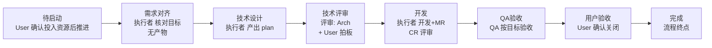

# 四流程 · 节点与人员对齐（流程图）

> **目的**：澄清 4 个流程的节点结构与涉及人员（owner + reviewers），作为 Excel 链路表修正与能力推演的对齐基准。
>
> **三层文档关系（权威顺序）**：
> ```
> docs-tmp/*.md（本会话最新设计，含「评审拆分一致性」等新决策）—— 当前处在此层，正在敲定
>   ↓ 待 merge
> arch_design.md（已 merge 的权威基线；相对 docs-tmp 过时）
>   ↓ 已对齐实现
> seed.json（实现数据，仅参考）
> ```
> 本文件以 **docs-tmp 讨论中的新设计**为「当前态」，标注 arch_design/seed 的现状差异（即待 merge 时需变更的点）。

## 0. 三层文档差异总览

| 主题 | docs-tmp 新设计（本文件当前态） | arch_design.md（基线） | seed.json（实现） |
|---|---|---|---|
| business 流程 | **需求对齐 + 产品设计评审分拆**（§8 新决策） | 12 节点：需求评审（融合需求合理性+产品方案评审） | 13 条（同 arch_design） |
| 评审节点拆分 | 设计/方案类评审拆为独立节点（一致性规则 §5） | plan task：方案评审/调研/架构规划=产出+门禁合一；business 设计类已拆 | 同 arch_design |
| 流程结束节点 | **4 流程末尾均有「完成」DONE 节点**（无动作，流程终点） | 无（收尾=用户验收/创建需求·启动版本） | 无 |
| 角色/能力 | capability.actions 含 productType/query 引用（新） | capabilities.how（字符串数组，旧） | 同 arch_design（旧） |
| 产物 | ProductType 枚举 + 对话类 query（新） | artifacts kind=document/link | 同 arch_design |
| trigger | currentTrigger/activeActions 程序契约（新） | 无（编排靠 Leader 协议） | 无 |

> 本文件描述「当前态（docs-tmp 新设计）」；凡与 arch_design/seed 不一致处，即待 merge 时需同步 arch_design 的变更点（在 §8 汇总）。

## 1. business 业务需求流程（定稿：需求对齐 + 产品设计评审）

> **2026-08-24 决策**：业务需求的「需求评审」节点是**错误的命名/职责**——需对齐为两个**同名但不同节点**（负责人完全不同）：

```
待启动(User 确认投入资源后推进)
 → 【需求对齐】(User + PM 沟通需求本身：目标/范围/价值；结论落 discussion，无文档产物)
    **负责人：User / PM**  ← 类比 task「需求对齐」、plan「立项需求对齐」
 → 产品设计(PM 主导产出 product_doc)
 → 【产品设计评审】(评审《产品设计文档》)
    **负责人：PM(主导/澄清质疑) / Architect(可行性) / RD·FE(按需，随 scope) / User(拍板)**
 → RD技术设计 → RD技术评审 → FE技术设计 → FE设计评审 → 用例设计 → 用例设计评审
 → RD开发 ∥ FE开发(各配 CR) → QA验收 → 用户验收 → 完成
```

```mermaid
flowchart LR
    subgraph 启动
        A0[待启动<br/>User 确认投入资源后推进]
    end
    subgraph 需求对齐
        A0a[需求对齐<br/>User + PM 沟通需求<br/>结论落 discussion<br/>无文档产物]
    end
    subgraph 设计
        A1[产品设计<br/>PM 主导产出 product_doc]
        A2[产品设计评审<br/>PM 澄清质疑 + Architect 必审<br/>RD/FE 按需(scope) + User 拍板 ★]
    end
    subgraph RD设计
        A3[RD技术设计<br/>RD 产出 rd_design]
        A4[RD技术评审<br/>评审: Arch/RD/FE/QA/PM<br/>+ User 方案确认]
    end
    subgraph FE设计
        A5[FE技术设计<br/>FE 产出 fe_design]
        A6[FE设计评审<br/>QA 评审]
    end
    subgraph 用例
        A7[用例设计<br/>QA 产出 case_design]
        A8[用例设计评审<br/>评审: RD + FE]
    end
    subgraph 开发并行
        A9a[RD开发<br/>RD: 开发+自测+MR<br/>CR 评审]
        A9b[FE开发<br/>FE: 开发+自测+MR<br/>CR 评审]
    end
    subgraph 验收
        A10[QA验收<br/>QA 按用例验收<br/>+ 缺陷闭环]
        A11[用户验收<br/>User 最终拍板]
    end
    A11 --> A12[完成<br/>流程终点]
    A0 --> A0a --> A1 --> A2 --> A3 --> A4 --> A5 --> A6 --> A7 --> A8 --> A9a
    A8 --> A9b
    A9a --> A10
    A9b --> A10
    A10 --> A11
```

**要点**：
- 「需求对齐」与「产品设计评审」**同名接近但绝不是同一个节点**——负责人完全不同（前者 User+PM 沟通需求；后者 PM+Architect 评审产品设计文档+User 拍板）；
- 产品设计评审的**评审对象 = product_doc**（设计文档），不再是"需求合理性"（那是需求对齐的事）；
- **产品设计 owner = PM**（阶段 owner 执行者，产出组织由 PM 牵头；Leader 才是协调者）；
- **评审成员：PM（澄清质疑）+ Arch（必须主持可行性）+ RD/FE（按需，随 scope）+ User（拍板）**——scope 含后端 → RD 参加（后端可行性）；含前端 → FE 参加（前端可实现性）。

## 2. tech 技术需求流程（13 节点）

（同前一版：需求对齐前置，无产物，User 拍板；差异见标注）

```mermaid
flowchart LR
    B0[待启动<br/>User 确认投入资源后推进]
    B1[需求对齐<br/>PM + User 拍板<br/>结论落 discussion]
    B2[RD技术设计<br/>RD 产出 rd_design]
    B3[RD技术评审(按需)<br/>评审: Arch/RD/FE/QA<br/>+ User 方案确认]
    B4[FE技术设计(按需)<br/>FE 产出 fe_design]
    B5[FE技术评审(按需)<br/>QA 评审]
    B6[用例设计<br/>QA 产出 case_design]
    B7[用例设计评审<br/>评审: RD + FE]
    B8a[并行开发(RD)<br/>RD 开发+MR<br/>CR 评审]
    B8b[并行开发(FE)<br/>FE 开发+MR<br/>CR 评审]
    B9[QA验收<br/>QA 按用例验收]
    B10[用户验收<br/>User 拍板]
    B10 --> B11[完成<br/>流程终点]
    B0 --> B1 --> B2 --> B3 --> B4 --> B5 --> B6 --> B7 --> B8a
    B7 --> B8b
    B8a --> B9
    B8b --> B9
    B9 --> B10
```

## 3. task 任务流程（8 节点）



> 执行者由 User/Leader 按 **scope** 动态指定（见 §6）。
> 2026-08-24 批注 C82：原「方案评审」更名/拆分为「技术设计（产出 plan）」+「技术评审」两节点——本阶段实际就是简易版本的需求（技术设计产出、技术评审把关）。

## 4. plan 版本规划流程（9 节点）

```mermaid
flowchart LR
    D0[待启动<br/>User 确认投入资源后推进]
    D1[立项需求对齐<br/>Architect 产出 alignment]
    D2[立项评审<br/>评审: PM + User 拍板]
    D3[调研<br/>Investigator 产出 research]
    D4[调研评审<br/>Architect 评审]
    D5[架构规划<br/>Architect 产出 architecture]
    D6[架构规划评审<br/>评审: PM + User 拍板]
    D7[创建需求·启动版本<br/>Leader 拆解需求+推进版本]
    D7 --> D8[完成<br/>流程终点]
    D0 --> D1 --> D2 --> D3 --> D4 --> D5 --> D6 --> D7
```



---

## 5. 评审节点拆分的一致性规则（2026-08-24 决策）

**问题**：如果 business 拆「需求对齐 + 产品设计评审」，那 plan 的「立项/**调研/架构规划**」（产出+评审合一）为何不拆？涉及同理"按评审 comment 修改文档"的流程。

**决策（保持一致性）**：
- **设计/方案类评审一律拆为独立评审节点**（business：产品设计评审、RD技术评审、FE设计评审、用例设计评审；plan：立项评审、调研评审、架构规划评审；task：技术评审）；
- **开发/验收类评审留在产出节点内**（开发+CR、QA验收自评、用户验收）——因为它们是"门禁一次判定"，不产生"重新设计上一级文档"的级联，且并行组已有 targetBranch 部分回滚；
- **判据一句话**：**凡评审可能触发「上一节点产物重做 + 级联回退」→ 拆；只是一次性门禁判定/局部回滚 → 不拆**。
- plan 的立项/调研/架构规划评审拆分（2026-08-24 批注 C97）**已实施**：拆为「立项(产出) → 立项评审(PM+User)」「调研(产出) → 调研评审(Architect)」「架构规划(产出) → 架构规划评审(PM+User)」。

## 6. scope（前端/后端/全部）对流程与人员的影响

> **scope 定义**（`requirement.scope`）：`full`（前后端都含）/ `fe-only`（仅前端）/ `be-only`（仅后端）。

**A. 对节点的裁剪**（`flow_template_nodes.scope`，seed/arch_design §8.3）：
| scope 值 | 含义 | 裁剪的节点 |
|---|---|---|
| `''` | 任何 scope 下都存在 | 需求对齐、产品设计(评审)、用例设计(评审)、QA验收、用户验收 |
| `'be'` | 仅需求含后端侧时存在 | RD技术设计/评审、RD开发 |
| `'fe'` | 仅需求含前端侧时存在 | FE技术设计/评审、FE开发 |

`fe-only`：RD侧节点不实例化，**owner = FE**；`be-only`：FE侧节点不实例化，**owner = RD**；并行开发组退化为单分支（串行）。

**B. 对评审者（reviewers）的裁剪**：
- 节点 scope 非空 → 评审位缺省随节点侧（如 RD技术评审 scope=be → arch/rd 随节点侧，fe 位需显式 scope=fe 才在 fe-only 下存在）；
- `be-only`：FE 位剔除；`fe-only`：Architect/RD 不参与前端侧评审（§8.3-C 对称规则）。

**产品设计评审的评审位（节点 scope=''，RD/FE 显式按 scope 裁剪）**：

| 评审位 | capability | scope 条件 | full | be-only | fe-only |
|---|---|---|---|---|---|
| PM 澄清质疑 | pm-review | `''` | ✅ | ✅ | ✅ |
| Architect 可行性 | arch-tech-review | `''` | ✅ | ✅ | ✅ |
| RD 后端可行性 | rd-tech-review | `be` | ✅ | ✅ | — |
| FE 前端可实现性 | fe-tech-review | `fe` | ✅ | — | ✅ |
| User 拍板 | final-approve | `''` | ✅ | ✅ | ✅ |

```jsonc
// 产品设计评审节点的 reviewers（JSON 表达，同 arch_design §8.3 示例风格）
{ "key": "产品设计评审", "scope": "",
  "reviewers": [
    { "role": "pm",   "capability_id": "pm-review" },
    { "role": "arch", "capability_id": "arch-tech-review" },
    { "role": "rd",   "capability_id": "rd-tech-review",   "scope": "be" },
    { "role": "fe",   "capability_id": "fe-tech-review",   "scope": "fe" },
    { "role": "user", "capability_id": "final-approve" }
  ] }
```

**respond 动作的响应范围随 scope 联动**（query 不写死评审者集合）：
- `full` → respond arch/rd/fe 意见；`be-only` → arch/rd；`fe-only` → arch/fe；
- 实现上：respond 的 query = 「当前实例化节点 reviewers 中存在的评审者」衍生的 assignee 集合（scope 裁剪后），而非固定列表。

**C. 对 owner 的影响（task 需求对齐示例）**：
- task 的「需求对齐」由**执行者核对目标**——执行者**按任务配置的 scope 决定**：`仅前端` → owner=**FE**；`仅后端`/`前后端都含` → owner=**RD**（与业务需求 owner 规则一致：`scope=仅前端→FE，其余→RD`）；
- 执行者 = User/Leader 依据 scope 动态指定，**不是固定角色**。

---

## 7. 修正 Excel / 推演的依据（对齐清单）

| 先前 Excel 错误 | 权威定义（依据本图与新决策） | 修正 |
|---|---|---|
| 「需求评审」职责错位（审产品设计文档） | 拆为「需求对齐」（User+PM 沟通需求）与「产品设计评审」（评审 product_doc）两节点，同名但不同节点、负责人不同 | business 流程增加需求对齐前置节点；产品设计评审评审对象=product_doc |
| 角色位列用能力名（rd-tech-review 等） | 角色位列应为评审人：Architect/FE/QA/PM/User/CR | 角色位=评审人；能力名只表达"评审视角" |
| tech「需求对齐」被当成普通节点 | 需求对齐首置、无产物、User 拍板 | 链路上置于设计 |
| task「执行者」固定了角色 | 执行者按 scope 动态指定（fe-only→FE，其余→RD） | 标注"执行者（按 scope 动态）" |
| plan 调研/架构规划评审未拆 | 一致性规则：设计/方案类评审拆、门禁一次判定不拆 | plan 调研/架构规划拆独立评审节点（C97 已实施） |
| 产品设计 owner=Architect | PM 是产品设计阶段的 owner（执行者），Leader 才是协调者 | product-design 产出组织=PM |

## 8. 评审语义与回退决策（2026-08-24 定稿）

1. **需求对齐 vs 产品设计评审可以同名，但绝不是同一个节点**——因为负责人可能完全不同（前者 User+PM，后者 PM+Architect+User 拍板）。

2. **评审要等全员表态（本轮全部评审者完成），不因第一个 block 就终止**：
   - 理由：并行评审任务下"第一个打回就中断"会让其他评审者困惑（任务悬空）；且**冲突需要综合决策**——如 Architect 否掉某功能、PM 却要求增加，若各自中断无法收敛；
   - **冲突处理**：评审阶段把相左意见都提出来（全部表态完）→ **由 User 拍板裁决**（保留/增加/删除）→ 再决定是否打回——避免返工（若先打回再让 PM 加回来，浪费一轮）。

3. **评论 ≠ 问题（澄清确认才成 issue）**：
   - 有 comment 不直接代表"需解决的任务"；**澄清后双方确认是问题**才纳入待决 issue；
   - 门禁判定仍为「该节点名下**已确认的问题**全部闭环才可通过」（open 的"评论/讨论"不阻塞，阻塞的是确认为问题的 open issue）；
   - 补充 `pending-confirm`（已解决待提评者复核）——闭环双路径（resolve→confirm）保留。

4. **回退后需要新动作 `<能力>.fix_on_review`**（如 `product-design.fix_on_review`、`backend-design.fix_on_review`）：
   - 触发：节点被打回（`reject_rolled_back`）重新进入设计节点；
   - `how` 描述：**读评审节点（被打回来源节点）的 comment/issue**（text + anchor + thread）→ 逐条修订设计文档 → resolve → 重新提评 → 新一轮评审；
   - reference 用 query（`state=open 且锚定被打回产物`）+ 回滚来源节点上下文，不写死节点。

5. **评审阶段的澄清闭环（2026-08-24 补充）**：
   - **被评审者动作 `clarify`**：对评审意见 reply 澄清（说明设计意图/权衡/依据，引用对应章节；此时修改文档=可选）——澄清在评审阶段完成；
   - **评审者动作 `review_response`（统一处理回复）**：读取被评审者的回复（澄清或修复，含定位信息）→ **基于当前文档做依据审核** → confirm/resolve（合理/已修）/ 坚持 reopen（不成立）；
   - **处理「澄清答复」与处理「修复答复」是同一评审者能力**——都是「读回复 → 对照当前文档 → 审核决定」，差异只在回复内容；
   - **打回前置条件**：评审节点的所有 open 问题都已被确认为真 issue（澄清环节已完成）→ 不存在"打回后再澄清"。

6. **打回后的临时任务态视图（2026-08-24 补充）**：
   - 回退设计节点后，展示**临时任务态**：当前已确认真 issue 的处理进度（待处理/已处理，含 assignee/位置）；
   - **设计阶段完成标志 = 全部 issue 被处理（resolve）**——即设计阶段的终点；
   - **过渡性**：重新推进到评审阶段后，此临时视图**不再展示**——直接看评审阶段的 issue 处理情况；
   - **不是两套数据**：同一批数据（issues）的两个观察口径——评审态看逐 issue 全过程（讨论/澄清/表态/闭环），任务态（临时）只看确认 issue 的处理进度。评审阶段一切（含澄清确认）在评审态完成；打回后只有真问题修复，修完即回评审态。

7. **流程结束节点「完成」（2026-08-24 定稿）**：
   - 4 个流程末尾追加**唯一结束节点「完成」**（DONE 标记，无产出、无评审）——标志流程终点；
   - 该节点**无能力/无动作**（占位行，when 说明「流程终点」），由 Leader 确认收尾（或 User 显式完成）；
   - 触发路径：最后一个生产节点（用户验收/创建需求·启动版本）通过后 → 进入「完成」→ 流程闭合（不再有后续节点）。

> 本文件为对齐基准，Excel 修正与 capability 推演以它为锚。

## 9. 当前工作定位（2026-08-24）

- **目标**：在 docs-tmp 内**小规模敲定 capabilities 的能力**（动作拆分、productType/query 引用、trigger 契约、评审语义），确认后再 merge 进 `arch_design.md`；
- 本文件的 4 张流程图 + §5 一致性规则 + §6 scope + §8 评审决策，是**能力推演的流程基座**——Excel 链路表的「节点→能力→action→how」以此为锚；
- 待 merge 进 arch_design 的变更点（§8 未落地项）：
  1. business 增加「需求对齐」节点（待启动后、产品设计前），「需求评审」拆为「产品设计评审」（已实施）→ 同步 arch_design 节点表；
  2. 「评审要等全员表态、冲突由 User 拍板」的状态机语义（arch_design §7.3 需补充）；
  3. 「评论 ≠ 问题（澄清确认才成 issue）」的评论状态机补充；
  4. 「fix_on_review」动作（capability.actions 新动作 + 编排协议）；
  5. plan 调研/架构规划评审拆分（C97，已实施）→ 同步 arch_design 与 seed；
  6. tech 补 FE 技术评审（按需）、用例设计评审、用户验收；task 拆「技术设计/技术评审」；
  7. 4 流程末尾「完成」结束节点（DONE，无动作，程序确认流程收尾）。