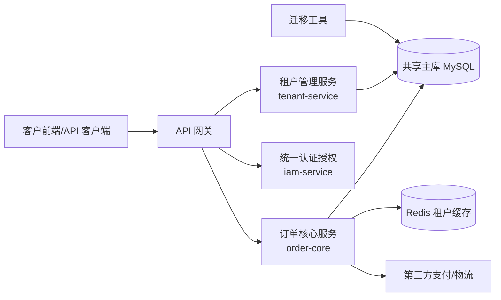
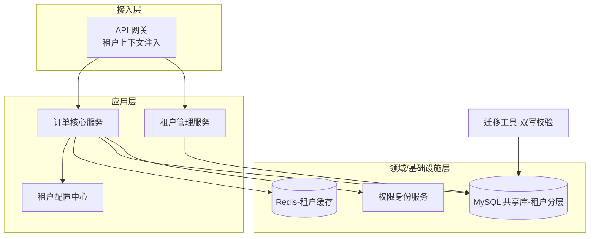
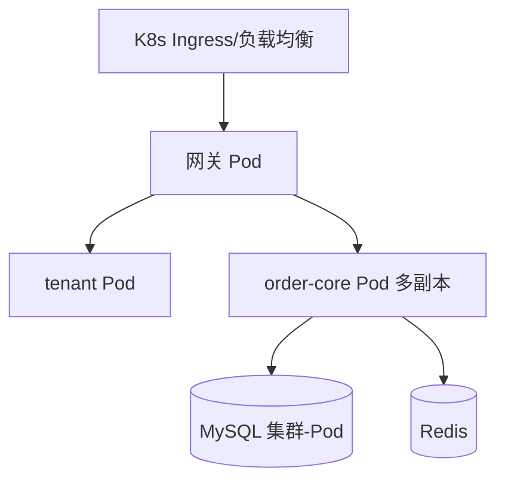

# 版本架构设计文档（Demo 示例）：订单系统 v2.0（多租户化改造）

> 本文为模板的**填充示例**，业务数据为虚构。定位：版本需求对齐（确定 v2.0 做什么，Epic 范围）完成后，确定**用什么架构怎么做**，并按架构把大功能拆解成可并行开发的需求。承接《订单系统 v2.0 需求对齐文档》。

---

## 0. 文档信息

| 项 | 值 |
|---|---|
| 版本 | v2.0（多租户化改造） |
| 文档版本 / 状态 | v1.0（已批准） |
| 架构师 | 王架构 |
| 设计与批准日期 | 2025-05-15 / 2025-05-28 |
| 关联需求对齐 | 《订单系统 v2.0 需求对齐文档》（Epic 范围 R-001~R-005 冻结） |
| 目标读者 | 前后端、测试、运维、项目负责人 |

## 1. 执行摘要（Executive Summary）

订单系统 v2.0 从"每客户一套独立部署"改造为**多租户 SaaS**：一套集群承载全部现有客户并支持新租户自助开通。核心架构决策为：

1. **数据隔离采用"共享库 + 行级隔离（tenant_id 字段）+ 租户级防护"**，在成本与隔离强度间取平衡（满足现有客户审计要求）；
2. **新增"租户上下文"贯穿层**：调用链、数据访问、缓存 key 均以租户为边界隔离；
3. **存量迁移采用"双写 + 校验 + 回切"平滑方案**，保证 3 个存量客户无感迁移。
主要组件：客户端、API 网关（注入租户上下文）、租户管理服务、核心订单服务、配置中心、迁移工具；技术栈沿用 Java/Spring 生态 + MySQL + Redis + K8s。

## 2. 版本背景与范围

### 2.1 范围

- **In scope（架构需支撑）**：多租户数据隔离（R-001）、租户生命周期管理（R-002）、权限身份改造（R-003）、租户可配置化（R-004）；存量迁移（R-005）。
- **Out of scope（不覆盖）**：国际化（R-007）、私有化/混合云部署、计费引擎（均下版/专项）。
- **关键假设 & 约束**：租户规模目标 ≤ 50 个活跃租户、单租户 ≤ 100 万订单；沿用 K8s + 现有中间件栈；迭代节奏为季度版本。

### 2.2 本次架构要解决的核心问题

- 如何在**一套代码/一套部署**下安全承载多租户数据，并满足隔离与审计要求？
- 如何把**租户身份贯穿**到调用链、数据访问、缓存，杜绝跨租户串数据（越权）？
- 如何让**3 个存量客户无感平滑迁移**到多租户，且可回滚？

## 3. 架构设计原则与决策

| 决策项 | 选择 | 备选 | 理由 | 引用 |
|---|---|---|---|---|
| 架构风格 | 模块化单体 + 独立租户管理服务 | 微服务拆分/每个租户一套 | 模块化单体利于演化、成本低；租户服务独立以满足开租协议；每租户一套与"一套代码多租户"目标冲突 | ADR-001 |
| 数据隔离策略 | 共享库 + 行级 tenant_id + 租户防护 | 库级隔离 / schema 级隔离 | 成本与隔离强度平衡，满足现有审计；库级作为高合规租户的可选增强 | ADR-002 |
| 存量迁移 | 双写 + 校验 + 回切 | 停机迁移 / 夜间只读窗口 | 支持客户业务连续；回切保证可控 | ADR-003 |
| 技术栈演进 | 另起新服务租户服务，核心服务内部改造 | 全部重写 | 控制回归风险，架构分层渐进 | ADR-004 |

## 4. 整体架构

### 4.1 系统上下文（与外部系统的边界）

### 4.2 逻辑架构（模块划分与分层）

### 4.3 部署架构

## 5. 组件与模块设计

### 模块A：租户管理服务（tenant-service，新增独立服务）

- **目的/职责**：租户开通、禁用、迁移、配额管理、自助接入协议、租户配置下发。
- **技术**：Java / Spring Boot；统一租户元数据表。
- **接口**：REST `/internal/tenant/*`；gRPC（内部）；发布租户事件。
- **依赖**：主库、IAM。
- **数据归属**：租户主档、租户状态、配额。
- **规模与扩展**：租户数 ≤50，低并发，单副本即可，预留水平扩展。

### 模块B：订单核心服务（order-core，内部改造）

- **目的/职责**：核心订单/结算业务，全部数据访问注入租户上下文。
- **技术**：Java / Spring，MyBatis 拦截器自动拼接 `tenant_id`，Redis key 带租户前缀。
- **接口**：REST（网关已注入租户头）。
- **依赖**：IAM（租户+角色鉴权）、配置中心（租户可配置规则）、支付/物流。
- **数据归属**：订单、结算明细（含 tenant_id，共享库+行级隔离）。
- **规模与扩展**：50 租户 × 100 万单 × 20% 增长，读写分离 + 缓存，水平扩容。

## 6. 需求拆解（架构驱动拆分，支撑并行开发）

> 对齐文档定了 7 个 Epic（R-001~R-007）；**按 4.2 逻辑架构的组件边界，把 P0/P1 大功能拆成 12 个架构需求单元（AUR）**，每个 AUR 归属单一组件、有独立验收要点，支撑并行开发。

### 6.1 拆解依据（为什么按架构拆）

- **以组件边界为拆分单位**：API 网关、tenant-service、order-core（数据层）、IAM、配置中心、迁移工具各自独立成拆解单元，归属无歧义；
- **接口契约先行**：网关与各服务的租户上下文协议（`X-Tenant-Id`、`/internal/tenant/*`）先冻结，组件间即可并行开发；
- **数据依赖按序**：order-core 数据层与迁移工具共享主库，排依赖序（先数据层后迁移工具）；
- **垂直切片 + 可验收**：每个 AUR 可独立集成并有验收要点（如"全 SQL 自动带 tenant 条件"）。

### 6.2 拆解结果表（架构需求单元 AUR）

| 父需求(Epic) | 拆解单元编号 | 架构需求单元（AUR） | 归属组件/模块 | 依赖（组件/接口） | 可并行 | 工作量 | 验收要点 |
|---|---|---|---|---|---|---|---|
| R-001 | AUR-001 | 租户上下文注入（网关解析 JWT → X-Tenant-Id） | API 网关 | 无（基座） | 是 | 10 | 全链路可拿到租户标识 |
| R-001 | AUR-002 | 数据访问租户拦截（MyBatis 拦截器 + mapper 门禁） | order-core 数据层 | AUR-001 | — | 12 | 全部 SQL 自动带 tenant 条件 |
| R-001 | AUR-003 | Redis 租户缓存隔离（key 前缀） | 基础设施/order-core | AUR-001 | — | 4 | 缓存读写不串租户 |
| R-001 | AUR-004 | 租户隔离验证与审计报告 | 质量/安全 | AUR-002、AUR-003 | — | 8 | 审计含租户维度、隔离验证通过 |
| R-002 | AUR-010 | 租户管理服务（tenant-service 生命周期 API） | tenant-service | AUR-001 | 是 | 13 | 开通/禁用/迁移状态正确流转 |
| R-002 | AUR-011 | 自助开通流程（前端 + 协议） | 客户端 | AUR-010 | 是 | 6 | 新租户当天自助开通可用 |
| R-003 | AUR-020 | IAM 租户化（租户角色模板/租户管理员） | IAM | AUR-001 | 是 | 10 | 租户内角色权限隔离生效 |
| R-003 | AUR-021 | 跨租户越权防护专项（安全） | 安全 | AUR-020 | — | 5 | 越权扫描与测试 0 泄漏 |
| R-004 | AUR-030 | 租户级配置中心（工作流/字段模板按租户下发） | 配置中心 | AUR-002 | — | 18 | 租户配置生效且互不干扰 |
| R-005 | AUR-040 | 存量迁移双写管道（事件驱动写目标库） | 迁移工具 | AUR-002 | — | 8 | 双写数据逐条进入目标库 |
| R-005 | AUR-041 | 对账校验与回切预案 | 迁移工具 | AUR-040 | — | 6 | 校验差异可发现、回切一键 |
| R-005 | AUR-042 | 逐客户灰度迁移执行（A→B→C） | 运维/项目 | AUR-041 | — | 4 | 3 个客户全部平滑迁移完成 |

> 工作量合计：12 个 AUR = 104 人日（对齐文档 R-001~R-005 Epic 粗估 101 人日；差异为拆解细化后新增缓存隔离/审计等单元，已在排期留缓冲）。

### 6.3 依赖与并行批次

**依赖类型**：组件接口依赖（AUR-002 依赖 AUR-001 的租户上下文协议）、数据依赖（AUR-040 依赖 AUR-002 的数据层改造）、外部依赖（AUR-042 依赖客户评审与迁移窗口）。

| 批次 | 拆解单元 | 并行说明 |
|---|---|---|
| 第 1 批（基座） | AUR-001 | 无依赖，先立基座（租户上下文贯穿层） |
| 第 2 批（并行） | AUR-002、AUR-003、AUR-010、AUR-020 | 仅依赖基座，接口契约冻结后**四线并行**（网关协议、Redis 规范、租户 API、IAM 租户模型） |
| 第 3 批 | AUR-004、AUR-011、AUR-021、AUR-030、AUR-040 | 依赖第 2 批；前端（自助开通）与后端（迁移双写）并行 |
| 第 4 批 | AUR-041 | 依赖双写管道 |
| 第 5 批 | AUR-042 | 依赖对账回切，客户灰度执行 |

**关键路径**：AUR-001 → AUR-002 → AUR-040 → AUR-041 → AUR-042（约 5 周开发 + 2 周迁移），决定 v2.0 最晚上线时间；第 2 批四条线并行、第 3 批前端/后端并行，关键路径单元优先保障资源。

**并行策略**：① 契约先行——网关 `X-Tenant-Id` 协议、tenant-service `/internal/tenant/*` API、Redis key 规范在批次 2 开工前冻结；② 按组件分团队并行（网关/租户服务/IAM 由后端小组内分工，前端小组做自助开通）；③ 集成窗口统一联调（每周一次批次集成）。

### 6.4 优先级与版本内排程

| 拆解单元 | 架构优先级 | 开发批次 | 迭代/里程碑安排 |
|---|---|---|---|
| AUR-001 | 基座（最高） | 1 | I2（批次对齐里程碑 M2 后首个迭代） |
| AUR-002、AUR-003、AUR-010、AUR-020 | 基座依赖 + 契约并行 | 2 | I3~I4 |
| AUR-040 | 关键路径 | 3 | I5 |
| AUR-041、AUR-042 | 关键路径收尾 | 4~5 | I6~I8 |
| AUR-021 | 安全必做（Must 业务优先级） | 3 | I5 |
| AUR-030 | 业务 Should（配置化，RICE: 48） | 3 | I5（容量允许则排） |
| AUR-004 | 隔离验证门禁 | 3 | I5 |

> 架构顺序优先于业务排序：虽然 AUR-030（配置化，Should）业务分高，但其依赖数据层且非关键路径，故排在批次 3 与关键路径单元并列保障，不插队批次 1–2。

## 7. 数据架构

| 数据域/存储 | 类型 | 选型理由 | 数据量/扩展 | 一致性 |
|---|---|---|---|---|
| 订单/结算主数据 | MySQL（共享库，新增 tenant_id 列） | 行级隔离成本低、满足审计 | 约 5000 万行，读写分离 + 分库分表按 tenant | 强一致（单库事务内） |
| 租户缓存 | Redis（key 前缀 tenant_id） | 缓存按租户隔离，防串 | 热点读，预留扩容 | 弱一致 |
| 租户主档 | MySQL 独立租户库 | 租户元数据高频低变 | 小数据量 | 强一致 |
| 迁移中间态 | 校验表 + 双写缓冲 | 支撑迁移对账与回切 | 按租赁峰值 | 双写强一致校验 |

**一致性策略**：迁移期间双写采用"源库写入 → 目标库写入 → 对账校验"，容忍秒级差异，校验失败自动回切源库；正式切流前全量校验一致总数。

## 8. 关键技术方案与重点实现

- **租户上下文贯穿（AUR-001/002/003 核心）**：网关解析 JWT 注入 `X-Tenant-Id` 头；服务端 ThreadLocal 保存；MyBatis 拦截器自动为查询/写入拼 `tenant_id` 条件（防漏写）；Redis key 统一前缀。**取舍**：ThreadLocal 有线程池穿透风险 → 通过拦截器清理 + 门禁测试，覆盖所有 mapper 防止遗漏。
- **越权/跨租户防护（AUR-020/021）**：IAM 上"租户 + 角色"双维度鉴权；租户之间数据访问在数据层由 tenant_id 强隔离；配套安全/合规评审。**取舍**：在网关做租户身份校验 + 数据层强隔离双保险。
- **存量迁移平滑（AUR-040~042）**：双写（事件驱动写目标库）→ 全量/增量对账校验 → 灰度切流 → 回切预案；客户 A 双写只读、客户 B 增量灰度、客户 C 全量灰度，逐级放量。
- **租户可配置化（AUR-030）**：配置中心按租户下发工作流/字段/规则模板，核心服务读取配置而非硬编码分支。**取舍**：仅收敛高频差异，低成本优先。

## 9. 非功能架构（横切设计）

| 类别 | 本版本架构要求 |
|---|---|
| 性能与扩展性 | 单租户查询 P95 < 500ms；按租户水平扩容，50 租户峰值无瓶颈 |
| 可用性与容灾 | 核心服务 99.9%、多副本；迁移期双写保证业务连续；回切换源可一键 |
| 安全 | 租户+角色双维鉴权；数据层 tenant 隔离防越权；审计日志含租户维度；数据脱敏 |
| 可观测性 | 指标/日志/链路均含 tenant_id 维度；租户级配额看板与告警 |
| 兼容性与迁移 | API 兼容旧客户端（透传 header）；迁移可回滚；灰度发布 |

## 10. 架构演进路线（本版本内）

| 阶段 | 架构工作 | 对应批次 | 产出 |
|---|---|---|---|
| 阶段1 骨架（S1） | 租户上下文贯穿层（网关+拦截器）、租户元数据表 | 第 1 批 | 多租户基座（AUR-001） |
| 阶段2 关键模块（S2） | 租户管理服务、IAM 租户化、配置中心、双写管道 | 第 2–3 批 | 可开通租户的核心系统（AUR-002/003/010/020/030/040） |
| 阶段3 迁移与非功能（S3） | 对账回切、客户灰度迁移、性能压测、安全加固 | 第 4–5 批 | 可正式上线的 v2.0（AUR-041/042 收尾） |

## 11. 风险与开放问题

| 风险/问题 | 影响 | 应对/缓解 | 负责人 |
|---|---|---|---|
| ThreadLocal 线程池穿透导致租户串数据 | 数据泄露（高） | 拦截器统一清理 + 覆盖全 mapper 的门禁测试（AUR-002 验收门禁） | 张 |
| 迁移对账差异 | 迁移失败 | 双写校验 + 回切预案 + 差异比对脚本（AUR-041） | 张 |
| 隔离策略审计未通过 | 范围/成本 | 预留库级隔离增强方案（ADR-002 备选），影响 AUR-002 工作量 | 王架构 |
| 开放问题：配额指标口径 | R-006 架构 | 数据组出口径，未决则 R-006 相关 AUR 下版 | 李 |

---

## 附：架构评审要点 Checklist（已核）

- [x] 架构决策均落到 v2.0 范围（多租户隔离/贯穿/迁移），未过度设计
- [x] 模块边界清晰：租户服务独立、核心服务内部改造，依赖方向健康
- [x] 关键技术选型有对比有取舍，ADR-001~004 可追溯
- [x] **需求拆解以架构为依据**：12 个 AUR 均归属单一组件、接口契约冻结、5 个并行批次与关键路径明确，可支撑并行开发（要点：拆解不跨组件边界，依赖按组件/接口登记）
- [x] 非功能（隔离安全、可用性、可观测性、迁移回切）均覆盖
- [x] 数据架构与一致性策略明确（双写对账、最终一致+校验）
- [x] 演进路线（S1/S2/S3）与批次、排期匹配，风险有应对