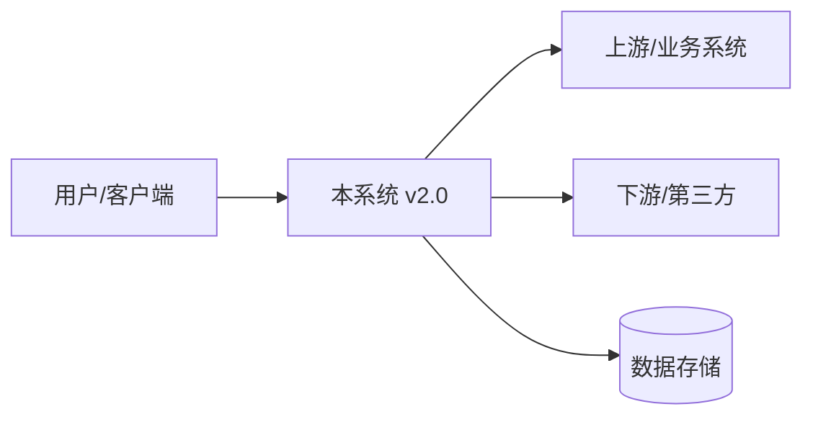
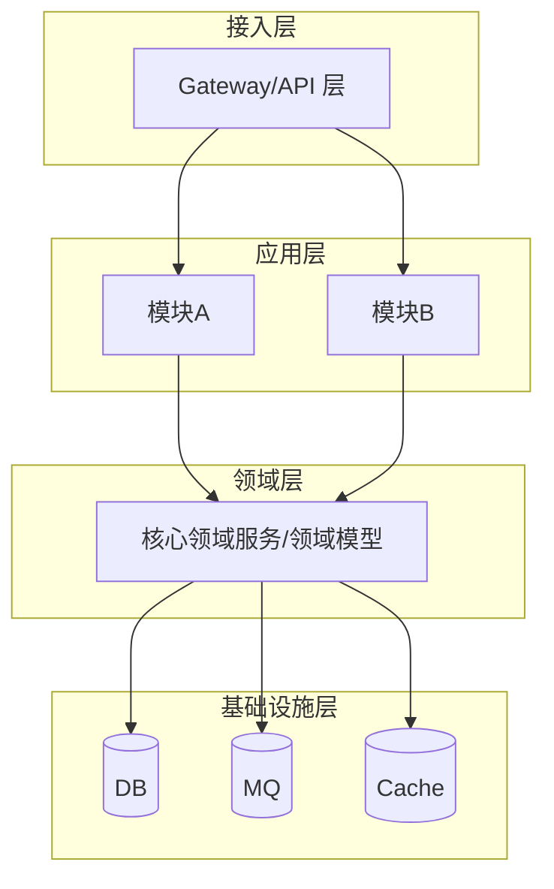
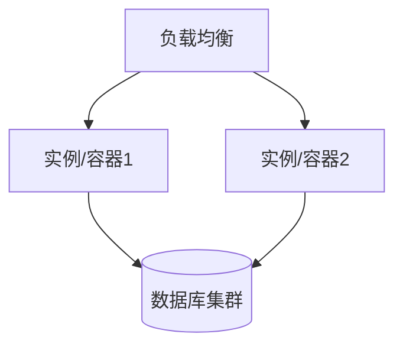

# 版本架构设计文档：v[版本号]

> 说明：本文是**大版本架构设计文档**标准模板。用途——**在版本需求对齐完成（确定"这个版本要做什么"，即 Epic 级范围）之后**，确定这个版本"用什么架构、怎么做"，并**按架构把大功能拆解成可并行开发的需求（拆依赖、排并行批次与优先级）**。斜体「说明」行为填写指引，使用时删除。
> 前置：基于《版本需求对齐文档》v[版本号]（已冻结范围）编写。架构决策可另用 ADR 记录并在此引用。

---

## 0. 文档信息

| 项 | 值 |
|---|---|
| 版本 | [v2.0] |
| 文档版本 / 状态 | [v0.1（草稿 / 评审中 / 已批准）] |
| 架构师 | [姓名] |
| 设计与批准日期 | [YYYY-MM-DD] / [YYYY-MM-DD] |
| 关联需求对齐 | 《版本需求对齐文档》v[版本号]（Epic 范围已冻结） |
| 目标读者 | [前端 / 后端 / 测试 / 运维 / 项目负责人] |

## 1. 执行摘要（Executive Summary）

> 说明：写给非技术读者 2–3 段话——系统做什么、核心架构选型、主要组件、关键技术、本版本重点。

[系统定位、本版本的架构要决策/改造什么、关键技术栈、核心取舍一句话]

## 2. 版本背景与范围

> 说明：承接《版本需求对齐文档》，简要说明本版本范围；重点写架构视角的边界。

### 2.1 范围

- In scope（架构需支撑的范围）：[对应需求对齐中的 R-xxx，从架构视角列出模块/能力]
- Out of scope（本版本架构不覆盖）：[明确排除；未来考虑]
- 关键假设 & 约束：[如性能指标、团队规模、技术栈约束、迭代节奏]

### 2.2 本次架构要解决的核心问题

> 说明：明确本版本架构要回答的问题（如：要支撑多租户？要支撑百万并发？要拆分模块化？要上云改造？）。

- [核心问题 1]
- [核心问题 2]

### 2.3 版本动机（用户故事）

> 说明：3–5 条用户故事，给阅读架构文档的人补充 context、理解"这个版本为什么存在"。固定格式：`As an <角色>, I want <功能/行为>, so that <收益>`。区别于 2.1 范围（做什么/不做什么）与 2.2（架构要回答的问题）：这里是**角色视角的动机叙述**，服务 Leader/RD/FE 快速进入版本上下文。

- [As an <角色>, I want <…>, so that <…>]

## 3. 架构设计原则与决策

> 说明：架构风格取舍 + 关键决策，引用 ADR。

| 决策项 | 选择 | 备选 | 理由 | 引用 |
|---|---|---|---|---|
| 架构风格 | [单体/微服务/事件驱动/分层/六边形/无服务] | [备选] | [为何适合本版本目标] | [ADR-001] |
| 关键决策 2 | [选择] | [备选] | [理由] | [ADR-002] |

## 4. 整体架构

> 说明：本版本要实现的系统级架构。从整体到细节，逐层给出结构图（建议 Mermaid 随库管理）。

### 4.1 系统上下文（与外部系统的边界）

### 4.2 逻辑架构（模块划分与分层）

> 说明：展示层/应用层/领域层/基础设施层；模块职责与职责边界。**本章的模块/组件边界是第 6 章需求拆解的依据。**

### 4.3 部署架构（Hardware/Container）

> 说明：本版本的部署拓扑、集群/扩缩容/环境。可选但大版本建议有。

## 5. 组件与模块设计

> 说明：逐模块描述职责、技术、接口、依赖、数据、规模。

### 模块A：[名称]

- **目的 / 职责**：[…]
- **技术**：[语言/框架]
- **接口**：[对外 REST/gRPC/事件]
- **依赖**：[DB / Cache / MQ / 外部服务]
- **数据归属**：[拥有哪些数据]
- **规模与扩展**：[预期负载、伸缩方式]

### 模块B：[名称]

[…]（同结构）

## 6. 需求拆解（架构驱动拆分，支撑并行开发）

> 说明：**本模块在整体架构、组件边界与接口依赖确定后，把《版本需求对齐文档》对齐的大功能（Epic，如 R-001）按架构拆解为多个可独立开发、可并行交付的需求（架构需求单元，AUR）**。对齐阶段只定"做什么"（大功能），**怎么拆取决于架构**：模块/组件边界、接口契约、数据依赖决定"拆成几块、能否并行"。

### 6.1 拆解依据（为什么按架构拆）

| 拆解原则 | 说明 |
|---|---|
| 以组件/模块边界为拆分单位 | 每个拆解单元归属一个组件，职责边界无歧义，避免跨组件扯皮 |
| 接口契约先行 | 跨模块接口定义冻结后即可并行开发（API-first / 契约驱动） |
| 数据/存储依赖按序 | 共享数据表/存储的单元排依赖序，或先行解耦（事件、读模型、接口隔离） |
| 依赖图 + 拓扑排序 | 得出并行批次与关键路径，决定并行调度与等待关系 |
| 粒度标准 | 每个拆解单元**可独立开发、独立集成、有验收标准**；配合垂直切片（跨层最小可体验闭环） |
| 方法论参考 | 架构驱动拆解（Architecture-driven decomposition）、DDD 限界上下文划分、康威定律下按团队/职责边界切分、接口优先 |

### 6.2 拆解结果表（架构需求单元 AUR）

> 说明：一个 Epic 拆成多个 AUR；AUR 即"需求"，供排期、分派、集成管理使用。

| 父需求(Epic) | 拆解单元编号 | 架构需求单元（AUR） | 归属组件/模块 | 依赖（组件/接口） | 可并行 | 工作量 | 验收要点 |
|---|---|---|---|---|---|---|---|
| R-001 | AUR-001 | [如：租户上下文注入（网关）] | [API 网关] | [无（基座）] | 是 | [X] | [租户头透传与校验] |
| R-001 | AUR-002 | [如：数据访问租户拦截] | [核心服务-数据层] | [AUR-001] | — | [X] | [SQL 全带租户条件] |
| R-002 | AUR-003 | […] | [模块] | [依赖项] | 是 | [X] | […] |

### 6.3 依赖与并行批次

> 说明：显式登记依赖类型（组件接口依赖 / 数据依赖 / 外部依赖），拓扑排序出**开发批次**，识别**关键路径**；批次表直接指导团队并行排程。

| 批次 | 拆解单元 | 并行说明 |
|---|---|---|
| 第 1 批（基座） | [AUR-001] | 无依赖，先立基座 |
| 第 2 批（并行） | [AUR-002、AUR-003、AUR-004] | 仅依赖基座，接口契约冻结后可三线并行 |
| 第 3 批 | […] | 依赖第 2 批 |

**并行策略**：接口契约冻结 → 按组件分团队并行 → 统一集成窗口联调；共享数据存储的单元按依赖序开发；关键路径单元优先保障资源。

### 6.4 优先级与版本内排程

> 说明：拆解后的优先级服务于**并行调度与迭代安排**：基座/公共模块优先（它们是并行的前提）、关键路径单元优先；对齐文档的业务优先级（MoSCoW/RICE）作为参考输入，但**架构顺序优先于业务排序**。

| 拆解单元 | 架构优先级（基座/关键路径/业务） | 开发批次 | 迭代/里程碑安排 |
|---|---|---|---|
| AUR-001 | 基座（最高） | 1 | [第 1 迭代] |
| AUR-002 | 基座依赖 | 2 | [第 2 迭代] |
| AUR-003 | 关键路径 | 3 | [第 3 迭代] |

## 7. 数据架构

> 说明：本版本数据模型/存储选型、跨模块数据流、一致性。

| 数据域/存储 | 类型 | 选型理由 | 数据量/扩展 | 一致性 |
|---|---|---|---|---|
| [主数据] | [MySQL] | [理由] | [容量] | [强一致/最终] |
| [缓存] | [Redis] | [理由] | [热点] | [弱一致] |

## 8. 关键技术方案与重点实现

> 说明：本版本**架构层面**要解决的关键技术点（架构视角，不含单需求实现细节）。逐项给方案与取舍。

- **关键技术点 1**（如多租户隔离策略）：[方案简述、取舍、引用 ADR]
- **关键技术点 2**（如高可用/容灾）：[…]
- **关键技术点 3**（如数据迁移/平滑升级）：[…]

## 9. 非功能架构（横切设计）

| 类别 | 本版本架构要求 |
|---|---|
| 性能与扩展性 | [指标、瓶颈、伸缩方案] |
| 可用性与容灾 | [SLA、故障转移、优雅降级] |
| 安全 | [鉴权、越权、数据隔离、合规] |
| 可观测性 | [日志、指标、告警、链路追踪] |
| 兼容性与迁移 | [切换/回滚/数据兼容] |

## 10. 架构演进路线（本版本内）

> 说明：针对大版本本身的分阶段演进（先搭骨架→填模块→性能优化），非产品 roadmap。**演进阶段可与第 6 章开发批次对应。**

| 阶段 | 架构工作 | 对应批次 | 产出 |
|---|---|---|---|
| 阶段1 骨架 | [搭建模块边界、基础设施选型落地] | [第 1 批] | [架构基座] |
| 阶段2 关键模块 | [实现核心模块] | [第 2–3 批] | [可运行子系统] |
| 阶段3 性能/非功能 | [压测、优化、安全加固] | [第 4–5 批] | [可上线版本] |

## 11. 风险与开放问题

| 风险/问题 | 影响 | 应对/缓解 | 负责人 |
|---|---|---|---|
| [风险 1：模块化拆分成本高] | [排期] | [缓解] | [姓名] |
| [开放问题：技术选型待验证] | [决策] | [原型验证，截止] | [姓名] |

---

## 附：架构评审要点 Checklist

- [ ] 架构决策是否都落到目标与范围（对本版本范围所需，不超范围、不外溢过度设计）
- [ ] 模块边界清晰、职责单一、依赖方向正确（无环依赖）
- [ ] 关键技术选型有对比、有取舍、有 ADR 可追溯
- [ ] **需求拆解是否以架构为依据**：拆解单元归属组件边界、接口契约已冻结、依赖批次与关键路径明确、可支撑并行开发
- [ ] 非功能（性能/可用性/安全/可观测性）是否达本版本指标
- [ ] 数据架构与一致性策略明确
- [ ] 演进路线与排期匹配，风险有应对

---

## 附：章节骨架标注（required / purpose）

> 设计定稿（m8 §2.11）：每个 section 标注「必填/可选」与服务对象，使用者据此判断必填项，评审者据此核对覆盖。

| section | required | purpose（服务谁、为什么需要） |
|---|---|---|
| 版本目标与范围（短板、本期解决什么） | ✅ 必填 | 服务 **User**：确认目标；服务 **Leader**：评审范围 |
| 版本动机（用户故事） | ✅ 必填 | 服务 **版本内 RD/FE/评审者**：补充 context、理解"这个版本为什么存在"——谁在什么处境下要什么、图什么 |
| 能力引入/实现规划 | ✅ 必填 | 服务 **Leader**：评审资源投入；承接 research 建议（引入/重写决策） |
| 需求拆解清单（归属版本） | ✅ 必填 | 服务 **Leader/PM**：范围与排期；服务 **创建需求·启动版本**：拆解输入 |
| 资源与依赖评估 | ✅ 必填 | 服务 **Leader**：评审资源；服务 **PM**：评审依赖 |
| 排期建议 | ✅ 必填 | 服务 **PM**：评审排期 |
| 架构约束与风险 | ✅ 必填 | 服务 **版本内 RD/FE**：rd-design/fe-design 技术路线一致性的对照上游；服务 **Leader**：风险 |

## 附：质量门禁（评审核对）

> 设计定稿（m8 §2.11）：产出者完成前按以下 gates 自检；评审者（各审各的）按 severity 分级核对。severity 定义：**blocker**（不满足则评审不得通过）/ **major**（评审必查，须在评审内闭环）/ **minor**（建议）。

| check（检查动作） | ref（依赖文档） | severity |
|---|---|---|
| 核对版本目标/能力规划与 research.md 建议一致（引入/重写决策有依据，未擅自偏离） | research.md | blocker |
| 逐条核对需求拆解覆盖版本目标与 align.md 范围，无遗漏 | align.md, roadmap.md（上版本路线） | blocker |
| 验证资源/排期评估有依据（人力/依赖/先后顺序），PM 可排期 | 需求池（wb_list_requirements） | major |
| 检查架构约束明确（技术选型/边界/共享设计），可供后续 rd-design/fe-design 遵循 | —（自含，下游消费） | major |
| 检查风险与回退路径有说明 | research.md | minor |