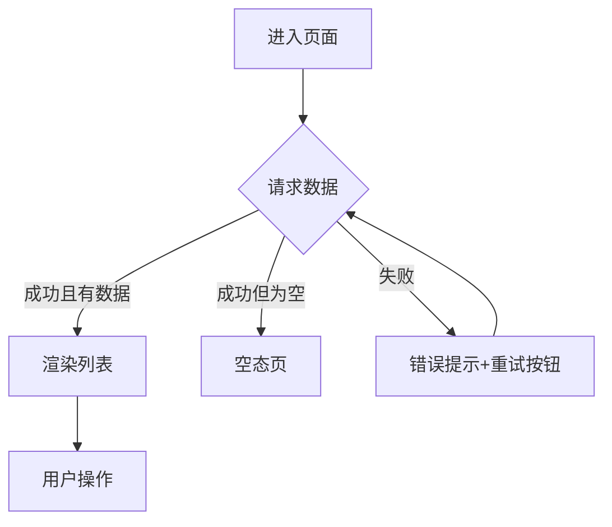
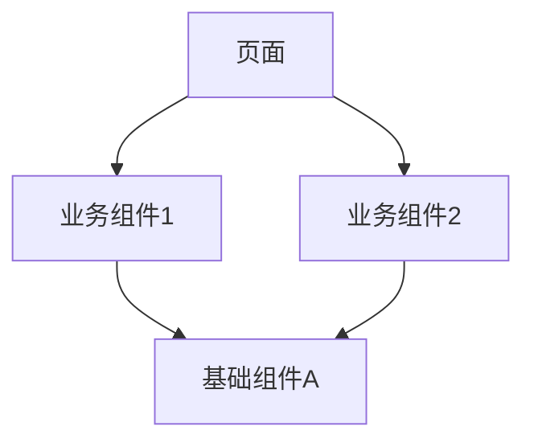

# [页面/功能名称] 前端技术设计文档

> **文档信息**

| 项 | 值 |
|---|---|
| 版本 | v0.1（草案 / 评审中 / 已定稿） |
| 作者 | [姓名] |
| 日期 | [YYYY-MM-DD] |
| 对应需求版本 | [版本号] |
| 相关文档 | [RP 链接] / [上线单] / [在线设计稿] |

---

## 1. 背景与目标

> 说明：业务背景、需求出处、交付目标与收益（产品收益要具体，开发收益要可感知）。

[业务背景与现状、需求出处、目标与收益]

### 1.1 动机场景（用户故事）

> 说明：3–5 条用户故事，给阅读设计文档的人补充 context、理解动机。固定格式：`As an <角色>, I want <功能/行为>, so that <收益>`。区别于上面背景段（业务背景叙述）：这里是**角色视角的动机叙述**，服务 FE 自身回溯动机、评审者/下游（qa/qa 验收）快速对齐"设计在解决谁的什么问题"。

- [As an FE, I want <…>, so that <…>]
- [As a User, I want <…>, so that <…>]

## 2. 页面与交互设计

### 2.1 页面清单与路由

| 页面/路由 | 说明 | 入口 | 是否新增 |
|---|---|---|---|
| [/path] | [页面用途] | [入口位置] | [新增/改造] |

### 2.2 交互流程

> 说明：前端交互流程图（区别于产品业务流程图），必须覆盖 loading / 空态 / 异常态。

### 2.3 状态梳理

> 列出页面所有状态及切换条件：加载中 / 空 / 正常 / 异常 / 无权限等。

| 状态 | 触发条件 | 展示内容 |
|---|---|---|
| [loading] | [触发条件] | [骨架屏/loading] |

## 3. 组件设计

> 说明：组件拆分与职责、组件树；标注哪些复用公共组件、哪些需新增、哪些可沉淀。

| 组件 | 类型（新增/复用/改造） | 职责 | 输入/输出 |
|---|---|---|---|
| [组件名] | [新增] | [职责] | [props/事件] |

## 4. 数据与状态管理

### 4.1 数据流

> 说明：页面 → 状态 → 接口的流转；本地状态与服务端状态边界。

### 4.2 状态管理方案

> 选型（Pinia / Redux / Zustand / 组件内 state 等）与理由；哪些状态全局、哪些局部。

| 状态 | 存放位置 | 理由 |
|---|---|---|
| [用户信息] | [全局 store] | [多处使用] |

## 5. 接口设计（前后端契约）

> 说明：接口清单与请求/响应结构，必须与后端提前对齐；写清字段与枚举。设计完成后后端可据此实现，前端可据此 mock 联调。

| 接口 | 方法 | 用途 | 请求参数 | 响应要点 |
|---|---|---|---|---|
| `/api/xxx` | GET | [用途] | [参数] | [响应字段] |

## 6. 技术选型与工程化

### 6.1 选型对比

> 说明：对新增技术（框架、状态库、UI 库、构建工具等）做对比与理由；纯业务页面无新增选型可省略。

| 技术 | 候选 | 选择 | 理由 |
|---|---|---|---|
| [状态管理] | [A / B] | [A] | [理由] |

### 6.2 目录与规范

> 目录结构约定、代码规范（lint/format）、样式方案、命名约定。

## 7. 性能与兼容性

### 7.1 性能优化

> 首屏优化、分包/懒加载、缓存策略、大列表渲染优化等。

### 7.2 兼容性

> 浏览器版本、机型、屏幕适配（响应式/REM 等）、降级方案（能力缺失时的兜底）。

## 8. 埋点与监控

> 统计埋点（曝光/点击/转化）、错误监控、日志上报。

| 埋点事件 | 触发时机 | 上报字段 |
|---|---|---|
| [event_name] | [时机] | [字段] |

## 9. 任务拆分与排期

> 说明：按页面/功能拆分任务；以页面维度估时，复杂交互额外 +20%~30%，UI 还原单独评估；大型项目加里程碑。

| 任务 | 负责人 | 估算 | 依赖 | 状态 |
|---|---|---|---|---|
| [任务 1] | [姓名] | [X人日] | [依赖项] | [未开始] |

## 10. 风险与验收

### 10.1 风险与应对

> 交互与浏览器能力偏差、接口未就绪、兼容性问题、重构的连带影响范围（需同步给测试同事）。

| 风险 | 影响 | 应对 |
|---|---|---|
| [风险 1] | [影响] | [措施] |

### 10.2 自测用例与验收标准

- [ ] Given [前置], when [操作], then [期望结果]
- [ ] [UI 还原检查项]

### 10.3 上线配置

> 页面权限配置、灰度开关、定制数据、环境相关配置。

## 11. 参考资料

- [PRD / 设计稿 / 后端接口文档链接]
- [组件库文档 / 内部规范]

---

## 附：章节骨架标注（required / purpose）

> 设计定稿（m8 §2.3）：每个 section 标注「必填/可选」与服务对象，使用者据此判断必填项，评审者据此核对覆盖。

| section | required | purpose（服务谁、为什么需要） |
|---|---|---|
| 页面/组件清单与交互方案 | ✅ 必填 | 服务 **QA**：评审交互可测性（每个页面/组件可操作）；服务 **FE 开发**：落地依据 |
| 动机场景（用户故事） | ✅ 必填 | 服务 **FE 自身/评审者/下游（qa 验收）**：补充 context、理解"设计在解决谁的什么问题" |
| 状态管理与数据流 | ✅ 必填 | 服务 **QA**：验证状态变化可观察；服务 **CR**：核对实现 |
| 接口对接（消费 rd 契约） | ✅ 必填 | 服务 **QA**：联调口径；服务 **CR**：核对接口消费与 rd/design.md 一致；上游 = **rd-design 接口/数据节** |
| 关键路径与边界处理 | ✅ 必填 | 服务 **QA**：评审关键路径可验证（登录/提交/异常）；服务 **CR**：回归风险 |
| 前端自测方案 | ✅ 必填 | 服务 **QA**：评审前端自测口径；服务 **FE 开发**：fe/dev.md 自测依据 |
| 兼容性与风险 | ⭕ 按需（涉及多端/浏览器差异时必填） | 服务 **QA**：回归影响评估 |

## 附：质量门禁（评审核对）

> 设计定稿（m8 §2.3）：产出者完成前按以下 gates 自检；评审者（各审各的）按 severity 分级核对。severity 定义：**blocker**（不满足则评审不得通过）/ **major**（评审必查，须在评审内闭环）/ **minor**（建议）。

| check（检查动作） | ref（依赖文档） | severity |
|---|---|---|
| 逐条对照 prd.md 页面/功能清单检查覆盖，无遗漏页面与关键流程 | prd.md | blocker |
| 逐条对照 rd/design.md 检查接口消费（方法/字段/错误处理）一致，无自造契约 | rd/design.md | blocker |
| 验证关键路径操作步骤可复现（点到哪、出现什么），QA 可据此设计交互用例 | prd.md（AC） | major |
| 检查加载/空/错误/超时等边界态有处理说明 | prd.md, rd/design.md | major |
| 核对前端自测用例在 qa/cases.md 中有对应口径，验收时可逐条核对 | qa/cases.md | minor |