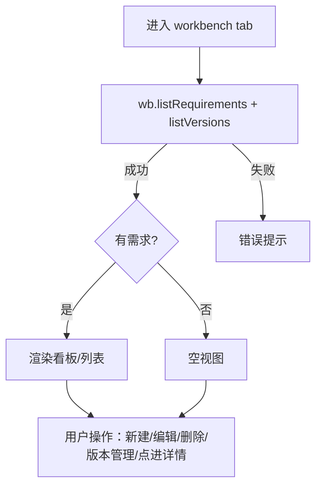
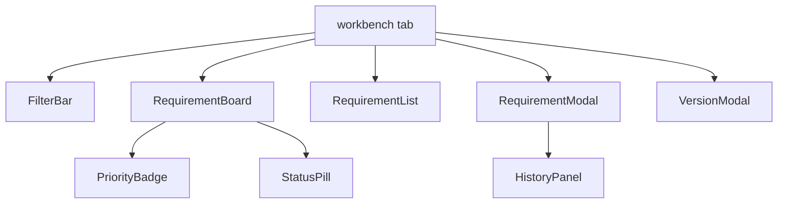
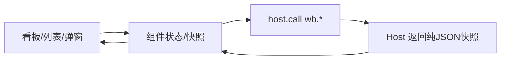

# 模块 I：版本看板 / 需求池 / 需求管理 / 版本管理 —— FE 技术设计

> **文档信息**

| 项 | 值 |
|---|---|
| 版本 | v1.0（已定稿） |
| 作者 | FE |
| 日期 | 2025-01-01 |
| 对应需求版本 | v1.0 |
| 相关文档 | 模块 I PRD（`01-module-board/prd/prd.md`）、后端接口 `01-module-board/rd/design.md` |

---

## 1. 背景与目标

模块 I 是工作台 `conversation.view` 的外层入口（tab id=`workbench`），展示需求池看板/列表、需求管理弹窗、版本管理弹窗。前端负责交互呈现，数据与规则全经 Host `wb.*` RPC（不直接碰文件）；本设计聚焦组件、状态、交互实现。

## 2. 页面与交互设计

### 2.1 页面清单与路由

| 页面/路由 | 说明 | 入口 | 是否新增 |
|---|---|---|---|
| 看板视图 | 状态四泳道 + 需求卡 | workbench tab | 新增 |
| 列表视图 | 按状态分组的列表 | workbench tab（切换） | 新增 |
| 新建/编辑需求弹窗（模态） | 需求字段表单 | 顶栏「＋新建需求」/ hover「✎」 | 新增 |
| 版本管理弹窗（模态） | 版本 CRUD + 进度汇总 | 顶栏「版本管理」 | 新增 |
| 需求详情（跳内层流程树） | 模块 II 详情 | 卡片/列表行点击 | 关联模块 II |

### 2.2 交互流程

### 2.3 状态梳理

| 状态 | 触发条件 | 展示内容 |
|---|---|---|
| loading | 首次拉取 | 加载中 |
| 空 | 无需求 | 空泳道/空组 |
| 正常 | 有需求 | 看板/列表 |
| 筛选无结果 | 组合筛选取交集为空 | 空容器 |
| 无流程数据详情 | 点进无 flow.json 需求 | 「暂无流程数据」+ 返回 |

## 3. 组件设计

| 组件 | 类型 | 职责 | 输入/输出 |
|---|---|---|---|
| RequirementBoard | 新增 | 看板视图（四泳道） | reqList/过滤 → 泳道分组 |
| RequirementList | 新增 | 列表视图（按状态分组） | reqList → 分组渲染 |
| FilterBar | 新增 | 版本×优先级筛选 | 过滤条件 → 取交集 |
| RequirementModal | 新增 | 新建/编辑需求弹窗 | 字段 → wb.create/update |
| VersionModal | 新增 | 版本管理弹窗 | verList → wb.*命令 |
| PriorityBadge | 新增 | 优先级徽标 | priority → 颜色 |
| StatusPill | 新增 | 状态徽标 | status → 色圆点+文本 |
| HistoryPanel | 新增 | 变更历史（自然语句） | history[] → 列表 |

## 4. 数据与状态管理

### 4.1 数据流

### 4.2 状态管理方案

| 状态 | 存放位置 | 理由 |
|---|---|---|
| 需求列表快照 | 组件顶层 state | 由 Host 每次写操作返回最新快照驱动重渲染，无轮询 |
| 版本列表 | 组件顶层 state | 与筛选/弹窗共用 |
| 过滤条件（版本×优先级） | workbench 顶层 state | 看板与列表共用同源过滤 |

## 5. 接口设计（前后端契约）

| 接口（host.call） | 用途 | 请求参数 | 响应要点 |
|---|---|---|---|
| `wb.listRequirements` | 需求池 | — | 全量需求数组 |
| `wb.listVersions` | 版本列表 | — | 版本数组（含 state） |
| `wb.createRequirement` | 新建需求 | `{title,...}` | `{ok, reqList}` |
| `wb.updateRequirement` | 编辑需求 | `{reqId,...}` | `{ok, reqList}` |
| `wb.deleteRequirement` | 删除需求 | `{reqId}` | `{ok, reqList}` |
| `wb.createVersion` | 新建版本 | `{name}` | `{ok, verList}` |
| `wb.updateVersion` | 改名 | `{versionId, name}` | `{ok, verList}` |
| `wb.advanceVersion` | 推进 | `{versionId}` | `{ok, verList, unfinished}` |
| `wb.deprecateVersion` | 废弃 | `{versionId}` | `{ok, verList, reqList, depCount}` |
| `wb.deleteVersion` | 删除版本 | `{versionId}` | `{ok, verList}` |

## 6. 技术选型与工程化

### 6.1 选型对比

| 技术 | 候选 | 选择 | 理由 |
|---|---|---|---|
| Markdown 渲染 | 完整库 / 轻量自研 | 轻量自研 | 只支持粗体/行内代码/标题/代码块/列表/链接，避免重依赖 |

### 6.2 目录与规范

组件按模块 I 收敛于 wbflow Client；权限/审计在 Host，前端不持有流程路由信息。轻量 Markdown 渲染器可沉淀为公共组件（模块 II 阅读器复用）。

## 7. 性能与兼容性

### 7.1 性能优化

大需求池列表按需优化（后置 E7）；每次写操作由 Host 快照驱动重渲染，无轮询。

### 7.2 兼容性

宿主环境：DSH Web；锚点/文案用宿主能力 `btoa/atob/TextEncoder`，无 crypto 依赖。

## 8. 埋点与监控

| 埋点事件 | 触发时机 | 上报字段 |
|---|---|---|
| 需求字段变更 | 编辑保存 | 7 字段 diff（由 Host history 承载） |
| 版本状态变更 | 推进/废弃 | 状态机转移 |

## 9. 任务拆分与排期

| 任务 | 负责人 | 估算 | 依赖 | 状态 |
|---|---|---|---|---|
| 看板视图 + 筛选 | FE | — | 数据层 | ✅（M3 pkg-7） |
| 列表视图 | FE | — | 数据层 | ✅（M3） |
| 需求 CRUD 弹窗 + 描述渲染 + 历史 | FE | — | 数据层 | ✅（M4） |
| 版本管理弹窗 + 进度 | FE | — | 数据层 | ✅（M5） |

## 10. 风险与验收

### 10.1 风险与应对

| 风险 | 影响 | 应对 |
|---|---|---|
| 宿主能力受限（无 crypto） | 锚点归位 | 用去空白原文指纹（模块 II 细则） |
| 真实流程生成未做 | 新需求无内层 | 显示「暂无流程数据」 |

### 10.2 自测用例与验收标准

- [ ] Given 进入 workbench tab, when 加载, then 默认看板全部需求 + 顶部切换。
- [ ] Given 新建需求标题为空, when 保存, then 禁用+红框。
- [ ] Given 编辑需求, when 保存, then 看板/列表即时刷新 + 变更历史更新。
- [ ] Given 版本管理弹窗, when 废弃, then 二次确认 + 需求联动更新。
- [ ] Given 无流程数据需求, when 进详情, then 「暂无流程数据」+返回不卡加载。

### 10.3 上线配置

随平台 MVP 随 `conversation.view` 工作台 tab 交付。

## 11. 参考资料

- `01-module-board/prd/prd.md`；`01-module-board/rd/design.md`（接口契约）
- `arch_design.md`（实体）；`arch_design.md`（平台架构）
