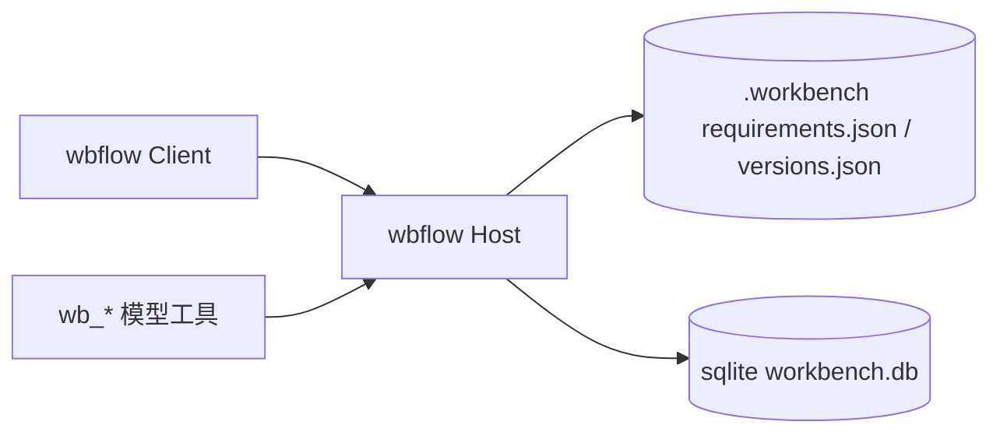
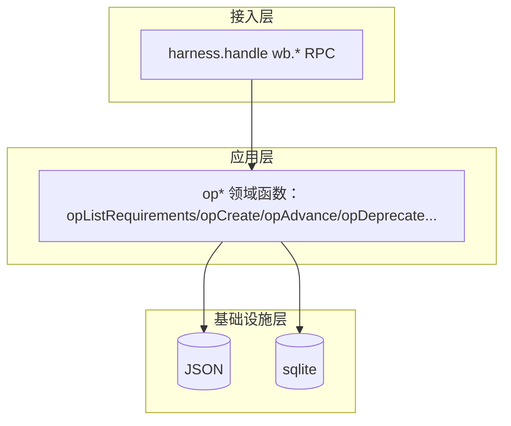
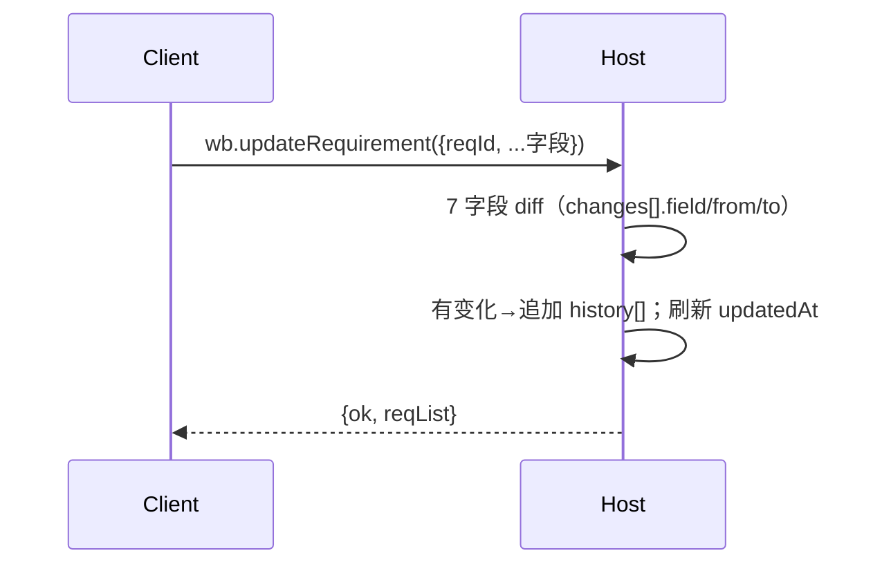

# 模块 I：版本看板 / 需求池 / 需求管理 / 版本管理 —— RD 技术设计

> **文档信息**

| 项 | 值 |
|---|---|
| 版本 | v1.0（已定稿） |
| 作者 | RD |
| 日期 | 2025-01-01 |
| 关联需求 | 模块 I PRD（`01-module-board/prd/prd.md`） |
| 关联设计 | 领域模型 `arch_design.md`、执行层工具 `arch_design.md` |

---

## 1. 背景与动机

模块 I 是工作台的「外层入口」，负责展示需求池全景、管理需求（CRUD+审计）与版本（状态机+进度汇总）。本设计聚焦**后端领域逻辑**：数据结构、编辑审计、版本状态机、Host `wb.*` RPC。前端交互见 `fe/design.md`。

## 2. 目标与非目标

### 2.1 目标

- 需求管理全链路：新建/编辑（带审计）/删除。
- 版本状态机精确转移（待启动→进行中→已发布单向；任意阶段可废弃）。
- Host 侧 `wb.*` RPC 与 UI 共用同一套 `op*` 领域函数，返回纯 JSON（lossless）。

### 2.2 非目标

- 多项目切换 UI、看板拖拽换列、真实流程生成（后置）。

## 3. 总体方案设计

### 3.1 系统上下文图



### 3.2 整体架构图



### 3.3 关键流程

**需求编辑审计流**：



**版本废弃流**：`wb.deprecateVersion` → 条件校验（其下**全部**需求未开始——任一已进入编排 → 409 blocked）→ 先写 `versions.json`（state=已废弃，终态）→ 再写 `requirements.json`（其下需求 `version_id → NULL` 解绑回待分配池，**不改 status、不写 history**，逐行审计）→ 返回 `{ok, verList, reqList, depCount}`（条件解绑口径：spec §1.2 注记-A）。

### 3.4 模块与依赖

| 模块 | 职责 | 依赖 | 解耦说明 |
|---|---|---|---|
| op* 领域函数 | 领域读写逻辑 | 实体模型（05） | 与 UI RPC 共用，单一逻辑 |
| Host RPC | 注册 `wb.*` | op* | 返回纯 JSON lossless |
| 存储 | JSON/sqlite | — | 写路径显式 `writePolicy()`（workspaceRoot=PROJECT） |

### 3.5 接口设计（Host `wb.*`）

| 接口 | 方法（RPC） | 说明 | 副作用 |
|---|---|---|---|
| `wb.listRequirements` | read | 返回 requirements.json 全量数组（非数组归一[]） | — |
| `wb.listVersions` | read | 返回 versions.json 全量（含 state） | — |
| `wb.getRequirement` | read | 聚合快照 `{requirement, flow, artifacts, comments}`；flow 缺失 null | — |
| `wb.createRequirement` | write | 建需求；title 必填；id 递增补零；`history=[]` | `{ok, reqList}` |
| `wb.updateRequirement` | write | Host 算 7 字段 diff → 追加 history | `{ok, reqList}` |
| `wb.deleteRequirement` ⚠️ | write | 移除（不删磁盘目录） | `{ok, reqList}` |
| `wb.createVersion` | write | 建版本（待启动） | `{ok, verList}` |
| `wb.updateVersion` | write | 改名（v-backlog 拒绝） | `{ok, verList}` |
| `wb.advanceVersion` | write | 按状态机单向推进；发布返回 unfinished | `{ok, verList}` |
| `wb.deprecateVersion` ⚠️ | write | 废弃 + 条件解绑（全部未开始 → 解绑回池不取消；任一已开始 → 409 blocked） | `{ok, verList, reqList, depCount}` |
| `wb.deleteVersion` | write | 有引用→blocked；无引用删除 | `{ok, verList}` |

```json
{ "ok": true, "reqList": [], "verList": [], "depCount": 0 }
```

> ⚠️ = 破坏性/强权操作，需 User 明确指令。

### 3.6 数据与存储设计

载体 `requirements.json`、`versions.json`（项目级全局）；实体字段定义以 `arch_design.md` §2.1/§2.2 为准，本文不重写。

- **优先级颜色映射**（纯展示）：P0 红 / P1 橙 / P2 蓝 / P3 灰；缺省 `—`。
- **版本名自由文本**：`id` 稳定短码（`v-<n>`、`v-backlog`），`name` 自由展示名；展示映射 `versionId → versions.json.name`，查不到回退 `versionId || '待分配'`。
- **版本删除引用检查**：`deleteVersion` 前置扫描 `requirements.json`，存在指向则拒绝（blocked + 引用数）。
- sqlite 迁移：实体入 11 表（versions/requirements），`audit_log` 留痕。

**编辑审计（history[]）**：

- **7 字段 diff**：`title / description / category / versionId / priority / status / owner`；变化判定 `args[f] !== undefined && String(args[f]) !== String(req[f] || '')`；`from`/`to` 存原始值（versionId 存短码，展示映射版本名）。
- 有变化才追加 `{at, by:'User', changes:[{field, from, to}]}`；无变化不追加；新建 `history=[]`；删除不写审计、不删目录。
- 审计计算在 **Host** 完成（防 Client 伪造）；`by` 固定 `'User'`。

**版本状态机（精确转移表）**：

状态常量 `S = ['待启动','进行中','已发布','已废弃']`；`v-backlog` state 恒为待启动且不参与转移。

| 动作 | 前置 | 下一态 | 副作用 / 拒绝 |
|---|---|---|---|
| advance | 待启动 | 进行中 | 开始迭代 |
| advance | 进行中 | 已发布 | 有未完成需求返回 `unfinished: n`，仅提示不阻止 |
| advance | 已发布/已废弃 | — | 拒绝 |
| advance | v-backlog | — | 拒绝 |
| deprecate | 任意非废弃态 | 已废弃 | 终态；条件解绑（注记-A）：全部未开始 → 解绑回池不取消；任一已开始 → 409 blocked；二次确认 |
| deprecate | 已废弃 | — | 拒绝（幂等） |

**废弃双写顺序**：条件校验（其下全部需求未开始）通过后，先写 versions.json，再写 requirements.json（解绑回池，逐行审计）；任一失败返回 error。

## 4. 备选方案与取舍

| 方案 | 描述 | 优点 | 缺点 |
|---|---|---|---|
| A | 列=版本的看板（早期方案） | 按版本聚合 | 无法直观表达状态泳道 |
| 方案 B（选） | 顶部 select 版本筛选 + 状态泳道 + 看板/列表切换 | 状态泳道清晰、筛选组合 | 需双视图同源 |

**最终选择**：方案 B。
**理由**：状态泳道比按版本分列更契合「需求推进状态」的核心视图。
**被放弃的内容**：列=版本看板（无法表达状态分布）、拖拽换列（改 status 仅经编辑弹窗）。

## 5. 非功能设计

### 5.1 性能

大需求池（>50 条）筛选优化列为后置（roadmap E7）。

### 5.2 稳定性

单写入者（Leader 主导），无并发锁；双写废弃任一失败返回 error。

### 5.3 安全

删除需求/废弃版本/强权操作标注破坏性，需 User 明确指令；审计在 Host 计算防 Client 伪造。

### 5.4 可观测性

`history[]`（需求字段变更）+ sqlite `audit_log` 全表留痕。

## 6. 风险与未决问题

| 风险/问题 | 影响 | 应对/缓解 |
|---|---|---|
| sqlite 应用层迁移未完成 | JSON 为当前载体 | 分步迁移，JSON 保留导出 |
| 真实流程生成未做 | 新建无流程树 | 详情显示「暂无流程数据」 |

## 7. 测试与验收

### 7.1 测试策略

单元测试：7 字段 diff（有/无变化、空值）；版本状态机转移表；废弃双写顺序。集成：Host RPC 持久化。

### 7.2 验收标准

- [ ] Given 编辑需求无变化, when 保存, then 不追加 history。
- [ ] Given 版本进行中, when advance, then 变已发布并返回未完成数。
- [ ] Given 删除有引用版本, when 操作, then blocked 并返回 refCount。
- [ ] Given 废弃版本且其下需求全部未开始, when 确认, then 版本已废弃且其下需求解绑回待分配池（不取消、逐行审计）；Given 任一需求已进入编排, when 废弃, then 409 blocked。

## 8. 排期与任务拆分

| 里程碑/任务 | 负责人 | 计划时间 | 状态 |
|---|---|---|---|
| 数据层实体（Version/Requirement） | RD | v1.0 | ✅（并入 M1） |
| 需求 CRUD + 审计 | RD | v1.0 | ✅（M4） |
| 版本管理状态机 | RD | v1.0 | ✅（M5） |
| sqlite 应用层迁移 | RD | v1.1 | ⏳（M8） |

## 9. 参考资料

- `arch_design.md`（领域模型/状态机）
- `arch_design.md`（wb_* 工具清单）
- `arch_design.md`（平台整体架构）
