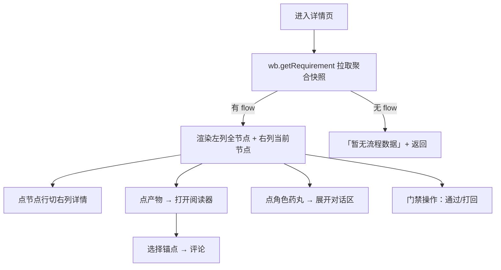
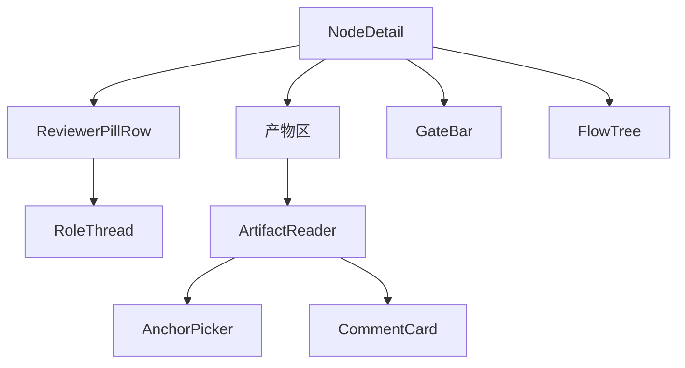

# 模块 II：需求 OA 流程树 —— FE 技术设计

> **文档信息**

| 项 | 值 |
|---|---|
| 版本 | v1.0（已定稿） |
| 作者 | FE |
| 日期 | 2025-01-01 |
| 对应需求版本 | v1.0 |
| 相关文档 | 模块 II PRD（`02-module-flow-tree/prd/prd.md`）、后端接口 `02-module-flow-tree/rd/design.md` |

---

## 1. 背景与目标

模块 II 是需求详情页 = OA 流程树视图，是平台价值核心。前端负责：流程树呈现、评审状态行与角色对话区、产物阅读器、锚点选择交互、门禁操作。数据与规则全经 Host `wb.*` RPC；本设计聚焦组件、交互、渲染。

## 2. 页面与交互设计

### 2.1 页面清单与路由

| 页面/路由 | 说明 | 入口 | 是否新增 |
|---|---|---|---|
| 流程树视图（需求详情页） | 左右双栏：流程步骤(左) + 节点详情(右) | 模块 I 卡片/行点击 | 新增 |
| 产物阅读器（弹窗） | 飞书式弹窗 ~72vw×85vh | 点产物文件行 | 新增 |

### 2.2 交互流程

### 2.3 状态梳理

| 状态 | 触发条件 | 展示内容 |
|---|---|---|
| loading | 拉取快照 | 加载中 |
| 无流程数据 | 需求无 flow.json | 「暂无流程数据」+返回（不卡 loading） |
| 正常 | 有 flow | 左列全节点 + 右列详情 |
| 无产物节点 | 节点无产物 | 「尚无产物」占位 |
| 门禁未满 | 评论未闭环 | 通过按钮置灰 | 

## 3. 组件设计

| 组件 | 类型 | 职责 | 输入/输出 |
|---|---|---|---|
| FlowTree | 新增 | 左列节点列表（状态圆点+节点名+↩N） | nodeList → 节点行 |
| NodeDetail | 新增 | 右列四区（元信息/评审状态行/产物/门禁） | currentNode → 四区 |
| ReviewerPillRow | 新增 | 评审状态行（角色药丸） | reviewers → 药丸+高亮 |
| RoleThread | 新增 | 单个角色「意见↔反馈」对话区 | comments → 对话串 |
| ArtifactReader | 新增 | 产物阅读器弹窗 | artifact content → 渲染+锚点 |
| AnchorPicker | 新增 | 行级/范围选择交互 | 选中行 → 锚点 |
| CommentCard | 新增 | 评论卡片（状态标+回复/解决） | comment → 卡片 |
| GateBar | 新增 | 门禁区（已解决/总数 + 通过/打回） | gate 状态 → 操作 |

## 4. 数据与状态管理

### 4.1 数据流

### 4.2 状态管理方案

| 状态 | 存放位置 | 理由 |
|---|---|---|
| 需求聚合快照 | 详情页顶层 state | 每次写操作 Host 返回最新快照驱动重渲染 |
| 当前选中节点 | 详情页 state | 切换右列详情 |
| 阅读器选中锚点 | 阅读器局部 state | 锚点选择四规则 |

## 5. 接口设计（前后端契约）

| 接口（host.call） | 用途 | 请求参数 | 响应要点 |
|---|---|---|---|
| `wb.getRequirement` | 拉取聚合快照 | `{reqId}` | `{requirement, flow, artifacts, comments}` |
| `wb.getArtifactContent` | 读产物正文 | `{reqId, artifactId}` | `{art, content}` |
| `wb.comment` | 发评论 | `{reqId,nodeId,text,anchor,...}` | 最新快照 |
| `wb.reply` | 回复 | `{reqId,commentId,text}` | 最新快照 |
| `wb.resolve` | 解决 | `{reqId,commentId,note}` | 最新快照 |
| `wb.override` | 强权 | `{reqId,commentId?/reviewerRole?}` | 最新快照 |
| `wb.decide` | 门禁 | `{reqId,nodeId,verdict,reason?,targetBranch?}` | 最新快照/blocked |
| `wb.review` / `wb.confirmReview` / `wb.reopen` | 评审表态/复核 | — | 最新快照 |

## 6. 技术选型与工程化

### 6.1 选型对比

| 技术 | 候选 | 选择 | 理由 |
|---|---|---|---|
| Markdown 渲染 | 完整库/轻量自研 | 轻量自研 | 只支持标题/粗体/行内代码/代码块，无重依赖 |
| Mermaid | 渲染/仅展示 | 仅按代码块展示不画图 | 避免复杂依赖，正文聚焦 |

### 6.2 目录与规范

阅读器组件可沉淀为公共组件（模块 I 描述渲染复用）；行高亮、锚点指纹定位逻辑放 Client 独立模块，遵循「程序做路由、agent 做专业」。

## 7. 性能与兼容性

### 7.1 性能优化

每次写由 Host 快照驱动重渲染，无轮询；阅读器行号渲染按需（1-based）。

### 7.2 兼容性

宿主仅 `btoa/atob/TextEncoder`（无 crypto）；锚点指纹用去空白原文字符串相等。

## 8. 埋点与监控

| 埋点事件 | 触发时机 | 上报字段 |
|---|---|---|
| 评审表态/门禁操作 | 通过/打回/override | nodeId/verdict |
| 锚点失效 | lineText 未命中 | 产物流/行号 |

## 9. 任务拆分与排期

| 任务 | 负责人 | 估算 | 依赖 | 状态 |
|---|---|---|---|---|
| 流程树 + 节点详情四区 | FE | — | 快照 | ✅（M2） |
| 评审状态行 + 角色对话区 | FE | — | 快照 | ✅（M2） |
| 产物阅读器 + 锚点选择 + 评论卡片 | FE | — | getArtifactContent | ✅（M2） |
| 门禁操作 | FE | — | decide | ✅（M2） |
| 行级锚点防漂移前端 | FE | — | 渲染 | ✅（M2） |

## 10. 风险与验收

### 10.1 风险与应对

| 风险 | 影响 | 应对 |
|---|---|---|
| 宿主无 crypto | 锚点指纹 | 用去空白原文字符串相等 |
| 锚点随版本失效 | 定位不准 | 四步定位 + ⚠ 标，用户重确认更新 |

### 10.2 自测用例与验收标准

- [ ] Given 有 flow, when 进详情, then 左列全节点 + 右列当前节点四区。
- [ ] Given 点产物文件行, when 打开, then 阅读器渲染正文 + 行号 + 底部输入框（约 72vw×85vh）。
- [ ] Given 单击一行, when 发表, then 生成 line 锚点评论（该行下方内嵌）。
- [ ] Given 框选范围, when 发表, then range 评论只在末行显示一次 + `↔A~B`。
- [ ] Given 门禁未满, when 点通过, then 置灰拦截。
- [ ] Given 角色轮次≥10 未解决, when 渲染, then 药丸黄色高亮「疑似卡死」。
- [ ] Given 已解决评论, when 渲染, then 默认折叠为一行摘要。

### 10.3 上线配置

随平台 MVP 随需求详情页交付。

## 11. 参考资料

- `02-module-flow-tree/prd/prd.md`；`02-module-flow-tree/rd/design.md`（接口契约）
- `arch_design.md`（Issue/FlowNode 实体）；`arch_design.md`（平台架构）
