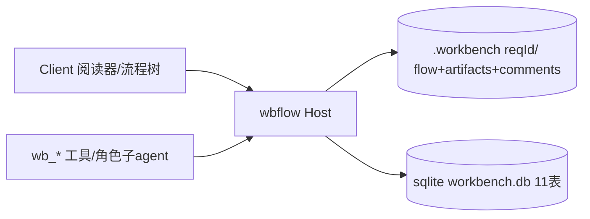
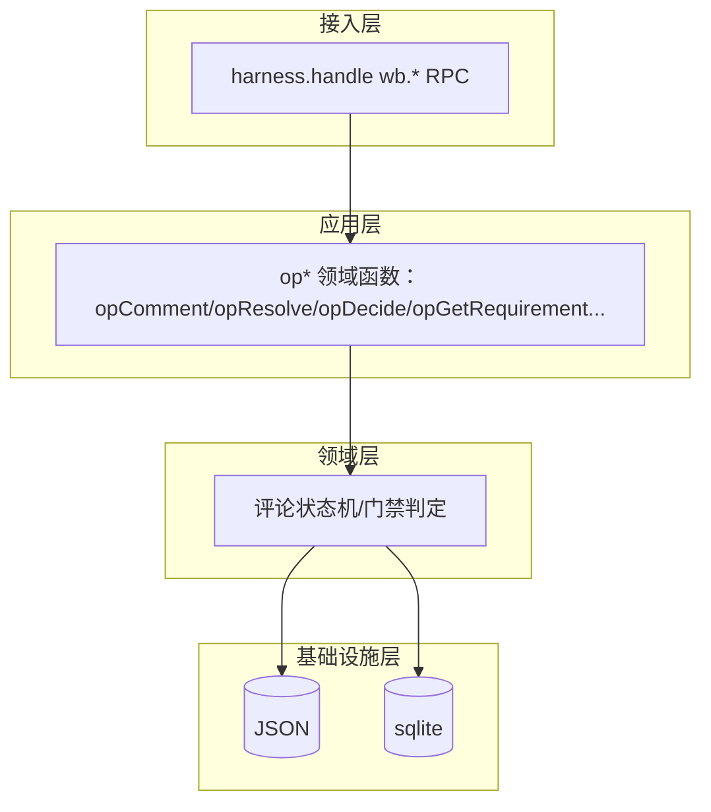

# 模块 II：需求 OA 流程树 —— RD 技术设计

> **文档信息**

| 项 | 值 |
|---|---|
| 版本 | v1.0（已定稿） |
| 作者 | RD |
| 日期 | 2025-01-01 |
| 关联需求 | 模块 II PRD（`02-module-flow-tree/prd/prd.md`） |
| 关联设计 | 领域模型 `arch_design.md`、制度层 `arch_design.md`、执行层 `07` |

---

## 1. 背景与动机

模块 II 是工作台的价值核心——需求详情页的 OA 流程树。本设计聚焦**后端领域逻辑**：文件结构与实体、节点门禁判定、评审两阶段闭环、行级锚点防漂移、远端 CR 简化、Host `wb.*` RPC。前端交互见 `fe/design.md`。

## 2. 目标与非目标

### 2.1 目标

- 流程树节点独立前进/回退（含并行组部分回滚）。
- 门禁判定精确：无 open + 无 pending-confirm + 全 resolved（复核确认）或 overridden 才可 pass。
- 评论 = 问题统一模型，四级锚点。
- Host RPC 返回最新聚合快照（纯 JSON、lossless）。

### 2.2 非目标

- diff 级锚点、代码 git-review 行内评论、多项目切换 UI（后置）。

## 3. 总体方案设计

### 3.1 系统上下文图



### 3.2 整体架构图



### 3.3 关键流程

**节点门禁通过流**：

```mermaid
sequenceDiagram
    participant U as User
    participant H as Host
    U->>H: wb.decide({reqId,nodeId,verdict:pass})
    H->>H: 校验门禁：无open+无pending-confirm+全resolved/overridden
    alt 未闭环
        H-->>U: {ok:false, blocked:true}
    else 已闭环
        H->>H: node→已通过; current_node_id 前移
        H-->>U: {ok, snapshot}
    end
```

**行级锚点防漂移（渲染时）**：读产物正文 → 按 `lineText` 反查内容相同行 → 命中锚定新行号 / 未命中按 `line` 就近展示并标「⚠」→ 用户重新确认时更新 line/lineText。

### 3.4 模块与依赖

| 模块 | 职责 | 依赖 | 解耦说明 |
|---|---|---|---|
| op* 领域函数 | 评论/门禁/快照 | 实体模型（05） | 与 UI RPC 共用 |
| 评论状态机 | resolve/confirm/reopen 精确转移 | — | 05 §3.2 唯一真相源 |
| 存储 | JSON/sqlite | — | 写路径 `writePolicy()` |

### 3.5 接口设计（Host `wb.*`）

| 方法 | 一句话语义 |
|---|---|
| `wb.getRequirement` | 读需求聚合快照：requirement+flow+artifacts+comments |
| `wb.getArtifactContent` | 读产物正文（供阅读器渲染与锚点定位） |
| `wb.comment` | 追加 open 评论（可带任一级锚点、归属角色） |
| `wb.reply` | 评论下追加对话（roundCount++） |
| `wb.resolve` | 关闭评论：A→pending-confirm，B→resolved（须带 note/path） |
| `wb.override` | 评论/整角色 → overridden（User 强权） |
| `wb.decide` | 门禁终审：pass（前置校验）→前进；reject（reason 必填）→回退+可选 pendingScope |
| `wb.forceRevise` | 记强制修改令（产出者不可异议） |
| `wb.defineScope` | 关闭 pendingScope，写入新范围边界 |
| `wb.review` | 角色评审表态 pass（pre 校验门禁） |
| `wb.confirmReview` | 提评者复核：pending-confirm→resolved（校验调用者=提评者） |
| `wb.reopen` | 提评者复核不通过：pending-confirm→open（roundCount++） |

- 同一套 `op*` 领域函数被 UI RPC 与模型工具共用；未满足门禁时返回 `blocked` 而非静默通过。

### 3.6 数据与存储设计

```
<workspace>/.workbench/
  requirements.json        # 项目级：需求列表
  <reqId>/
    flow.json              # 流程实例 + 节点（FlowNode，含 reviewers[]）
    artifacts.json         # 产物（文件行）
    comments.json          # 统一评论模型（四级锚点）
```

实体字段以 `arch_design.md` §7.2 为唯一真相源（Version/Requirement/Flow+FlowNode/Issue/Artifact/Task）。关键对齐点：

- `reviewers[]` 仅静态声明 `[{role, capability_id, scope?}]`，动态「谁过了没」由评审表态 + 评论闭环派生。
- 评论 = 问题统一模型（不区分评审 Issue 与普通评论）。

**节点通过门禁判定**（精确）：

- 门禁 = 该节点名下全部评论闭环：无 `open`、无 `pending-confirm`，且全部 `resolved`（`reviewer_confirmed=true`）或 `overridden` 才可「通过」。
- UI 常驻展示 `已解决/总数`（如 2/6）；未满时「通过」置灰/拦截。
- 有 `reviewers` 时额外派生：每个 reviewer 状态 = 其名下评论全部闭环才「已通过」——角色粒度是评论归属的统计维，与节点门禁是两回事。

**评论状态机**（复用 05 §3.2，不重写）：

```
open ──讨论──▶ open（roundCount++）
  ├─ A assignee resolve(note) ──▶ pending-confirm → 提评者 confirm ──▶ resolved
  │                                   └─ reopen ──▶ open（roundCount++）
  ├─ B 提评者 resolve(note, agree) ──▶ resolved
  ├─ roundCount>5 ──▶ 通知 Leader/User 介入
  └─ override（User 指令）──▶ overridden
```

**行级锚点防漂移**：

- 记录 `line`（绝对行号，1 起）+ `lineText`（去首尾空白后的原文，作定位指纹）。
- 指纹不用密码学哈希（宿主仅 `btoa/atob/TextEncoder`）；直接用去空白原文，字符串相等即命中。
- 定位四步：①按 lineText 反查内容相同行 ②命中→锚定新行号 ③未命中→按 line 就近展示+「⚠ 锚点可能失效」④用户重新确认时更新。

**远端 GitHub CR 简化**：远端评审结论本地化——无远端评论、无双向同步；CR 结论落工作台本地评论（author=Code Reviewer，nodeId=开发节点，anchor=MR link，text=评审结论）；评论 `source` 恒为 `workbench`，GitHub 行级上下文在 text 中体现（path:line）。

**超时与拉锯**：拉锯 `roundCount > 5` → 自动通知 Leader/User；待复核超时提醒（轮询每 5 分钟）—提评者=User 阈值 1h、=agent 阈值 5min。

## 4. 备选方案与取舍

| 方案 | 描述 | 优点 | 缺点 |
|---|---|---|---|
| A | 区分「评审 Issue / 普通评论」 | 语义清晰 | 模型分裂、状态机不统一 |
| 方案 B（选） | 统一「评论=问题」模型 | 单一来源、状态机统一 | 需区分标 issue_type |
| C | 章节级 heading 锚点 | 定位粗粒度 | 精确性不足，已废弃 |

**最终选择**：方案 B（统一评论模型 + 四级锚点）。
**理由**：一条状态机覆盖全部评论场景（评审、讨论、缺陷）；四级锚点平衡精确性与实现成本。
**被放弃的内容**：章节级 heading 锚点（已废弃）；diff 级锚点（后置，需 revision 存储）。

## 5. 非功能设计

### 5.1 性能

M2 单用户读改写无锁；每次写返回最新聚合快照（纯 JSON、lossless），Client 直接重渲染，无轮询。

### 5.2 稳定性

`wb_my_task` 以 `sessionsByNode` 供给全会话；断点续接靠 `dispatch_at/last_ack/last_progress/resume_hint`。

### 5.3 安全

override/forceRevise 需 User 明确指令；评论不可编辑/删除（误发 reply 标注作废）；confirm/reopen 仅限提评者。

### 5.4 可观测性

`audit_log` 全表留痕；拉锯升级与复核超时提醒为运维信号。

## 6. 风险与未决问题

| 风险/问题 | 影响 | 应对/缓解 |
|---|---|---|
| 锚点随产物版本变化失效 | 评论定位不准 | lineText 指纹四步定位 + ⚠ 标 |
| 评论无限拉锯 | 评审卡死 | roundCount>5 通知 Leader/User |
| sqlite 迁移未完成 | JSON 载体 | 分步迁移 |

## 7. 测试与验收

### 7.1 测试策略

单元：门禁判定（open/pending-confirm/resolved/overridden 组合）；评论状态机精确转移；锚点防漂移四步。集成：Host RPC 评审闭环。

### 7.2 验收标准

- [ ] Given 节点有 open 评论, when decide pass, then blocked（不前进）。
- [ ] Given 全评论 resolved（复核确认）, when decide pass, then 前进+current_node_id 前移。
- [ ] Given 行号漂移但 lineText 相同, when 渲染阅读器, then 锚定到新行号。
- [ ] Given lineText 未命中, when 渲染, then 就近展示 + 标「⚠」。
- [ ] Given 提评者 confirm, when 复核, then pending-confirm→resolved。
- [ ] Given 并行组 QA 打回 targetBranch=fe, when decide reject, then 仅 FE 回滚、RD 保持通过。

## 8. 排期与任务拆分

| 里程碑/任务 | 负责人 | 计划时间 | 状态 |
|---|---|---|---|
| 流程树 + 评审闭环 + 门禁 | RD | v1.0 | ✅（M2） |
| 产物阅读器 + 锚点评论 | RD | v1.0 | ✅（M2） |
| 行级锚点防漂移 | RD | v1.0 | ✅（M2） |
| sqlite 应用层迁移 | RD | v1.1 | ⏳（M8） |
| diff 级锚点 | RD | v1.1 | ⏳（E1） |

## 9. 参考资料

- `arch_design.md`（Issue/Flow 状态机）
- `arch_design.md`（流程模板/评审分工）
- `arch_design.md`（wb_* 工具/协议）
- `02-module-flow-tree/prd/prd.md`（PRD）
