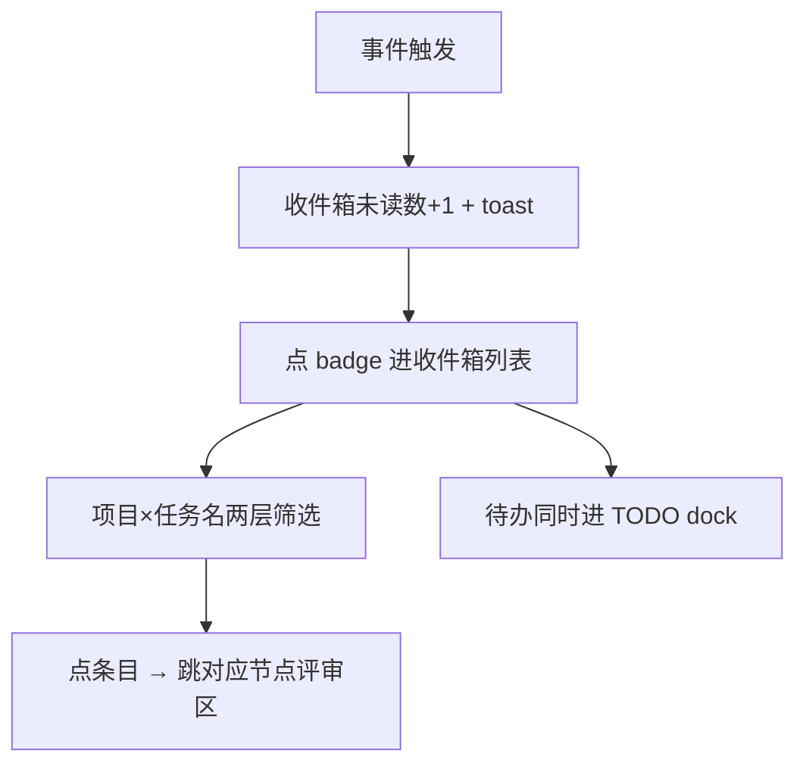
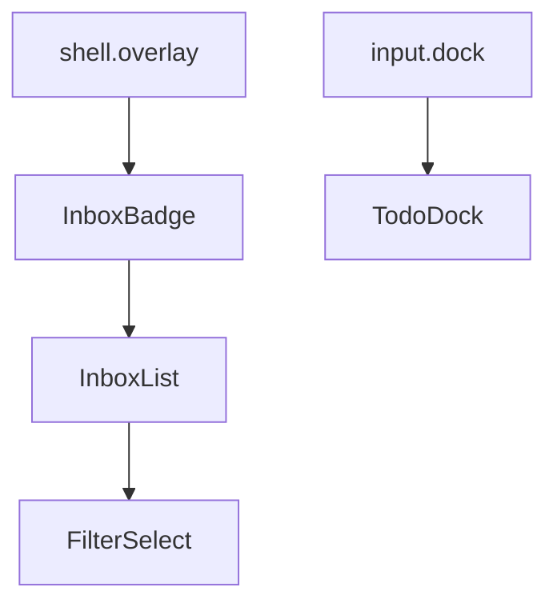
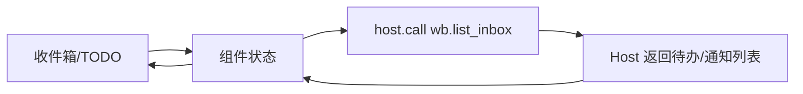

# 模块 III/IV：门禁通知收件箱 + TODO 列表 —— FE 技术设计

> **文档信息**

| 项 | 值 |
|---|---|
| 版本 | v1.0（已定稿） |
| 作者 | FE |
| 日期 | 2025-01-01 |
| 对应需求版本 | v1.0 |
| 相关文档 | 模块 III/IV PRD（`03-module-inbox-todo/prd/prd.md`）、后端接口 `03-module-inbox-todo/rd/design.md` |

---

## 1. 背景与目标

模块 III（收件箱）与模块 IV（TODO）是 User 处理待办的界面。收件箱 UI 挂 `shell.overlay`（badge/toast + 未读数 + 列表）；TODO 挂 `conversation.input.dock`。数据为查询投影（tasks/issues 实时推导），前端聚焦呈现、筛选、点击跳转。

## 2. 页面与交互设计

### 2.1 页面清单与路由

| 页面/路由 | 说明 | 入口 | 是否新增 |
|---|---|---|---|
| 收件箱 badge/toast | 未读数提示，不弹窗抢占 | shell.overlay | 新增 |
| 收件箱列表 | 六类条目 + 两层筛选 | 点 badge | 新增 |
| TODO 列表 | 未完成数 + 分类聚合 | conversation.input.dock | 新增 |

### 2.2 交互流程

### 2.3 状态梳理

| 状态 | 触发条件 | 展示内容 |
|---|---|---|
| 未读 | 有待办 | badge 未读数 + toast（不弹窗） |
| 空 | 无待办 | 空列表 |
| 已处理 | 条目处理 | 从列表移除 |

## 3. 组件设计

| 组件 | 类型 | 职责 | 输入/输出 |
|---|---|---|---|
| InboxBadge | 新增 | badge/toast + 未读数 | 未读数 → 提示 |
| InboxList | 新增 | 六类条目 + 两层筛选 | 条目 → 列表 |
| TodoDock | 新增 | TODO 聚合（未完成数+分类） | 待办 → 聚合 |
| FilterSelect | 新增（复用） | 项目 × 任务名筛选 | 条件 → 过滤 |

## 4. 数据与状态管理

### 4.1 数据流

### 4.2 状态管理方案

| 状态 | 存放位置 | 理由 |
|---|---|---|
| 未读数 | overlay 顶层 | 全局提示 |
| 收件箱条目 | 列表局部 state | 由查询投影返回 |
| 筛选条件 | 列表局部 state | 两层可叠加 |

## 5. 接口设计（前后端契约）

| 接口（host.call） | 用途 | 请求参数 | 响应要点 |
|---|---|---|---|
| `wb.list_inbox` | 收件箱/待办列表 | — | 待办/通知条目列表（tasks/issues 推导） |

条目行字段：`taskId/issueId`、`projectId`、`requirementId`、`requirementTitle`、`nodeId`、类型、`summary`、状态。

## 6. 技术选型与工程化

### 6.1 选型对比

无新增技术选型；复用现有 `approval/request`、`session/event`、`goal/changed`、`domain/changed` 事件形态（业务收件箱走领域数据状态变更 + 客户端订阅，不污染系统 approval 语义）。

### 6.2 目录与规范

收件箱走 `shell.overlay`；TODO 走 `conversation.input.dock`（todo/goal/queue 先例）。不直接碰文件，全经 host.call。

## 7. 性能与兼容性

### 7.1 性能优化

未读数/列表实时推导，无轮询；两层筛选本地过滤 + service 搜索。

### 7.2 兼容性

DSH shell.overlay / input.dock；项目筛选（workspace）× 任务名筛选（关键词）。

## 8. 埋点与监控

| 埋点事件 | 触发时机 | 上报字段 |
|---|---|---|
| 收件箱点击跳转 | 条目点击 | 条目类型/nodeId |

## 9. 任务拆分与排期

| 任务 | 负责人 | 估算 | 依赖 | 状态 |
|---|---|---|---|---|
| badge/toast + 未读数 | FE | — | 事件 | ✅（并入 M6） |
| 收件箱列表 + 两层筛选 | FE | — | wb.list_inbox | ✅ |
| TODO dock 聚合 | FE | — | 待办投影 | ✅（并入 M6） |
| 多项目聚合 UI | FE | v1.1 | E3 | ⏳ |

## 10. 风险与验收

### 10.1 风险与应对

| 风险 | 影响 | 应对 |
|---|---|---|
| 消息多淹没 | 待办遗漏 | 两层筛选聚合 |
| toast 抢占 | 干扰 | 不弹窗抢占，badge 提示 |

### 10.2 自测用例与验收标准

- [ ] Given 有待办, when 渲染, then 收件箱 badge/toast 显示未读数 + 列表。
- [ ] Given 项目×任务名筛选, when 叠加, then 展示交集条目。
- [ ] Given 点条目, when 操作, then 跳对应节点评审区。
- [ ] Given 有待办, when 渲染, then TODO dock 显示「未完成数 + 分类」聚合。

### 10.3 上线配置

随平台 MVP 交付；TodoDock 可复用 todo/goal/queue 先例。

## 11. 参考资料

- `03-module-inbox-todo/prd/prd.md`；`03-module-inbox-todo/rd/design.md`（查询投影）
- `arch_design.md`（Task/Issue 实体）
