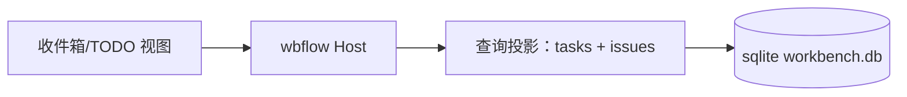
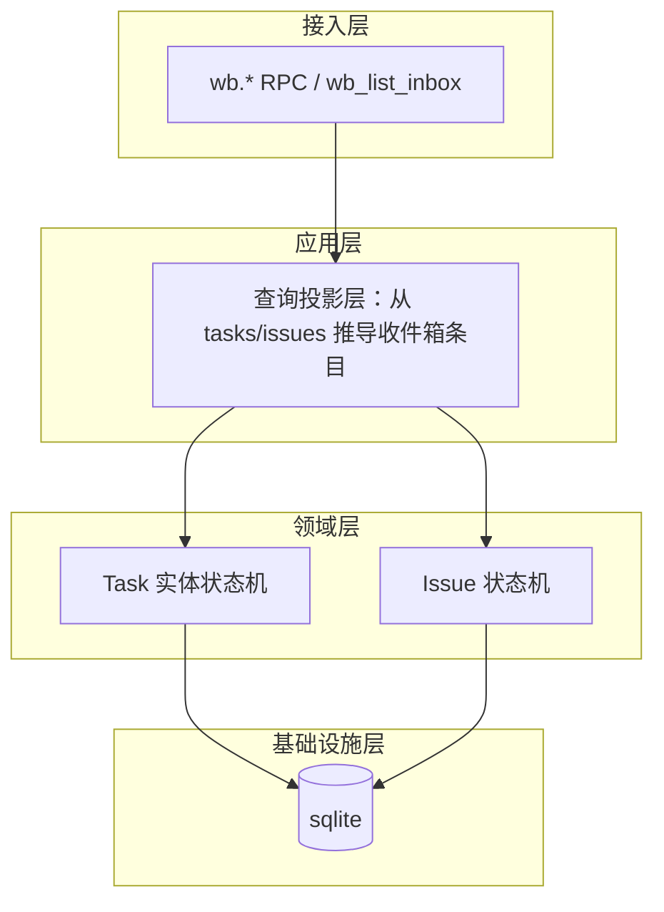
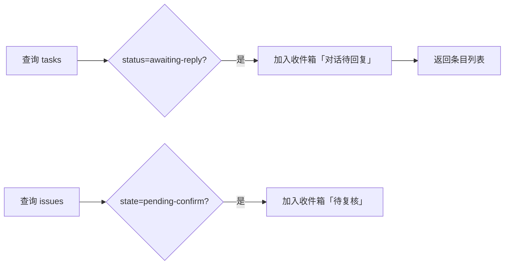

# 模块 III/IV：门禁通知收件箱 + TODO 列表 —— RD 技术设计

> **文档信息**

| 项 | 值 |
|---|---|
| 版本 | v1.0（已定稿） |
| 作者 | RD |
| 日期 | 2025-01-01 |
| 关联需求 | 模块 III/IV PRD（`03-module-inbox-todo/prd/prd.md`） |
| 关联设计 | 领域模型 `arch_design.md`、模块 II `02-module-flow-tree/rd/design.md` |

---

## 1. 背景与动机

模块 III（收件箱）与模块 IV（TODO）是 User 与执行侧的沟通自然面。收件箱不是一次性门禁提醒，而是「必须处理的 IM 收件箱」。本设计聚焦**后端数据与规则**：条目类型判定、查询投影、断点续接、待回复推导。前端交互见 `fe/design.md`。

## 2. 目标与非目标

### 2.1 目标

- 收件箱条目 = `tasks`/`issues` 的**查询投影**，不建独立通知表（决策 3）。
- 两层筛选：项目筛选 × 任务名筛选（免跨文件 join）。
- 断点续接：派发/断点字段支撑重启恢复。

### 2.2 非目标

- 独立通知表、多项目聚合 UI（E3 后置）。

## 3. 总体方案设计

### 3.1 系统上下文图

### 3.2 整体架构图

### 3.3 关键流程（待回复推导）

### 3.4 模块与依赖

| 模块 | 职责 | 依赖 | 解耦说明 |
|---|---|---|---|
| 查询投影层 | 从 tasks/issues 推导条目 | Task/Issue 实体 | 不建通知表 |
| 断点续接 | dispatch/ack/progress/hint | Task 实体 | 重启恢复 |

### 3.5 接口设计

`wb.list_inbox` — 返回待办/通知列表；收件箱条目 = `tasks`/`issues` 实时推导。

### 3.6 数据与存储设计

**条目类型判定（六类）**：

| 触发 | 产生条目 |
|---|---|
| `decide` 推进 / 节点进入待评审 | 待评审门禁；打回带新范围→待界定新范围 |
| 评论（wb_comment 提及/归属） | 产出者反驳 / 要求补充答复 / 对话待回复 |
| 评审待表态 | 待评审门禁 |
| 缺陷指派（QA 传 domain=rd\|fe） | 返工修订→产出修订完成待复验 |

**投影行字段**：`taskId/issueId`、`projectId`、`requirementId`、`requirementTitle`（冗余，供两层筛选）、`nodeId`、类型（六类/四类投影规则）、`summary`、状态（未处理/已处理）。视图快照如需落盘：JSON 载体 `inbox.json` 与 sqlite 对应表同 schema（不另建通知表）。

**断点续接与待回复推导**：

- `dispatch_at`（证明已派出）/ `last_ack`（心跳，NULL=未送达需重发）/ `last_progress`（执行到哪一步）/ `resume_hint`（从哪续做）——定义见 `05` §2.6，不重写。
- 重启续接：扫描「已派未确认」（dispatch_at 有值且 last_ack NULL→重新通知）与「进度陈旧」（in-progress 但 last_progress 久未更新→从 last_progress/resume_hint 续做，不重来）。
- 待回复视图：`tasks WHERE status='awaiting-reply'` + `issues WHERE state='pending-confirm'` —— 实时查询推导。

**对话本体唯一载体 = issues**：对话本体唯一载体是 `issues`（根评论 + `replies` JSON 内嵌）；收件箱只是带跳转的提示。执行侧 `wb_my_task`（`sessionsByNode`）供给同一真相源。

## 4. 备选方案与取舍

| 方案 | 描述 | 优点 | 缺点 |
|---|---|---|---|
| A | 独立通知表 | 查询简单 | 与状态脱节、冗余维护 |
| 方案 B（选） | TASK 唯一待办总线，通知是查询投影 | 单一真相源、实时推导 | 每次查询需推导 |

**最终选择**：方案 B。
**理由**：通知本质是视图不是数据，查询推导避免状态与通知表脱节。
**被放弃的内容**：独立通知表（维护成本与一致性风险）。

## 5. 非功能设计

### 5.1 性能

查询投影实时推导；`requirementTitle` 冗余避免跨文件 join。

### 5.2 稳定性

断点续接字段保障重启恢复；刷新待复核超时提醒（User 1h / agent 5min，轮询每 5 分钟）。

### 5.3 可观测性

`audit_log` 全表留痕；拉锯升级（roundCount>5）与待复核超时提醒为运维信号。

## 6. 风险与未决问题

| 风险/问题 | 影响 | 应对/缓解 |
|---|---|---|
| 多项目聚合未做 | 收件箱仅单项目视图 | 数据已按 projectId 分桶，E3 补 UI |

## 7. 测试与验收

### 7.1 测试策略

单元：六类/四类条目投影规则；断点续接判定（last_ack NULL/进度陈旧）。集成：`wb_list_inbox` 查询推导。

### 7.2 验收标准

- [ ] Given 有 awaiting-reply 任务, when 查询收件箱, then 出现「对话待回复」条目。
- [ ] Given 任务已派未确认（last_ack NULL）, when 重启扫描, then 重新通知。
- [ ] Given 任务进度陈旧, when 重启扫描, then 从 last_progress/resume_hint 续做。

## 8. 排期与任务拆分

| 里程碑/任务 | 负责人 | 计划时间 | 状态 |
|---|---|---|---|
| 收件箱查询投影 + wb_list_inbox | RD | v1.0 | ✅（并入 M6 工具层） |
| 断点续接 | RD | v1.0 | ✅ |
| 多项目聚合 | RD | v1.1 | ⏳（E3） |

## 9. 参考资料

- `arch_design.md`（Task 实体/状态机）
- `02-module-flow-tree/rd/design.md`（事件来源）
- `arch_design.md`（wb_my_task/sessionsByNode）
