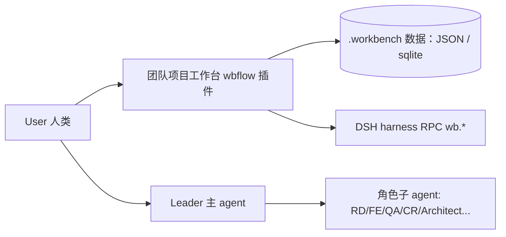
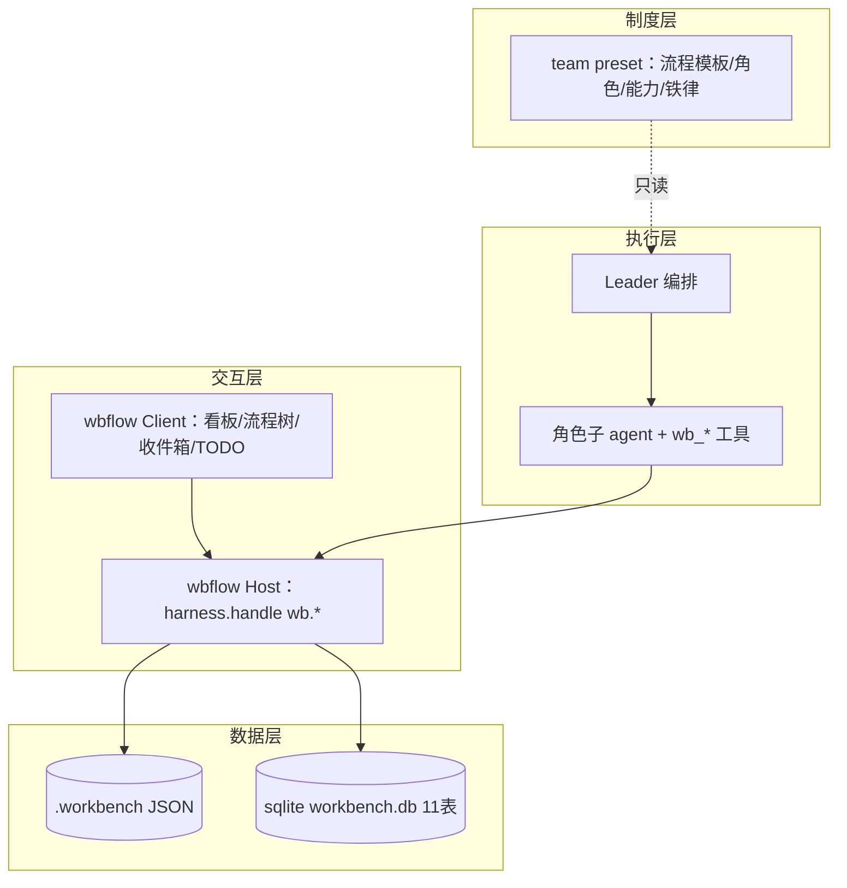
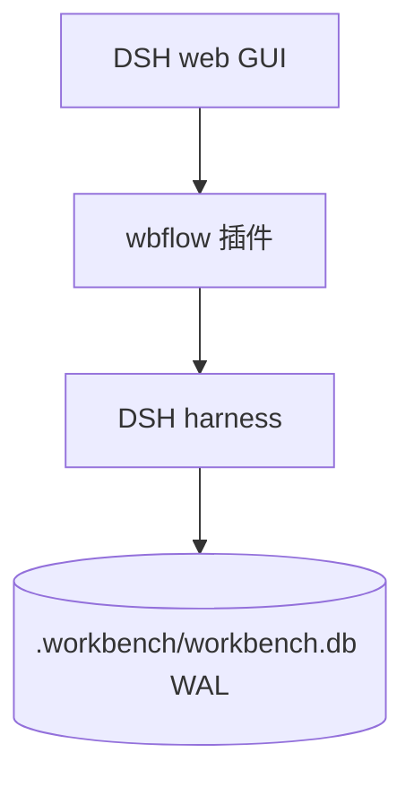
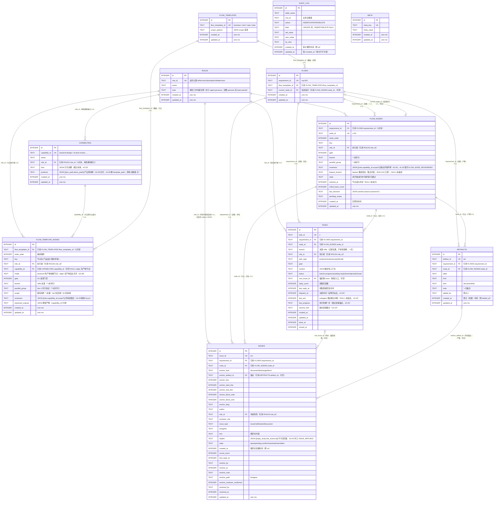
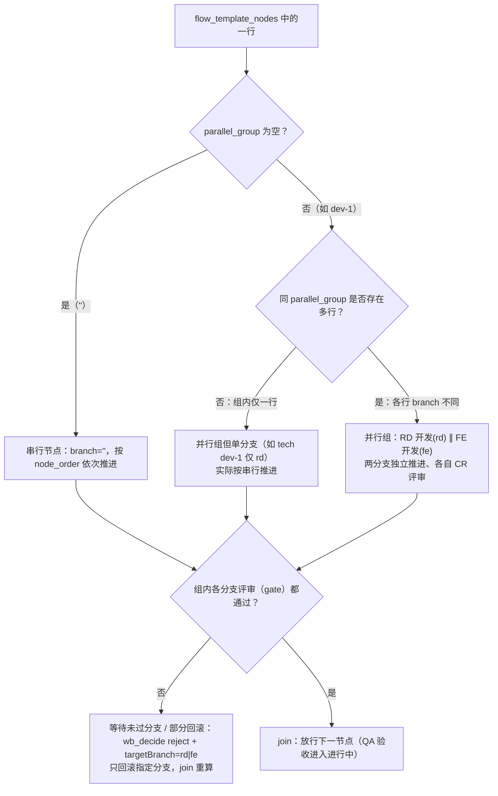

# 版本架构设计文档：v1.0 —— 团队项目工作台平台（总集）

> **⚠️ 定位标注（2026-09-12）**：本文件为 v1 设计基线的历史底稿——§7-§9 沿用 pkg-16 时代词汇（wb_decide/resolve(note)/overridden/pass|block 表态/19 旧能力等），与现行设计（docs-tmp/ 五件套 v5 口径）不一致。现行设计以 docs-tmp 为权威，本文件仅作基线留档；逐节刷新为独立 effort（未排期）。

> **本文档是平台 v1.0 的架构设计总集**：整体架构 + 数据层 + 制度层 + 执行层 + 文档规范 + 里程碑的合并文档。
> 由原 `arch_design.md`（架构）+ `05-domain-model.md`（数据）+ `06-flows-and-roles.md`（制度）+ `07-tools-and-orchestration.md`（执行）+ `08-doc-standards.md`（规范）+ `09-milestones.md`（进度）合并而成。
> 定位：描述跑在 DeepSeek Harness（DSH）之上的「项目管理 + OA 流程 + 评审协作」三合一平台的完整设计，并据此把平台自身拆解为可并行实现的需求单元（模块级 prd/rd/fe 见各 module 目录）。
> 交互层四模块的功能级设计见 `01-module-board/`、`02-module-flow-tree/`、`03-module-inbox-todo/` 下各 `prd/prd.md` + `rd/design.md` + `fe/design.md`。

---

## 0. 文档信息

| 项 | 值 |
|---|---|
| 版本 | v1.0 |
| 文档版本 / 状态 | v1.0（已批准） |
| 架构师 | Architect |
| 设计与批准日期 | 2025-01-01 / 2025-01-01 |
| 关联需求对齐 | 团队项目工作台 v1.0（平台整体立项，范围整体冻结） |
| 目标读者 | 前端 / 后端 / 测试 / 项目负责人 |

## 1. 执行摘要

**团队项目工作台**是运行在 DeepSeek Harness（DSH）之上的三合一交互系统，将「项目管理 + OA 流程 + 评审协作」收敛进一个 `conversation.view` 工作台界面。核心差异点：每个流程阶段绑定产物、阶段下挂评审沟通记录、阶段由 Agent 角色（PM/RD/FE/QA/Architect）而非仅人类成员负责、门禁 = User 评审决策（双向多轮对话）。

平台采用**四层架构**：制度层（DSH team preset，只读）→ 交互层（wbflow 插件 Host+Client 两半）→ 数据层（`.workbench/` JSON → sqlite 11 表）→ 执行层（Leader + 角色子 agent + 22 个 `wb_*` 领域工具）。四大模块：I 版本看板+需求池+需求管理+版本管理；II 需求 OA 流程树（评审闭环+产物阅读器+锚点评论+门禁）；III 门禁通知收件箱（User 全局）；IV TODO 列表。

关键技术栈：DSH 插件（Cordis，host+client 必须同时定义）、sqlite（WAL，单写多读）、轻量 Markdown 渲染阅读器、无外部依赖的锚点防漂移（去空白原文指纹）。核心取舍一句话：**流程写死不造引擎、程序做路由 agent 做专业、数据与 UI 解耦、TASK 是唯一待办总线**。

## 2. 版本背景与范围

### 2.1 范围

- In scope（架构需支撑）：四层架构落地、四大模块（看板 / 流程树 / 收件箱 / TODO）、四类流程模板（business/tech/task/plan）、9+1 角色 + 19 能力 + 22 工具、sqlite 领域存储、审计闭环。
- Out of scope（本版本架构不覆盖）：多项目切换 UI（数据已按 projectId 分桶，仅缺界面）、diff 级行锚点、看板拖拽换列、通用可视化流程编辑。
- 关键假设 & 约束：平台运行于 DSH 插件体系；项目 = DSH workspace 目录；流程写死为确定节点/门禁；宿主仅提供 `btoa/atob/TextEncoder`（无 crypto）用于指纹；单写入者（Leader 主导）无并发锁。

### 2.2 本次架构要解决的核心问题

- 如何把「制度（Agent 学习）」「界面（User 操作）」「数据（持久化）」「执行（Agent 编排）」四者解耦为可独立演进的层？
- 如何在不做可视化流程引擎的前提下，把 30+ 节点、5 种交互模式统一为程序可路由、agent 仅做专业判断的确定性模型？
- 如何保证流程推进、评审、审计的数据一致性（状态机、audit_log、门禁前置校验）？

## 3. 架构设计原则与决策

### 3.1 关键概念边界

| 概念 | 含义 | 归属 |
|---|---|---|
| 流程 / 角色 / 门禁制度 | 四类流程、9 角色、各阶段与门禁规则 | **制度层**（team preset，只读，供 Agent 学习遵循） |
| 交互工作台 | 版本看板 / OA 流程树 / 收件箱 / TODO | **交互层**（插件，供 User 操作） |
| 过程数据 | 版本、需求、流程节点、产物、评论、任务 | **数据层**（持久化存储） |
| 执行引擎 | 谁推进节点、生成产物、回复评审 | **执行层**（Leader + 角色子 agent + wb_* 工具） |

**一句话**：制度进预设（Agent 学习并遵循），界面进插件（User 操作），数据进存储（持久化），执行靠 Agent 编排。

### 3.2 设计原则

1. **流程写死、不造引擎**：四类流程以确定节点/门禁建模，不做可视化流程编辑。
2. **门禁是人机交互的自然面**：User 确认 = 评审卡点；评审必有产出物 + 可对话 + 可带理由打回 + 可异议多轮 + 可引入新范围反向确认。
3. **数据与 UI 解耦**：数据层是单一可查询领域模型；UI 只是它的投影。
4. **渐进落地**：先静态流程骨架 + 交互 demo，再接入真实 Agent 编排。
5. **程序做路由，agent 做专业**：节点/评审/归属/通知的路由由程序从数据推导（`wb_my_task`/默认路由），Agent 只做内容与专业判断。
6. **文档先行、小步多确认（协作节奏）**：每个里程碑先细化文档 → 产出**产品文档**（页面/交互/数据字段）→ **User 确认**后进入实现；实现中遇新决策点回到 1 补充产品文档再定。**纯数据/后端里程碑无可见页面时**，产品文档以「数据 Schema + 命令/查询接口说明 + 数据样例」呈现，同样需 User 确认。

### 3.3 关键技术决策（定稿）

| # | 决策 | 定稿 |
|---|---|---|
| 1 | 领域存储 | 文件存储 `<workspace>/.workbench/` 起步（透明可 diff）；**已演进为 sqlite**（`workbench.db`，11 表，无外键、逻辑引用、审计留痕），JSON 仅作导出格式 |
| 2 | 制度只读 | 流程/角色/门禁落在 team preset（只读）；User 明文告知才调整 |
| 3 | 通知形态 | 经历「IM 收件箱 → 任务总线」演进，**定稿：TASK 是唯一待办总线**；通知/待回复由查询 `tasks`/`issues` 实时推导（通知是视图，不是数据） |
| 4 | 评论模型 | 统一「评论 = 问题」模型；状态 `open → pending-confirm → resolved`（或 `overridden`）；解决需提评者复核确认 |
| 5 | 锚点 | 四级：`document / line / range / block` |
| 6 | 项目边界 | 项目 = DSH workspace（目录），各一套独立数据；收件箱/TODO 为 User 全局（跨项目聚合，可按项目/任务名筛选） |
| 7 | 评审职责 | **各审各的**：评审者只对自己职责内维度评审与表态（维度固化在评审能力 how） |
| 8 | 问题归属 | 三层：L1 锚点产物作者 → L2 节点 owner → L3 QA 跨端根因判定（`domain=rd\|fe`） |
| 9 | 流程演进 | 流程路由程序化（`wb_my_task` + 默认路由），persona 只留专业能力卡 + 3 行协作协议 |
| 10 | 进程约定 | 插件 Cordis 定义必须同时带 `host`+`client`；Host 返回恒为纯 JSON（lossless）；写文件显式传 `writePolicy()`（workspaceRoot=PROJECT） |

## 4. 整体架构

### 4.1 系统上下文



### 4.2 逻辑架构（四层）



- **交互层不直接改数据**：所有领域读写经 Host `harness.handle` 的 `wb.*` RPC；模型工具（`wb_*`）与 UI 共用同一套 `op*` 领域函数（同一审计/门禁/状态机）。
- **制度只读**：执行角色不得自行改制度；调整仅经「User 明文告知 → 协助调整 preset 文件」通道。

**主路径**：用户 → wbflow Client → Host → op* 领域函数 → 数据层（交互 / 评审 → 流程推进 → 持久化）。

### 4.3 部署架构

平台以 DSH 插件形态部署于宿主进程；数据落 DSH workspace 目录（`.workbench/`）。sqlite 采用 WAL（单写多读）。无独立服务端集群，单实例承载。



## 5. 组件与模块设计（交互层）

### 模块 I：版本看板 / 需求池 / 需求管理 / 版本管理

- **目的**：外层入口，查看全部需求看板，管理需求与版本。
- **技术**：wbflow Client（interaction view）+ Host RPC。
- **接口**：`wb.listRequirements / wb.listVersions / wb.getRequirement / wb.createRequirement / wb.updateRequirement / wb.deleteRequirement / wb.createVersion / wb.updateVersion / wb.advanceVersion / wb.deprecateVersion / wb.deleteVersion`。
- **数据**：`requirements.json`、`versions.json`；需求 7 字段编辑审计 `history[]`。
- **状态机**：版本 `待启动→进行中→已发布` 单向，任意阶段可废弃（按注记-A 条件解绑，不取消需求）；需求 `待启动/进行中/已完成/已取消`，与编排推进自动联动（待启动节点通过→进行中；落位尾节点→已完成，§7.3）。
- 设计细节见 `01-module-board/{prd/prd.md, rd/design.md, fe/design.md}`。

### 模块 II：需求 OA 流程树（需求详情页）

- **目的**：价值核心模块——在详情页评审产物、多轮对话、推进流程。
- **技术**：流程树视图 + 产物阅读器 + 锚点评论 + 门禁。
- **接口**：`wb.getRequirement / getArtifactContent / comment / reply / resolve / override / decide / forceRevise / defineScope / review / confirmReview / reopen`。
- **数据**：`<reqId>/flow.json + artifacts.json + comments.json`；四级锚点；评论=问题统一模型。
- 设计细节见 `02-module-flow-tree/{prd/prd.md, rd/design.md, fe/design.md}`。

### 模块 III/IV：门禁通知收件箱 + TODO 列表

- **目的**：任何需 User 回应的沟通进收件箱；TODO 是收件箱的可操作投影。
- **技术**：`shell.overlay` badge/toast；`conversation.input.dock`。
- **数据**：查询投影 `tasks`/`issues`，不建通知表；`inbox.json` 快照可选。
- 设计细节见 `03-module-inbox-todo/{prd/prd.md, rd/design.md, fe/design.md}`。

## 6. 需求拆解（架构驱动拆分）

> 平台整体立项，按架构把自身拆为**架构需求单元（AUR）**，与工作台四个模块对应——模块即需求，各自 prd + rd/design + fe/design 一套，可并行演进。

### 6.1 拆解依据

| 拆解原则 | 说明 |
|---|---|
| 以组件/模块边界为拆分单位 | 模块 I/II/III-IV 各归一个需求单元，职责无歧义 |
| 接口契约先行 | 各模块 walk 同一套 `wb.*` RPC 契约，冻结后并行 |
| 数据/存储依赖按序 | 共享 `.workbench/` 实体模型（§7），先立数据层 |
| 依赖图 + 拓扑排序 | 数据层 → 模块 II（核心）→ 模块 I → 模块 III/IV |
| 粒度标准 | 每单元可独立开发、独立集成、有验收标准 |

### 6.2 拆解结果表（AUR）

| 父需求(Epic) | 拆解单元编号 | 架构需求单元（AUR） | 归属组件/模块 | 依赖 | 可并行 | 验收要点 |
|---|---|---|---|---|---|---|
| 平台 v1.0 | AUR-001 | 数据层与领域模型 | §7 | —— | 是 | 实体/状态机/审计一致 |
| 平台 v1.0 | AUR-002 | 模块 II：OA 流程树 | 02-module-flow-tree | AUR-001 | 是 | 评审闭环/门禁/锚点 |
| 平台 v1.0 | AUR-003 | 模块 I：看板/需求/版本 | 01-module-board | AUR-001 | 是 | CRUD/审计/状态机 |
| 平台 v1.0 | AUR-004 | 模块 III/IV：收件箱/TODO | 03-module-inbox-todo | AUR-002 | 是 | 查询投影/跳转 |
| 平台 v1.0 | AUR-005 | 制度层 + 执行层 | §8/§9 | AUR-002 | 是 | preset+工具+编排 |

### 6.3 依赖与并行批次

| 批次 | 拆解单元 | 并行说明 |
|---|---|---|
| 第 1 批（基座） | AUR-001 数据层 | 先立实体/状态机，供其余消费 |
| 第 2 批（并行） | AUR-002、AUR-003、AUR-005 | 契约（`wb.*`/实体）冻结后三线并行 |
| 第 3 批 | AUR-004 | 依赖模块 II 事件，聚合收件箱 |

## 7. 数据层（领域模型与存储）

> 数据层唯一真相源：实体字段、状态机、存储形态。交互层状态机行为见各模块文档；本节约给出精确转移定义。

### 7.1 存储形态与演进

| 阶段 | 载体 | 状态 |
|---|---|---|
| 起步（M1~） | `<workspace>/.workbench/*.json` 文件存储，透明可 diff | ✅ 插件当前运行载体 |
| 目标（已建库） | `<workspace>/.workbench/workbench.db`（sqlite，11 表，schema_version=28） | ✅ 定义层已 seed；实例层迁移进行中 |

- **多项目**：项目 = DSH workspace 目录；所有实体以 `requirement_id` 归属流程实例，`versions.json`/`requirements.json` 为项目级全局文件（每 workspace 一套）。
- **JSON 载体文件映射**：`requirements.json`、`versions.json`、`inbox.json`（项目级）；`<reqId>/flow.json`、`artifacts.json`、`comments.json`（需求级）。
- **迁移方向**：JSON → sqlite（WAL，单写多读）；审计靠 `audit_log` 表，不依赖 git diff；JSON 保留为导出格式。

**无外键约定（v0.10）**：所有表**不使用 FOREIGN KEY 约束**——结构演进（加表/改列/拆表）无需先解除外键，迁移成本低。关联通过**逻辑引用**表达：子表关联列与父表业务主键**同名同值**（如 `capabilities.role_id → roles.role_id`、`flow_template_nodes.flow_templates_id → flow_templates.flow_templates_id`、`issues.requirement_id → flows.requirement_id`），应用层（wb_* 工具）负责校验引用存在性。关联列建普通索引加速 JOIN/查询。演进流程：改结构 → 递增 `meta.schema_version` → 迁移脚本（`ALTER`/数据搬运/校验）。

**类型约定（v0.12/v0.16，用户纠正）**：

| 类别 | 约定 |
|---|---|
| ID | 纯内部行 id 用 `INTEGER PRIMARY KEY AUTOINCREMENT`；业务主键（requirement_id/node_id/task_id/issue_id 等）保留 **TEXT UNIQUE**——跨系统引用（文档路径/锚点/git 可读）需要可读性 |
| 时间 | INTEGER（unix 毫秒时间戳，与 Node `Date.now()` 一致；原 TEXT(ISO8601) 已废弃） |
| 状态/枚举 | TEXT（值可读，应用层校验白名单） |
| 布尔/标志 | INTEGER (0/1) |
| 计数/序号/行号/轮数 | INTEGER |
| JSON 结构（how/context/reviews…） | TEXT（sqlite 无 jsonb，存 JSON 文本；必要时 JSON1 扩展查询） |

**NULL 策略（v0.21，User 拍板）**：**非必要不使用 NULL**——仅当「空字符串有歧义」（模板缺省 doc_path/structure/quality_gates/version、审计 action 不适用）或「字段'无值'≠'空串'」（未发生时间/未指派引用/锚点类型不适用）时保留 NULL；其余一律 NOT NULL + DEFAULT（branch/parallel_group 非泳道=`''`、note=`''`、JSON=`'[]'`/`'{}'`、计数/布尔=0）。

**全表时间戳（v0.22，User 拍板）**：每张表都有 `created_at`/`updated_at`（INTEGER unix ms；定义层 DEFAULT=当前时间毫秒自动填充）。旧等价字段改名——`artifacts.added_at→created_at`、`issues.at→created_at`、`audit_log.at→created_at`（audit_log 也加 updated_at，恒=created_at）；`flow_nodes.entered_at` 保留（业务语义=节点进入时间，≠行创建）。

### 7.2 实体定义

**Version（版本）**

| 字段 | 说明 |
|---|---|
| `id` | 稳定短码 `v-<n>`；`v-backlog` 固定为「待分配」保留项（不可删/不可改/无状态操作） |
| `name` | 展示名，自由文本（`v1.0`、`2.0 迭代`…） |
| `state` | `待启动 / 进行中 / 已发布 / 已废弃` |
| `isBacklog` | 是否待分配池（仅 `v-backlog` 为 true） |

**状态机**：`待启动 → 进行中 → 已发布` 单向推进；任意阶段可「废弃」（state=已废弃，终态）——**条件解绑**（spec §1.2 注记-A，2026-09-09 拍板）：其下全部需求未开始 → 废弃成功并解绑回待分配池（**不取消需求**）；任一需求已进入编排 → 409 blocked（详见 `01-module-board/rd/design.md` §3.6）。

**Requirement（需求）**

| 字段 | 说明 |
|---|---|
| `id` | `req-<序号>`（递增补零，如 `req-007`） |
| `title` | 标题（必填） |
| `description` | 需求描述（Markdown，可含代码块/链接） |
| `category` | `需求任务 / 任务 / 版本规划任务`（决定流程模板） |
| `reqType` | `业务需求 / 技术需求`（仅需求任务） |
| `scope` | `仅前端 / 仅后端 / 前后端都含`（裁剪 FE/RD 侧节点，见 §8.4） |
| `versionId` | 归属版本 `id` 或 `v-backlog` |
| `priority` | `P0 / P1 / P2 / P3` |
| `status` | `待启动 / 进行中 / 已完成 / 已取消` |
| `owner` | 负责人（角色）；owner 规则见 §8.2 |
| `history[]` | 编辑审计（JSON 载体）；`{at, by, changes:[{field, from, to}]}`，仅字段级变化时追加 |
| `createdAt / updatedAt` | 创建/更新时间 |

**Flow（流程实例）与 FlowNode（节点实例）**

```
Flow:   requirement_id, flow_templates_id(business|tech|task|plan),
        current_node_id（当前指针；并行组内指向进行中分支）, created_at, updated_at

FlowNode: node_id(n-00…), node_order, key, role_id（执行者角色）,
          gate(0/1), branch(''|rd|fe), parallel_group(''|dev-1), feature_branch,
          state, entered_at, rolled_back_count, last_decision,
          pending_scope, reviewers[]（静态评审声明 JSON）
```

- **节点独立**：一条流程标签一个节点，可独立回退重入；通过 → 前进下一节点；打回 → 回退上一节点。
- **reviewers[]**：`[{role, capability_id, scope?}]`（定稿：leader 不在 reviewers 中，决策者 ≠ 评审表态者）；动态「谁过了没」由评审表态 + 评论闭环推导。
- **并行组**：同 `parallel_group` 的节点并行；join = 组内全部 `state=已通过` 才放行组后节点（详见 §8.4）。

**Issue（评论 / 问题 / 线程）**

```
id(id 自增) / issue_id(cm-<ts> 业务可读), requirement_id, node_id（挂载节点）,
anchor_kind(document|line|range|block), anchor_artifact_id（锚定产物，NULL=未锚定）,
anchor_line（仅 line）, anchor_start_line/anchor_end_line（仅 range）,
anchor_block_start/anchor_block_end/anchor_lang（仅 block）,
author, role_id, reviewer_role（L3 跨端根因推导后写）, issue_type(issue|notification|discussion),
assignee（解决责任人 L1/L2/L3）, text, replies[]（不可变回复数组 JSON，v0.20 并入 issue_replies）,
state, round_count, last_reply_at,
resolve 族：resolve_by/resolve_at/resolve_note/resolve_path(fix|agree)/resolve_reviewer_confirmed(0/1),
resolved 族：resolved_by/resolved_at（最终闭环确认）, created_at, updated_at
```

- **统一模型**：任何评论 = 一个待解决问题（不区分「评审 Issue」与「普通评论」）。
- **锚点四级**：`document` / `line` / `range` / `block`（`heading` 章节级已废弃，diff 级后置）。
- **replies 内嵌**（v0.20，User 拍板线程合并）：`issue_replies` 表并入 `issues.replies` JSON——无按回复行查询需求，消费场景都是「读整个线程」，JSON 一次读更快；audit_log 对 replies 整段 diff 粒度可接受。
- 评论**不可编辑/删除**（保留审计）；误发用 reply 标注「作废」。

**Artifact（产物）**

```
id(art-<ts>), requirement_id, node_id, label, href, kind(document|link),
note, added_by（登记人）, created_at, updated_at
```

- 产物即「文件行」：文件名 + href + note；文档正文由作者用文件工具写入项目目录，登记只写元数据。
- **产物入库约束（spec 注记-K，BUG-015 拍板 2026-09-10）**：expected_outputs 期望的产物必须 kind=document 且 href 为相对 docs root 路径、文件真实存在；登记口期望 document 而以 link 登记 → 400 blocked，判据口仅 kind 合规计入；link 仅用于期望外补充外链（如 code_mr）。
- 一节点可多产物（QA 验收 = test.md + defect.md；并行开发 = rd/fe 各一份）。

**Task（任务，唯一待办总线）**

```
task_id(t-<ts>-<seq>), requirement_id, node_id, branch, role_id（执行者）,
task_type(produce|review|accept|decide), goal, context（确定性上下文 JSON）,
status, root_issue_id（锚定线程）, reply_count, last_reply_at,
dispatch_at, last_ack, last_progress, resume_hint, done_at, closed_at
```

- **TASK 是唯一待办总线**：取代收件箱待办载体；通知是视图不是数据——任何通知/待回复由查询 `tasks`（awaiting-reply/未 ack/进度陈旧）+ `issues`（pending-confirm）实时推导，不预存通知表。
- **派发/断点交接**：`dispatch_at`（证明已派出）/ `last_ack`（心跳，NULL=未送达需重发）/ `last_progress`（执行到哪一步）/ `resume_hint`（从哪续做）——重启后扫描「已派未确认」「进度陈旧」即可断点续接：*派发阶段挂断*（task 已写 dispatch_at 但 last_ack NULL）→ 重新通知；*执行中中断*（in-progress 但进度陈旧）→ 从 last_progress/resume_hint 续做不重来。`done_at`/`closed_at` 记录完成/关闭时刻。
- **wb_my_task 与 TASK 互补**：TASK 是**派发记录**（谁何时被派了什么：goal/context/状态/线程锚点）；wb_my_task 是**「此刻我该做什么」的确定性视图**——按 reqId+nodeId+role **即时推导**（无论任务是否显式登记过都能推导）。

**支撑表**

| 表 | 说明 |
|---|---|
| `audit_log` | 变更审计：`{table_name, row_id, action, field, old_value, new_value, by_who, at}`，agent 每步改库留痕 |
| `meta` | 元信息：`schema_version` 等 |

### 7.3 状态机（精确转移）

**节点状态（FlowNode.state）**

| 当前 | 事件 | 下一态 | 副作用 |
|---|---|---|---|
| 未开始 | 进入 | 进行中 | 记 `entered_at` |
| 进行中 | 产出完成（gate 节点） | 待评审 | 评审者初始化待表态 |
| 待评审 | 全部问题闭环 + User 通过 | 已通过 | `current_node_id` 前移下一节点 |
| 待评审 | 打回（reason 必填） | 进行中 | `rolled_back_count++`；上一节点回退为进行中；可产生 `pending_scope` |
| 已通过 | 被下一节点打回 | 进行中 | `rolled_back_count++` |

> 打回语义：回退到**上一个节点**重新产出（非当前节点内打转）。部分回滚（并行组）：`targetBranch` 指定分支，仅该分支回滚，另一分支保持已通过。

**评论状态（Issue.state）**

```
open ──提评后讨论──▶ open（thread 回复、round_count++）
  ├─ A 修复关闭：assignee resolve(note=修复说明) ──▶ pending-confirm（待提评者复核）
  │     ├─ 提评者 confirm ──▶ resolved（reviewer_confirmed=true，门禁放行）
  │     └─ 提评者 reopen ──▶ open（round_count++，通知 assignee）
  ├─ B 协商一致关闭：提评者 resolve(note=一致结论, path=agree) ──▶ resolved
  ├─ round_count > 5 ──▶ 通知 Leader/User 介入（拉锯升级）
  └─ 强权 override（User 明确指令）──▶ overridden（绕过门禁）
```

- **谁 resolve**：A 路径 = assignee（解决责任人）；B 路径 = 提评者；resolve 必须带 note。
- **谁 confirm/reopen**：仅提评者（不能自确认）。
- **assignee 规则**：普通评审意见 → 锚定产物作者（谁的产物谁改）；QA 验收缺陷 → 显式指派 RD|FE（配合 `targetBranch` 部分回滚）。
- **门禁判定**：`wb_decide pass` 前置 = 无 open + 无 pending-confirm + 全部 resolved 且 `reviewer_confirmed=true`（或 overridden）。
- **待复核超时提醒**：pending-confirm 挂起超时 → 提醒提评者复核（提评者 = User 阈值 1 小时；agent 5 分钟；轮询每 5 分钟）。

**QA 缺陷特殊化（验收缺陷的裁决链，m7 §3）**：

- QA 建缺陷（提评者=QA，`assignee=RD|FE` 按缺陷归属端显式指派）→ RD/FE 处理：真缺陷修复 `resolve(note=修复说明)`；认为误判/非缺陷 → **直接 `resolve(note=理由)`**——**不存在"RD 打回 QA"**，带理由解决即异议表达 → QA 复核（最终裁定）：认可（修复 OK / 理由成立）→ `confirm` 缺陷关闭；不认可修复结果 → `reopen`（即"QA 打回对方解决"），RD/FE 继续。
- **与流程级 reject 区分**：`wb_decide reject(targetBranch)` 是 QA 验收**整体打回开发阶段**（批量退回）；评论 `reopen` 是**单条缺陷**不认可修复——两级裁决语义不同。

**通知链路（动作 → 通知谁 → 内容，m7 §5）**：

| 动作 | 通知（to=） | 内容 |
|---|---|---|
| 作者提评（交付） | 当前节点评审归属角色 | 请评审 |
| 评审者提评审意见 | 作者（RD/FE） | 问题列表，请修复 |
| 作者回复/修复 | 提评者 | 已修复，请复核 |
| **assignee resolve（A）** | 提评者（reviewer） | 已修复，请复核 |
| **提评者 confirm** | （无，门禁放行） | — |
| **提评者 reopen** | assignee | 复核不通过，请继续 |
| **协商一致关闭（B）** | （无） | 讨论达成一致，直接关闭 |
| QA 缺陷建立 | 缺陷负责人 RD/FE | 缺陷指派，请修复 |
| QA 缺陷打回 | 对应分支 owner（RD/FE） | 部分回滚 + 缺陷详情 |

**任务状态（Task.status）**

```
todo → in-progress（执行者开始）→ done（产物登记/评审表态）→ closed（终态）
     ↘ awaiting-reply（等回复/表态）→ done | rejected
rejected → in-progress（返工重做）
```

**需求状态与版本状态**

- 需求 `status`：`待启动 / 进行中 / 已完成 / 已取消`；废弃版本按注记-A 条件解绑（不取消需求）；与编排推进自动联动（2026-09-10 BUG-001 拍板，spec §1.2 注记-J1）：**待启动节点通过（流程首次进入编排，`flows.current_node_id` 空变非空）→ `进行中`；落位尾节点（流程定义最后一个节点被激活/驻留）→ `已完成`**。联动在推进核内同事务落值 + 审计（by_who=plugin/system），值不变不写（幂等），已取消为终态不覆盖；手动 `wb_update_requirement` 仍可显式改状态（空串=不修改，注记-J2）。
- 版本状态机见 §8（`01-module-board/rd/design.md` §3.6）。

### 7.4 审计与一致性

- **审计即证据（audit_log，替代 JSON 的 git diff）**：每次写操作记录 `{table_name, row_id（业务主键）, action(INSERT|UPDATE|DELETE), field, old_value, new_value, by_who, created_at}`——**精确到字段的变更历史**（替代 `requirements.history`/手写字段 diff，迁移时 `requirements.history → audit_log`）。
- **snapshots 已删除（v0.18）**：曾按需把全库 JSON 序列化存一份作人工对比，判定无需——agent 交互项目管理 source of truth 已唯一、无防篡改需求；audit_log 作每步改库留痕已足够。
- **审查一致性**：节点执行者必须拥有节点绑定的能力（`role_id` 匹配 `capabilities.role_id`）；唯一例外 task 流程 `executor` 动态占位。
- **写策略**：所有 `wb.*` 写操作返回最新快照（纯 JSON、lossless）；单写入者（Leader 主导），无并发锁；sqlite WAL 单写多读。

### 7.5 sqlite 表结构（设计定稿，11 表）

> 设计阶段完整 DDL 如下（机器可执行版见 `workbench-sql/schema.sql`，本处为设计真源；实现阶段以 schema.sql 为基线）。
> 定义层 4 + 实例层 5 + 支撑层 2 = 11 表。**无外键（v0.10）**；每表 `created_at`/`updated_at`（定义层 DEFAULT=当前时间毫秒，v0.22）。
**定义层（4）**

**capabilities（能力注册表）**

```sql
-- 能力注册表（v0.28 products 单列：产出型 11 项有 products、评审/决策 8 项 '[]'；示例未固化项 demo_path = JSON null；v0.29 起 products 项无 template_path）
CREATE TABLE capabilities (
  id            INTEGER PRIMARY KEY AUTOINCREMENT,
  capability_id TEXT NOT NULL UNIQUE,   -- 'backend-design' | 'backend-dev' | …（唯一标识）
  name          TEXT NOT NULL,          -- 能力显示名
  role_id       TEXT NOT NULL,          -- 归属角色（逻辑引用 roles.role_id，1 对多）
  how           TEXT NOT NULL DEFAULT '[]',   -- JSON:[行为步骤]（能力本体；评审维度内聚在评审能力 how）
  products      TEXT NOT NULL DEFAULT '[]',   -- JSON:[{doc_path, demo_path}]（v0.29 删 template_path，标准指针不入 DB）
  created_at    INTEGER NOT NULL DEFAULT (CAST(strftime('%s','now') AS INTEGER) * 1000),
  updated_at    INTEGER NOT NULL DEFAULT (CAST(strftime('%s','now') AS INTEGER) * 1000)
);
```

```jsonc
{
  "id": 1,
  "capability_id": "backend-design",                  // 能力唯一标识
  "name": "后端技术设计",                              // 能力显示名
  "role_id": "rd",                                    // 归属角色（1 对多：rd 拥有多个能力）
  "how": [                                            // JSON: 行为步骤（能力本体，v0.23 强化）
    "对照 prd.md 逐条核对功能点：接口设计覆盖前端全部页面交互，无遗漏",
    "按 prd 前端页面需求设计接口契约：方法/路径/入参/出参/错误码，FE 可据此直接对接",
    "技术与版本架构文档 arch_design.md 保持大方向一致",
    "数据设计保证可测性：字段/约束清晰、测试构造容易、QA 可按口径验收",
    "登记产物 → 提评"
  ],
  "products": [                                       // JSON: 产出物清单（v0.28 合并三列，v0.29 删 template_path）
    {
      "doc_path": "docs/v2.0/req-019/rd/design.md",   // 产出文档存放路径
      "demo_path": "docs/templates/backend-design-doc-demo.md"
    }
  ],
  "created_at": 1786000000000,
  "updated_at": 1786000500000
}
```

**roles（角色注册表）**

```sql
-- 角色注册表（note=角色工作内容注释，非子 agent persona；完整 persona 落 team preset）
CREATE TABLE roles (
  id         INTEGER PRIMARY KEY AUTOINCREMENT,
  role_id    TEXT NOT NULL UNIQUE,   -- 'rd'|'fe'|'cr'|'arch'|'pm'|'qa'|'inv'|'leader'|'user'|'executor'
  name       TEXT NOT NULL,
  note       TEXT NOT NULL,          -- 角色工作内容注释（人读）
  created_at INTEGER NOT NULL DEFAULT (CAST(strftime('%s','now') AS INTEGER) * 1000),
  updated_at INTEGER NOT NULL DEFAULT (CAST(strftime('%s','now') AS INTEGER) * 1000)
);
```

```jsonc
{
  "id": 2,
  "role_id": "rd",                                    // 角色唯一标识
  "name": "后端开发",                                  // 角色显示名
  "note": "负责技术设计与后端实现：领域建模、接口契约、数据一致性；对设计完整性与自测负责。",  // 角色工作内容注释（非子 agent persona）
  "created_at": 1786000000000,
  "updated_at": 1786000000000
}
```

**flow_templates（流程模板）**

```sql
-- 流程模板（静态定义，4 种）
CREATE TABLE flow_templates (
  id              INTEGER PRIMARY KEY AUTOINCREMENT,
  flow_templates_id TEXT NOT NULL UNIQUE, -- 'business'|'tech'|'task'|'plan'
  scope_options   TEXT NOT NULL DEFAULT '[]',   -- JSON:['full','fe-only','be-only']
  created_at      INTEGER NOT NULL DEFAULT (CAST(strftime('%s','now') AS INTEGER) * 1000),
  updated_at      INTEGER NOT NULL DEFAULT (CAST(strftime('%s','now') AS INTEGER) * 1000)
);
```

```jsonc
{
  "id": 1,
  "flow_templates_id": "business",                    // 模板唯一标识
  "scope_options": ["full", "fe-only", "be-only"],    // JSON: 可选实施范围
  "created_at": 1786000000000,
  "updated_at": 1786000000000
}
```

**flow_template_nodes（模板节点定义）**

```sql
-- 模板节点定义（节点骨架：用什么能力/期望产物/评审人/并行编排）
CREATE TABLE flow_template_nodes (
  id               INTEGER PRIMARY KEY AUTOINCREMENT,
  flow_templates_id TEXT NOT NULL,      -- 逻辑引用 flow_templates
  node_order       INTEGER NOT NULL,    -- 节点序号（编排顺序，1 起）
  key              TEXT NOT NULL,       -- 节点名
  role_id          TEXT NOT NULL,       -- 执行者角色
  capability_id    TEXT,                -- 用什么能力执行（NULL=mode='align' 无产出节点）
  mode             TEXT NOT NULL DEFAULT 'produce',  -- 'produce'|'align'
  gate             INTEGER NOT NULL DEFAULT 0,
  branch           TEXT NOT NULL DEFAULT '',     -- 'rd'|'fe'（并行泳道；''=非并行）
  parallel_group   TEXT NOT NULL DEFAULT '',     -- 'dev-1'（并行标记；''=非并行）
  scope            TEXT NOT NULL DEFAULT '',     -- 裁剪：''=全量｜'be'=仅后端｜'fe'=仅前端
  reviewers        TEXT NOT NULL DEFAULT '[]',   -- JSON:[{role,capability_id,scope?}]
  expected_outputs TEXT NOT NULL DEFAULT '[]',   -- JSON:[{capability_id,label,kind}]
  created_at       INTEGER NOT NULL DEFAULT (CAST(strftime('%s','now') AS INTEGER) * 1000),
  updated_at       INTEGER NOT NULL DEFAULT (CAST(strftime('%s','now') AS INTEGER) * 1000),
  UNIQUE (flow_templates_id, node_order)
);
```

```jsonc
{
  "id": 5,
  "flow_templates_id": "business",                    // 逻辑引用 flow_templates
  "node_order": 3,                                    // 节点序号
  "key": "RD 技术设计",                                // 节点名
  "role_id": "rd",                                    // 执行者角色
  "capability_id": "backend-design",                  // 用什么能力执行（align 节点为 null）
  "mode": "produce",                                  // produce｜align（v0.28）
  "gate": 0,                                          // 0/1 是否门禁
  "branch": "",                                       // 泳道（''=非并行；rd/fe=并行泳道）
  "parallel_group": "",                               // 并行组标记（''=非并行）
  "scope": "be",                                      // 裁剪：''=全量｜be=仅后端｜fe=仅前端
  "reviewers": [                                      // JSON: 静态评审声明（v0.28：[{role,capability_id,scope?}]）
    { "role": "rd",   "capability_id": "rd-tech-review",   "scope": "be" },
    { "role": "arch", "capability_id": "arch-tech-review", "scope": "be" },
    { "role": "fe",   "capability_id": "fe-tech-review",   "scope": "fe" },
    { "role": "qa",   "capability_id": "qa-tech-review" },
    { "role": "pm",   "capability_id": "pm-review" }
  ],
  "expected_outputs": [                               // JSON: 期望产物（引用能力）
    { "capability_id": "backend-design", "label": "《RD 技术设计》", "kind": "document" }
  ],
  "created_at": 1786000000000,
  "updated_at": 1786000000000
}
```
**实例层（5）**

**flows（流程实例）**

```sql
-- 流程实例（每个需求/任务一份）
CREATE TABLE flows (
  id              INTEGER PRIMARY KEY AUTOINCREMENT,
  requirement_id  TEXT NOT NULL UNIQUE,  -- 业务主键（req-001）
  flow_templates_id TEXT NOT NULL,       -- 逻辑引用 flow_templates
  current_node_id TEXT,                  -- 当前指针（n-00…；NULL=未启动）
  created_at      INTEGER NOT NULL,
  updated_at      INTEGER NOT NULL
);
```

```jsonc
{
  "id": 12,
  "requirement_id": "req-019",                        // 业务主键（每个需求一份）
  "flow_templates_id": "business",                    // 实例→模板
  "current_node_id": "n-04",                          // 当前指针（null=未启动）
  "created_at": 1786000000000,
  "updated_at": 1786001000000                         // 每次节点推进都刷新
}
```

**flow_nodes（节点实例）**

```sql
-- 节点实例（独立 id，运行时状态；reviewers JSON 取代独立 flow_node_reviewers 表 v0.18）
CREATE TABLE flow_nodes (
  id              INTEGER PRIMARY KEY AUTOINCREMENT,
  requirement_id  TEXT NOT NULL,        -- 逻辑引用 flows.requirement_id
  node_id         TEXT NOT NULL,        -- n-00…（实例化生成）
  node_order      INTEGER NOT NULL,
  key             TEXT NOT NULL,
  role_id         TEXT NOT NULL,
  gate            INTEGER NOT NULL DEFAULT 0,
  branch          TEXT NOT NULL DEFAULT '',
  parallel_group  TEXT NOT NULL DEFAULT '',
  reviewers       TEXT NOT NULL DEFAULT '[]',  -- JSON:[{role,capability_id,scope?}]
  feature_branch  TEXT,                 -- 评审敲定后写入的落点约定：feature 集成线名（工单分支自其切出合回；NULL=未敲定）
  state           TEXT NOT NULL DEFAULT '未开始',  -- 未开始/进行中/待评审/已通过
  entered_at      INTEGER,              -- 节点进入执行时间（NULL=未进入；业务语义≠行创建）
  rolled_back_count INTEGER NOT NULL DEFAULT 0,
  last_decision   TEXT,                 -- JSON:{verdict,reason,at,branch?}（NULL=未决策）
  pending_scope   TEXT,                 -- 打回时待重定范围（NULL=无）
  created_at      INTEGER NOT NULL DEFAULT (CAST(strftime('%s','now') AS INTEGER) * 1000),
  updated_at      INTEGER NOT NULL DEFAULT (CAST(strftime('%s','now') AS INTEGER) * 1000)
);
```

```jsonc
{
  "id": 34,
  "requirement_id": "req-019",
  "node_id": "n-04",                                  // 实例化时生成，独立可读 id
  "node_order": 4,
  "key": "RD 技术评审",                                // 节点名（从模板复制）
  "role_id": "arch",                                  // 执行者角色
  "gate": 1,                                          // 门禁节点
  "branch": "",                                       // ''=非并行
  "parallel_group": "",
  "reviewers": [                                      // JSON: 静态评审声明
    { "role": "arch", "capability_id": "arch-tech-review", "focus": "技术路线/架构一致性" },
    { "role": "fe",   "capability_id": "fe-tech-review",   "focus": "接口契约" },
    { "role": "qa",   "capability_id": "qa-tech-review",   "focus": "可测性" }
  ],
  "feature_branch": null,                             // 评审敲定集成线后写入（null=未敲定）
  "state": "待评审",                                  // 未开始/进行中/待评审/已通过
  "entered_at": 1786000800000,                        // 节点进入时间（null=未进入）
  "rolled_back_count": 0,                             // 回滚次数
  "last_decision": null,                              // JSON:{verdict,reason,at,branch?}（null=未决策）
  "pending_scope": null,                              // 打回待重定范围（null=无）
  "created_at": 1786000000000,
  "updated_at": 1786000800000
}
```

**tasks（任务，唯一待办总线）**

```sql
-- 任务（唯一待办总线 v0.18，取代 inbox；推模式派发）
CREATE TABLE tasks (
  id         INTEGER PRIMARY KEY AUTOINCREMENT,
  task_id    TEXT NOT NULL UNIQUE,      -- t-<ts>-<seq>
  requirement_id TEXT NOT NULL,
  node_id    TEXT NOT NULL,
  branch     TEXT NOT NULL DEFAULT '',
  role_id    TEXT NOT NULL,
  task_type  TEXT NOT NULL,             -- produce|review|accept|decide
  goal       TEXT NOT NULL,
  context    TEXT NOT NULL,             -- JSON:确定性上下文（nodeKey/branch/artifacts/dependencyDocs）
  status     TEXT NOT NULL DEFAULT 'todo',   -- todo|in-progress|awaiting-reply|done|rejected|closed
  root_issue_id TEXT,                   -- 锚定根 issue（NULL=纯执行任务）
  reply_count  INTEGER NOT NULL DEFAULT 0,
  last_reply_at INTEGER,
  -- 派发/断点交接（v0.19）
  dispatch_at  INTEGER,                 -- 派发时间（NULL=未派发）
  last_ack     INTEGER,                 -- 确认收到心跳（NULL=未送达需重发）
  last_progress TEXT,                   -- 执行到哪一步（断点续接锚点）
  resume_hint  TEXT,                    -- 断点续接提示
  created_at INTEGER NOT NULL,
  updated_at INTEGER NOT NULL,
  done_at    INTEGER,                   -- NULL=未完成
  closed_at  INTEGER                    -- NULL=未关闭
);
```

```jsonc
{
  "id": 42,
  "task_id": "t-20260815-002",                        // 业务可读 id
  "requirement_id": "req-019",
  "node_id": "n-04",                                  // 绑定节点
  "branch": "",                                       // 泳道（''=无）
  "role_id": "arch",                                  // 负责角色
  "task_type": "review",                              // produce | review | accept | decide
  "goal": "评审 RD 技术设计（n-04，架构视角）",
  "context": {                                        // JSON: 主 agent 组装的确定性上下文
    "nodeKey": "RD 技术评审",
    "branch": "",
    "artifacts": [{ "id": "art-101", "label": "《RD 技术设计》", "href": "docs/v2.0/req-019/rd/design.md" }],
    "dependencyDocs": ["prd.md", "rd/design.md"]
  },
  "status": "awaiting-reply",                         // todo|in-progress|awaiting-reply|done|rejected|closed
  "root_issue_id": "cm-1002",                         // 锚定根 issue 线程（null=纯执行任务）
  "reply_count": 2,                                   // 线程回复数
  "last_reply_at": 1786001200000,
  "dispatch_at": 1786000950000,                       // 派发时间（证明已派出）
  "last_ack": 1786000960000,                          // 确认收到时刻（null=未送达需重发）
  "last_progress": "已读 design.md，提出意见 cm-1002", // 断点续接锚点
  "resume_hint": "等待 arch 对 cm-1002 的最终确认",
  "created_at": 1786000950000,
  "updated_at": 1786001200000,
  "done_at": null,                                    // null=未完成
  "closed_at": null                                   // null=未关闭
}
```

**artifacts（产物）**

```sql
-- 产物
CREATE TABLE artifacts (
  id          INTEGER PRIMARY KEY AUTOINCREMENT,
  artifact_id TEXT NOT NULL UNIQUE,     -- art-<ts>
  requirement_id TEXT NOT NULL,
  node_id     TEXT NOT NULL,
  label       TEXT NOT NULL,
  href        TEXT NOT NULL,            -- 文档路径 / 链接 URL
  kind        TEXT NOT NULL DEFAULT 'document',  -- document|link
  note        TEXT NOT NULL DEFAULT '',
  added_by    TEXT NOT NULL,            -- 登记人（role_id）
  created_at  INTEGER NOT NULL,         -- 登记（创建）时间（原 added_at）
  updated_at  INTEGER NOT NULL
);
```

```jsonc
{
  "id": 101,
  "artifact_id": "art-101",
  "requirement_id": "req-019",
  "node_id": "n-03",                                  // 挂到产出节点
  "label": "《RD 技术设计》",                          // 显示名
  "href": "v2.0/req-019/rd/design.md",                // 相对 docs root 路径（kind=link 时为外链 URL；spec 注记-K）
  "kind": "document",                                 // document | link
  "note": "含接口契约 v2 修订",                        // 可选备注（''=无）
  "added_by": "rd",                                   // 登记人
  "created_at": 1786000800000,                        // 登记（创建）时间
  "updated_at": 1786000800000
}
```

**issues（评论/问题/线程）**

```sql
-- 评论/问题/线程（单表 v0.20：根评论 + replies JSON 内嵌；issue_replies 已并入）
CREATE TABLE issues (
  id           INTEGER PRIMARY KEY AUTOINCREMENT,
  issue_id     TEXT NOT NULL UNIQUE,     -- cm-<ts>
  requirement_id TEXT NOT NULL,
  node_id      TEXT NOT NULL,
  anchor_kind  TEXT NOT NULL DEFAULT 'document',  -- document|line|range|block
  anchor_artifact_id TEXT,               -- 锚定产物（NULL=未锚定）
  anchor_line       INTEGER,             -- 仅 kind=line
  anchor_start_line INTEGER,             -- 仅 kind=range
  anchor_end_line   INTEGER,             -- 仅 kind=range
  anchor_block_start INTEGER,            -- 仅 kind=block
  anchor_block_end  INTEGER,             -- 仅 kind=block
  anchor_lang  TEXT,                     -- 仅 kind=block
  author       TEXT NOT NULL,
  role_id      TEXT NOT NULL,
  reviewer_role TEXT,                    -- 评审归属（L3 domain 推导后；NULL=未推导）
  issue_type   TEXT NOT NULL DEFAULT 'issue',  -- issue|notification|discussion
  assignee     TEXT,                     -- 解决责任人（L1/L2/L3；NULL=未指派）
  text         TEXT NOT NULL,
  replies      TEXT NOT NULL DEFAULT '[]',   -- JSON:[{reply_id,by,role_id,text,at}]（不可变追加）
  state        TEXT NOT NULL DEFAULT 'open',  -- open|pending-confirm|resolved|overridden
  created_at   INTEGER NOT NULL,         -- 根评论创建时间（原 at）
  round_count  INTEGER NOT NULL DEFAULT 0,
  last_reply_at INTEGER,
  resolve_by   TEXT,                     -- 解决责任人（NULL=未解决）
  resolve_at   INTEGER,
  resolve_note TEXT,
  resolve_path TEXT,                     -- fix|agree
  resolve_reviewer_confirmed INTEGER NOT NULL DEFAULT 0,  -- 0/1 评审者确认
  resolved_by  TEXT,                     -- 最终确认人（NULL=未闭环）
  resolved_at  INTEGER,
  updated_at   INTEGER NOT NULL
);
```

```jsonc
{
  "id": 1002,
  "issue_id": "cm-1002",
  "requirement_id": "req-019",
  "node_id": "n-04",                                  // 评论所属节点
  "anchor_kind": "block",                             // document|line|range|block
  "anchor_artifact_id": "art-101",                    // 锚定产物（null=未锚定）
  "anchor_line": null,                                // 仅 kind=line
  "anchor_start_line": null,                          // 仅 kind=range
  "anchor_end_line": null,                            // 仅 kind=range
  "anchor_block_start": 42,                           // 代码块起行（仅 kind=block）
  "anchor_block_end": 58,                             // 代码块终行（仅 kind=block）
  "anchor_lang": "sql",                               // 代码块语言（仅 kind=block）
  "author": "arch",                                   // 作者
  "role_id": "arch",                                  // 作者角色
  "reviewer_role": null,                              // L3 归属（null=非跨端）
  "issue_type": "issue",                              // issue|notification|discussion
  "assignee": "rd",                                   // 解决责任人（L1/L2/L3）
  "text": "数据模型表 user_order 缺唯一约束，并发下单会重复。",
  "replies": [                                        // JSON: 不可变回复数组
    { "reply_id": "r-1", "by": "rd",   "role_id": "rd",   "text": "已补 UNIQUE，见 §3", "at": 1786001100000 },
    { "reply_id": "r-2", "by": "arch", "role_id": "arch", "text": "确认，可关闭。",      "at": 1786001200000 }
  ],
  "state": "pending-confirm",                         // open|pending-confirm|resolved|overridden
  "created_at": 1786001000000,                        // 根评论创建时间
  "round_count": 2,                                   // 回复轮数
  "last_reply_at": 1786001200000,
  "resolve_by": "rd",                                 // 解决责任人（null=未解决）
  "resolve_at": 1786001100000,                        // 解决时间（null=未解决）
  "resolve_note": "已补唯一约束",
  "resolve_path": "fix",                              // fix|agree
  "resolve_reviewer_confirmed": 1,                    // 评审者是否确认
  "resolved_by": null,                                // 最终确认人（null=未闭环）
  "resolved_at": null,                                // 最终确认时间（null=未闭环）
  "updated_at": 1786001200000
}
```
**支撑层（2）**

**audit_log（审计）**

```sql
-- 审计（agent 每步改库留痕；snapshots 已删）
CREATE TABLE audit_log (
  id         INTEGER PRIMARY KEY AUTOINCREMENT,
  table_name TEXT NOT NULL,
  row_id     TEXT NOT NULL,             -- 业务主键值（req-001 / n-09 / cm-xxx / t-xxx）
  action     TEXT NOT NULL,             -- INSERT|UPDATE|DELETE
  field      TEXT,                      -- 变更字段（UPDATE；INSERT/DELETE NULL）
  old_value  TEXT,                      -- 旧值（NULL=无旧值）
  new_value  TEXT,                      -- 新值（NULL=无新值）
  by_who     TEXT NOT NULL,             -- 操作者（role_id/'user'/'system'）
  created_at INTEGER NOT NULL,          -- 审计事件时间（原 at）
  updated_at INTEGER NOT NULL DEFAULT (CAST(strftime('%s','now') AS INTEGER) * 1000)  -- 恒=created_at
);
```

```jsonc
{
  "id": 5201,
  "table_name": "tasks",                              // 被变更的表
  "row_id": "t-20260815-001",                         // 业务主键值
  "action": "UPDATE",                                 // INSERT | UPDATE | DELETE
  "field": "status",                                  // 变更字段（INSERT/DELETE null）
  "old_value": "in-progress",                         // 旧值（null=无旧值）
  "new_value": "done",                                // 新值（null=无新值）
  "by_who": "rd",                                     // 操作者
  "created_at": 1786000900000,                        // 审计事件时间
  "updated_at": 1786000900000                         // 恒=created_at（审计行不可变）
}
```

**meta（元信息）**

```sql
-- 元信息（schema 版本/迁移）
CREATE TABLE meta (
  id         INTEGER PRIMARY KEY AUTOINCREMENT,
  meta_key   TEXT NOT NULL UNIQUE,      -- 如 schema_version
  meta_value TEXT NOT NULL,
  created_at INTEGER NOT NULL DEFAULT (CAST(strftime('%s','now') AS INTEGER) * 1000),
  updated_at INTEGER NOT NULL DEFAULT (CAST(strftime('%s','now') AS INTEGER) * 1000)
);
```

```jsonc
{
  "id": 1,
  "meta_key": "schema_version",                       // 元信息键
  "meta_value": "6",                                  // 元信息值（迁移版本）
  "created_at": 1786000000000,
  "updated_at": 1786000000000
}
```

**表-实体-能力落点（m8 §3.6.5 衔接）**

| 数据模型需求 | sqlite 落点 |
|---|---|
| 流程模板/实例分离 | flow_templates / flow_template_nodes + flows / flow_nodes |
| 节点独立 id + 并行编排 | flow_nodes(node_id, parallel_group, reviewers JSON) |
| 任务实体 + 确定性上下文 | tasks（goal/context JSON；唯一待办总线，取代 inbox） |
| 待回复场景（多轮线程） | tasks(root_issue_id) 锚定 issues（replies JSON 内嵌，v0.20） |
| IM/通知（视图非数据） | 查询 tasks + issues 实时推导，不建通知表（v0.19） |
| 角色同一性 | roles 注册表 + capabilities.role_id（1 对多） |
| 节点用什么能力 | flow_template_nodes.capability_id → capabilities（how/products，v0.28） |
| 问题归属 L1/L2/L3 | issues(assignee) + reviewer_role；L3 domain 工具写 assignee |
| 审计留痕 | audit_log（v0.18；snapshots 已删） |
| 产出标准权威 | v0.23 模板外置 docs/templates/ → v0.29 收敛进产出 skill（docs/templates/skills/，有 skill 的 4 类；无 skill 模板暂承载待建）；products=[{doc_path, demo_path}]（D4 拍板 47c53ed9） |

### 7.6 迁移与并发

**迁移（JSON → sqlite）**：
1. 一次性导入脚本：requirements/versions/inbox/各 req 的 flow/artifacts/comments → sqlite（inbox 并入 tasks，以 task 形式导入，root_issue_id 关联原评论线程）；
2. 历史字段映射：`requirements.history → audit_log`、`comments.resolve → issues 列`；
3. `meta` 表记录 schema 版本；后续演进走 `ALTER` + 迁移脚本（版本化）。

**并发**：sqlite WAL 模式——单写多读，工作台单 Leader 写主导，无写冲突；所有 wb_* 工具改走 sqlite（事务包裹），JSON 读写层废弃。

**访问路径**：保留 `.workbench/` 目录但改为 `workbench.db`（JSON 只作导出格式）；db 是否入 git 由仓库政策决定（sqlite WAL 二进制；留痕靠 audit_log，不依赖 git diff）。

### 7.7 数据模型 ER 图（可视化）

> 与 §7.5 DDL 一一对应（11 张表）。依据 `.workbench/workbench.db` 实际 schema + README 注记 8 关联矩阵。关联约定（v0.16）：子表关联列与父表业务主键**同名同值（TEXT）**；`id`（INTEGER）仅作内部主键，不做跨表关联；无外键约束（逻辑引用）。基数标记：`||--o{` = 1 对多；`||--||` = 1 对 1（可空用 `o|`）。



**图例说明**：

| 符号 | 含义 |
|---|---|
| `||--o{` | 父表 1 → 子表 n |
| `||--o|` | 父表 1 → 子表 1（子侧可空） |
| `o|--o|` | 双向可空 1:1（如 current_node_id 指针） |
| PK | 内部主键（INTEGER AUTOINCREMENT） |
| UK | 业务主键（TEXT UNIQUE，可读/跨系统引用） |
| FK | 逻辑引用（无外键约束；关联列与父表业务主键同名） |

**三类分组**：

1. **定义层**（模板/注册表）：ROLES、CAPABILITIES、FLOW_TEMPLATES、FLOW_TEMPLATE_NODES
2. **实例层**（运行时状态）：FLOWS、FLOW_NODES、TASKS、ARTIFACTS、ISSUES
3. **支撑层**（审计/元信息）：AUDIT_LOG、META

> ER 演进注记与 §7.1 的时间戳/NULL/字段收缩约定一致（v0.17 模板内联→v0.23 外置、v0.18 inbox/reviewers 并入、v0.19 conversations 删除+派发字段、v0.20 replies 并入、v0.21 NULL 收紧、v0.22 全表时间戳、v0.28 products 单列+QA 合并+align 节点）。

## 8. 制度层（流程模板 · 角色 · 能力 · 评审分工）

> 制度层以 **DSH team preset** 落地：从 standard preset 复制，叠加团队制度（角色/流程/门禁/协作铁律/skill 指南）；团队内任何 agent 会话（主会话 + 子 agent）加载同一份制度。
> preset 决定：该会话挂哪些工具、系统提示中的制度内容、可加载哪些 skill。skill：`wb-agent-guide`（工作台工具组合流程）、`team-conventions`（角色/流程/门禁/评审分工速查）。

### 8.1 团队角色（9+1）

| 角色 | 职责（一句话） |
|---|---|
| User | 需求提出方 / 最终决策者，制度唯一修改入口（确认范围、拍板发布） |
| Leader | 团队负责人：拆解任务、分派 owner、门禁决策（wb_decide）推进 |
| Investigator | 调研 / 澄清需求，输出调研结论（竞品/开源：引入 or 重写，为什么） |
| Architect | 技术方案设计与评审：产品设计、技术路线、架构规划、版本规划 |
| RD | 后端研发：技术设计、开发与自测 |
| PM | 项目管理 / 范围管控：需求价值、优先级、排期与依赖 |
| FE | 前端研发：技术设计、开发与自测 |
| QA | 测试与验收：用例设计、验收、缺陷闭环（含跨端根因判定） |
| Code Reviewer | 代码评审：代码质量、设计落地、回归风险 |
| executor（动态占位） | 任务流程（task）的动态执行者：由 User/Leader 指定，实例化时按实际执行者解析（模板默认绑 backend-dev） |

**owner 规则**：需求任务 `scope=仅前端` → **FE**；其余（仅后端、前后端都含）→ **RD**；任务流程执行者由 User/Leader 指定。

### 8.2 流程模板（4 类）

按需求 `category`/`reqType` 选择模板（business / tech / task / plan）。**通用首阶段「待启动」**：需求已创建但尚未投入资源；当团队开始投入时推进到下一阶段。owner=Leader，无门禁。

**业务需求（business）：12 节点 + 待启动**

> ①产品设计 → ②需求评审 → ③RD 技术设计 → ④RD 技术评审 → ⑤FE 技术设计 → ⑥FE 设计评审 → ⑦用例设计 → ⑧用例设计评审 → ⑨.1 RD 开发 ∥ ⑨.2 FE 开发（并行）→ ⑩QA 验收 → ⑪用户验收。**无产品设计评审独立节点**（并入②）；**设计阶段串行；仅开发阶段并行**。

| 阶段 | 负责人 | 做什么 | 输入 | 产物 | 门禁 / 审核维度 |
|---|---|---|---|---|---|
| ① 产品设计 | Architect | 产品方案 | 需求描述 + 架构文档 | 《产品设计文档》 | —（产出后由②把关） |
| ② 需求评审 | PM | 评审合理性 + 产品方案 | 产品设计文档 | 评审结论 | PM 价值/优先级/范围 + Architect 技术可行性 + **User 拍板** |
| ③ RD 技术设计 | RD | 后端技术方案 | 产品设计文档 | 《RD 技术设计》 | — |
| ④ RD 技术评审 | RD 发起 | 评审 RD 方案；敲定 feature 集成线与分支拆合约定 | RD 技术设计 | 评审意见 | Architect 路线一致 + RD 完整性/自测 + FE 接口可对接 + QA 可测性 + PM 工期依赖 + **User 拍板** |
| ⑤ FE 技术设计 | FE | 前端技术方案 | 产品设计 + RD 设计 | 《FE 技术设计》 | — |
| ⑥ FE 设计评审 | FE 发起 | 评审 FE 方案 | FE 技术设计 | 评审意见 | QA 交互可测性/关键路径可验证 |
| ⑦ 用例设计 | QA | 明确前后端各自自测、如何联调 | RD/FE 设计文档 | 《用例/联调设计》 | — |
| ⑧ 用例设计评审 | QA 发起 | 评审用例覆盖与口径 | 用例设计 | 评审意见 | RD 后端口径 + FE 前端口径（按需） |
| ⑨.1 RD 开发 | RD | 开发、自测、feature branch + MR | 用例设计 | 代码 MR（RD）（link） | Code Reviewer：代码质量/设计落地/回归风险（并行组） |
| ⑨.2 FE 开发 | FE | 开发、自测、feature branch + MR | 用例设计 | 代码 MR（FE）（link） | Code Reviewer：代码质量/设计落地/回归风险（并行组） |
| ⑩ QA 验收 | QA | 读 prd(AC)+用例+接口协议+代码；按 AC 建测试资产（`qa/data/`+`qa/code/` 落代码供回测）并按用例验收；缺陷打回对应方 | MR 合并产物 + rd/fe 设计文档 | 《测试用例与验收记录》（含 §测试资产）+《缺陷文档》 | QA 用例执行/自动化通过率/缺陷闭环/联调通过 |
| ⑪ 用户验收 | User | 最终验收 | 验收记录 | — | User 目标达成/可交付 |

**技术需求（tech）：8 节点 + 待启动**

> ①需求对齐（align）→ ②RD 技术设计 → ③RD 技术评审（按需）→ ④FE 技术设计（按需）→ ⑤用例设计 → ⑥并行开发 → ⑦QA 验收 → ⑧用户验收。owner=RD。

| 阶段 | 负责人 | 做什么 | 输入 | 产物 | 门禁 / 审核维度 |
|---|---|---|---|---|---|
| ① 需求对齐 | RD | 对齐目标；无产物；疑问与架构师/User 澄清拍板 | 需求描述 | —（结论落 issues） | User 拍板确认对齐结论 |
| ② RD 技术设计 | RD | 后端技术方案 | 需求描述 + 架构文档 | 《RD 技术设计》 | — |
| ③ RD 技术评审 | RD 发起 | 评审；敲定 feature 集成线与分支拆合约定 | RD 技术设计 | 评审意见 | Architect 路线 + FE 接口（按需）+ QA 可测性 + User 拍板 |
| ④ FE 技术设计 | FE | 前端技术方案 | 产品设计 + RD 设计 | 《FE 技术设计》 | — |
| ⑤ 用例设计 | QA | 自测/回归/联调口径 | RD/FE 设计文档 | 《用例设计》 | RD、FE（按需）口径 |
| ⑥ 并行开发 | RD + FE | 开发+自测+MR | 用例设计 | 代码 MR(link) | Code Reviewer（分别 CR） |
| ⑦ QA 验收 | QA | 按用例验收；缺陷打回 | MR + rd/fe 设计 | 《测试用例与验收记录》+《缺陷文档》 | QA 用例执行/缺陷闭环 |
| ⑧ 用户验收 | User | 验收通过 | 验收记录 | — | User 目标达成 |

**分支约定（2026-09-10 BUG-014 口径修订）**：feature **集成线**在 ③ 敲定（`feature/<需求id>-<主题>`）；各执行任务从集成线切出工单分支（`<集成线>-t<N>-<slug>`）在独立 worktree 干活，完成后合回集成线；后续开发/CR/QA 验收**全程看同一集成线**。原「同一分支」口径在 worktree 并行下物理不成立（git 一个分支仅允许一个 worktree checkout），收敛点由集成线承接、隔离由工单分支+worktree 承接（铁律⑦⑧配套）。

**任务（task）：5 节点 + 待启动**

> ①需求对齐（align）→ ②方案评审 → ③开发 → ④QA 验收 → ⑤用户验收。owner=执行者（User/Leader 指定）。

| 阶段 | 负责人 | 做什么 | 输入 | 产物 | 门禁 / 审核维度 |
|---|---|---|---|---|---|
| ① 需求对齐 | 执行者 | 明确目标/范围/验收口径，指定执行者 | 任务说明 + 架构文档 | —（最多沟通记录） | — |
| ② 方案评审 | 执行者 | 产出《方案文档》；约定 fix 分支名 | 任务说明/缺陷报告 | 《方案文档》 | QA 可执行性/可测性 + User 拍板 |
| ③ 开发 | 执行者 | 编码+自测+MR | 方案文档 | 代码 MR(link) | Code Reviewer 代码质量/设计落地 |
| ④ QA 验收 | QA | 测试验证+回归 | MR + 方案文档 | 《测试用例与验收记录》+《缺陷文档》 | QA 目标验证/回归 |
| ⑤ 用户验收 | User | 确认关闭 | 验收记录 | — | User 确认 |

**版本规划（plan）：4 节点 + 待启动**

> ①立项（需求对齐）→ ②调研 → ③架构规划 → ④创建需求·启动版本。owner=**Architect**。

| 阶段 | 负责人 | 做什么 | 输入 | 产物 | 门禁 / 审核维度 |
|---|---|---|---|---|---|
| ① 立项 | Architect | 对齐需求，产出《需求对齐文档》 | 需求池 + 上版本路线 | 《需求对齐文档》 | PM 产品评审 + User 拍板 |
| ② 调研 | Investigator | 调研竞品（GitHub 等）：引入 or 重写 | 对齐文档（范围） | 《调研文档》 | Architect 覆盖度/建议合理性 |
| ③ 架构规划 | Architect | 定版本目标、定能力引入、拆解需求 | 调研文档 + 对齐文档 | 《架构规划》 | Leader 资源 + PM 排期 + User 拍板 |
| ④ 创建需求·启动版本 | Leader | 按拆解建需求；创建前查重 | 架构规划（拆解清单） | 需求清单(doc) + 版本推进 | —（版本状态机单向推进） |

### 8.3 scope 裁剪与并行（数据模型直接表达，机器可读）

> 目的：把"scope 裁剪"从 prose 规则变成**数据模型可直接表达**的机制——定义类表声明每行/每个评审位在哪些 scope 下存在；实例表由**确定性构建流程**生成，不靠任何 persona/人工判断。

**A. 定义层：可裁剪性写在哪（三处，均机器可读）**

1. **`flow_templates.scope_options`**（模板级声明）：business=`["full","fe-only","be-only"]`，tech=`["be-only","full"]`，task/plan=`[]`；
2. **`flow_template_nodes.scope`**（每行自带裁剪条件，取代"按 key 硬编码跳过"的隐式规则）：

   | scope 值 | 含义 | business 模板中的应用 |
   |---|---|---|
   | `''`（全量） | 任何 scope 下都存在 | 待启动、产品设计、需求评审、用例设计、用例设计评审、QA 验收、用户验收 |
   | `'be'` | 仅当需求含后端侧时存在 | RD 技术设计③、RD 技术评审④、RD 开发⑨.1（dev-1 rd 分支） |
   | `'fe'` | 仅当需求含前端侧时存在 | FE 技术设计⑤、FE 设计评审⑥、FE 开发⑨.2（dev-1 fe 分支） |

   保留判定：`节点保留 ⇔ scope='' 或 requirement.scope 覆盖该侧`（前后端都含=两侧都覆盖）。
3. **`flow_template_nodes.reviewers[]` 条目级 `scope` 条件**（可选字段）：评审者只在其声明侧存在时进入该节点的评审。**缺省语义**：节点 scope 非空时评审位缺省随节点侧；节点 scope=''（全量）时侧特定的评审位必须显式声明 `scope`，全量评审位（QA/PM/User/Architect-产品层）缺省即两侧都参与。示例（RD 技术评审，节点 scope='be'）：

   ```jsonc
   { "key": "RD 技术评审",
     "reviewers": [
       { "role": "arch", "capability_id": "arch-tech-review" },              // 随节点侧（be）
       { "role": "rd",   "capability_id": "rd-tech-review" },                // 随节点侧（be）
       { "role": "fe",   "capability_id": "fe-tech-review", "scope": "fe" }, // ★ 仅前端侧存在时参与
       { "role": "qa",   "capability_id": "qa-tech-review" },
       { "role": "pm",   "capability_id": "pm-review" },
       { "role": "user", "capability_id": "final-approve" }
     ] }
   ```

**B. 实例构建流程（模板 → `flow_nodes` 的确定性步骤）**

1. **输入**：`requirement.scope` + `flow_templates_id`（创建需求时确定；打回重定范围走 A-C 组）；
2. **取模板**：`SELECT * FROM flow_template_nodes WHERE flow_templates_id=? ORDER BY node_order`；
3. **过滤节点**：按 A2 保留判定逐行过滤（scope 不覆盖的行不实例化）；
4. **过滤评审位**：每个保留节点的 `reviewers[]` 按条目 scope 过滤（A3）；`expected_outputs` 不变；
5. **生成实例行**：每个保留节点写一条 `flow_nodes`（`node_id=n-00…` 连续编号；复制 key/role_id/capability_id/gate/branch/parallel_group）；`flows.current_node_id=n-00`（待启动）；
6. **并行组退化**：实例化后若 `dev-1` 组只剩单分支（be-only 仅 RD / fe-only 仅 FE）→ 组内按串行推进，join 恒成立，状态机/回滚逻辑不受影响；
7. **此后一切按实例走**：wb_my_task 只派实例 `flow_nodes` 里的任务；join/部分回滚只统计实例行。

**C. 评审参与规则（明确化 + 设计遗漏修复）**

| requirement.scope | 每个评审节点的评审者（按 A3 过滤后） | 说明 |
|---|---|---|
| `前后端都含` | ② PM+Architect+User；④ Architect/RD/FE/QA/PM/User；⑥ QA；⑧ RD+FE | 全量 |
| `仅后端`（be-only） | ④ 剔 **fe** 位；⑧ 剔 **fe** 位；⑥ 节点整体不存在 | **FE 不参与任何评审**（无前端改动无需审） |
| `仅前端`（fe-only） | ⑥ FE 设计评审仍仅 QA；⑧ 剔 **rd** 位；④ 节点整体不存在 | **Architect/RD 不参加前端侧评审**；② 需求评审 Architect 仍参与（产品可行性属产品层） |

> 遗漏修复点：此前只写了「be-only 时 FE 不参与评审」，**对称的 fe-only 规则**（⑧ 剔 rd 位、⑥ 保持仅 QA、④ 不存在）一并在此定死；实现时评审位过滤与节点过滤用**同一套 scope 判定函数**。

**示例：业务需求 `scope=仅后端`（be-only），13 模板行 → 10 实例行（fe 位全部剔除）**

> 实例 node_id 按 §B 步骤 5 连续重编（n-00…n-09），不保留被裁剪行的序号空洞。

| node | 节点 | role | gate | 并行 | 保留的 reviewers（fe 位全部剔除） |
|---|---|---|---|---|---|
| n-00 | 待启动 | leader | 0 | — | — |
| n-01 | 产品设计 | arch | 0 | — | — |
| n-02 | 需求评审 | pm | 1 | — | pm、arch、user（产品层 Architect 照常） |
| n-03 | RD 技术设计 | rd | 0 | — | — |
| n-04 | RD 技术评审 | rd | 1 | — | arch、rd、qa、pm、user（fe 位剔除） |
| n-05 | 用例设计 | qa | 0 | — | — |
| n-06 | 用例设计评审 | qa | 1 | — | rd（fe 位剔除） |
| n-07 | RD 开发 | rd | 1 | dev-1（仅剩 rd 单分支，串行） | cr（Code Reviewer 全量） |
| n-08 | QA 验收 | qa | 1 | — | qa |
| n-09 | 用户验收 | user | 1 | — | user |

> 不实例化：FE 技术设计、FE 设计评审、FE 开发 三行；**FE 角色在该需求上零节点、零任务、零评审位**。节点裁剪与评审位裁剪由同一套 scope 判定函数给出。

**并行判定（怎么确定一行节点是并行的）**：看 `parallel_group` + `branch` 两字段。



> **join 与部分回滚**：两分支各自 CR 评审（gate=1）都通过后，QA 验收才从待启动进入进行中（join）；QA 打回 `wb_decide reject + targetBranch=fe` 只回滚 FE 分支（node 10），RD 分支（node 9）保持已通过；回滚后 join 重算再放行。

**事后改范围**：评审/验收打回需重定范围 → `flow_nodes.pending_scope` 记录待定范围 → Leader 改 `requirements.scope` → **重跑 B 节实例化**（新增缺失节点、移除多余节点；已通过节点状态保留）。

### 8.4 能力模型（19 能力）

- **role → capability 1 对多**，能力唯一归属角色（`capabilities.role_id` 引用 roles）；角色 = 其拥有的能力集合；能力一次定义跨流程复用（RD 在业务/技术/任务中同一能力集合）。
- **评审能力按角色拆分不共享**：arch/rd/fe/qa 各自 tech-review（视角不同），另有 pm-review / code-review / decide-cap / final-approve。
- **reviewers 条目** `{role, capability_id, scope?}`；**leader 不在 reviewers**（决策者 ≠ 评审表态者）。
- **mode**：`produce`（有产物，默认）｜`align`（无产物自主对齐，结论落 issues；capability_id=NULL）。
- **products 单列 JSON**（v0.28 合并；v0.29 删 template_path）：`[{doc_path, demo_path}]`；一能力可多产物（acceptance-test 挂 qa/test.md + qa/defect.md）；demo 为 null = 填充示例未固化。产出标准不入 DB：按产出 skill 寻址（docs/templates/skills/）。
- **字段收缩轨迹（v0.23，User 拍板）**：曾内联 `structure/version/quality_gates/reviewer_focus/inputs`，v0.23 删除——`reviewer_focus` 职责错位（评审维度应写在**评审能力自身**的 how，而非被评审能力）；`inputs` 冗余（依赖已在派发时 task.context 给出）；`quality_gates/structure/version` 由**模板文件**承载（DB 不再内联）；v0.28 三列合并为单列 products；v0.29 删 template_path（标准权威迁产出 skill，D4 拍板）。
- **how = 能力本体**：行为步骤（"对照 prd 核对功能点→接口契约 FE 可对接→与架构一致→数据可测性→登记提评"）——评审类能力在 how 里写明评审维度与表态流程。
- **1 对多一致性规则**（wb_my_task 校验）：节点 `role_id` 必须等于其 `capability_id` 能力的 `role_id`（执行者拥有该能力）；唯一例外 task 流程「开发」节点 owner=executor（动态角色，模板默认 backend-dev）。

| capability_id | name | role_id | 类型 | 产出去向 |
|---|---|---|---|---|
| product-design | 产品设计 | arch | 产出 | `<需求名>/prd/prd.md` |
| backend-design | 后端技术设计 | rd | 产出 | `<需求名>/rd/design.md` |
| frontend-design | 前端技术设计 | fe | 产出 | `<需求名>/fe/design.md` |
| case-design-cap | 用例/联调设计 | qa | 产出 | `<需求名>/qa/cases.md` |
| backend-dev | 后端开发 | rd | 产出 | `<需求名>/rd/dev.md` |
| frontend-dev | 前端开发 | fe | 产出 | `<需求名>/fe/dev.md` |
| acceptance-test | 验收与缺陷管理 | qa | 产出 | 2 产物：`qa/test.md` + `qa/defect.md` |
| research-cap | 竞品调研 | inv | 产出 | `<版本号>/research.md` |
| arch-cap | 架构规划 | arch | 产出 | `<版本号>/arch_design.md` |
| alignment-cap | 需求对齐 | arch | 产出 | `<版本号>/align.md` |
| plan-cap | 方案设计（任务） | executor | 产出 | `<需求名>/plan.md` |
| code-review | 代码评审 | cr | 评审 | — |
| arch/rd/fe/qa-tech-review | 技术方案评审 | arch/rd/fe/qa | 评审 | — |
| pm-review | 价值/排期评审 | pm | 评审 | — |
| decide-cap | 门禁决策 | leader | 决策 | — |
| final-approve | 最终拍板 | user | 决策 | — |

### 8.5 评审职责分工（各审各的）

**铁律**：每个评审节点，各评审者只审职责内维度；职责外异议仅供参考。职责内问题未解决则该评审者不 pass。

| 评审者 | 主要审什么 |
|---|---|
| User | 方向/目标是否符合预期、是否可交付 |
| PM | 需求价值、优先级、范围、排期与依赖 |
| Architect | 技术路线、方案可行性、与总体架构一致性 |
| RD（设计方） | 设计完整性、接口/数据、自测方案 |
| FE（设计方） | 接口契约、可测性、交互可实现性 |
| QA | 可测性、用例覆盖、验收口径、缺陷闭环 |
| Code Reviewer | 代码质量、设计落地、回归风险 |

### 8.6 行为协议与协作铁律

- **评审者 5 步**：读产物 → 按 focus 审 → 评论（wb_comment 锚到产物）→ 表态（wb_review pass/block）→ 复核（confirm/reopen）。
- **被评审者 5 步**：读全部意见 → 澄清分歧（wb_reply）→ 修订 resolve → 复核 → 等推进。
- **persona 只留**：专业能力卡 + 产物规范 + 3 行协作协议（① 被分配任务先调 wb_my_task；② 评论/缺陷只传 reqId+nodeId+内容(+domain)；③ 不越权：流程推进归 Leader wb_decide）。
- **协作铁律**：① 文档先行 ② 小步多确认 ③ feature branch + MR ④ 审计即证据 ⑤ 破坏性操作确认 ⑥ 验收闭环 ⑦ 同一 feature 集成线（工单分支切出合回，评审/QA/CR 看集成线） ⑧ 多任务并行用 worktree。

**角色卡（已实现 4 张：RD/FE/CR/QA；Architect/PM/Investigator 待落地，按同风格定义）**：

| 角色 | 职责 | 输入 | 产物 | 输出格式 | 协作 |
|---|---|---|---|---|---|
| **RD** ✅ | 后端设计（业务③/技术②）、开发（⑨.1）、自测 | 需求描述、产品设计/RD 设计文档 | 《RD 技术设计》/《RD 开发说明》（`rd/design.md`/`rd/dev.md`） | 报告 artifactId/commentId/自测结论/阻塞问题 | 登记产物 by=RD；评论 author=RD reviewerRole=Code Reviewer |
| **FE** ✅ | 前端设计（⑤）、开发（⑨.2）、自测 | 产品设计 + RD 设计（接口契约） | 《FE 技术设计》/《FE 开发说明》（`fe/design.md`/`fe/dev.md`） | 同 RD | 同 RD（author=FE） |
| **Code Reviewer** ✅ | 评审开发产物（质量/设计落地/边界与回归风险，各审各的） | 开发说明文档（+ 真实代码，若可用） | 评审结论评论（author=Code Reviewer，open；通过/阻塞） | pass/block + 结论摘要 + 非阻塞建议 | — |
| **QA** ✅ | 用例设计（⑦）、验收（⑩ 按用例+缺陷闭环） | 需求描述（验收点）、设计文档、开发说明 | 《用例/联调设计》《测试用例与结果》《缺陷文档》《验收记录》 | AC 逐条核对结论 + 用例结果表 + 通过/遗留 | 建缺陷当 assignee=RD/FE |
| **Architect** ⏳ | 产品设计（①）、RD 技术评审把关、版本规划 | 需求描述、架构文档 | 《产品设计文档》/《架构规划》/《需求对齐文档》 | 待定（按 RD 风格） | — |
| **PM** ⏳ | 需求评审（② 价值/优先级/范围）、排期与依赖把关 | 需求描述、产品设计、RD 设计（工期/依赖） | 评审结论评论 | 待定 | — |
| **Investigator** ⏳ | 版本规划 ② 竞品调研（引入 or 重写、为什么） | 《需求对齐文档》 | 《调研文档》 | 待定 | — |

## 9. 执行层（wb_* 工具 + Agent 编排协议 + 程序路由）

> 执行层 = **Leader（主 agent）+ 角色子 agent**，通过 22 个 `wb_*` 模型工具直接驱动工作台；与 UI 走同一套 `op*` 领域函数（同一审计/门禁/状态机）。
> 一句话：**程序做路由，agent 做专业**——「你在哪、看什么、产什么、通知谁」由程序从数据推导，Agent 只做内容与专业判断。

### 9.1 工具清单（22 个 wb_*）

> ⚠️ = 破坏性/强权操作，需 User 明确指令。失败统一 `{ok:false, error, ...}`；门禁拦截带 `blocked:true`；成功返回纯 JSON（lossless）。

**读（5）**：

| 工具 | 入参 | 出参 | 语义 |
|---|---|---|---|
| `wb_list_requirements` | — | 需求池数组 | 全量需求 |
| `wb_list_versions` | — | 版本数组 | 确认目标版本 |
| `wb_get_requirement` | `{reqId}` | 聚合快照或 null | 需求+流程+产物+评论 |
| `wb_get_artifact_content` | `{reqId, artifactId}` | `{art, content}` | 读产物正文 |
| `wb_my_task` | `{reqId, role, nodeId?}` | 确定性任务上下文 | **任务确定性来源** |

**需求（3）**：`wb_create_requirement` / `wb_update_requirement` / `wb_delete_requirement`⚠️

**版本（4）**：`wb_create_version` / `wb_update_version` / `wb_advance_version` / `wb_deprecate_version`⚠️

**评论/评审（5）**：`wb_comment`（默认路由）/ `wb_reply` / `wb_resolve` / `wb_override`⚠️ / `wb_decide`

**其他（5）**：`wb_add_artifact` / `wb_review` / `wb_confirm_review` / `wb_reopen` / `wb_list_inbox`

### 9.2 确定性任务（wb_my_task）

`wb_my_task` 是「程序做路由」的核心：程序从 flow.json / artifacts.json / comments.json 推导并返回**确定性任务上下文**，subagent 被派活后先调本工具拿全部上下文，无需自行检索。

- 入参 `{reqId, role, nodeId?}`；nodeId 缺省 = 当前节点。
- 返回：requirement / node / mode(produce|align) / gate / task / roleObjective / behaviors / onFeedback / reviewers / artifactsToReview / dependencyDocs / outputs / `sessionsByNode`。
- **被评审产物（2026-09-10 BUG-011 拍板，spec 注记-J5）**：评审节点的 relatedArtifacts/artifactsToReview 注入**直接上游 produce 节点已登记产物**（提评来源，多上游取全部直接上游——实例链线性即紧邻前驱起的连续 produce 段），置前于本节点产物；评审者零跳转读被评审文档。
- **sessionsByNode**：全需求每个 node 的全部会话（issue/discussion/notification 全含），按 node 分组、双重复位（nodeId+nodeKey）；对话本体唯一载体 = issues。
- **任务派生规则**：对每个「进行中或待评审」节点，ownerRole===role → 产出任务；gate 且 reviewers 含 role 且未表态 → 评审任务。
- **并行编排 vs 确定性任务**：org 层并行组是流程结构；`wb_my_task` 返回扁平化具体任务列表，不做推断。

**四者联通组装链（节点 → 能力 → 产出 skill → 角色 → 讨论 → 上下文，m8 §3.4.4；v0.29 模板层改 skill 层）**：

```
wb_my_task(reqId, nodeId, role) 组装：
  1. 节点：flow_template_nodes[key] → capability_id + roleId + mode + scope + expectedOutputs（引用 capability_id）
  2. 能力：capabilities[capability_id] → how（行为步骤=能力本体）+ products（doc_path + demo_path，v0.29 无 template_path）
  3. 产出 skill：按能力→skill 约定寻址（docs/templates/skills/，frontmatter 声明动作绑定）——章节骨架/门禁/准出权威；demo 由 products[].demo_path 指向
  4. 角色：roles[role] + capabilities 校验「该角色是否拥有该能力」（roleId 匹配）
  5. 讨论：该需求全流程 issues（含 align 阶段 discussion 澄清结论）打包进上下文，subagent 无需自行检索
  6. 输出：{ nodeKey, mode, capability:{name, how[]}, products[], reviewers[]（capability_id→各自评审能力.how 取维度）, discussions, dependencyDocs（来自 task.context） }
  —— 角色拿到「做什么(how) + 产出 skill + 示例(demo_path) + 讨论(discussions) + 依赖(dependencyDocs)」完整上下文，persona 零流程逻辑
```

**示例（RD 技术设计节点，role=RD）**：nodeKey=`RD 技术设计`、mode=produce；capability.how=`["读输入…","按产出 skill（to-rd-techdesign）标准逐节撰写…","按 skill 自检节自检…","登记+提评"]`；products=`[{doc_path:"docs/<版本>/<需求>/rd/design.md", demo_path:"…/backend-design-doc-demo.md"}]`；reviewers=`[{role:"arch",capability_id:"arch-tech-review"},…]`（维度从各评审能力.how 取）；dependencyDocs 来自 task.context（QA 验收额外含 rd/design.md+fe/design.md「接口协议」+MR/featureBranch「代码」）。

### 9.3 默认路由与问题归属

- **wb_comment 全切默认路由**：agent 只传 `reqId+nodeId+text+anchor(+type?+domain?)`；`reviewerRole/to/assignee` 程序推导。
- **评审评论必须锚产物（2026-09-10 BUG-013 拍板「所有的评审都是挂在文档上的」，spec 注记-J6）**：评审上下文（节点 state ∈ {review, respond}，或 author 角色 ∈ 节点评审位）的 issue 类评论，document 级锚点必须携带 `anchorArtifactId`（指向被评审产物），否则 400 invalidArg 引导挂锚；notification/discussion 类不受限；存量数据不回溯。无产物节点（纯对齐/门禁）document 锚保持合法。
- **问题归属三层**：L1 锚点产物作者 → L2 节点 owner → L3 QA 跨端根因判定（`domain=rd|fe`）；domain 是 L3 的根因输出，不是「打回谁」标签。

### 9.4 交互模式（5 种可复用模式）

| 模式 | 出现的节点 | 程序统一处理 |
|---|---|---|
| P1 产出→提评 | 产品设计/RD·FE设计/用例/方案/调研/架构/需求对齐 | wb_my_task 给产出清单；wb_comment 自动 to=评审归属 |
| P2 多评审者表态 | 各评审节点 | wb_my_task 给评审任务；reviewerRole 按节点推导 |
| P3 开发→CR 并行评审 | 开发节点 | wb_my_task 返回多任务（扁平化）；domain 自动指派 |
| P4 验收→缺陷闭环 | QA 验收 | wb_comment(domain) 全自动；reopen 拉锯升级 |
| P5 拍板推进 | 各 gate 节点末 | wb_decide 状态机（join/部分回滚） |

**结论**：四流程 = 5 种交互模式 × 参数化。`wb_my_task` + `wb_comment` 默认路由即可覆盖全部，无需在 persona 写节点专属逻辑。

**组合流程（skill `wb-agent-guide`，随 preset 挂载，m6 §3.2）**——工具描述只承载单工具语义；多步业务编排由 skill 承载（agent 接到相关任务时主动加载）：

- **任务上下文（所有角色通用）**：被派活先调 `wb_my_task(reqId, role)` 拿确定性上下文——本节点做什么（roleObjective/behaviors/onFeedback）、审什么（reviewers/artifactsToReview）、依据什么（dependencyDocs + sessionsByNode 全会话）；随后按 outputs 产出或按 reviewers 表态。
- **拆分大版本**：`wb_list_versions` 确认目标 → 按 owner 规则逐条 `wb_create_requirement`（带描述 md、owner）→ 每条自动带审计起点。
- **推进任务**：`wb_list_requirements` 定位 → `wb_get_requirement` 看节点/评论 → 补齐产物与评论 → `wb_resolve` 全部 → `wb_decide pass`；被打回则 `wb_decide reject` 理由回退。
- **评审闭环**：`wb_get_requirement` → `wb_get_artifact_content` 读正文 → `wb_comment` 行级/代码块级问题 → User 处理 → 循环至全 resolved → `wb_decide pass`。
- **版本生命周期**：`wb_advance_version` 单向推进；发布前检查 `unfinished`，有未完成需求需 User 确认；`wb_deprecate_version` 前先确认需求归属。

**工具层缺口补齐清单（m6-gap-closure §0，已落地）**：

| # | 缺口 | 方案 | 归属 |
|---|---|---|---|
| 1 | 产物登记（doc/link 无工具挂 artifacts.json） | 新增 `wb_add_artifact` | M6 |
| 2 | 评审者正式表态（reviewers[].state 无工具维护） | 新增 `wb_review`；wb_decide 门禁联动 reviewers | M6 |
| 3 | 评论无身份/角色（wb_comment 固定 author=User） | wb_comment 支持 author/role 参数 | M6 |
| 4 | CR 读代码（link 类无法读内容） | Code Reviewer 子 agent 用 fs/代码工具评审真实代码 | M7 |
| 5 | 工期/依赖信息无约定 | RD 技术设计模板含工期与依赖小节 | 文档约定 |
| 6 | 部分回滚（QA 打回仅回滚对应分支） | 并行组 join 判定 + reject 支持 targetBranch | M7 |
| 7 | 通知提醒（门禁待处理/评审@） | sqlite inbox 落库（v1，UI 后置）——已演进为 tasks 投影 | M6 |

### 9.5 编排协议

- **Leader 行为协议（7 条）**：全局视图 → 拆解分派 → 子 agent 并行 → 正式落账 → 门禁推进 → 返工循环 → 收尾。**铁律：Leader 不替角色表态**。
- **角色子 agent 通用约定**：prompt 自包含；无 wb_* 工具时按 host.js 格式直写 `.workbench/` JSON；不越权（不改 flow.json 状态）。
- **缺陷闭环与部分回滚**：QA 写《缺陷文档》+ `wb_comment(domain)` 自动指派 → assignee resolve → QA confirm/reopen → QA 重跑自动化回测（`qa/data/` + `qa/code/`）。
- **断点续接**：`dispatch_at / last_ack / last_progress / resume_hint` 承载，重启扫「已派未确认」「进度陈旧」续接。

## 10. 文档规范（目录 / 文档依赖 / 产物模板 / 质量门禁）

> 平台自身的文档规范：规定 `docs/` 目录结构、角色间文档依赖与「开发完成检查」、产物模板与严重度执行口径。

### 10.1 目录结构

**三层组织：版本 → 需求 → 角色**。文档按版本隔离，版本内按需求与角色落位；架构文档位于版本层，被该版本全部需求遵循。

```
docs/
├── <版本号>/                           # 版本目录，如 v1.0 / v1.2
│   ├── arch_design.md                  # 版本架构设计（总纲，即本文档）
│   ├── roadmap.md                      # 版本规划：目标/范围/需求清单/拆分
│   ├── align.md                        # 需求对齐文档（版本规划①产物）
│   ├── research.md                     # 调研文档（版本规划②产物）
│   ├── diagrams/                       # 架构图（可交互 HTML + 源 JSON）
│   └── <需求名>/                       # 需求目录，如 01-module-board / 02-module-flow-tree / req-019-join-rollback
│       ├── prd/
│       │   └── prd.md                  # 产品需求文档（业务①/任务场景按需）
│       ├── rd/
│       │   ├── design.md               # RD 技术设计（业务③/技术②）
│       │   └── dev.md                  # RD 开发说明（业务⑨.1/技术⑥，含实现-设计对照表）
│       ├── fe/
│       │   ├── design.md               # FE 技术设计（业务⑤/技术④按需）
│       │   └── dev.md                  # FE 开发说明（业务⑨.2/技术⑥，含实现-设计对照表）
│       ├── qa/
│       │   ├── cases.md                # 用例/联调设计（业务⑦/技术⑤）
│       │   ├── test.md                 # 测试用例与验收记录（业务⑩/技术⑦，含 §测试资产）
│       │   ├── defect.md               # 缺陷文档（QA 验收发现 bug 时）
│       │   ├── accept.md               # 验收记录（已并入 test.md，废弃留痕）
│       │   ├── data/                   # 测试资产·数据构造（幂等可重建）
│       │   └── code/                   # 测试资产·测试代码（一键复跑）
│       └── plan.md                     # 方案文档（category=任务，执行者产出）
```

**命名与登记规则**：

| 项 | 规则 |
|---|---|
| 需求目录 | `req-<id>-<短slug>`——id 保留工作台 `.workbench` 数据关联；slug 取需求主题 |
| 版本目录 | `v<主>.<次>`——与 `.workbench/versions.json` 的 id 对应（如 v-11 → `v1.1`） |
| 文件命名 | 固定名（`design.md` / `dev.md` / `cases.md` / `test.md` …），版本演进覆盖同文件，git 留痕 |
| 产物登记 | 产物写入后调用 `wb_add_artifact` 登记（href=文件路径，label=《文档名》，kind=document） |

### 10.2 文档依赖矩阵与开发完成检查

**文档依赖矩阵**：

| 角色产出 | 来源（优先级从高到低） |
|---|---|
| RD 开发（rd/dev.md） | `rd/design.md` → `prd/prd.md` → `qa/cases.md` → `arch_design.md` |
| FE 开发（fe/dev.md） | `fe/design.md` → `rd/design.md`（接口契约）→ `prd/prd.md` → `qa/cases.md` |
| RD 技术设计（rd/design.md） | `prd/prd.md` + `arch_design.md` |
| FE 技术设计（fe/design.md） | `prd/prd.md` + `rd/design.md` |
| QA 用例（qa/cases.md） | `prd/prd.md` + `rd/design.md` + `fe/design.md` |
| QA 验收（qa/test.md + qa/defect.md） | `qa/cases.md` + `rd/dev.md` + `fe/dev.md`；测试资产按 `qa/cases.md` 口径沉淀 |
| 版本规划（align/research/arch_design/roadmap） | 需求池 + 上版本规划 |

**开发完成检查（RD/FE 通用）**：读依据文档 → 核对四类一致性（覆盖/一致/契约/边界）→ 输出实现-设计对照表（附 dev.md）→ 偏差处理（行为/接口变更 → 停止报告 Leader）→ 完成判定（对照表全一致+自测通过+MR 就绪）。

### 10.3 产物标准机制（v0.29：产出 skill 为权威）

- **标准权威分层**（v0.29，User 拍板 D1-D6，semantica 47c53ed9）：有产出 skill 的产物，章节骨架 / required / purpose / 质量门禁 / 准出 / 接口协议**全部内联在 skill**（`docs/templates/skills/<skill>/SKILL.md`）——brd/prd/rd/fe 四类已迁（to-brd / to-prd / to-rd-techdesign / to-fe-techdesign）；无 skill 的产物暂由 `docs/templates/*-template.md` 承载（**skill 待建**，索引见 `docs/templates/README.md`）。`*-demo.md`（填充示例）恒保留，与 skill 骨架保持一致（D5）。
- **capabilities.products 引用（v0.29）**：`[{doc_path, demo_path}]`——**DB 不存标准指针**；产出/评审端经**产出 skill 寻址**（skill frontmatter 声明「用于 X 产出型动作」即绑定）。
- **程序做路由、agent 做专业**：调整产出标准 = 改对应 skill 文件，全局生效（不碰 persona / 不碰代码 / 不碰 DB）。

**标准作用机制（三层，v0.29 改写自模板三层 m8 §1.2）**：

```
产出 skill（定义：章节骨架 + 质量门禁 + 准出 + 接口协议，内联 SKILL.md）
  ├─ 章节骨架        → 产出者按 skill「必填节 + Process」逐节撰写（必填节内联，无自造小标题）
  ├─ 质量门禁/准出   → 双重消费：
  │                    ① 产出者完成前按 skill「自检」节逐条自检（severity 分级）
  │                    ② 评审者按评审能力 how 的「按产出 skill 自检节逐条核对」步骤核对（D1）
  └─ demo（示例）    → products[].demo_path 指向填充示例，结构与 skill 骨架一致（D5）
wb_my_task.dependencyDocs  ← 与自检项 ref 同源（同一套路径约定）
```

- **产出端**：`wb_my_task` 返回 outputs[]（doc_path/demo_path）+ 能力 how → 角色按产出 skill 逐节撰写、按自检节自检 → 写盘（doc_path）→ `wb_add_artifact` 登记；
- **评审端（D1=a）**：评审者按评审能力 how 内「按产出 skill 自检节逐条核对」步骤 severity 分级核对（blocker 不过即打回、major 必查、minor 建议）——自检在产出动作内（skill 自检节）完成，**flow 无专门自检节点**；
- **ref 约定**：skill 自检项引用文档一律写目录约定的相对路径短名（`prd/prd.md` / `rd/design.md` / `fe/design.md` / `qa/cases.md` / `qa/test.md` / `qa/defect.md` / `rd/dev.md` / `fe/dev.md` / `plan.md` / `align.md` / `research.md` / `arch_design.md` / `roadmap.md`）；`—（自含）` 表示该检查只依据本文件内容，无外部依赖。

**产出 skill 覆盖范围（v0.29：产出型能力 11 项；已建 skill 4 类，其余模板暂承载待建）**：

| capability_id | 名称 | role_id | 产出 skill / 暂承载模板 | products（doc_path 简述） | 服务对象（谁审什么） |
|---|---|---|---|---|---|
| product-design | 产品设计 | arch | **to-prd** | prd/prd.md | 需求评审（PM 价值/可行性） |
| backend-design | 后端技术设计 | rd | **to-rd-techdesign** | rd/design.md | RD 技术评审（Architect/RD/FE/QA/PM） |
| frontend-design | 前端技术设计 | fe | **to-fe-techdesign** | fe/design.md | FE 设计评审（QA 可测性） |
| case-design-cap | 用例/联调设计 | qa | qa-testcase-review-template.md（skill 待建） | qa/cases.md | 用例评审（RD/FE 口径） |
| acceptance-test | 验收与缺陷管理（v0.28 合并） | qa | qa-acceptance-*.md + qa-defect-management-*.md（skill 待建） | **2 产物**：qa/test.md + qa/defect.md | QA 验收（AC 逐条）+ User |
| research-cap | 竞品调研 | inv | research-open-source-tech-template.md（skill 待建） | research.md | 调研评审（Architect 覆盖度/建议） |
| arch-cap | 架构规划 | arch | arch-version-design-template.md（skill 待建） | arch_design.md | 架构规划评审（Leader/PM/User） |
| alignment-cap | 需求对齐 | arch | arch-version-scope-align-template.md（skill 待建） | align.md | 立项评审（PM/User） |
| backend-dev | 后端开发 | rd | dev-notes-template.md（skill 待建） | rd/dev.md | CR（设计落地核对） |
| frontend-dev | 前端开发 | fe | dev-notes-template.md（skill 待建） | fe/dev.md | CR（设计落地核对） |
| plan-cap | 方案设计（任务） | executor | plan-template.md（skill 待建） | plan.md | 方案评审（QA 可测性/User 拍板） |

> v0.29 变更（D2/D3/D4，User 拍板）：prd / backend-design / frontend-design 三组模板文件删除（标准已进 skill，brd-template 同）；无 skill 的模板原样保留标「skill 待建」；products 删 template_path。运行机制：① wb_my_task outputs[] 给 doc_path/demo_path，产出标准按能力→skill 约定寻址；② 产出者按 skill 自检节自检，评审者按评审能力 how 的 skill 核对步骤审（各审各的）；③ 改 skill 文件即全局调标准（不碰 persona/代码/DB）；④ skill 管「产出结构/门禁/准出」，persona 管「专业能力」，流程路由完全程序化。

**产物速查（13 类产出去向）**：brd→`brd/brd.md`、prd→`prd/prd.md`、rd-design→`rd/design.md`、fe-design→`fe/design.md`、case-design→`qa/cases.md`、test-result→`qa/test.md`、defect→`qa/defect.md`、research→`research.md`、architecture→`arch_design.md`、alignment→`align.md`、dev-notes(rd/fe)→`rd|fe/dev.md`、plan→`plan.md`（权威 skill / 暂承载模板索引见 `docs/templates/README.md`）。

**质量门禁严重度**：**blocker**（阻塞门禁：不满足不可评审通过）/ **major**（评审必查，须在评审内闭环）/ **minor**（建议）。skill 自检项引用的 ref 文档必须在产出前可读或在验收时存在。

**产物依赖链**：AC 链（prd AC→cases 验收用例→test 逐条核对）、契约链（rd 接口→fe 对接）、版本链（align→research→architecture→roadmap→需求）、验收链（test 结论 + defect 归属→返工闭环）。

**产物形态与展示**：doc（文档正文，阅读器+锚点评论）/ link（新窗口跳转）；📄=doc、🔗=link；节点无产物显示「该节点无产物」。

## 11. 里程碑与落地状态

> 实现沿 M0–M8 演进；每个里程碑独立评审、可回滚。

| 里程碑 | 内容 | 状态 |
|---|---|---|
| M0 | 设计对齐：本文档体系 + 定稿决策 | ✅ |
| M1 | 数据层：`.workbench/` 文件 Schema + 多项目分桶 + CRUD | ✅（并入 M2） |
| M2 | **模块 II** 需求 OA 流程树（流程树+评审+阅读器+锚点+门禁） | ✅ |
| M3 | **模块 I（上）** 版本看板 + 需求池 + 优先级 + 分组列表 | ✅ |
| M4 | **模块 I（中）** 需求 CRUD + 描述 + 编辑审计 | ✅ |
| M5 | **模块 I（下）** 版本管理 | ✅ |
| M6 | 制度层 preset + 工具层（wb_* 全量）+ 通知落库 | 🟡 |
| M7 | 执行层：真实子 agent 评审编排 | 🟡（req-019 演练 ✅） |
| M8 | 流程简化程序化：wb_my_task + 默认路由 + sqlite | 🟡 |

**当前进度明细**：交互层 M2-M5 全部完成；工具层 22 工具注册完成（pkg-41）；数据层 JSON 载体运行中、sqlite 11 表已 seed（schema_version=28）；制度层 preset 待接线；M7 req-019 演练全通过。

**验证记录**：2026-08-15 req-019 业务需求全流程（并行 join / 部分回滚）RD/FE/CR/QA 四角色 + Leader ✅。

**遗留事项**：workbench-plugin 落盘源码对齐；sqlite 应用层落地；team preset 接线 + skill 挂载；剩余角色卡（Architect/PM/Investigator）；需求对齐节点实践；diff 级锚点；多项目切换 UI。

## 12. 关键技术方案与重点实现

- **锚点防漂移**：行级锚点记录 `line` + 去空白 `lineText` 原文指纹；宿主无 crypto，用字符串相等命中，四步定位策略（`02-module-flow-tree/rd/design.md`）。
- **确定性任务路由**：`wb_my_task` 从 flow.json/artifacts/comments 推导确定性任务上下文，程序做路由、agent 做专业（§9.2）。
- **评论状态机**：`open → pending-confirm → resolved`（A 修复/B 协商），`confirm`/`reopen` 仅提评者；拉锯升级圆数 >5 通知 Leader/User（§7.3）。
- **部分回滚**：并行组 `targetBranch=rd|fe` 仅回滚指定分支，join 重算（§8.3）。

## 13. 非功能架构

| 类别 | 本版本架构要求 |
|---|---|
| 性能与扩展性 | 大需求池 >50 条列表筛选优化；sqlite WAL 性能验证（E7 后置增强） |
| 可用性 | M2 单用户读改写无锁；每次写返回最新聚合快照（lossless） |
| 安全 | 制度只读；破坏性操作（删需求/废弃版本/强权通过）需 User 明确指令 |
| 可观测性 | `audit_log` 全表留痕、变更回放 |
| 兼容性 | 宿主仅 `btoa/atob/TextEncoder`，无 crypto 依赖 |

**工程约束（实现铁律，M3 起强制执行）**：

1. `cordis_define` **必须同时传 `code.host` 与 `code.client`**（曾多次只传一半导致半包）。
2. **Host 返回绝不出现 `undefined` 字段**——缺值用 `null`/`[]` 归一（lossless 铁律的落地形态）。
3. **前端 hooks 全部前置到组件顶部**，之后才允许条件 return。
4. **循环内 onClick 闭包用块级 `const`**（`while` 内 `var` 共享函数作用域会全指向最后一行）。

## 14. 架构演进路线（本版本内）

| 阶段 | 架构工作 | 对应批次 | 产出 |
|---|---|---|---|
| 阶段 1 数据基座 | 实体模型 + sqlite schema | 第 1 批 | 数据层可用 |
| 阶段 2 核心模块 | 模块 II 流程树 + 模块 I 看板 + 制度/执行 | 第 2 批 | 可运行闭环 |
| 阶段 3 聚合与稳定 | 收件箱/TODO + 里程碑收尾 | 第 3 批 | 可上线平台 |

后续增强（v1.1+）：diff 锚点、多项目切换 UI、跨项目聚合、Agent 审计日志、版本间需求批量迁移、候补队列——见 `roadmap.md`。

## 15. 风险与开放问题

| 风险/问题 | 影响 | 应对 | 负责人 |
|---|---|---|---|
| sqlite 应用层迁移未完成 | JSON 载体为当前运行载体 | 分步迁移，JSON 保留导出 | Leader |
| team preset 尚未接线 | 制度层未生效 | 从 standard preset 叠加挂 skill | Leader |
| Architect/PM/Investigator 角色卡待落地 | 执行层角色不全 | 按角色卡精简生成 | Engineer |

## 16. 架构评审结论与签名

**评审结论**：通过（平台整体立项设计评审）

| 角色 | 姓名 | 签名/日期 |
|---|---|---|
| 架构评审委员 | Architect | 2025-01-01 |
| 后端 | RD | 2025-01-01 |
| 前端 | FE | 2025-01-01 |
| 测试 | QA | 2025-01-01 |

## 需求详情页信息架构（2026-09-10 批注轮修复口径，BUG-012/OPT-001/002/003）

- 头部元信息之下、流程导航之上为**需求说明描述卡**：Markdown 渲染（mini renderer，与产物阅读器同口径不引重库），有描述默认展开；变更历史折叠区随描述卡归位（不再沉底）。
- flow 页**两栏布局**：左列流程导航常驻（当前节点高亮、点击切换），右列节点详情；≤980px 退化为上下堆叠。节点点色语义=门禁结论优先（绿已通过/琥珀待拍板/红已打回）、相位色兜底。
- 评审上下文呈现：review 型节点详情将**被评审产物**（直接上游 produce 段，my-task relatedArtifacts 置前序）分组顶前展示；评审表态药丸可点展开该角色意见线程（只读，发言走评论通道并强制锚产物，见 BUG-013）。
