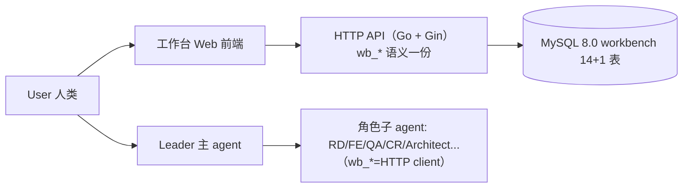
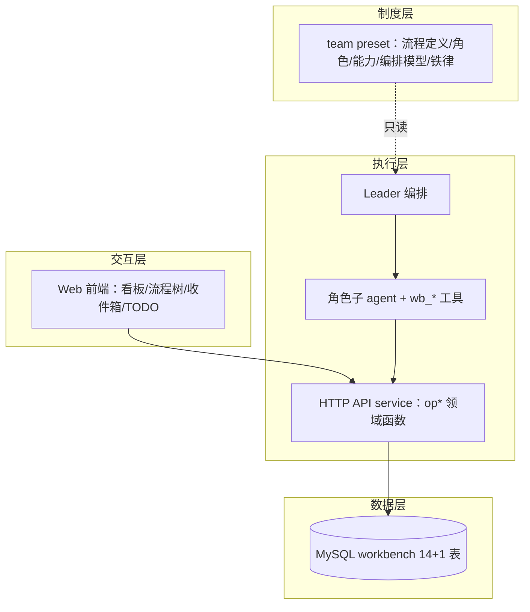
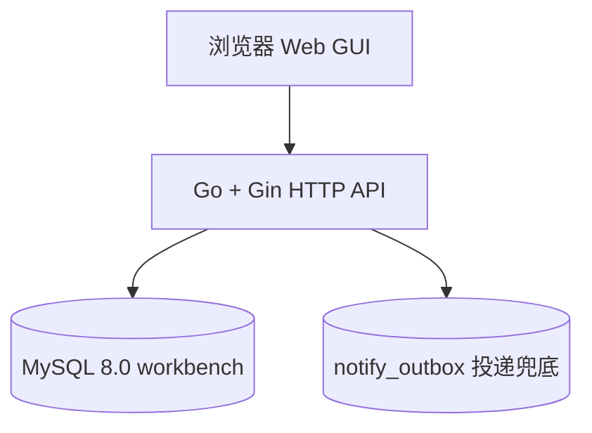
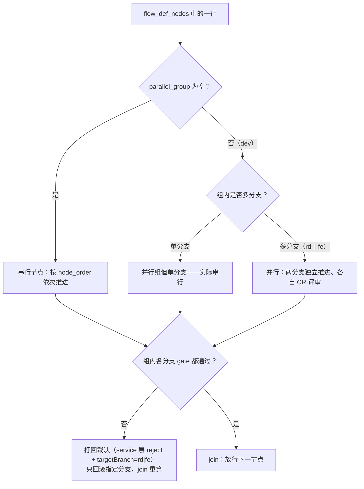

# 版本架构设计文档：v1.0 —— 团队项目工作台平台（总集）

> **本文件 = 现行设计单一权威（2026-09-12 MIG-07 合并拍板：「合并吧，保留一份权威的 arch_design」）**。原 docs-tmp 五件套（capability-model / capability-actions / business-flow-derivation / flow-derivation-tech-task-plan / data-tools / ui-interaction-final）已按本文件章节结构并入；历史沿革见 `.plan/timeline/`（decision-timeline.md / terminology-evolution.md）；推演底稿原件归档于 `.archive/docs-tmp-final/`。
> 词汇基准 = `CONTEXT.md`（现行词汇单点定义）。实现层规格（MySQL DDL / HTTP API）= `.plan/wbflow-impl/spec.md`（本文件不复制其正文，避免第二真相源）。

> **本文档是平台 v1.0 的架构设计总集**：整体架构 + 数据层 + 制度层（含节点编排模型）+ 执行层 + 文档规范 + 里程碑的合并文档。
> 定位：描述「项目管理 + OA 流程 + 评审协作」三合一平台的完整设计，并据此把平台自身拆解为可并行实现的需求单元（模块级 prd/rd/fe 见各 module 目录）。
> 交互层四模块的功能级设计见 `01-module-board/`、`02-module-flow-tree/`、`03-module-inbox-todo/` 下各 `prd/prd.md` + `rd/design.md` + `fe/design.md`。

---

## 0. 文档信息

| 项 | 值 |
|---|---|
| 版本 | v1.0 |
| 文档版本 / 状态 | v1.1（2026-09-12 MIG-07 合并五件套，单一设计权威） |
| 架构师 | Architect |
| 关联需求对齐 | 团队项目工作台 v1.0（平台整体立项，范围整体冻结） |
| 目标读者 | 前端 / 后端 / 测试 / 项目负责人 |
| 配套 | 词汇基准 `CONTEXT.md`；实现规格 `.plan/wbflow-impl/spec.md`；决策台账 `.plan/timeline/decision-timeline.md` |

## 1. 执行摘要

**团队项目工作台**是「项目管理 + OA 流程 + 评审协作」三合一交互系统，将三类工作收敛进一个工作台界面。核心差异点：每个流程阶段绑定产物、阶段下挂评审沟通记录、阶段由 Agent 角色（PM/RD/FE/QA/Architect）而非仅人类成员负责、门禁 = User 评审决策（双向多轮对话）。

平台采用**四层架构**：制度层（team preset，只读，含节点编排模型）→ 交互层（Web 前端；预留 DSH plugin 嵌入）→ 数据层（**MySQL 8.0，14+1 表**）→ 执行层（后端 Go + Gin，wb_* 语义一份、HTTP 一张皮）。四大模块：I 版本看板+需求池+需求管理+版本管理；II 需求 OA 流程树（评审闭环+产物阅读器+锚点评论+门禁）；III 门禁通知收件箱（User 全局）；IV TODO 列表。

节点编排 = **两层属性状态机**：`node.state` 可配动作相位（entry/exec/review/respond，done=离场终态）+ `reviewState` per-agent 评审轮（每评审位独立 reviewing→agree/unagree，collect 聚合判定 approved/rejected）。issue 走**五态状态机**（open/pending-confirm/to-fix/fixed/resolved）+ 复核事件（clarified/settle/qualify/reopen/declare-fixed/confirm/revise/override）。核心取舍一句话：**流程写死不造引擎、程序做路由 agent 做专业、数据与 UI 解耦、TASK 是唯一待办总线**。

## 2. 版本背景与范围

### 2.1 范围

- In scope（架构需支撑）：四层架构落地、四大模块（看板 / 流程树 / 收件箱 / TODO）、四类流程定义（business 13 节点 / tech 11 / task 7 / plan 9，共 40 定义节点）、9+1 角色 + 21 活跃能力 + 22 个 wb_* 工具语义、MySQL 领域存储、审计闭环、outbox 通知可靠性。
- Out of scope（本版本架构不覆盖）：DSH 嵌入适配器（接口已预留）、多项目切换 UI 完整版、diff 级锚点、看板拖拽换列、通用可视化流程编辑、依赖调度器（MVP 人工卡点）。
- 关键假设 & 约束：一期 = 自包含 Web 应用（MySQL 8.0 / Go + Gin / React+Vite+TS）；最高接缝 = HTTP API（agent 侧 wb_* 工具=HTTP client）；不建物理外键（逻辑引用）；乐观锁 = `updated_at`。

### 2.2 本次架构要解决的核心问题

- 如何把「制度（Agent 学习）」「界面（User 操作）」「数据（持久化）」「执行（Agent 编排）」四者解耦为可独立演进的层？
- 如何在不做可视化流程引擎的前提下，把 40 个定义节点、5 种交互模式统一为程序可路由、agent 仅做专业判断的确定性模型？
- 如何保证流程推进、评审、审计的数据一致性（两层状态机、issue 五态、audit_log、门禁前置校验、outbox 无限重试）？

## 3. 架构设计原则与决策

### 3.1 关键概念边界

| 概念 | 含义 | 归属 |
|---|---|---|
| 流程 / 角色 / 门禁制度 | 四类流程、9+1 角色、节点编排模型、门禁规则 | **制度层**（team preset，只读，供 Agent 学习遵循） |
| 交互工作台 | 版本看板 / OA 流程树 / 收件箱 / TODO | **交互层**（Web 前端，供 User 操作） |
| 过程数据 | 版本、需求、流程节点、产物、评论、任务 | **数据层**（MySQL 持久化） |
| 执行引擎 | 谁推进节点、生成产物、回复评审 | **执行层**（后端 service + 角色子 agent + wb_* 工具） |

**一句话**：制度进预设（Agent 学习并遵循），界面进前端（User 操作），数据进存储（持久化），执行靠 Agent 编排。

### 3.2 设计原则

1. **流程写死、不造引擎**：四类流程以确定节点/门禁建模，不做可视化流程编辑。
2. **门禁是人机交互的自然面**：User 确认 = 评审卡点；评审必有产出物 + 可对话 + 可带理由打回 + 可异议多轮 + 可引入新范围反向确认。
3. **数据与 UI 解耦**：数据层是单一可查询领域模型；UI 只是它的投影。
4. **渐进落地**：先静态流程骨架 + 交互原型，再接入真实 Agent 编排。
5. **程序做路由，agent 做专业**：节点/评审/归属/通知的路由由程序从数据推导（`wb_my_task`/默认路由），Agent 只做内容与专业判断。
6. **文档先行、小步多确认（协作节奏）**：每个里程碑先细化文档 → 产出**产品文档**（页面/交互/数据字段）→ **User 确认**后进入实现；实现中遇新决策点回到 1 补充产品文档再定。**纯数据/后端里程碑无可见页面时**，产品文档以「数据 Schema + 命令/查询接口说明 + 数据样例」呈现，同样需 User 确认。

### 3.3 关键技术决策（定稿）

| # | 决策 | 定稿 |
|---|---|---|
| 1 | 领域存储 | 文件存储 `.workbench/` JSON 起步 → sqlite（一版实现）→ **现行：MySQL 8.0**（DM-08，重新实现换栈）；磁盘仅保留产物文档本身（docs/ 仓库） |
| 2 | 制度只读 | 流程/角色/门禁落在 team preset（只读）；User 明文告知才调整 |
| 3 | 通知形态 | 经历「IM 收件箱 → 任务总线」演进，**定稿：TASK 是唯一待办总线**；通知/待回复由查询 `tasks`/`issues` 实时推导（通知是视图，不是数据）；投递可靠性走 **notify_outbox 消息事务表**（业务事务内 enqueue + 提交后 Flush + scanner 补投；**无 dead 终态、无限重试直至送达**，铁律#6） |
| 4 | 评论模型 | 统一「评论 = 问题」模型；**issue 五态** `open → pending-confirm →（resolved / to-fix / open）`；修复子机 `to-fix → fixed →（resolved / to-fix）`；复核事件 clarified/settle/qualify/reopen/declare-fixed/confirm/revise；override 是动作、结果置 resolved（**无 overridden 态**，09-12 裁决） |
| 5 | 锚点 | 两级：`range`（划词）/ `document`（文档级）（OPT-005 按飞书口径收窄；line/block 后端 400 废弃，存量只读兼容，-L3） |
| 6 | 项目边界 | 项目 = DSH workspace（目录），各一套独立数据；收件箱/TODO 为 User 全局（跨项目聚合，可按项目/任务名筛选） |
| 7 | 评审职责 | **各审各的 + 文档不自评（铁律#2）**：评审者只对自己职责内维度评审与表态；评审能力按「对象×角色」对象化（{role}.{object}-review，最小上下文） |
| 8 | 问题归属 | 三层：L1 锚点产物作者 → L2 节点 owner → L3 QA 跨端根因判定（`domain=rd\|fe`） |
| 9 | 流程演进 | 流程路由程序化（`wb_my_task` + 默认路由），persona 只留专业能力卡 + 3 行协作协议 |
| 10 | 进程约定 | 一期 Web 前后端分离（React+Vite+TS / Go+Gin）；未来 DSH 嵌入仅新增认证适配器 + conversation.view 挂载，无 API 变更（API-first） |
| 11 | 技术规格硬约束 | 可执行完整 DDL、每表 created_at+updated_at 毫秒、主键 BIGINT UNSIGNED AUTO_INCREMENT、不建物理外键、乐观锁=updated_at、JSON 载荷存 TEXT 不用 JSON 类型、proto 为真相源（DM-09） |

## 4. 整体架构

### 4.1 系统上下文



### 4.2 逻辑架构（四层）



- **交互层不直接改数据**：所有领域读写经 HTTP API 的 `wb.*` 契约；模型工具（`wb_*`）与 UI 共用同一套 `op*` 领域函数（同一审计/门禁/状态机）。
- **制度只读**：执行角色不得自行改制度；调整仅经「User 明文告知 → 协助调整 preset 文件」通道。

**主路径**：用户 → Web 前端 → HTTP API → op* 领域函数 → 数据层（交互 / 评审 → 流程推进 → 持久化）。

### 4.3 部署架构

一期为自包含 Web 应用：浏览器 + Go 后端（Gin，单实例）+ MySQL 8.0。未来 DSH 嵌入（conversation.view 槽）仅新增认证适配器，API 不变。



## 5. 组件与模块设计（交互层）

> 既有三份 PRD/RD/FE 设计（`01-module-board` / `02-module-flow-tree` / `03-module-inbox-todo`）为基线；本节后部（§5.4 起）为 v3 编排模型下的**交互增补层**（源：ui-interaction-final）——只写「改什么、加什么」，未提及处基线照旧。

### 5.1 模块 I：版本看板 / 需求池 / 需求管理 / 版本管理

- **目的**：外层入口，查看全部需求看板，管理需求与版本。
- **接口**：`wb.listRequirements / wb.listVersions / wb.getRequirement / wb.createRequirement / wb.updateRequirement / wb.deleteRequirement / wb.createVersion / wb.updateVersion / wb.advanceVersion / wb.deprecateVersion / wb.deleteVersion`（HTTP 路由以 spec §1.2 为准）。
- **数据**：requirements / versions 两表；需求编辑审计 `audit_log`。
- **状态机**：版本 `待启动→进行中→已发布` 单向，任意阶段可废弃——**条件解绑**（VER-05 裁决 A）：其下全部需求未开始 → 废弃/下掉回待分配池（**不取消需求**）；任一需求已进入编排 → 拦截（spec §1.2 注记-A）。需求 `待启动/进行中/已完成/已取消`，与编排推进自动联动（BUG-001：待启动节点通过→进行中；落位尾节点→已完成，§7.3）。
- 设计细节见 `01-module-board/{prd/prd.md, rd/design.md, fe/design.md}`；v3 增补见 §5.4。

### 5.2 模块 II：需求 OA 流程树（需求详情页）

- **目的**：价值核心模块——在详情页评审产物、多轮对话、推进流程。
- **技术**：流程树视图 + 产物阅读器 + 锚点评论 + 门禁拍板卡。
- **接口**：comment / reply / resolve / reopen / review（表态）/ confirm-review / add-artifact / my-task / assign-task / task-update 等（HTTP 路由以 spec §1.2 为准）；**override / decide 不在 agent 工具清单**——语义保留 service 层（拍板卡/裁决卡由 User UI 触发）。
- **数据**：flows / flow_nodes / artifacts / issues / review_results（flow_nodes 单 JSON 字段）。
- 设计细节见 `02-module-flow-tree/{prd/prd.md, rd/design.md, fe/design.md}`；v3 增补（五区分栏/拍板卡/冲突卡/会话通道）见 §5.5。

### 5.3 模块 III/IV：门禁通知收件箱 + TODO 列表

- **目的**：任何需 User 回应的沟通进收件箱；TODO 是收件箱的可操作投影。
- **数据**：查询投影 `tasks`/`issues`，不建通知表；投递触达保障走 notify_outbox。
- 设计细节见 `03-module-inbox-todo/{prd/prd.md, rd/design.md, fe/design.md}`；v3 七类通知见 §5.6。

### 5.4 模块 I 增补（看板 / 需求池 / 版本管理）

| 增补点 | 规格 |
|---|---|
| **scope 徽标** | 需求卡/列表行/详情补 scope 徽标（full / rd / fe，三色区分）——需求 scope 三值 |
| **dependencies 角标** | 需求卡/详情补依赖数（`依赖 ×N`）；点开显示前置需求名列表（flows.dependencies） |
| **依赖树视图** | 版本管理弹窗内新增「依赖树」入口：按版本动态加载依赖树（plugin 内置分层派生，不对用户显示层级；**分析师按需拉取，非常驻**） |
| **并发度配置入口** | 版本管理内「并发调度」区（长期预留展示：并发度=正在工作的需求数、就绪池规则说明）——MVP 人工卡点（节点 0 user_gate=1），调度器为长期 effort |
| 版本管理基线交互 | 版本状态机 待启动→进行中→已发布（单向）+ 条件解绑废弃 + 发布软约束 + 删除有引用禁止 + 进度四色条 + 行操作（完整吸收基线，零改动） |
| **类别标签（tag）** | 需求卡/列表/详情的类别徽标（【需求任务】【规划审批任务】【版本规划任务】）——**类别↔流程类型绑定**：需求任务→business/tech/task（scope 三值）、规划审批任务/版本规划任务→plan（无 scope）；scope_options 随类别派生 |
| **owner 提示规则** | 架构→Architect；纯后端→RD；纯前端→FE——与 scope 三值呼应，新建弹窗按类别/侧提示默认负责人 |
| **变更历史面板** | 既有 histPanel（自然语句审计）保留，与详情五区分栏并存 |

### 5.5 模块 II 增补（流程树 / 节点详情 / 拍板卡 / 冲突卡）

**流程树 → SVG 横向流程图**：

| 增补点 | 规格 |
|---|---|
| **scope 动态渲染重排** | 节点集 = `flow_def_nodes.scope 表达式 ∩ requirement.scope`；过滤后**重新分组排布 + 重编号**（被裁节点不占位）；并行组仅当两侧节点都可见时保留泳道/分叉汇聚，单侧可见并入主链 |
| **节点行双属性** | 节点方块 = 状态点 + 节点名（渲染序号）+ `↩N` + **相位角标**：exec 期=当前动作名；review 期=collect 聚合快照「表态 N/M · unagree N」（派生自 review_results，非节点级状态） |
| 交互 | 点击节点 → 右列详情；横向滚动（沿用基线） |

**节点详情：右列五区分栏**：

| 区 | 内容 |
|---|---|
| ① 状态卡（双行） | 执行行（node.state 徽标 + 当前挂载动作名）；审批行（collect 聚合快照：agree N · unagree N · reviewing N；无评审位恒 '-'） |
| ② 评审状态行 | per-agent 表态：各评审位 **reviewing / agree / unagree** 药丸 + open 数；点药丸展开角色对话区（轮内完整时间线视图暂缓） |
| ③ 产物区 | 文件行 + 评论数 + link 外链（基线不变）——点击 → 产物阅读器（锚点评论，§5.7） |
| ④ 意见区 | 评论操作矩阵（状态×操作者）+ **escalate 标记** + 冲突卡 |
| ⑤ 门禁 / 拍板卡 | 三态（见下） |
| 会话 tab | 节点关联 sessions 列表（历史/进行中 subagent 对话，不经中转；条目=绑定角色+状态+最近消息摘要+时间） |
| 变更历史 | 底部折叠卡：描述 Markdown（折叠 150px 可展开）+ 元信息行 + 变更历史自然语句 |

**门禁 / 拍板卡三态（user_gate 节点）**：

| 态 | 呈现 | 操作 |
|---|---|---|
| 进度态（评审轮进行中） | 只读：表态 N/M + 工单统计（open/pending-confirm/resolved） | 无按钮（拍板置灰） |
| **门禁待拍板（gate_pending）→ 迎宾呈现态** | 门禁汇总（各评审位结论 + resolved 摘要 + 产物链接 + 建议）——owner 报送 | 通过 / 打回（必填理由，走 reject 结论协议）/ 会话找 owner / 跳节点详情 |
| 收件箱联动 | 「待你拍板」通知，双通道：收件箱=系统投递（plugin）、迎宾=owner 呈现（agent 层） | 点此跳节点详情 |

**冲突卡与上升（取代 override 强权入口）**：

- 澄清/复核循环不收敛 → 任一方 `escalate` 标记 → 评论区聚合**冲突卡**：分歧点 + **正反双方结论汇总两栏对照** + issue 线程引用 + 「上升裁决」按钮。
- 上升裁决 session：reviewer 主持（开场白=分歧点+双方立场）→ 用户结论 → **回填冲突 issue**（数据层留痕）→ reviewer 重新表态（回 reviewing）→ 正常判据链恢复。
- **override 强权入口移除**（wb_override 移出 agent 清单；冲突走上升仲裁；override 动作语义保留 service 层且只开两格，§7.3）。
- 死循环兜底：轮内不收敛走 escalate；User 与评审者反复分歧走线下（流程内不建模）。

**对齐节点详情（交互型）**：右列以**会话为主体**——顶部状态条（entry · 等待你的输入 + 响应者）+ 会话视图；底部单按钮「**完成对齐**」（User 确认 → to-brd 生成落盘 → 迁移下一节点）——无 BRD 预览审批步（brd 在下一节点产物区可见）。用户确认 = 唯一完成信号；程序兜底 = 周期提醒（扫描器）。

**按需会话通道按钮**：节点详情/门禁卡常驻「会话找 X」（X=绑定角色，**按 scope 动态：full=qa / 单侧=开发执行者**）——用户验收报障直连开发方；点击 → plugin 泛用接口拉起该角色会话（开场白模板随绑定配置）→ 结论回填 issue。

### 5.6 模块 III/IV 增补（收件箱七类 / TODO 五分类）

**收件箱条目类型（七类）**：

| 类型 | 触发 | 报送责任人 | 用户动作/跳转 |
|---|---|---|---|
| **待你拍板** | 门禁 agreed + user_gate | owner（迎宾呈现+收件箱双通道） | 迎宾拍板卡 |
| **澄清任务** | collect 判 unagree | owner（澄清 issue 清单） | 节点详情意见区 |
| **重新表态请求** | 澄清回填**或修复提交（to-fix→fixed）**后请 reviewer/提评者回到评审循环（含 retest 复验） | reviewer/提评者（followup/复用通道） | 节点详情 |
| **悬置催办** | 已结束 5min 未表态 | reviewer（followup 文案：遇卡点上报） | reviewer followup（不进 User 列表） |
| **需你介入** | 10min 仍未推进 | plugin → User | 节点详情 |
| **冲突上升裁决** | escalate 标记 | reviewer 主持 | 冲突卡 |
| **会话消息** | 按需通道/对齐未读 | 绑定角色 | 对应会话视图 |

收件箱按接收人投递，User 列表=报送对象含 User 的子集。

**TODO 五分类（收件箱操作投影，同源同筛选）**：待拍板←待你拍板；待澄清←澄清任务；待重表态←重新表态请求（澄清子型）；待复验←重新表态请求（retest 子型）；冲突待裁决←冲突上升裁决。悬置催办/需你介入为提醒类，不产生 TODO。点击跳对应节点详情（scope 过滤后定位）。

### 5.7 产物阅读器（基线吸收 · 零改动）

- 弹窗飞书式 ~72vw×85vh；轻量 Markdown 渲染 + 行号（1-based）；底部固定输入框（文案随选中态变化）。
- **锚两级展示**：range=划词（末行一次展示）；document=正文末尾（line/block 后端 400 废弃，存量只读兼容，-L3）。
- **划词锚防漂移**：按去空白原文指纹（lineText 同法）反查内容相同位置重锚定；未命中就近展示标注，用户确认时更新。
- 评论操作矩阵（状态×操作者）与「不可编辑/删除、误发 reply 标注作废」规则全部沿用。
- 评审上下文 issue 类评论必须携带 anchorArtifactId（BUG-013「所有的评审都是挂在文档上的」）。

## 6. 需求拆解（架构驱动拆分）

> 平台整体立项，按架构把自身拆为**架构需求单元（AUR）**，与工作台四个模块对应——模块即需求，各自 prd + rd/design + fe/design 一套，可并行演进。

### 6.1 拆解依据

| 拆解原则 | 说明 |
|---|---|
| 以组件/模块边界为拆分单位 | 模块 I/II/III-IV 各归一个需求单元，职责无歧义 |
| 接口契约先行 | 各模块 walk 同一套 `wb.*` RPC 契约，冻结后并行 |
| 数据/存储依赖按序 | 共享领域实体模型（§7），先立数据层 |
| 依赖图 + 拓扑排序 | 数据层 → 模块 II（核心）→ 模块 I → 模块 III/IV |
| 粒度标准 | 每单元可独立开发、独立集成、有验收标准 |

### 6.2 拆解结果表（AUR）

| 父需求(Epic) | 拆解单元编号 | 架构需求单元（AUR） | 归属组件/模块 | 依赖 | 可并行 | 验收要点 |
|---|---|---|---|---|---|---|
| 平台 v1.0 | AUR-001 | 数据层与领域模型 | §7 | —— | 是 | 实体/状态机/审计一致 |
| 平台 v1.0 | AUR-002 | 模块 II：OA 流程树 | 02-module-flow-tree | AUR-001 | 是 | 评审闭环/门禁/锚点 |
| 平台 v1.0 | AUR-003 | 模块 I：看板/需求/版本 | 01-module-board | AUR-001 | 是 | CRUD/审计/状态机 |
| 平台 v1.0 | AUR-004 | 模块 III/IV：收件箱/TODO | 03-module-inbox-todo | AUR-002 | 是 | 查询投影/跳转 |
| 平台 v1.0 | AUR-005 | 制度层 + 执行层 | §8/§9 | AUR-002 | 是 | preset+工具+编排 |

### 6.3 依赖与并行批次

| 批次 | 拆解单元 | 并行说明 |
|---|---|---|
| 第 1 批（基座） | AUR-001 数据层 | 先立实体/状态机，供其余消费 |
| 第 2 批（并行） | AUR-002、AUR-003、AUR-005 | 契约（`wb.*`/实体）冻结后三线并行 |
| 第 3 批 | AUR-004 | 依赖模块 II 事件，聚合收件箱 |

## 7. 数据层（领域模型与存储）

> 数据层唯一真相源：实体字段、状态机、存储形态。**表结构完整 DDL 真相源 = spec §0（MySQL 14 表）+ 迁移链 `rd/migration/sql/0001-0004`**（0004 增 notify_outbox，共 15 表）；本节只写设计口径与语义，不复制 DDL——避免第二真相源。
> 交互层状态机行为见各模块文档；本节约给出精确转移定义。

### 7.1 存储形态与演进

| 阶段 | 载体 | 状态 |
|---|---|---|
| 起步（推演期） | `.workbench/*.json` 文件存储，透明可 diff | 已废弃（JSON 载体退役） |
| 一版实现 | `.workbench/workbench.db`（sqlite 11 表，WAL） | 已冻结（workbench-sql/ 设计期底稿，不再演进） |
| **现行（重新实现）** | **MySQL 8.0**：spec §0 全量 14 表 + `notify_outbox`（迁移链 0001-0004，已建库 seed） | ✅ 运行时真相 |

- **表数口径**：定义层 4（roles / capabilities / flow_defs / flow_def_nodes）+ 实例层 7（flows / flow_nodes / tasks / artifacts / issues / sessions / requirements、versions 收编）+ 支撑层 3（audit_log / meta / notify_outbox）。
- **需求/版本本体**：原 `.workbench/requirements.json + versions.json` 已 MySQL 收编（spec §0.3 requirements/versions 两表），JSON 载体废弃，磁盘仅保留产物文档本身（docs/ 仓库）。
- **工程约定（普适，逐表适用）**：主键 BIGINT UNSIGNED AUTO_INCREMENT；不建物理外键（`xx_id` 列+索引，逻辑引用同名同值，完整性 service 层保证）；乐观锁=`updated_at`；JSON 载荷统一 TEXT 列（不用 MySQL JSON 类型）；默认 NOT NULL、字符串缺省空串，仅数值/时间/整型引用列按 NULL 清单保留（spec §0.2）；每表 created_at+updated_at（unix 毫秒，append-only 表两者恒同值）。

### 7.2 实体定义（语义要点）

> 逐列定义见 spec §0；此处只列设计语义与易错点。

**Version（版本）**：`version_id`（`v-<n>`；`v-backlog` 固定待分配保留项）+ `name` + `state`（待启动/进行中/已发布/已废弃）+ `is_backlog`。状态机：单向推进；废弃=终态，**条件解绑**（VER-05：已开始需求禁止废弃；未开始直接下掉回待分配池，不取消需求）。

**Requirement（需求）**：`requirement_id`（req-<序号>）、title、description（Markdown）、category（类别标签→流程类型绑定）、`flow_defs_id`（由 category 派生）、version_id（NULL=待分配池）、priority（P0-P3）、status（待启动/进行中/已完成/已取消）、owner（负责人角色；规则见 §8.1）。编辑审计走 audit_log（原 history[] 已收编）。

**FlowDef / FlowDefNode（流程定义，原 flow_templates / flow_template_nodes）**：`flow_defs_id`（business/tech/task/plan）+ `scope_options`（business/tech={full,rd,fe}、task={rd,fe}、plan=[]）。定义节点：`template_node_id`（稳定 id 如 bus-03）、node_order、node_key、**node_type**（produce/review/align/gate 四类）、gate（准出判定，与 node_type 正交）、**user_gate**（User 终审拍板位）、**scope_expr**（渲染集合表达式，§8.4）、reviewers[]（静态评审位声明 `[{role, capability_id, scope?}]`）、**node_actions**（动作激活清单两类条目：capability 激活 + node action）、expected_outputs。

**Flow / FlowNode（流程/节点实例）**：flows 含 `dependencies`（同版本前置需求 JSON 数组；plan D7 create_reqs 从 architecture 需求拆解节写入）+ `scope`（生效范围）+ current_node_id（NULL=未进入编排）。flow_nodes：`def_node_id`（引用定义节点）、**state**（`''`=未进入编排 / entry / exec / review / respond；done=离场终态语义见 §7.3）、**review_results**（单 JSON 字段承载全部评审位轮转 `[{role, capabilityId, state: reviewing|agree|unagree, round, at}]`——collect 反复更新与读取）、`reopen_source`（''/upstream-reject/downstream-reject/rework-return——plugin 回退时写入）、rolled_back_count（0=首次，≥1=重入）、reviewers[]（scope 过滤后实例声明）、feature_branch、entered_at、pending_scope、last_decision（门禁裁决 approved/rejected 由其承载，JSON 含 reject 结论协议 branches/confirmed_issues/context）。

**Task（任务，唯一待办总线）**：task_id、requirement_id、node_id、**action_id**（能力×动作定位）、branch、role_id、task_type（produce/dev/review/respond/accept/create_reqs）、goal、context（确定性上下文 JSON）、status（todo/in-progress/awaiting-reply/**completed（仅判据校验通过后置，agent 不可直置）**/rejected/closed）、root_issue_id（锚定线程）、派发/断点四件套（dispatch_at/last_ack/last_progress/resume_hint）、done_at/closed_at。派发幂等键 `reqId+nodeId+action_id+assignee`。

**Artifact（产物）**：artifact_id（art-<ts>）、requirement_id、node_id、**product_type**（受控枚举：brd/product_doc/rd_design/fe_design/architecture/research/plan/alignment/dev_notes/code_mr/test_result/defect/discussion；无 case_design）、label、href（相对 docs root 或外链）、kind（document|link）、note、added_by。**产物入库约束（注记-K，铁律#4）**：expected_outputs 期望产物必须 kind=document 且 href 相对 docs root 真实存在；link 仅期望外补充外链。

**Issue（评论/问题，五态状态机 v2）**：issue_id（cm-<ts>）、anchor（anchor_kind + anchor_artifact_id + 位置列）、author/role_id/reviewer_role、issue_type（issue/notification/discussion）、assignee、text、replies（JSON 不可变追加，含裁决结论回填）、**state（open/pending-confirm/to-fix/fixed/resolved；无 overridden 态）**、**escalate**（冲突上升标记）、**loop_count**（回退计数：澄清期读=reopen 次数、修复期读=revise 次数）、resolve 族（resolve_by/at/note/`resolve_path（fix|agree|override）`/resolve_reviewer_confirmed）、resolved 族。转移精确定义见 §7.3。

**Session（会话绑定，#10）**：session_id、requirement_id、node_id、role_id（绑定角色，**支持按 scope 动态**：full=qa / 单侧=开发执行者）、dsh_ref（DSH 会话句柄）、status（active/ended/disposed）。用途：flow↔session 绑定注册表 + 按需会话通道共用；UI 经插件页面查看 subagent 对话不经 Leader 中转。

**NotifyOutbox（通知事务表，0004 增）**：业务事务内 enqueue + 提交后 FlushPending + scanner SweepOutbox 补投；**无 dead 终态、无限重试直至送达**（NTF-04/05）。

**支撑表**：audit_log（append-only，`{table_name, row_id, action, field, old_value, new_value, by_who, created_at}`——agent 每步改库留痕，精确到字段）；meta（schema_version 等）。

### 7.3 状态机（精确转移，v5 口径）

**节点相位（flow_nodes.state）**

- `''`（未进入编排，无占位）→ 激活后进入可配动作相位：**entry / exec / review / respond**（可配动作相位 4 值，每相位按 node_actions 激活清单挂动作，**一个 state 只挂一个动作**，铁律#1）。
- **done = 离场业务终态**：节点通过迁移下一节点时前置相位统一置 done；done 禁挂载；被打回复位重入（BUG-016/CMT-05）。
- exec 支持首/重入双配置，按 `rolled_back_count`（0=首次，≥1=重入）选择；`reopen_source` 记录重开来源（upstream-reject/downstream-reject/rework-return）。

**评审轮（reviewState，per-agent 三态）**

- 每一个评审位（agent）各自独立轮转：**reviewing（评审+表态中）→ agree / unagree（已表态）**；数据在 `flow_nodes.review_results[]`。
- agent 自判上报（**知道自己有 open 工单 → 报 unagree；没有 → 报 agree**；plugin 不判 open 工单，wb_review 落库）。
- **collect 聚合（plugin 内置，无状态机）**：①收票——实时查询全部评审位是否已上报；②判定——**全 agree → agreed（collect 层专用词，达成一致的判定输出）→ 门禁 approved；有 unagree → 触发 owner 澄清 → 回①重新收集循环**；③再收票——澄清后重新等待表态。
- **澄清后重新表态（内置机制，不设专门 state）**：owner 澄清后 plugin 将澄清 issue 发给对应 reviewer（followup）→ 该 reviewer **回 reviewing 重新表态** → collect 重新收集。等待重新表态阶段不挂载任何 action、不暴露。
- **approved / rejected 是门禁裁决结果**（汇总级，由 `last_decision` 承载）——reviewState 不包含它们；reviewState 亦无 collecting/clarifying/confirming/agreed 存储态（REV-07/08）。
- **门禁**：user_gate=1 → agreed 后唤醒 User 终审（拍板：通过 → 迁移下一节点；不通过 → 问题记 issue 回澄清循环）；user_gate=0 → 机械 approved。
- 拦截最小原则（铁律#5）：应有产物未提交不允许过 exec——**在最初的地方拦截**，approve 不判投票/澄清遗漏。

**正交关系**：state 与 reviewState 两列独立——exec 期 reviewState 恒 '-'（无评审位节点亦然）；review 期间各评审位各自轮转。UI 分开显示「当前执行动作」与「各评审位表态」。

**Issue 五态 + 复核事件（澄清/修复双子机，逐 issue）**

```
澄清子机（owner respond 相位）：
open（待澄清）
  └─ owner 申报 clarified（澄清完成，API 通道回复/解决）→ pending-confirm（已澄清待复核）
pending-confirm 复核位三出口（评审者/提评者裁定）：
  ① settle（协商一致）→ resolved（门禁放行）
  ② qualify（定性真问题）→ to-fix（触发打回）
  ③ reopen（未解释清楚）→ open（loop_count+1，通知 owner）

修复子机（产出节点 exec 重入相位）：
to-fix（待修复）→ owner 申报 declare-fixed（修复完成）→ fixed（已修复待复核）
fixed 复核位两出口：
  ① confirm（修复成功）→ resolved
  ② revise（修复失败）→ to-fix（loop_count+1）

override（User 仲裁动作，只开两格）：
  pending-confirm → resolved（澄清期上升，issue 先回待复核等仲裁）
  fixed → resolved（修复期反复修复不成功上升；判定主体=产出节点 re-exec 按 revise 计数，判定时点 issue=fixed）
  open / to-fix 不接受 override。override 是动作、结果置 resolved——无 overridden 态（09-12 裁决）。
```

- **事件名（领域词，权威=CONTEXT.md）**：`clarified`（owner 澄清完成申报）/ `settle`（协商一致→resolved）/ `qualify`（定性→to-fix）/ `reopen`（复核不通过→open）/ `declare-fixed`（owner 修复完成申报）/ `confirm`（修复成功→resolved）/ `revise`（修复失败→to-fix）/ `override`（User 仲裁→resolved）。open×settle 开格限场景=提评者撤回（OVR-06③）。
- **API 工具词映射**：现行 API（wb_reply / wb_resolve / wb_confirm_review / wb_reopen 等）与领域事件名存在 gap，映射修复已立项（NAM-09 todo：先文档映射 → 代码契约修复 → 替换）；本文以领域事件名为准。
- **agent 只在被调用时响应（铁律#3）**：待复核态无自主追加；补充信息合法路径=复核者 reopen；pending-confirm×clarified、fixed×declare-fixed 自循环=非法。
- **assignee 规则**：普通评审意见 → 锚定产物作者（谁的产物谁改）；QA 验收缺陷 → 显式指派 RD|FE（配合 targetBranch 部分回滚）。
- **QA 缺陷特殊化**：QA 建缺陷（assignee=RD|FE）→ RD/FE 处理：真缺陷修复（declare-fixed）；认为误判/非缺陷 → **直接带理由解决**——**不存在「RD 打回 QA」**，带理由解决即异议表达 → QA 复核（最终裁定）：认可 → confirm 关闭；不认可 → reopen，RD/FE 继续。**与流程级打回区分**：打回裁决（reject + targetBranch）是验收**整体打回开发阶段**（批量退回）；issue reopen 是**单条缺陷**不认可修复——两级裁决语义不同。
- **拉锯升级**：澄清期 loop_count≥5 自动上升（会话通道 User 仲裁）；修复期反复修复不成功由 re-exec 按 revise 计数判上升（issue 时点=fixed）。

**任务状态（Task.status）**

```
todo → in-progress（执行者 ack）→ awaiting-reply（等回复/表态）→ completed（仅 plugin 判据校验通过后置）→ closed
     ↘ rejected → in-progress（返工重做）
```

**需求/版本状态**

- 需求 `status`：`待启动 / 进行中 / 已完成 / 已取消`；与编排推进自动联动（BUG-001，同事务落值+审计，幂等，已取消为终态不覆盖；手动更新仍可显式改）：**待启动节点通过（flows.current_node_id 空变非空）→ 进行中；落位尾节点 → 已完成**。
- 版本状态机：`待启动 → 进行中 → 已发布` 单向 + 条件解绑废弃（§7.2）。

### 7.4 审计与一致性

- **审计即证据（audit_log）**：每次写操作记录 `{table_name, row_id（业务主键）, action(INSERT|UPDATE|DELETE), field, old_value, new_value, by_who, created_at}`——精确到字段的变更历史；历史轮评审表态由 audit_log 回放（不加新表）。
- **乐观锁**：UPDATE 带 `updated_at` 读取时值，0 行命中 → 版本冲突（上层重试或报错）。
- **一致性校验**：节点执行者必须拥有节点绑定的能力（role_id 匹配 capabilities.role_id）；唯一例外 task 流程执行者动态占位。
- **写策略**：所有 `wb.*` 写操作返回最新快照（纯 JSON、lossless——无 undefined 字段）；单写入者（Leader 主导）无并发锁。

### 7.5 表结构真相源声明

- **完整 DDL 唯一真相源 = `.plan/wbflow-impl/spec.md` §0（MySQL 14 表）+ `rd/migration/sql/0001-0004` 迁移链**（0004 增 notify_outbox）。本文件与任何其他文档不得复制完整 DDL（避免第二真相源）。
- 一版 sqlite 设计稿（11 表，v0.15~v0.29 时代）冻结于 `workbench-sql/`（仅作参考，表名/列名以 MySQL 迁移链为准：flow_defs / flow_def_nodes 更名已落）。
- schema 演进纪律：改结构 → 迁移链追加版本化脚本（禁止自动 DROP；重复应用零效应）。

### 7.6 迁移与并发

- **迁移链**：`rd/migration/sql/` 版本化——0001 全量 schema（14 表）+ 0002 seed + 0003 flows.scope/flow_nodes.last_decision 补列 + 0004 notify_outbox。
- **并发**：MySQL InnoDB；乐观锁 updated_at；应用层单写入者（Leader 主导）。
- **幂等声明（全局）**：`event:'complete'` 幂等（判据为数据状态，重复上报无害）；回退动作按 `requirement_id+node_id+round` 幂等；task 派发按 `reqId+nodeId+action_id+assignee` 幂等。

### 7.7 表清单与关联（概念模型）

> 完整字段与索引见 spec §0；此处列 15 表分组与关键逻辑引用（子表关联列与父表业务主键同名同值，无物理外键）。

| 分组 | 表 | 关键逻辑引用 |
|---|---|---|
| 定义层（4） | roles / capabilities / flow_defs / flow_def_nodes | capabilities.role_id→roles；flow_def_nodes.flow_defs_id→flow_defs；flow_def_nodes.capability_id（reviewers/node_actions/expected_outputs JSON 内）→capabilities |
| 实例层（7） | flows / flow_nodes / tasks / artifacts / issues / sessions / requirements·versions | flows.requirement_id→requirements；flow_nodes.def_node_id→flow_def_nodes.template_node_id；tasks/artifacts/issues.requirement_id+node_id；tasks.root_issue_id→issues；issues.anchor_artifact_id→artifacts；flows.current_node_id→flow_nodes |
| 支撑层（3） | audit_log / meta / notify_outbox | audit_log.row_id=各表业务主键值 |

**需求依赖树（plugin 层内置）**：plugin 依据 flows.dependencies 构建版本内需求依赖树——需求实例按依赖自动注册在各自父节点下；分层由依赖图派生（拓扑分层），不对用户显示层级；树视图分析师动态加载（非常驻）。调度器（长期）：就绪池=依赖全部 approved 的节点，按高优 priority 拉取（business/tech/task 适用，plan 除外）；MVP 人工卡点（节点 0 user_gate=1）。

## 8. 制度层（角色 · 编排模型 · 流程定义 · 能力 · 评审分工）

> 制度层以 **DSH team preset** 落地：团队内任何 agent 会话（主会话 + 子 agent）加载同一份制度。preset 决定：该会话挂哪些工具、系统提示中的制度内容、可加载哪些 skill（`wb-agent-guide` 工具组合流程 / `team-conventions` 速查）。

### 8.1 团队角色（9+1）

| 角色 | 职责（一句话） |
|---|---|
| User | 需求提出方 / 最终决策者，制度唯一修改入口（确认范围、拍板发布） |
| Leader | 团队负责人：拆解任务、分派 owner、门禁裁决（service 层）与 create_reqs 直执行 |
| Investigator | 调研 / 澄清需求，输出调研结论（竞品/开源：引入 or 重写，为什么） |
| Architect | 技术方案设计与评审：产品设计、技术路线、架构规划、版本规划 |
| RD | 后端研发：技术设计、开发与自测 |
| PM | 项目管理 / 范围管控：需求价值、优先级、排期与依赖 |
| FE | 前端研发：技术设计、开发与自测 |
| QA | 测试与验收：验收执行、缺陷闭环（含跨端根因判定；用例设计合并入验收，QA-02） |
| Code Reviewer | 代码评审：代码质量、设计落地、回归风险 |
| executor（动态占位） | 任务流程（task）的动态执行者：由 User/Leader 指定，实例化时按实际执行者解析 |

**owner 规则**：需求任务 `scope=fe` → FE；`rd`/含 rd → RD；架构规划类→Architect；任务流程执行者由 User/Leader 指定。

### 8.2 节点编排模型（两层属性状态机 · 定稿）

> 源：capability-model-final v3（2026-09-05 定稿，09-08 v5 评审轮重构，09-11/09-12 批注定稿）。历史演进与作废裁决见附录 A。

#### 8.2.1 可配动作相位（node.state）

| state | 语义 | 典型挂载 |
|---|---|---|
| **entry** | 进入节点：首次=开场迎宾；重入=重迎宾（多配置按 rolled_back_count 选） | 开场白 action（内置强制等待指令）——交互型专属 |
| **exec** | 执行：**首次=主产出**（produce/dev/accept→skill）；**重入=域分立**（文档域 revise / 代码域 diagnosing-bugs / QA 域 retest，rolled_back_count≥1 触发） | skill/inline |
| **review** | 评审相位：评审位按审批 skills map 各自评审表态；无内嵌评审的节点跳过；**审批类节点以 review 为产出动作位（exec 不配置）** | review→skill（各评审位对象化） |
| **respond** | owner 响应期：跨节点评审=澄清（clarify 单挂）；节点内 CR=只修复（fix_on_review 单挂，CR 异化裁决） | clarify / fix_on_review（按节点激活清单） |
| **done** | 离场业务终态：节点通过迁移下一节点时前置相位统一置 done；**禁挂载**；打回复位 | ——（无挂载） |

节点未进入编排 = 无 state（不设占位，`''`）。**空转规则**：相位无挂载 → plugin 直接轮转（视为通过）。

#### 8.2.2 评审轮（reviewState，per-agent 三态）与 collect

见 §7.3「评审轮」——数据模型与转移的权威定义在彼处；此处补编排语义：

- reviewState 是**每个评审位各自**的轮转状态（1/N），非节点整体状态；节点级聚合由 collect 内置逻辑完成（不暴露、无专门 state）。
- collect 完整动作三段：**收票**（实时查询各 reviewer verdict）→ **判定**（全 agree → agreed → 门禁；有 unagree → owner 澄清循环）→ **再收票**（澄清后重新等待）。
- 确认真问题（qualify → to-fix）→ rejected 回上一节点（沿既有裁决打回）。

#### 8.2.3 裁决规则（collect 输出，plugin 内置）

```
collect 收集全部评审位上报（agree / unagree）：
  ├─ 全 agree → agreed → 门禁（user_gate=1 唤醒 User 终审：通过 → 迁移下一节点；
  │         不通过 → 问题记 issue 回澄清循环）（user_gate=0 → 机械 approved）
  └─ 有 unagree → owner 澄清（plugin 派发澄清任务）→ 澄清后 plugin 将 issue 发回对应
                    reviewer 重新表态（回 reviewing）→ 重新收集循环
                       └─ 确认真问题（qualify→to-fix）→ 打回：rejected → 上一节点 exec 重入
```

- 节点内评审（CR 异化）**永不产生 rejected**——unagree 循环（respond 修复→重表态）至全 agree。
- 上升（escalate）：循环不收敛 → 会话通道 User 仲裁 → 结论回填 issue → reviewer 重新表态（§5.5 冲突卡）。

#### 8.2.4 回退与重入

- **reject（裁决事件）→ plugin 回退被重做节点**（数据路由：targetBranch / 缺陷 assignee 映射，非节点写死逻辑）→ 目标节点 exec 重入（域分立动作）→ 完成上报 → 重新提评 → 评审相位重开（reviewing）。
- **重入识别**：rolled_back_count（0=首次，≥1=重入）——entry/exec 的多配置按计数选择；reopen_source 记录重开来源。
- 并行组 2 对 1：只回滚被重做分支（targetBranch），其余分支维持 approved，join 重算。

#### 8.2.5 评审轮内部小状态机（澄清/修复双子机）

见 §7.3「Issue 五态 + 复核事件」——issue 逐条走澄清子机（open→pending-confirm→resolved/to-fix/open）与修复子机（to-fix→fixed→resolved/to-fix），loop_count 单计数器承载拉锯。**UI 视角规则**：reviewing 看表态标签矩阵（各评审位 × 三态）；澄清/修复看 **issue 视角**（每条工单的子状态+计数），非角色状态栏。

#### 8.2.6 节点类型实例化（四类）

| 节点类型 | 可配相位 | reviewState | 例 |
|---|---|---|---|
| **产出类（有内审）** | exec（首/重入）→ review → respond → review… | per-agent 三态（CR 异化：respond=fix_on_review，无 rejected 出口） | RD/FE 开发 |
| **产出类（无内审）** | exec（首/重入） | 恒 '-'（评审在下游审批类节点；**编写文档节点没有 review**——共识） | 产品设计 / RD·FE 技术设计 |
| **审批类** | **review（产出动作位，exec 不配置）** | per-agent 三态（collect 判定→门禁 approved/rejected） | 产品设计评审 / RD·FE 技术评审 / 调研评审 / 架构规划评审 |
| **交互类** | entry → exec（to-brd / to-alignment） | 恒 '-' | 需求对齐 |
| **门禁类** | entry（迎宾呈现+会话通道） | 恒 '-' | 待启动 / 用户验收 / 立项评审（D2 门禁型） |

交互/门禁类无 collect/review（空转规则：无挂载相位直过）。

#### 8.2.7 评审双轨制

| | 节点内评审（CR 异化） | 跨节点评审 |
|---|---|---|
| 评审对象 | **本节点产物**（代码/MR） | **上一个节点的产物** |
| 适用 | **仅开发节点**（编写文档节点没有 review） | 独立评审节点承载 |
| 相位 | dev 节点 review 相位（CR agent 轮转） | 评审节点同一套 per-agent 轮转 |
| 不通过 | **回 respond 直接修复（fix_on_review，不做澄清）——永不输出 rejected** | agreed 判定输出 rejected → 回退上一节点 exec 重入（域分立 revise/diagnosing-bugs） |
| User 终审 | 无（机械收口） | 按节点 user_gate 配置位 |

机制差异仅三处：**评审位配置位置** + **reject 权** + **respond 挂载**；其余全同一套相位与 reviewState 词汇。

#### 8.2.8 轮转图

**dev 节点（内嵌 CR，全生命周期）**：

```
exec（首次 → implement-techdesign）→ 完成上报+校验
   → review（CR：reviewing → 上报 agree/unagree）
      → collect：全 agree → 门禁 approved（join）→ QA 验收
      → 有 unagree → respond（fix_on_review 修复，不做澄清）→ CR 回 reviewing 重表态 → 循环至全 agree
QA 打回 → plugin 回退 → exec 重入（diagnosing-bugs）→ 重新提评 → review 重开 → … → approved → QA 复验（retest）
```

**跨节点评审节点（如 RD 技术评审）**：

```
[上游 exec 完成提评迁移激活]
   → review（arch/fe/qa/pm 对象化评审 skill；各 agent reviewing → 上报 agree/unagree）
      → collect：全 agree → 门禁 approved（user_gate=1 唤醒 User 终审 → 上游节点完成，流转）
      → 有 unagree → respond（owner clarify 单动作，跨节点路由）→ 重表态（回 reviewing）→ 循环
      → 确认真问题（qualify→to-fix）→ 门禁 rejected → 上游 exec 重入 revise → 重新提评 → review 重开
```

#### 8.2.9 动作 schema 与推进契约（agent ↔ plugin）

```
action = { action_id, name, on(相位), skill?, inline?, outputProductTypes }
capability = { capability_id, role_id, inputs[], actions[] }
```

- **skill 挂载制**：复杂动作挂 skill（内部按需编排其他 skill、自带目标/自检/门禁）；短动作一句话内联；**how 四要素退出框架**（how-spec-v2 降级为 skill 写作参考）。
- **依赖注入**：my_task 上下文（{action_id, skill, nodeId, reqId, inputs 引用}）；inputs[]=跨流程可见性上限，按流程可用产物动态注入（skill 内写明来源，实现阶段校验）。
- **issue 即产物**：评审类动作产出=issue（一等数据），outputProductTypes 空=正确语义。
- **完成上报双通道**：短动作（表态/澄清/复核）=数据写入即完成（plugin 判据推导）；长任务/交互等待=响应者调标准完成接口（`event:'complete'`，上报即数据写入，plugin 校验判据防谎报，遗漏→扫描器兜底）。
- **响应者规则**：有挂载动作的相位必有响应者（谁等结果谁负责推进）；executor≠响应者。
- **reject/escalation 结论协议**：branches（单节点留空/并发明确）+ confirmed_issues（从 open issues）+ branch 上下文注入 + escalate 标记；producer 双通道（响应者提交/User 拍板自动装配）。
- **三重匹配派发**：判据成立+节点声明相位挂载+存在匹配数据；缺一环空转降级。
- **冲突响应机制**：clarify/confirm 循环不收敛 → escalate 标记 → plugin 拉起按需会话通道裁决 session → 用户裁决 → 结论追加到冲突 issue → reviewer 重新表态落库 → 正常判据链恢复。
- **按需会话通道**：plugin 泛用接口（拉起角色会话+开场白模板随绑定配置）；实例：对齐=PM、拍板呈现=owner、冲突上升=reviewer、用户验收报障=qa（单侧=开发执行者）——不占相位词汇。
- **用户门禁与上升通知规程**（通用能力——门禁汇总结果与待评审内容报送用户，由责任人发出）：

| 阶段 | 报送责任人 | 通知内容 | 渠道 |
|---|---|---|---|
| 用户拍板（user_gate 节点） | **owner（被评审方）** | 门禁汇总：表态结果 + 各评审位 verdict + 已 resolved 意见摘要 + 待拍板产物链接 + 建议 | 会话通道（owner 迎宾呈现）+ 收件箱通知 |
| 冲突上升（escalate） | **reviewer** | 分歧点 + **正反双方结论汇总** + issue 线程引用 | 裁决 session（reviewer 迎宾等待） |
| 用户验收 | **qa（full）/ 单侧开发执行者** | 验收材料呈现（test_result/defect）+ 报障收集 | 会话通道（绑定角色开场白） |

- **外部兜底扫描器**（宿主侧）：绑定 subagent 执行中（status=running）→ 等待；已结束 **5min** 未表态 → followup 催办（「继续当前工作，遇卡点直接上报 user」）；**10min** 仍未推进 → 通知 User 介入。参数化配置。
- **边界**：轮转内置逻辑（collect/澄清派发/重新收票/approved-rejected 输出）全部 plugin 驱动不可配，可配的只有动作相位上的 action；project 维度=工作区隔离（per-project workbench + plugin 全局注册表）；MVP 无 agent 跨项目操作。

### 8.3 流程定义（4 类 · 40 定义节点 · 逐节点配置）

> 源：business-flow-derivation / flow-derivation-tech-task-plan v3.1（逐 state 单列）。本节压缩为逐节点配置表；**跳过相位不列出 = 该相位无挂载直过（空转）**。通用约定（全节点适用）：两层属性（§8.2）；rolled_back_count 计数位；回退路由=rejected → plugin 回退被重做节点 → 目标节点 exec 重入；幂等声明；**自审禁令（铁律#2：reviewers[] 不得含本节点产物 owner）**；escalate 全局规则；gate=1 ⟺ 节点有准出判定；单评审位=机械判定、多评审位含方向确认=User 拍板（user_gate=1）。
> 需求 scope 三值：full（rd+fe）/ rd / fe（be→rd 术语统一）。

**business 业务需求流程（13 节点）**

```
0 待启动 → 1 需求对齐 → 2 产品设计 → 3 产品设计评审 → 4 RD技术设计 → 5 RD技术评审
→ 6 FE技术设计 → 7 FE设计评审 → 8 RD开发 ∥ 9 FE开发 → 10 QA验收 → 11 用户验收 → 12 完成
```

| # | 节点 | type | gate/user_gate | scope | 评审位（自审禁令已落实） | exec 首次 | exec 重入 | respond | 回退进入 |
|---|---|---|---|---|---|---|---|---|---|
| 0 | 待启动 | gate | 0/1 | '' | — | ——（门禁直判：User 确认投入资源） | | | |
| 1 | 需求对齐 | align | 0/1 | '' | — | entry=align.opening（program 迎宾）+ exec=**to-brd**（node action 公共 skill，pm 直启）；产物 brd | — | — | — |
| 2 | 产品设计 | produce | 0/0 | '' | — | product-design.produce（to-prd） | revise | — | ←3 rejected |
| 3 | 产品设计评审 | review | 1/1 | '' | arch/rd/fe .prd-review（位级 scope：rd|full、fe|full）；**无 pm 位（产出者不自审）** | ——（审批类 exec 不配置） | — | product-design.clarify（pm 跨节点） | to-fix → 2 exec |
| 4 | RD 技术设计 | produce | 0/0 | rd\|full | — | backend-design.produce（to-rd-techdesign，接口面原则进门禁） | revise | — | ←5 rejected |
| 5 | RD 技术评审 | review | 1/1 | rd\|full | arch/qa/pm .rd-design-review + fe 位（full 时）；**无 rd 位** | —— | — | backend-design.clarify（rd） | to-fix → 4 exec |
| 6 | FE 技术设计 | produce | 0/0 | fe\|full | — | frontend-design.produce（to-fe-techdesign，页面对照 rd 接口契约） | revise | — | ←7 rejected |
| 7 | FE 设计评审 | review | 1/0 | fe\|full | qa.fe-design-review（单评位机械） | —— | — | frontend-design.clarify（fe） | to-fix → 6 exec |
| 8 | RD 开发 | produce | 1/0 | rd\|full · branch=rd · dev | cr.code-review（**节点内 CR 异化**） | backend-dev.dev（implement-techdesign） | diagnosing-bugs | **fix_on_review**（只响应 CR，不做澄清；无 rejected 出口） | ←10 rejected(targetBranch=rd) |
| 9 | FE 开发 | produce | 1/0 | fe\|full · branch=fe · dev | cr.code-review | frontend-dev.dev | diagnosing-bugs | fix_on_review | ←10 rejected(targetBranch=fe) |
| 10 | QA 验收（含联调） | produce | 1/0 | **full**（仅 full 渲染——联调职责，单侧无联调） | —（**qa 不自审**，验收结论=exec 产出本身） | acceptance-test.accept（qa-acceptance） | **retest**（复验重测：针对重新提测代码重测→核对修复→更新 defect） | backend-dev/frontend-dev.clarify（rd/fe 缺陷确认/归属争议，跨节点；修复在 8/9 exec 重入） | ←11 报障(full) |
| 11 | 用户验收 | gate | 1/1 | '' | —（会话通道绑定按 scope 动态：full=qa / fe-only=fe / rd-only=rd） | entry=迎宾呈现 | — | — | full → 10 exec（retest）；单侧 → 8/9 exec（diagnosing-bugs，报障不经 QA 中转） |
| 12 | 完成 | gate | 0/0 | '' | — | ——（DONE 占位，程序确认收尾；流程终态） | | | |

注记：① brd 无评审回路（已知取舍：质量由对齐期 User 确认背书；修正=评审异议上升 User → leader 同步 brd）。② 节点 5 fe 位按需（需求含 fe 才参与——rd-only 无接口消费方，位级 scope）。③ 单侧需求节点 6/7/9 或 4/5/8 不渲染（scope 表达式过滤）；节点 10 仅 full 渲染——用户验收直接对接开发节点。④ 死循环兜底：反复分歧走线下。

**tech 技术需求流程（11 节点）**

```
B0 待启动 → B1 需求对齐 → B2 RD技术设计 → B3 RD技术评审(按需) → B4 FE技术设计(按需)
→ B5 FE技术评审(按需) → B8a RD开发 ∥ B8b FE开发 → B9 QA验收 → B10 用户验收 → B11 完成
```

| 节点 | type | gate/user_gate | scope | 评审位 | exec 首次 | exec 重入 | respond | 回退进入 |
|---|---|---|---|---|---|---|---|---|
| B0 待启动 | gate | 0/1 | '' | — | 门禁直判（User 确认） | | | |
| B1 需求对齐 | align | 0/1 | '' | — | entry=align.opening + exec=**to-brd**（公共 skill，pm 直启；产物 brd——✅D1 统一产 brd 喂 rd_design） | — | — | — |
| B2 RD 技术设计 | produce | 0/0 | rd\|full | — | backend-design.produce | revise | — | ←B3 rejected |
| B3 RD 技术评审(按需) | review | 1/1 | rd\|full | arch/qa .rd-design-review + fe 位(full)；**无 rd、无 pm 位**（技术需求无产品视角评审） | —— | — | backend-design.clarify | to-fix → B2 exec |
| B4 FE 技术设计(按需) | produce | 0/0 | fe\|full | — | frontend-design.produce | revise | — | ←B5 rejected |
| B5 FE 技术评审(按需) | review | 1/0 | fe\|full | qa.fe-design-review（单评位机械） | —— | — | frontend-design.clarify | to-fix → B4 exec |
| B8a RD 开发 | produce | 1/0 | rd\|full · rd · dev | cr.code-review | backend-dev.dev | diagnosing-bugs | fix_on_review | ←B9 rejected(rd) |
| B8b FE 开发 | produce | 1/0 | fe\|full · fe · dev | cr.code-review | frontend-dev.dev | diagnosing-bugs | fix_on_review | ←B9 rejected(fe) |
| B9 QA 验收(含联调) | produce | 1/0 | **full** | —（qa 不自审） | acceptance-test.accept | retest | backend/frontend-dev.clarify | ←B10 报障(full) |
| B10 用户验收 | gate | 1/1 | '' | —（绑定按 scope 动态） | entry=迎宾 | — | — | full → B9（retest）；单侧 → B8a/B8b |
| B11 完成 | gate | 0/0 | '' | — | DONE 占位 | | | |

注记：tech scope 三值 {full, rd, fe}——**fe-only 纯前端技术需求合法**（B2/B3 不渲染、B4 起步）；B2 inputs 动态注入（tech=brd / business=product_doc，✅D5）。

**task 任务流程（7 节点，无 QA 验收）**

```
C0 待启动 → C1 需求对齐 → C2 技术设计 → C3 技术评审 → C4 开发 → C6 用户验收 → C7 完成
```

| 节点 | type | gate/user_gate | scope | 评审位 | exec 首次 | exec 重入 | respond | 回退进入 |
|---|---|---|---|---|---|---|---|---|
| C0 待启动 | gate | 0/1 | '' | — | 门禁直判 | | | |
| C1 需求对齐 | align | 0/1 | '' | — | entry=align.opening（执行者响应）；**exec 跳过——✅D2 维持无产物**（对齐结论=C2 基础，my_task 注入） | — | — | — |
| C2 技术设计 | produce | 0/0 | rd\|fe | — | backend-design.produce（scope=rd）/ frontend-design.produce（scope=fe）——**按场景选 techdesign 能力**（plan-cap 退役） | revise | — | ←C3 rejected |
| C3 技术评审 | review | 1/1 | rd\|fe | arch.rd-design-review（rd）/ arch.fe-design-review（fe）——单评位 by scope | —— | — | backend/frontend-design.clarify | to-fix → C2 exec |
| C4 开发 | produce | 1/0 | rd\|fe · dev | cr.code-review | backend/frontend-dev.dev（by scope） | diagnosing-bugs | fix_on_review | ←C6 rejected（报障） |
| C6 用户验收 | gate | 1/1 | '' | —（会话通道绑定=**开发执行者**，报障直连无 QA 中转） | entry=迎宾 | — | — | C4 exec（diagnosing-bugs） |
| C7 完成 | gate | 0/0 | '' | — | DONE 占位 | | | |

历史留痕：task scope 三值化（+full+C5 联调）同日回滚（SCP-03）——**保持指定单个开发者、无联调、去掉测试节点**（8→7 节点）。task scope 二值 {rd, fe}（无 full）。

**plan 版本规划流程（9 节点）**

```
D0 待启动 → D1 立项需求对齐 → D2 立项评审 → D3 调研 → D4 调研评审 → D5 架构规划 → D6 架构规划评审 → D7 创建需求·启动版本 → D8 完成
```

| 节点 | type | gate/user_gate | 评审位 | exec 首次 | exec 重入 | respond | 回退进入 |
|---|---|---|---|---|---|---|---|
| D0 待启动 | gate 0/1 | — | 门禁直判 | | | |
| D1 立项需求对齐 | align 0/1 | — | entry=align.opening（arch 响应）+ exec=**to-alignment**（node action 公共 skill；✅D3 交互对齐+固化：wayfinder/改进项/遗留 TODO/使用发现汇总）；产物 alignment（版本级 align.md） | — | — | — |
| D2 立项评审 | **gate** 1/1 | —（**暂不评审，用户结论=最终结论**——门禁型；后期恢复评审再重建） | entry=迎宾呈现（alignment 材料） | — | — | rejected → D1 exec（to-alignment 重写） |
| D3 调研 | produce 0/0 | — | research-cap.produce（research skill 已有） | revise | — | ←D4 rejected |
| D4 调研评审 | review 1/0 | arch.research-review（单评位机械；✅D4 用户不参与） | —— | — | research-cap.clarify（inv） | to-fix → D3 exec |
| D5 架构规划 | produce 0/0 | — | arch-cap.produce（to-arch）；产物 architecture（含需求拆解节——D7 依赖边来源） | revise | — | ←D6 rejected |
| D6 架构规划评审 | review 1/1 | pm.architecture-review | —— | — | arch-cap.clarify（arch） | to-fix → D5 exec |
| D7 创建需求·启动版本 | produce 0/0 | — | **decide-cap.create_reqs → to-tickets**（**leader 直执行，不起 subagent**）；产物 requirements[]（逐需求创建+写入 dependencies 依赖边+priority）+ 版本推进 | — | —（机械执行，D6 已拍板） | — |
| D8 完成 | gate 0/0 | — | DONE 占位 | | | |

### 8.4 scope 渲染集合表达式与并行

> 目的：把 scope 裁剪从 prose 规则变成**数据模型直接表达**的机制——定义层声明每行/每个评审位在哪些 scope 下存在；实例由确定性构建流程生成（SCP-05 表达式制定稿）。

**A. 表达式语义（scope_expr，取代单值枚举）**

| 表达式 | 渲染条件 | 应用 |
|---|---|---|
| `''` | any（任何 scope 渲染） | 中性节点（待启动/对齐/产品设计/评审/用户验收/完成） |
| `rd\|full` | 需求 scope ∈ {rd, full} | RD 侧节点 |
| `fe\|full` | 需求 scope ∈ {fe, full} | FE 侧节点 |
| `full` | 仅 full | QA 验收（联调职责，单侧无联调） |
| `rd\|fe` | 需求 scope ∈ {rd, fe} | task 全渲染（task 无 full） |

scope_options：business/tech={full, rd, fe}、task={rd, fe}、plan=无 scope。实例化判定：**表达式 ∩ requirement.scope 非空 → 渲染**。

**B. 实例构建流程（模板 → flow_nodes 确定性步骤）**

1. 输入：requirement.scope + flow_defs_id（创建需求时确定；打回重定范围走重实例化）；
2. 取定义节点（按 node_order）；
3. 过滤节点（表达式 ∩ scope 判定）；
4. 过滤评审位（位级 scope：按需评审位仅在其声明侧存在时实例化——如 B3 fe 位=需求含 fe 才参与）；
5. 生成实例行（node_id 连续重编，**被裁节点不占位**；复制 type/gate/user_gate/reviewers/node_actions）；
6. 并行组退化：单分支 → 串行推进，join 恒成立；
7. 此后一切按实例走（my_task 只派实例任务；join/部分回滚只统计实例行）。

**C. 并行判定与 join**



**事后改范围**：评审/验收打回需重定范围 → flow_nodes.pending_scope 记录 → 改 requirements.scope → 重跑实例化（新增缺失节点、移除多余节点；已通过节点状态保留）。

### 8.5 能力模型（21 活跃能力 · 动作挂载）

- **role → capability 1 对多**，能力唯一归属角色；能力一次定义跨流程复用（inputs[]=可见性上限，实际按流程可用产物动态注入 my_task——✅D5：每个 skill 必须写明上下文依赖来源，实现阶段逐个校验）。
- **评审能力对象化（最小上下文准则）**：评审能力按「对象×角色」切分（`{role}.{object}-review`，如 arch.prd-review），inputs 仅含评审对象、skill 仅含该对象维度——不共享、不全局 review-protocol（ACT-03 两步裁决：①否决全局协议；②对象化）。
- **评审位条目** `{role, capability_id, scope?}`；**产出者不自审（铁律#2）**：产品评审无 pm 位、RD 技术评审无 rd 位、QA 验收无 qa 位。
- **node_type**：produce（有产物）/ review（审批类）/ align（无产物自主对齐）/ gate（门禁）——与 gate 正交（开发节点 produce+gate=1 内嵌 CR）。
- **node_actions 激活清单**：能力动作=通用词表，**节点决定激活子集**（`flow_template_nodes.node_actions=[{kind:'capability',…},{kind:'node',…}]`，与 reviewers[] 同模式）。
- **products JSON**：`[{doc_path, demo_path}]`（D4 拍板：v0.29 起 DB 不存标准指针 template_path，产出标准按产出 skill 寻址）。
- **动作 schema 与 skill 挂载制**见 §8.2.9。

**域分立轴（exec 重入与 respond 按域/轨道分立，2026-09-05 用户纠错定稿）**：

| 轴 | 文档域 | 代码域 | QA 域 |
|---|---|---|---|
| exec 重入（响应打回） | **revise**（inline：基于评审结论逐条修订→模板自检→重新提评） | **diagnosing-bugs**（复现→一次一变量定位→修在正确接缝→补回归→重新提评） | **retest**（复验重测：重新提测代码重测→核对修复→更新 defect） |
| respond（评审轮内响应） | 跨节点评审=**clarify**（只澄清不修复；修复=rejected → 产出节点 exec 重入 revise） | 节点内 CR=**fix_on_review**（唯一存活处，只修复不澄清；轮内闭环不打回） | ——（qa 不自审） |

**轨道规则（普适约束：一个 state 只挂一个动作，铁律#1）**：开发节点激活 [dev, diagnosing-bugs, fix_on_review]，无 clarify；文档产出节点激活 [produce, revise, clarify]，无 diagnosing-bugs；backend-dev/frontend-dev.clarify 仅 QA 验收节点激活（缺陷确认/归属争议）。rework-return 仅作 reopen_source 预留值，不作现行为。

**动作 → skill 挂载表**：

| 动作（on） | skill | 状态 |
|---|---|---|
| produce ×5（exec） | to-prd / to-rd-techdesign / to-fe-techdesign / research（已有）/ to-arch | 4 待建 |
| 对齐 exec（entry 后） | **to-brd / to-alignment**（node action 公共 skill，business/tech/plan 复用） | 待建 |
| dev（exec） | **implement-techdesign**（内部编排 to-techdesign 校验 + tdd/implement 工人；并发度可配） | 待建 |
| submit（exec 闭环内联） | 不挂——「产物登记（wb_add_artifact）→ 请评」登记齐、请评已发即完成 | inline |
| clarify（respond） | 不挂——读 assignee=本角色且 open 意见/缺陷 → 逐条说明意图/权衡/依据或确认/争议归属；缺陷性意见修订产物 → resolve；由节点激活清单声明服务场景 | inline |
| confirm（respond 复核环节，plugin 轮转触发） | 不挂——读本人 pending-confirm 意见 → 核对 → 复核事件 | inline |
| fix_on_review（respond） | 不挂——CR 异化轨道专用（§8.5 域分立轴） | inline |
| diagnosing-bugs（exec 重入） | **diagnosing-bugs**（已有） | 已有 |
| review（各评审能力·对象化） | **{role}.{object}-review 各自独立 skill** ×13 | 待建 |
| accept（exec） | **qa-acceptance**（内含 triage + diagnosing-bugs 判定步） | 待建 |
| create_reqs（exec@plan D7） | **to-tickets**（triage 纪律内部调用） | 已有 |
| decide | ——**退役**（join 裁决=plugin 内置轮转吸收；User 拍板=UI→service 层） | —— |

**21 活跃能力清单**：

| 能力 | role | 动作（on） | 产物 |
|---|---|---|---|
| product-design | pm | produce(to-prd) / revise / clarify / submit | product_doc |
| backend-design | rd | produce(to-rd-techdesign) / revise / clarify / submit | rd_design |
| frontend-design | fe | produce(to-fe-techdesign) / revise / clarify / submit | fe_design |
| research-cap | inv | produce(research) / revise / clarify / submit | research |
| arch-cap | arch | produce(to-arch) / revise / clarify / submit | architecture |
| backend-dev | rd | dev(implement-techdesign) / submit / fix_on_review / diagnosing-bugs / clarify(仅 QA 验收节点) | dev_notes, code_mr |
| frontend-dev | fe | 同上（fe 侧） | dev_notes, code_mr |
| arch/rd/fe.prd-review ×3 | arch/rd/fe | review / confirm | —（issue 即产物） |
| arch/fe/qa/pm.rd-design-review ×4 | arch/fe/qa/pm | review / confirm | — |
| qa.fe-design-review / arch.fe-design-review ×2 | qa/arch | review / confirm | — |
| arch.research-review | arch | review / confirm | — |
| pm.architecture-review | pm | review / confirm | — |
| code-review | cr | review（Standards→Spec 两子步，worktree 读代码）/ confirm | — |
| acceptance-test | qa | accept(qa-acceptance)；exec 重入=retest | test_result, defect |
| decide-cap | leader | create_reqs(to-tickets，leader 直执行) | —（requirements[]） |

退役留痕（勿再引用）：plan-cap（C2 按场景用 backend/frontend-design）、alignment-cap（D2 门禁型）、arch.plan-review、pm.alignment-review、final-approve（User 终审=user_gate 配置位）、case-design-cap（用例合并入验收，QA-02）、respond_to_cr / respond_to_qa（并入 clarify 来源无关）、decide 动作（plugin 内置）——见附录 A。

### 8.6 评审职责分工（各审各的）

**铁律**：每个评审节点，各评审者只审职责内维度；职责外异议仅供参考。职责内问题未解决则该评审者不表态 agree。

| 评审者 | 主要审什么 |
|---|---|
| User | 方向/目标是否符合预期、是否可交付 |
| PM | 需求价值、优先级、范围、排期与依赖 |
| Architect | 技术路线、方案可行性、与总体架构一致性 |
| RD（设计方） | 设计完整性、接口/数据、自测方案 |
| FE（设计方） | 接口契约、可测性、交互可实现性 |
| QA | 可测性、验收口径、缺陷闭环（用例设计已并入验收，QA-02） |
| Code Reviewer | 代码质量、设计落地、回归风险 |

（对象化后各维度固化在对应 `{role}.{object}-review` skill 内。）

### 8.7 行为协议与协作铁律

- **评审者**：读产物 → 按对象化 skill 维度审 → 评论（wb_comment 锚到产物，评审上下文必须带 anchorArtifactId）→ 表态（wb_review：verdict=agree|unagree，自判 open 工单）→ 复核（澄清侧 settle/qualify/reopen；修复侧 confirm/revise）。
- **被评审者（owner）**：读全部意见 → 澄清分歧（clarify：逐条说明意图/权衡/依据）→ 修复（fix_on_review 或 exec 重入域分立动作）→ 申报（clarified/declare-fixed）→ 等复核。
- **persona 只留**：专业能力卡 + 产物规范 + 3 行协作协议（① 被分配任务先调 wb_my_task；② 评论/缺陷只传 reqId+nodeId+内容(+domain)；③ 不越权：流程推进归 plugin/User 拍板）。
- **协作铁律**：① 文档先行 ② 小步多确认 ③ feature 集成线 + 工单分支（集成线在技术评审敲定 `feature/<需求id>-<主题>`；工单分支 `<集成线>-t<N>-<slug>` 独立 worktree 干活合回集成线；BUG-014 口径）④ 审计即证据 ⑤ 破坏性操作确认 ⑥ 验收闭环 ⑦ 全程看同一集成线 ⑧ 多任务并行用 worktree。
- **铁律级普适约束**（全文见 decision-timeline 附二）：#1 一个 state 只挂一个动作；#2 文档不自评；#3 除 user 外皆 agent 只在被调用时响应；#4 产物必须系统内入库、禁止外链+飞书式评论；#5 在最初的地方拦截（最小原则）；#6 outbox 无 dead、无限重试；#7 术语退役词 grep 清零；#8 约束级变更全文件 sweep。

## 9. 执行层（wb_* 工具 + Agent 编排协议 + 程序路由）

> 执行层 = **Leader（主 agent）+ 角色子 agent + HTTP API service**；agent 侧 wb_* 工具=HTTP client，与 UI 走同一套 `op*` 领域函数（同一审计/门禁/状态机）。
> 一句话：**程序做路由，agent 做专业**——「你在哪、看什么、产什么、通知谁」由程序从数据推导，Agent 只做内容与专业判断。

### 9.1 工具清单（22 个 wb_* 语义）

> ⚠️ = 破坏性操作，需 User 明确指令。失败统一 `{ok:false, error, ...}`；门禁拦截带 `blocked:true`；成功返回纯 JSON（lossless）。HTTP 路由以 spec §1.2 为准（本表为语义清单）。

**变更总览（相对一版）**：+wb_assign_task、+wb_task_update；**wb_decide / wb_override 移出 agent 清单**（裁决=plugin 内置轮转 + User 拍板 UI→service 层；pass/reject/targetBranch/override 语义保留 service 层）；升级 wb_my_task；参数扩展 wb_add_artifact / wb_resolve / wb_reopen。

| 组 | 工具 | 语义 |
|---|---|---|
| 读（5） | wb_list_requirements / wb_list_versions / wb_get_requirement / wb_get_artifact_content / **wb_my_task** | my_task=任务确定性来源（§9.2） |
| 需求（3） | wb_create_requirement / wb_update_requirement / wb_delete_requirement⚠️ | create_reqs 由 leader 直执行逐条调用 |
| 版本（4） | wb_create_version / wb_update_version / wb_advance_version / wb_deprecate_version⚠️ | 条件解绑（§7.2） |
| 评论/评审（3） | wb_comment / wb_reply / **wb_resolve(+escalate?)** | comment 默认路由（§9.3）；escalate 标记拉起裁决 session |
| 评审表态（3） | **wb_review / wb_confirm_review / wb_reopen(+escalate?)** | wb_review 落 review_results（§9.2） |
| 产物（1） | **wb_add_artifact(+product_type)** | 枚举校验 + 注记-K 入库约束 |
| 任务（2，新增） | **wb_assign_task / wb_task_update** | 派发 + 心跳/完成上报（§9.2） |
| 收件箱（1） | wb_list_inbox | tasks/issues 投影 |

### 9.2 关键工具契约

**wb_my_task（任务确定性来源）**：入参 `{reqId, role, nodeId?}`（nodeId 缺省=当前节点）。返回：requirement 摘要 / node（state、review_results 摘要）/ currentPhase / **activeActions**（按节点激活清单+当前相位过滤，含上下文注入：产物引用、意见清单、打回清单）/ relatedNodes（最小返回集）/ reviewers（审批 skills map 派生）/ inputs 可用产物引用。身份 three-way 校验（reqId+nodeId+role 与派发记录一致）。

**wb_assign_task（派发）**：`{reqId, nodeId, action_id, assignee_role, goal?, context?}` → 创建 task + 唤醒/启动 assignee subagent；幂等键 `reqId+nodeId+action_id+assignee`。

**wb_task_update（心跳+完成上报）**：`{task_id, event: 'ack'|'progress'|'complete', progress?, 结论引用?}`；ack/progress=断点续接信号；**complete=相位收口信号**（长任务/交互等待动作专属）→ plugin 校验该相位判据 → 通过置 completed 并轮转；不通过 `{ok:false, blocked:true, missing:[…]}`。重复 complete 无害（判据幂等）。

**wb_review（表态落库）**：`{reqId, nodeId, verdict: 'agree'|'unagree'}` → 写 flow_nodes.review_results；同轮同角色覆写取最后；collect 实时判据：全部评审位 state≠reviewing 且 round==rolled_back_count → 判定。**表态与意见分离**：意见=issues 线程（wb_comment）；表态=review_results 结构化判定。

**四者联通组装链（节点 → 能力 → 产出 skill → 角色 → 讨论 → 上下文）**：

```
wb_my_task(reqId, nodeId, role) 组装：
  1. 节点：flow_def_nodes → node_type + gate/user_gate + scope + node_actions 激活清单
  2. 能力：capabilities[capability_id] → inputs + actions（含 on/skill）
  3. 产出 skill：按能力→skill 约定寻址（docs/templates/skills/，frontmatter 声明动作绑定）
  4. 角色：roles + capabilities 校验「该角色拥有该能力」
  5. 讨论：该需求全流程 issues（含 align 澄清结论）打包进上下文，subagent 无需自行检索
  6. 输出：{ nodeKey, node_type, activeActions, reviewers（各评审能力 skill 取维度）, discussions, dependencyDocs }
```

**被评审产物注入（BUG-011）**：评审节点的 artifactsToReview 注入**直接上游 produce 节点已登记产物**（提评来源，多上游取全部直接上游），置前于本节点产物——评审者零跳转读被评审文档。

### 9.3 默认路由与问题归属

- **wb_comment 全切默认路由**：agent 只传 `reqId+nodeId+text+anchor(+type?+domain?)`；`reviewerRole/to/assignee` 程序推导。
- **评审评论必须锚产物（BUG-013）**：评审上下文的 issue 类评论，document 级锚点必须携带 anchorArtifactId，否则 400 invalidArg 引导挂锚；notification/discussion 类不受限；存量数据不回溯。无产物节点（纯对齐/门禁）document 锚保持合法。
- **问题归属三层**：L1 锚点产物作者 → L2 节点 owner → L3 QA 跨端根因判定（`domain=rd|fe`）；domain 是 L3 的根因输出，不是「打回谁」标签。

### 9.4 交互模式（5 种可复用模式）

| 模式 | 出现的节点 | 程序统一处理 |
|---|---|---|
| P1 产出→提评 | 设计/调研/架构/对齐类 | wb_my_task 给产出清单；wb_comment 自动 to=评审归属 |
| P2 多评审者表态 | 各评审节点 | wb_my_task 给评审任务；reviewers 按节点+位级 scope 推导 |
| P3 开发→CR 内嵌评审 | 开发节点 | wb_my_task 返回多任务（扁平化）；domain 自动指派 |
| P4 验收→缺陷闭环 | QA 验收 | wb_comment(domain) 全自动；reopen 拉锯升级 |
| P5 拍板推进 | 各 gate 节点末 | collect 聚合 agreed → user_gate 唤醒 User 拍板（通过/打回，reject 结论协议；join/部分回滚） |

**结论**：四流程 = 5 种交互模式 × 参数化。`wb_my_task` + `wb_comment` 默认路由即可覆盖全部，无需在 persona 写节点专属逻辑。

**组合流程（skill `wb-agent-guide` 承载，工具描述只承载单工具语义）**：

- **任务上下文（所有角色通用）**：被派活先调 wb_my_task 拿确定性上下文——本节点做什么（activeActions）、审什么（reviewers/artifactsToReview）、依据什么（dependencyDocs + discussions）；随后按 outputs 产出或按 reviewers 表态。
- **拆分大版本**：wb_list_versions 确认目标 → 按 owner 规则逐条 wb_create_requirement → 每条自动带审计起点。
- **推进任务**：wb_list_requirements 定位 → wb_get_requirement 看节点/评论 → 补齐产物与意见闭环 → collect 聚合 agreed → User 拍板（user_gate）；被打回按 reject 结论协议 exec 重入返工。
- **评审闭环**：wb_get_requirement → wb_get_artifact_content 读正文 → wb_comment 锚产物提意见 → owner 澄清/修复 → 复核事件循环 → 全部闭环 → collect 判定。
- **版本生命周期**：wb_advance_version 单向推进；发布前检查 unfinished；wb_deprecate_version 前确认条件解绑。

### 9.5 编排协议

- **Leader 行为协议（7 条）**：全局视图 → 拆解分派 → 子 agent 并行 → 正式落账 → 门禁推进 → 返工循环 → 收尾。**铁律：Leader 不替角色表态**（表态由各评审位 agent 自判上报）。
- **角色子 agent 通用约定**：prompt 自包含（wb_my_task 上下文 + persona 能力卡）；不越权（不直改流程状态，推进=plugin 判据轮转）。
- **缺陷闭环与部分回滚**：QA 写 defect + wb_comment(domain) 自动指派 → assignee 修复（declare-fixed）→ QA 复核（confirm/revise）→ 重跑自动化回测（qa/data/ + qa/code/）；验收整体打回走 reject+targetBranch 部分回滚。
- **断点续接**：dispatch_at / last_ack / last_progress / resume_hint 承载，重启扫「已派未确认」「进度陈旧」续接；派发阶段挂断→重新通知；执行中中断→从断点续做不重来。

## 10. 文档规范（目录 / 文档依赖 / 产物模板 / 质量门禁）

> 平台自身的文档规范：规定 `docs/` 目录结构、角色间文档依赖与「开发完成检查」、产物模板与严重度执行口径。

### 10.1 目录结构

**三层组织：版本 → 需求 → 角色**。文档按版本隔离，版本内按需求与角色落位；架构文档位于版本层，被该版本全部需求遵循。

```
docs/
├── <版本号>/                           # 版本目录，如 v1.0 / v1.2
│   ├── arch_design.md                  # 版本架构设计（总纲，即本文档）
│   ├── roadmap.md                      # 版本规划：目标/范围/需求清单/拆分
│   ├── align.md                        # 需求对齐文档（plan D1 产物）
│   ├── research.md                     # 调研文档（plan D3 产物）
│   ├── diagrams/                       # 架构图（可交互 HTML + 源 JSON）
│   └── <需求名>/                       # 需求目录
│       ├── brd/brd.md                  # 业务需求文档（business/tech 需求对齐产物）
│       ├── prd/prd.md                  # 产品需求文档（business ② 产物）
│       ├── rd/{design.md, dev.md}      # RD 技术设计 / 开发说明
│       ├── fe/{design.md, dev.md}      # FE 技术设计 / 开发说明
│       ├── qa/{test.md, defect.md}     # 验收记录与缺陷文档 + data/ + code/ 测试资产
│       └── plan.md                     # 方案文档（task 执行者产出）
```

**命名与登记规则**：需求目录 `req-<id>-<短slug>`；版本目录 `v<主>.<次>`；文件固定名、版本演进覆盖同文件（git 留痕）；产物写入后 `wb_add_artifact` 登记（href=相对 docs root，kind=document，注记-K 真实存在性校验）。

### 10.2 文档依赖矩阵与开发完成检查

| 角色产出 | 来源（优先级从高到低） |
|---|---|
| RD 开发（rd/dev.md） | `rd/design.md` → `prd/prd.md` → `qa/cases 口径` → `arch_design.md` |
| FE 开发（fe/dev.md） | `fe/design.md` → `rd/design.md`（接口契约）→ `prd/prd.md` |
| RD 技术设计（rd/design.md） | 输入可见性：business=product_doc / tech=brd（动态注入）+ `arch_design.md` |
| FE 技术设计（fe/design.md） | product_doc + rd_design（接口契约，不自造契约） |
| QA 验收（qa/test.md + qa/defect.md） | product_doc（AC）+ rd/fe 设计 + dev_notes + code_mr |

**开发完成检查（RD/FE 通用）**：读依据文档 → 核对四类一致性（覆盖/一致/契约/边界）→ 输出实现-设计对照表（附 dev.md）→ 偏差处理（行为/接口变更 → 停止报告 Leader）→ 完成判定（对照表全一致+自测通过+MR 就绪）。

### 10.3 产物标准机制（产出 skill 为权威）

- **标准权威分层**（D1-D6 拍板）：有产出 skill 的产物，章节骨架 / required / purpose / 质量门禁 / 准出 / 接口协议**全部内联在 skill**（`docs/templates/skills/<skill>/SKILL.md`）；无 skill 的产物暂由 `docs/templates/*-template.md` 承载（索引见 `docs/templates/README.md`）；`*-demo.md`（填充示例）恒保留，与 skill 骨架一致（D5）。
- **capabilities.products 引用**：`[{doc_path, demo_path}]`——**DB 不存标准指针**（v0.29 删 template_path，D4）；产出/评审端经**产出 skill 寻址**（skill frontmatter 声明「用于 X 产出型动作」即绑定）。
- **程序做路由、agent 做专业**：调整产出标准 = 改对应 skill 文件，全局生效（不碰 persona / 不碰代码 / 不碰 DB）。
- **待建 skill 清单（22：产出 8 + 开发编排 1 + 对象化评审 13）**：to-brd / to-prd / to-rd-techdesign / to-fe-techdesign / to-arch / to-alignment / implement-techdesign / 对象化评审 ×13（prd-review-{arch,rd,fe}、rd-design-review-{arch,fe,qa,pm}、fe-design-review-qa、arch.fe-design-review、research-review-arch、architecture-review-pm）/ qa-acceptance。已有复用：research / tdd / implement / diagnosing-bugs / to-tickets / triage。
- **ref 约定**：skill 自检项引用文档一律写目录约定相对路径短名；`—（自含）`=该检查只依据本文件。
- **质量门禁严重度**：**blocker**（不满足不可评审通过）/ **major**（评审必查，评审内闭环）/ **minor**（建议）。**拦截最小原则**：自检在产出动作内完成，flow 无专门自检节点；exec 准出判据在最初的地方拦截。

**产物速查（product_type → 去向）**：brd→`brd/brd.md`、product_doc→`prd/prd.md`、rd_design→`rd/design.md`、fe_design→`fe/design.md`、test_result→`qa/test.md`、defect→`qa/defect.md`、research→`research.md`、architecture→`arch_design.md`、alignment→`align.md`、dev_notes→`rd|fe/dev.md`、plan→`plan.md`、code_mr→MR 链接（link）。

**产物依赖链**：AC 链（product_doc AC→验收逐条核对）、契约链（rd 接口→fe 对接）、版本链（alignment→research→architecture→roadmap→需求）、验收链（test 结论 + defect 归属→返工闭环）。

## 11. 里程碑与落地状态

**历史里程碑（插件时代，M0-M8）**：设计对齐 / 数据层 / 模块 II / 模块 I 三段 / 工具层 / 执行层演练（req-019 全流程演练 ✅）/ sqlite——全部完成或演练通过；历史实现与文档归档 `.archive/`。

**现行（2026-09-08 MVP 重新实现，MIG-04/06）**：

| 阶段 | 内容 | 状态 |
|---|---|---|
| 设计定稿 | 五件套推演定稿（v3.1/v5 口径）→ 本文件合并（MIG-07） | ✅ |
| 数据层 | MySQL 14 表 DDL + 迁移链 0001-0004（含 outbox）+ seed | ✅ |
| 后端 | Go + Gin，HTTP API 22 端点语义 / 28 路由，领域层+repo+service+handler | 🟡 迭代中 |
| 前端 | React+Vite+TS Web（看板/流程树/收件箱/TODO + P1-P11 原型口径） | 🟡 迭代中 |
| 质量闸门 | gofmt/vet/build/test + fe test + qa_drive + buf breaking + qa_branch_audit（pre-push） | ✅ 已接线 |

验证记录：一版 req-019 业务需求全流程（并行 join / 部分回滚）四角色演练 ✅；现行实现验收标准见 spec §4。

## 12. 关键技术方案与重点实现

- **锚点防漂移**：划词锚记录去空白原文指纹，字符串相等命中重锚定；宿主无 crypto 依赖（`02-module-flow-tree/rd/design.md`）。
- **确定性任务路由**：wb_my_task 从领域数据推导确定性任务上下文（§9.2）。
- **评审轮聚合**：review_results 单字段 + collect 实时判定（全表态全 agree → approved；有 unagree → 澄清循环）——approved/rejected 由 last_decision 承载（§7.3）。
- **issue 五态双子机**：澄清/修复两阶段 + loop_count 单计数器 + 复核事件（§7.3）。
- **部分回滚**：并行组 targetBranch=rd|fe 仅回滚指定分支，join 重算（§8.4 C）。
- **outbox 可靠投递**：事务表 + FlushPending + SweepOutbox，无 dead 无限重试（§7.2）。

## 13. 非功能架构

| 类别 | 本版本架构要求 |
|---|---|
| 性能与扩展性 | 大需求池 >50 条列表筛选优化；MySQL 索引按 spec §0；依赖树按需拉取（非常驻） |
| 可用性 | 单用户读改写+乐观锁；每次写返回最新聚合快照（lossless） |
| 安全 | 制度只读；破坏性操作（删需求/废弃版本）需 User 明确指令 |
| 可观测性 | `audit_log` 全表留痕、变更回放；outbox 投递状态可查 |
| 兼容性 | proto 为真相源（buf breaking 闸门护 wire 兼容）；宿主无 crypto 依赖 |

**工程约束（实现铁律）**：

1. Host/API 返回绝不出现 `undefined` 字段——缺值用 `null`/`[]` 归一（lossless）。
2. 前端 hooks 全部前置到组件顶部，之后才允许条件 return。
3. 循环内 onClick 闭包用块级 `const`。
4. 破坏性契约变更：commit 注记声明后 `--no-verify` 绕过 pre-push 闸门。

## 14. 架构演进路线（本版本内）

| 阶段 | 架构工作 | 产出 |
|---|---|---|
| 阶段 1 数据基座 | MySQL schema + 迁移链 + seed | 数据层可用（✅） |
| 阶段 2 核心链路 | HTTP API 全端点 + 领域层 + 前端四模块 | 可运行闭环 |
| 阶段 3 聚合与稳定 | 收件箱/TODO + outbox + 质量闸门收尾 | 可上线平台 |

后续增强（v1.1+）：DSH 嵌入适配器、diff 锚点、多项目切换 UI、跨项目聚合、依赖调度器、版本间需求批量迁移——见 `roadmap.md`。

## 15. 风险与开放问题

| 风险/问题 | 影响 | 应对 | 负责人 |
|---|---|---|---|
| 待建 skill 22 个未落地 | 产出/评审动作暂无 skill 承载 | 按清单逐个建（模板暂承载） | Leader |
| API 词 ↔ 领域事件名 gap（NAM-09） | 接口命名与 CONTEXT 词汇不一致 | 按定序修复：文档映射 → 代码契约 → 替换 | Leader |
| done 相位存储表达未定（附录 B） | 节点离场终态落库口径 | 实现期裁决 | Leader |
| Architect/PM/Investigator 角色卡待落地 | 执行层角色不全 | 按角色卡精简生成 | Engineer |

## 16. 架构评审结论与签名

**评审结论**：通过（平台整体立项设计评审；2026-09-12 MIG-07 合并刷新）

| 角色 | 姓名 | 签名/日期 |
|---|---|---|
| 架构评审委员 | Architect | 2026-09-12 |
| 后端 | RD | 2026-09-12 |
| 前端 | FE | 2026-09-12 |
| 测试 | QA | 2026-09-12 |

## 需求详情页信息架构（2026-09-10 批注轮修复口径，BUG-012/OPT-001/002/003）

- 头部元信息之下、流程导航之上为**需求说明描述卡**：Markdown 渲染（mini renderer，与产物阅读器同口径不引重库），有描述默认展开；变更历史折叠区随描述卡归位（不再沉底）。
- flow 页**两栏布局**：左列流程导航常驻（当前节点高亮、点击切换），右列节点详情；≤980px 退化为上下堆叠。节点点色语义=门禁结论优先（绿已通过/琥珀待拍板/红已打回）、相位色兜底。
- 评审上下文呈现：review 型节点详情将**被评审产物**（直接上游 produce 段，my-task relatedArtifacts 置前序）分组顶前展示；评审表态药丸可点展开该角色意见线程（只读，发言走评论通道并强制锚产物，见 BUG-013）。

## 附录 A：作废留痕（undermined，勿再引用；历史裁决正典）

> 源：capability-model-final §8（作废留痕表）合并保留；完整裁决链见 `.plan/timeline/decision-timeline.md` 与 `retired-terms-audit.md`。本附录内旧词汇为历史引用，不受现行词汇黑名单约束。

| 作废项 | 被推翻原因 | 取代 |
|---|---|---|
| v1 hook 表（7+1：entry/exec/feedback/replied/reject/exit/transform+task_stale，action 挂 hook） | 轮次制推演；trigger 与编排混同 | 两层属性状态机（§8.2） |
| trigger 8 词表（含 reviewed/replied/approve/reject 为编排词） | 编排相位=唯一词汇 | 相位 4 值+reviewState per-agent 三态（§7.3） |
| collect/reviewed/replied/complete/ready 作为节点相位 | 相位=有等待的编排步骤；收集/复核降为评审轮；complete/ready=瞬时信号非相位 | §8.2.2 + 完成上报信号 |
| 评审节点无 exec / 评审节点恢复 exec（两次摇摆） | exec/review 拆分定稿：审批类节点 exec 不配置、review=产出动作位 | §8.2.6 审批类 |
| re-entry / re-exec 相位 | 并入 entry/exec（计数位选择配置）——plugin 回退动作保留 | §8.2.4 |
| Q-F「fix_on_review 统一并入 diagnosing-bugs」 | 用户二次纠正：两动作两挂载（fix_on_review@respond 只响应 CR；diagnosing-bugs@exec 重入响应打回） | §8.5 域分立轴 |
| qa 意见直通打回 | qa 意见=可测性/安全性设计维度，同走轮次澄清 | §8.2.3 轮次循环 |
| retest 独立动作（09-07 曾退役） | 09-09 复活为现行动作名——QA exec 重入=复验重测 | §8.5（台账疑义#6 名源待正名） |
| respond_to_cr / respond_to_qa 独立动作 | 统一 clarify（来源无关）+ fix_on_review 分立 | §8.5 |
| after-exec hook（提评+评审派发） | 两层属性模型吸收其职责；hook 层全部退役（仅通知/同步扩展位预留） | §8.2.9 完成上报 |
| 取消独立评审节点（提案） | 评审双轨制确立：跨节点评审需独立节点承载 | §8.2.7 |
| pending / done / gate 状态占位（作节点态） | 编排进度展示无占位；approve=通过终态（done 后以离场终态语义回归，见 §7.3） | §8.2.1 |
| pm-review@产品设计评审（自审位） | 文档评审产出者不自审（铁律#2） | §8.3 business 节点 3 |
| decide-cap.decide（join 裁决动作） | join 裁决=plugin 内置轮转吸收；decide-cap 收缩为 create_reqs 单动作 | §8.2.3 + §8.5 |
| final-approve 能力 | User 终审职责由 flow_def_nodes.user_gate 配置位承载 | §8.2.3 |
| 产出类设计节点无内审（v3.1 曾裁跳过）→ 又补内嵌 CR → 再回退 | 最终定稿：编写文档节点没有 review（共识，铁律#2） | §8.2.6 产出类（无内审） |
| plan-cap 跨流程实例化 / plan-review-arch / alignment-cap / alignment-review-pm | 2026-09-07 裁决：C2 按场景用 backend/frontend-design；D2 门禁型 | §8.5 退役留痕 |
| R1「跨节点评审 respond=clarify+fix_on_review 双动作」 | 铁律#1（一个 state 只挂一个动作）取代——跨节点 respond=clarify 单挂，修复=rejected → exec 重入 | §8.5 轨道规则 |
| 技术设计节点内嵌 CR 轮（77f9d96 补裁） | 用户澄清共识回退（gate 回 0、reviewers 清空） | §8.2.6 |
| **overridden 作为 issue 状态**（一版实现混入） | 09-11/09-12 裁决（NAM-07/ISS-08）：override 是动作、结果置 resolved；resolve_path 增 override 值承载 | §7.3 issue 五态 |
| **pass / block 作表态值** | v5 per-agent 表态轮转：verdict=agree|unagree（REV-05→07） | §7.3 评审轮 |
| **resolve(note) 双路径事件名** | 复核位拆分事件：clarified/settle/qualify/reopen/declare-fixed/confirm/revise（ISS-08 三轮定稿） | §7.3 事件名 |
| wb_decide / wb_override 作 agent 工具 | 裁决=plugin 内置轮转 + User 拍板 UI→service；移出 agent 清单（#2 缺漏裁决 + 09-12） | §9.1 |

## 附录 B：合并疑义（两源冲突/未决项，待裁决；本合并未自行发明结论）

1. **能力池计数口径**：capability-actions-final 标题「18 能力」vs 其 §2 表活跃行与 data-tools-final/seed 工单口径「**21 活跃**」——本文取 **21**（与 seed/实例一致：5 产出 + 2 开发 + 11 对象化评审 + code-review + acceptance-test + decide-cap）；「18」疑为中间口径或标题笔误，待正名（可随 NAM-09 批处理）。
2. **products JSON 的 templatePath**：spec §0 capabilities.products 注释含 `templatePath`，与 D4 拍板（v0.29 删 template_path，DB 不存标准指针，产出 skill 寻址）冲突——本文按 **D4**（docPath+demoPath）；spec §0 注释滞后，随 NAM-09 批次修正。
3. **done 相位的存储表达**：CONTEXT 相位词条（done=离场业务终态、禁挂载、打回复位）vs spec §0 flow_nodes.state 注释仅 `'':entry/exec/review/respond`——done 落库形态（state='done' 枚举值 vs current_node 前移+state=''）spec 未体现，实现期裁决。
4. **retest 命名**：QA-04 定行为（复验重测）、NAM-06 原话只到「给个英文名吧」，「retest」具体名未见于取证原话（decision-timeline 疑义#6）——本文沿用 retest（五件套与代码现行）。
5. **issue 事件名 ↔ API 工具词 gap**：领域事件（clarified/settle/qualify/declare-fixed/confirm/revise/override）与现行 API（wb_reply/wb_resolve/wb_confirm_review/wb_reopen）存在 gap——REV-08/NAM-09 已立项（先文档映射→代码契约修复→替换）；本文以领域事件名为准，API 词按现行契约（spec §1.2）保留。
