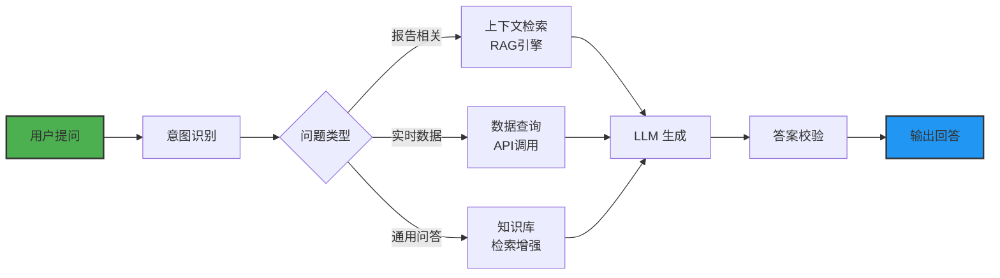

# TradingAgent-Go 智能量化交易决策系统

## 一、产品概述

### 1.1 产品定位

**产品名称**：TradingAgent-Go 智能量化交易决策系统

**核心价值**：基于 AI 的多Agent协作，为投资者提供全面、深度的股票投资分析和交易决策支持

### 1.2 解决的问题

- 个人投资者缺乏专业的多维度分析能力
- 投资决策依赖单一信息源，容易产生偏差
- 缺乏系统化的风险评估和辩论机制
- 难以平衡投资收益与风险控制

### 1.3 目标用户

- 个人投资者：寻求专业投资分析支持
- 量化交易团队：需要 AI 辅助决策引擎
- 金融机构：需要智能化的投资分析工具

---

## 二、核心功能

### 2.1 TradingAgents 智能决策引擎

**分析师阶段**：
- 市场分析：宏观市场走势与板块轮动分析
- 情绪分析：社交媒体与新闻情绪挖掘
- 新闻分析：新闻内容深度解读与影响评估
- 基本面分析：财务数据与估值分析

**研究员辩论阶段**：
- 多头研究：挖掘上涨理由与投资机会
- 空头研究：识别风险与潜在下跌因素
- 辩论过程：多轮观点碰撞与论证

**交易员阶段**：
- 生成交易计划
- 确定买入/卖出/持有决策
- 计算建议仓位与持有周期

**风险辩论阶段**：
- 激进视角：潜在收益与机会评估
- 保守视角：潜在风险与规避策略
- 中立视角：平衡分析与综合建议

**投资组合经理阶段**：
- 投资组合优化与配置建议
- 最终决策生成
- 风险等级评估

### 2.2 多市场数据支持

- A股市场（AkShare、东方财富）
- 港股市场（Yahoo Finance）
- 美股市场（Yahoo Finance、Alpha Vantage）
- 宏观经济数据（FRED）
- 预测市场（Polymarket）

### 2.3 数据能力矩阵

| 能力 | 描述 | 支持市场 |
|------|------|----------|
| K线数据 | 历史价格与成交量 | A股/港股/美股 |
| 技术指标 | RSI、MACD、布林带等 | A股/港股/美股 |
| 基本面 | 估值指标与财务概况 | A股/港股/美股 |
| 财务报表 | 资产负债表、现金流量表、损益表 | A股/港股/美股 |
| 新闻资讯 | 个股与市场新闻 | A股/港股/美股/全球 |
| 公司公告 | 上市公司公告 | A股/港股/美股 |
| 宏观指标 | GDP、CPI、利率等 | 全球 |
| 预测市场 | 事件预测数据 | 全球 |

---

## 三、数据来源

### 3.1 市场数据

| 数据类型 | 来源 | 覆盖范围 |
|----------|------|----------|
| A股行情 | AkShare、东方财富 | 沪市、深市全部股票 |
| 港股行情 | Yahoo Finance | 香港交易所全部股票 |
| 美股行情 | Yahoo Finance、Alpha Vantage | 纳斯达克、纽交所 |

### 3.2 财务数据

| 数据类型 | 来源 | 覆盖范围 |
|----------|------|----------|
| 基本面指标 | AkShare、Yahoo Finance | A股/港股/美股 |
| 资产负债表 | AkShare、Yahoo Finance | A股/港股/美股 |
| 现金流量表 | AkShare、Yahoo Finance | A股/港股/美股 |
| 损益表 | AkShare、Yahoo Finance | A股/港股/美股 |

### 3.3 资讯数据

| 数据类型 | 来源 | 覆盖范围 |
|----------|------|----------|
| 个股新闻 | 东方财富、Yahoo Finance | A股/港股/美股 |
| 市场新闻 | 东方财富、Yahoo Finance | 全球市场 |
| 公司公告 | 东方财富 | A股/港股 |
| 内部交易 | Yahoo Finance | 美股 |

### 3.4 宏观数据

| 数据类型 | 来源 | 覆盖范围 |
|----------|------|----------|
| 宏观经济指标 | FRED | 全球主要经济体（GDP、CPI、利率等） |
| 预测市场数据 | Polymarket | 全球事件预测（政治、经济、科技等） |

---

## 四、核心产出

### 4.1 分析报告

**市场分析报告**：
- 当前市场整体走势判断
- 板块轮动分析
- 市场情绪指数
- 关键市场指标解读

**个股分析报告**：
- 技术面分析（K线形态、技术指标）
- 基本面分析（估值、财务健康度）
- 新闻舆情分析
- 市场情绪分析

**研究辩论报告**：
- 多头观点：看好理由与证据
- 空头观点：看空理由与风险
- 辩论过程与关键论点
- 综合研究结论

**风险评估报告**：
- 激进视角：潜在收益与机会
- 保守视角：潜在风险与规避策略
- 中立视角：平衡分析与建议
- 风险等级评估

### 4.2 交易决策

**决策类型**：

| 决策动作 | 说明 |
|----------|------|
| BUY | 买入 |
| SELL | 卖出 |
| HOLD | 持有观望 |

**决策要素**：
- 决策动作（买入/卖出/持有）
- 置信度（0-100%）
- 决策理由
- 建议数量/仓位
- 建议持有周期

### 4.3 投资组合建议

**配置建议**：
- 资产配置比例
- 行业分散度建议
- 风险敞口控制

**执行计划**：
- 建仓策略
- 止盈止损建议
- 调仓时机提示

---

## 五、用户交互流程

### 5.1 分析流程

```
用户输入 → 股票代码、交易日期
    ↓
数据采集 → 行情、财务、新闻、宏观
    ↓
分析师阶段 → 市场、情绪、新闻、基本面分析
    ↓
研究员辩论 → 多头/空头观点碰撞
    ↓
交易员阶段 → 生成交易计划
    ↓
风险辩论 → 激进/保守/中立评估
    ↓
投资组合经理 → 最终决策与建议
    ↓
输出报告 → 分析报告、交易决策、组合建议
    ↓
AI问答 → 基于上下文的智能问答
```

### 5.2 用户操作步骤

**第一步：输入分析参数**
- 选择股票代码（支持A股、港股、美股）
- 指定交易日期
- 设置分析模式（快速模式/深度模式）

**第二步：系统自动分析**
- 自动采集多源数据
- 多Agent协作分析
- 生成各维度报告

**第三步：查看分析结果**
- 查看各分析师报告
- 查看研究辩论过程
- 查看交易决策建议

**第四步：AI问答**
- 针对分析结果提问
- 获取详细解答
- 探索更多投资信息

**第五步：获取决策支持**
- 获取最终交易决策
- 获取投资组合建议
- 导出分析报告

---

## 六、结果展示

### 6.1 报告展示形式

**可视化报告**：
- 市场走势图表
- 财务指标对比图
- 情绪指数走势图
- 决策置信度雷达图

**文本报告**：
- 结构化分析报告（PDF/Word）
- 决策摘要（关键结论）
- 详细分析文档（完整逻辑）

**交互式报告**：
- 可筛选的分析维度
- 动态更新的市场数据
- 个性化的风险偏好设置

### 6.2 决策展示

**决策卡片**：
- 股票代码与名称
- 决策动作（买入/卖出/持有）
- 置信度百分比
- 决策时间

**决策详情**：
- 决策理由（多维度分析）
- 支撑数据来源
- 风险提示
- 建议操作

### 6.3 组合展示

**组合概览**：
- 当前持仓比例
- 建议调整方向
- 风险等级

**配置建议**：
- 行业分布建议
- 个股权重建议
- 调仓方案

---

## 七、配置与定制

### 7.1 分析深度配置

| 配置项 | 说明 |
|--------|------|
| 研究深度 | 控制分析师分析的详细程度 |
| 辩论轮次 | 控制多头/空头、风险辩论的轮数 |
| 快速模式 | 快速生成核心结论，跳过部分深度分析 |

### 7.2 分析师配置

| 分析师 | 功能 | 是否可关闭 |
|--------|------|------------|
| 市场分析师 | 市场整体走势分析 | 是 |
| 情绪分析师 | 舆情与情绪分析 | 是 |
| 新闻分析师 | 新闻深度解读 | 是 |
| 基本面分析师 | 财务与估值分析 | 是 |
| 研究员 | 多空辩论研究 | 是 |
| 交易员 | 交易计划生成 | 是 |
| 风险辩论者 | 风险评估 | 是 |
| 投资组合经理 | 最终决策 | 否 |

### 7.3 数据源配置

| 配置项 | 说明 |
|--------|------|
| 主数据源 | 优先使用的数据供应商 |
| 备用数据源 | 主数据源失败时的降级方案 |
| 数据更新频率 | 缓存有效期设置 |

---

## 八、应用场景

### 8.1 个人投资辅助
- 场景：个人投资者分析个股，获取专业投资建议
- 价值：弥补专业知识不足，获取多维度分析

### 8.2 量化交易策略
- 场景：量化团队将 AI 决策作为策略输入
- 价值：提供定性分析补充，增强策略鲁棒性

### 8.3 投资研究支持
- 场景：机构研究员快速获取初步分析框架
- 价值：节省研究时间，提高分析效率

### 8.4 风险管理
- 场景：投资组合风险评估与预警
- 价值：多视角风险分析，降低投资风险

---
## 九、AI 问答模块

### 9.1 模块概述

AI 问答模块是 TradingAgent-Go 的智能交互层，允许用户在获取分析报告后，基于分析上下文进行自然语言提问，系统结合分析结果和实时数据给出专业解答。

**核心能力**：
- 基于上下文的深度问答理解分析报告内容并精准回答
- 多轮对话，支持追问和细化
- 实时数据查询，结合最新市场行情补充答案
- 多语言支持，中英文无缝切换

### 9.2 问答类型

| 问答类型 | 描述 | 示例 |
|----------|------|------|
| 报告解读 | 对分析报告内容的解释 | "为什么给出买入建议？" |
| 数据查询 | 查询具体的数据指标 | "该股票的市盈率是多少？" |
| 对比分析 | 多只股票横向对比 | "和同行业股票相比如何？" |
| 风险咨询 | 了解投资风险点 | "最大的风险因素是什么？" |
| 策略建议 | 个性化的投资策略 | "如果我是保守型投资者该怎么操作？" |
| 市场洞察 | 宏观市场趋势解读 | "当前市场处于什么阶段？" |

### 9.3 技术架构



### 9.4 上下文管理

- **分析会话上下文**：缓存当前分析的所有 Agent 输出报告
- **历史对话上下文**：维护最近 N 轮对话记录
- **用户偏好上下文**：记录用户的风险偏好、关注行业等
- **上下文窗口管理**：智能裁剪，确保不超出 LLM token 限制

### 9.5 RAG 检索引擎

| 组件 | 描述 | 技术方案 |
|------|------|----------|
| 文档切片 | 分析报告分段处理 | 语义分块 + 滑动窗口 |
| 向量化 | 文本转向量表示 | Embedding 模型 |
| 向量存储 | 高效相似度检索 | ChromaDB / FAISS |
| 混合检索 | 关键词 + 语义 | BM25 + 向量检索融合 |
| 重排序 | 结果精确排序 | Cross-encoder 精排 |

### 9.6 安全与合规

- **投资建议免责声明**：每次回答附带风险提示
- **数据隐私**：用户对话数据加密存储，不用于模型训练
- **合规审查**：敏感信息脱敏处理，防止内幕信息泄露
- **回答校验**：对涉及具体操作建议的回答进行人工审核标记

---
## 十、FAQ

### 10.1 支持哪些市场？
- A股、港股、美股三大市场，覆盖全球主要经济体的宏观数据

### 10.2 分析结果可靠吗？
- 系统基于多源数据和多Agent辩论机制，提供全面的分析视角，但投资决策仍需用户自主判断

### 10.3 如何调整分析深度？
- 通过配置研究深度和辩论轮次，可在分析速度和深度之间做出平衡

### 10.4 可以自定义分析师吗？
- 支持选择性启用/关闭特定分析师，根据需求定制分析流程

---

**文档版本**：v1.0  
**生成日期**：2026-07-21  
**项目地址**：http://gitlab.huzilin.com/huzilin/trade.git
