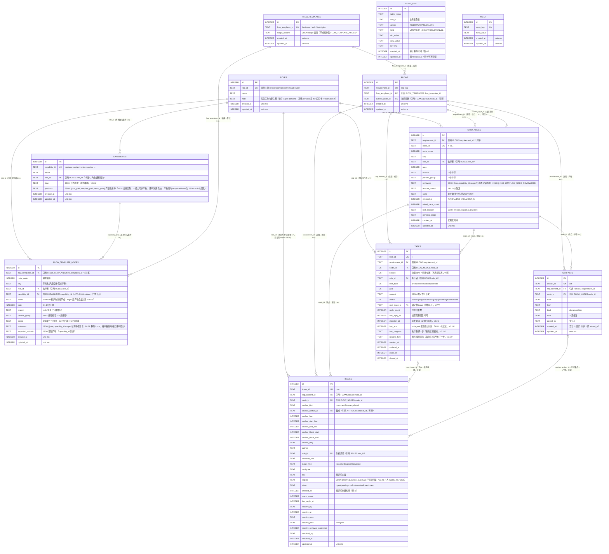

# 团队工作台 · 数据模型 ER 图（erDiagram）

> 依据：`.workbench/workbench.db` 实际 schema（11 张表）+ README 注记 8 关联矩阵。
> 关联约定（v0.16）：子表关联列与父表业务主键**同名同值（TEXT）**；`id`（INTEGER）仅作内部主键，不做跨表关联；无外键约束（逻辑引用）。
> 基数标记：`||--o{` = 1 对多；`||--||` = 1 对 1（可空用 o|）。

---

## 图例说明

| 符号 | 含义 |
|---|---|
| `||--o{` | 父表 1 → 子表 n |
| `||--o|` | 父表 1 → 子表 1（子侧可空） |
| `o|--o|` | 双向可空 1:1（如 current_node_id 指针） |
| PK | 内部主键（INTEGER AUTOINCREMENT） |
| UK | 业务主键（TEXT UNIQUE，可读/跨系统引用） |
| FK | 逻辑引用（无外键约束；关联列与父表业务主键同名） |

## 三类分组

1. **定义层**（模板/注册表）：ROLES、CAPABILITIES、FLOW_TEMPLATES、FLOW_TEMPLATE_NODES
2. **实例层**（运行时状态）：FLOWS、FLOW_NODES、TASKS、ARTIFACTS、ISSUES
3. **支撑层**（审计/元信息）：AUDIT_LOG、META

> v0.17：产物模板已内联进 CAPABILITIES（doc_path/structure/quality_gates/version），DOCUMENT_TEMPLATES 独立实体删除。
> v0.18（User 拍板）：INBOX 并入 TASKS（唯一待办总线）；FLOW_NODE_REVIEWERS 并入 FLOW_NODES.reviewers（JSON）；SNAPSHOTS 删除。
> v0.19（User 拍板）：CONVERSATIONS 删除（IM 是视图非数据，通知由查询 TASKS/ISSUES 实时推导）；TASKS 加派发/断点交接字段（dispatch_at/last_ack/last_progress/resume_hint）——13 → 12 实体。
> v0.20（User 拍板）：ISSUE_REPLIES 并入 ISSUES.replies（JSON，不可变追加；无按回复行查询需求）——12 → 11 实体。
> v0.21（User 拍板）：NULL 策略收紧——非必要不 NULL；branch/parallel_group/note 为 NOT NULL DEFAULT ''。
> v0.22（User 拍板）：每实体增加 created_at/updated_at（unix ms）；旧等价字段改名——ARTIFACTS.added_at→created_at、ISSUES.at→created_at、AUDIT_LOG.at→created_at（audit_log 也加 updated_at 恒=created_at）；FLOW_NODES.entered_at 保留（业务时间≠行创建）。
> v0.23（User 拍板）：CAPABILITIES 收缩——删 structure/quality_gates/version/reviewer_focus/inputs；加 template_path/demo_path（模板外置 docs/templates/）；how 强化为能力本体。
> v0.28（User 拍板，m8 §10 节点-能力绑定模型）：CAPABILITIES.doc_path/template_path/demo_path → 单列 products（JSON 数组，一能力可多产物；评审/决策类 '[]'）；QA 能力合并（acceptance-test 挂 2 产物，defect-management 删除）；FLOW_TEMPLATE_NODES 加 mode（produce|align）、capability_id 可空（align 无产物节点）；reviewers 统一 [{role,capability_id,scope?}]（focus 移除）；角色缩写（architect→arch、investigator→inv）。
